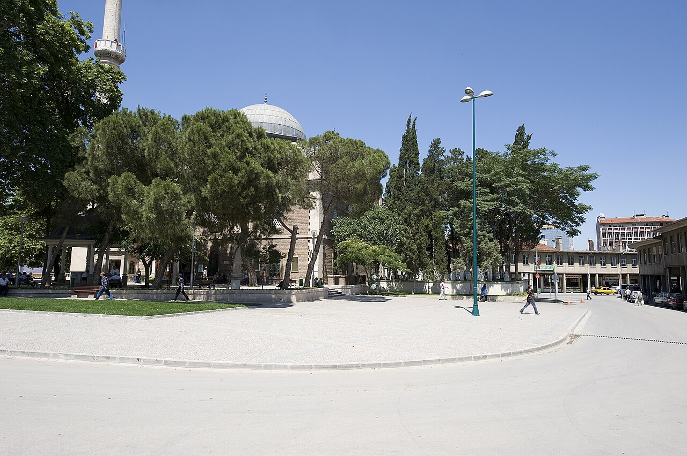
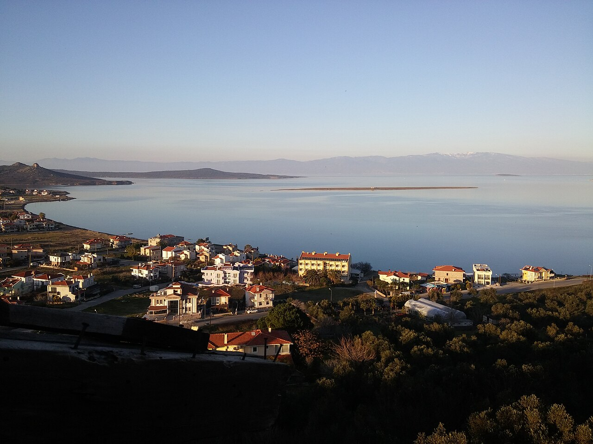

# 📍 Balikesir - Seyahat ve Sefer Dosyası

  

## 📜 Şehrin Ruhu
> "Kaz Dağları'nın oksijeni ile Marmara ve Ege'nin buluştuğu bereketli topraklar."

### 🌍 Şehrin Dokusu ve Tarihsel Arka Planı
Hem Marmara hem de Ege Denizi'ne kıyısı olan nadir Anadolu illerinden Balıkesir, antik Mysia coğrafyasının bereketli ovaları üzerinde yükselir. Tarih sahnesinde Roma imparatoru Hadrianus'un kurduğu Hadrianutherae şehrinden, Anadolu Selçukluları sonrasında denizcilikte çığır açan Karesioğulları Beyliği'ne kadar köklü bir devlet geleneğine ev sahipliği yapmıştır. Karesioğulları'nın Osmanlı'ya katılmasıyla birlikte Türklerin Rumeli'ye geçişinin ve Osmanlı donanmasının temel taşı hâline gelen Balıkesir, Millî Mücadele yıllarında da "Kuva-yı Milliye Şehri" unvanını alnının akıyla kazanmıştır. Zeytinliklerle bezeli Edremit Körfezi, kuş cıvıltılarıyla dolup taşan Manyas Kuş Cenneti ve efsanelere konu olan Kaz Dağları ile tabiat ve tarih bu şehirde eşsiz bir ahenk içindedir.

### 🕌 Manevi Mimarlar ve Kültürel Miras
- **Zağnos Mehmet Paşa:** Fatih Sultan Mehmed'in sadrazamı ve İstanbul'un fethinin önde gelen komutanlarından; Balıkesir merkezde yaptırdığı Zağnos Paşa Camii ve Külliyesi şehrin hem manevi hem de Millî Mücadele dönemindeki hutbe hafızasının merkezidir.
- **Karesi Bey & Hacı İlbey:** Karesioğulları'nın kurucu iradesi ve Osmanlı'nın Rumeli fetihlerine öncülük eden alp gaziler; bölgenin denizcilik ve akıncılık ruhunu şekillendirmiştir.
- **Hasan Baba & Hasan Boğuldu Efsanesi:** Kaz Dağları'nın serin sularına ve yüksek yaylalarına sinmiş halk irfanı ve Sabahattin Ali'nin kalemiyle ölümsüzleşen Anadolu hikayeciliği.
- **Seyit Onbaşı (Havranlı Koca Seyit):** Çanakkale destanında 276 kiloluk mermiyi sırtlayarak tarihin akışını değiştiren Havranlı kahraman; Balıkesir toprağının vefa ve metanet timsalidir.

### 💬 Şehir Hakkında Edebi ve Tarihi Alıntılar
> "Balıkesir, havası latif, suları şifalı, halkı misafirperver ve çarşıları mamur bir beldedir." — Evliya Çelebi
>
> "Kaz Dağları'nın çam kokulu rüzgarında insan, yeryüzünün ilk yaratıldığı günkü ferahlığı hisseder." — Sabahattin Ali (Kuyucaklı Yusuf & Hasan Boğuldu izleğinden)
>
> "Balıkesir, Kuva-yı Milliye'nin ilk ateşinin yakıldığı, düşmana karşı azmin ve birliğin sarsılmaz kalesidir." — Millî Mücadele Hatıratları

### 🍽️ Yöresel Lezzetler
- **Höşmerim:** Taze peynir, irmik ve şekerin ustalıkla buluştuğu, Balıkesir'in asırlık şölen tatlısı.
- **Susurluk Tostu & Köpüklü Ayranı:** Yolcuların vazgeçilmez menzil durağı; bol köpüklü yayık ayranı ve çıtır salçalı tost.
- **Balıkesir Kaymaklısı & Tirit:** Kuzu eti ve süzme yoğurtla hazırlanan geleneksel ziyafet yemekleri ile kaymaklı hamur tatlıları.
- **Ayvalık Zeytinyağlıları & Papalina:** Kuzey Ege kıyılarının hafif, bereketli ve güneş kokulu sofraları.

### 📖 Planlanan Kütüphane Ofisi
- **Hedef İlim Durağı:** Balıkesir İl Halk Kütüphanesi - Geniş bahçesi ve sakin çalışma alanlarıyla verimli bir ortam.
- **Yarı Göçebe Mesai Planı:** Sabah 09.00–14.00 arası kütüphanede yazılım, okuma ve araştırma mesaisi; öğleden sonra merkezdeki tarihi külliyeler ve çevre ilçelere yönelik kültür-doğa keşifleri.

### 🧭 5 Günlük Planlanan Menzil Rotası
- **1. Gün — Kuruluş ve Kuva-yı Milliye Merkezi:** Balıkesir İl Halk Kütüphanesi mesaisi sonrası Zağnos Paşa Camii, Yıldırım Camii, Saat Kulesi ve Kuva-yı Milliye Müzesi ziyareti; akşam merkezde höşmerim tadımı.
- **2. Gün — Kuşların ve Gölün Sükuneti (Bandırma & Manyas):** Manyas Kuş Cenneti Milli Parkı'nda göçmen kuşların gözlemi, Kyzikos Antik Kenti kalıntıları ve Erdek kıyılarında Marmara rüzgarı eşliğinde yürüyüş.
- **3. Gün — Kaz Dağları'nın Oksijeni (Edremit & Hasan Boğuldu):** Kaz Dağları Milli Parkı, Sütüven Şelalesi, Hasan Boğuldu Göleti ve Tahtakuşlar Etnografya Müzesi'nde Yörük-Türkmen kültürünün izini sürme.
- **4. Gün — Taş Sokaklar ve Adalar (Ayvalık & Cunda):** Ayvalık'ın tarihi Rum ve Osmanlı taş evleri, Taksiyarhis Anıt Müzesi, Cunda Adası sokakları ve Şeytan Sofrası'nda Ege'ye karşı gün batımı tefekkürü.
- **5. Gün — Vefa ve Şifa Durağı (Havran & Bigadiç / Susurluk):** Havran'da Koca Seyit Anıtı ziyareti, dönüş güzergahında Susurluk'ta meşhur köpüklü ayran eşliğinde Balıkesir sefer defterinin notlarını temize çekme.

### ✨ Keşfedilesi Duraklar
- [ ] **Zağnos Paşa Camii ve Külliyesi**
- [ ] **Cunda Adası ve Ayvalık Tarihi Sokakları**
- [ ] **Kaz Dağları Milli Parkı ve Sütüven Şelalesi**
- [ ] **Manyas Kuş Cenneti Milli Parkı**
- [ ] **Balıkesir Kuva-yı Milliye Müzesi ve Koca Seyit Anıtı**

### 📸 Menzil Fotoğraf Galerisi
<table>
  <tr>
    <td align="center" width="50%">
      
       <b>İki Denizin Buluşması:</b> Kaz Dağları'nın nefesi ve Ege-Marmara kıyılarının bereketi.
    </td>
    <td align="center" width="50%">
      
       <b>Tarih ve Tabiat:</b> Zağnos Paşa'dan Cunda'nın taş sokaklarına uzanan sefer beklentisi.
    </td>
  </tr>
</table>

---
*Henüz adımlanmamış bu kadim menzil, sıradaki sefer rotasında yer almaktadır.*
