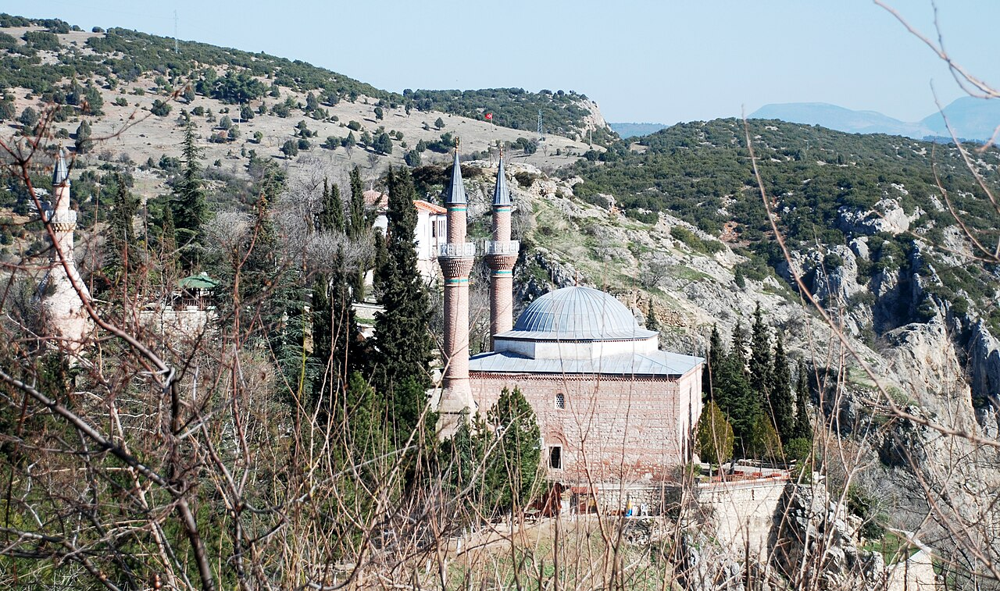
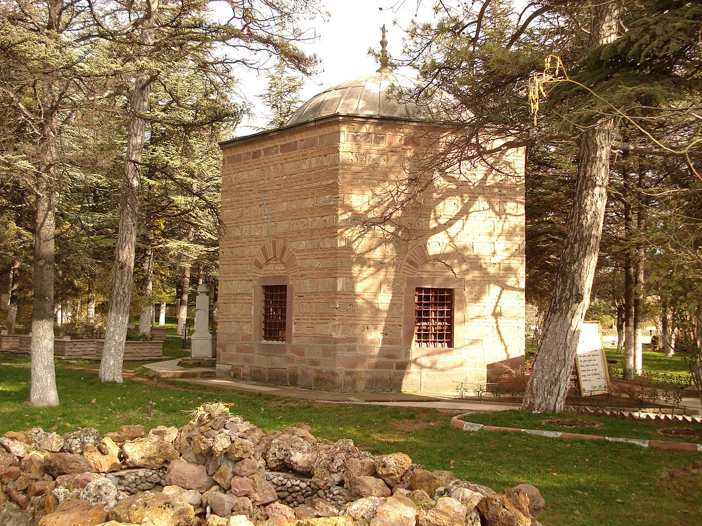

# 📍 Bilecik - Seyahat ve Sefer Dosyası

  

## 📜 Şehrin Ruhu
> "Osmanlı Devleti'nin mayalandığı, Şeyh Edebali'nin 'İnsanı yaşat ki devlet yaşasın' nasihatinin yankılandığı kurucu menzil."

### 🌍 Şehrin Dokusu ve Tarihsel Arka Planı
Marmara, Ege, İç Anadolu ve Karadeniz bölgelerinin dördünde de toprağı bulunan Türkiye'nin tek ili olan Bilecik, coğrafi bir kavşak olmanın ötesinde bir cihan devletinin tohumlarının atıldığı kutlu bir eşiktir. 13. yüzyılın sonlarında Ertuğrul Gazi liderliğindeki Kayı Boyu'nun Söğüt'ü kışlak, Domaniç'i yaylak edinmesiyle başlayan bu yürüyüş, 1299 yılında Osman Gazi'nin istiklalini ilan etmesiyle tarihin akışını değiştirmiştir. Sakarya Nehri'nin bereketli vadileri, derin kanyonları ve sarp tepeleri arasında kurulu olan Bilecik; Ahilik teşkilatının ahlakını, gaza ruhunu ve devlet hikmetini taşlarında saklar. Eski Bilecik vadisindeki Şeyh Edebali Türbesi, Orhan Gazi Camii ve Söğüt'teki Ertuğrul Gazi Otağı, bu şehri yalnızca bir gezi noktası değil, bir medeniyet muhasebesi durağı kılar.

### 🕌 Manevi Mimarlar ve Kültürel Miras
- **Şeyh Edebali:** Osmanlı Devleti'nin manevi kurucusu, Ahi teşkilatının önderi ve Osman Gazi'nin kayınpederi. "Ey oğul! Beysin! Bundan sonra öfke bize, uysallık sana... İnsanı yaşat ki devlet yaşasın!" vasiyetiyle altı asırlık bir adalet felsefesinin temelini atmıştır.
- **Ertuğrul Gazi:** Kayı Boyu'nun uç beyi, Osman Gazi'nin babası; Söğüt'teki türbesi her yıl Yörük ve Türkmenlerin vefa durağıdır.
- **Dursun Fakıh:** Şeyh Edebali'nin talebesi ve damadı; Osman Gazi adına ilk hutbeyi okuyarak Osmanlı'nın ilk kadısı ve hukuk mimarı olmuştur.
- **Kuyulu Mescit & Orhan Gazi Mirası:** Kuruluş döneminin sade, gösterişten uzak ama derin anlam yüklü erken Osmanlı mimari estetiği.

### 💬 Şehir Hakkında Edebi ve Tarihi Alıntılar
> "Ey oğul! İnsanı yaşat ki devlet yaşasın. Geçmişini bilmeyen, geleceğini de bilemez." — Şeyh Edebali
>
> "Söğüt'te bir çınar tohumu toprağa düştü; gölgesi üç kıtayı ve yedi denizi kapladı." — Tarık Buğra (Osmancık izleğinden)
>
> "Bilecik ve Söğüt vadilerinde esen rüzgar, hâlâ kuruluş çağının samimiyetini ve tevazusunu taşır." — Anadolu Seyahat Notları

### 🍽️ Yöresel Lezzetler
- **Bilecik Güveci:** Toprak kapta, odun ateşinde ağır ağır pişen kuzu eti ve mevsim sebzelerinin kadim uyumu.
- **Pazaryeri Helvası & Boza:** Bölgeye özgü tahinli helva ve kış aylarının şifalı içeceği geleneksel Pazaryeri bozası.
- **Bıldırcın Kebabı & Ovmaç Çorbası:** Yöre mutfağının emek ve bereket dolu, ev yapımı geleneksel yemekleri.
- **Osmaneli Ayva Lokumu:** Sakarya vadisinin bereketli bahçelerinden sofralara taşınan doğal tat.

### 📖 Planlanan Kütüphane Ofisi
- **Hedef İlim Durağı:** Bilecik İl Halk Kütüphanesi - Sakin ve odaklanmaya elverişli butik bir çalışma alanı.
- **Yarı Göçebe Mesai Planı:** Sabah saatlerinde Bilecik İl Halk Kütüphanesi'nde odaklanmış yazılım ve tarih okumaları; öğleden sonra kuruluş menzillerinde yürüyüş ve tefekkür.

### 🧭 5 Günlük Planlanan Menzil Rotası
- **1. Gün — Manevi Kuruluşun Kalbi (Eski Bilecik Vadisi):** Kütüphane mesaisi sonrası Şeyh Edebali Türbesi, Orhan Gazi Camii, Osmanlı Padişahları Tarih Şeridi ve şehir merkezindeki Tarihi Saat Kulesi ziyareti.
- **2. Gün — Kayı'nın Otağı (Söğüt):** Ertuğrul Gazi Türbesi'nde alp nöbeti değişimini izleme, Kuyulu Mescit, Hamidiye Camii ve Söğüt Ertuğrul Gazi Müzesi'nde kuruluş asrının izlerini sürme.
- **3. Gün — İlk Hutbenin Tepesi ve Yaylalar (Bozüyük & Metristepe):** İnhisar-Söğüt hattından geçerek Dursun Fakıh Türbesi ziyareti, Bozüyük'te Kasımpaşa Camii ve Millî Mücadele'nin dönüm noktası Metristepe Anıtı.
- **4. Gün — Kanyonlar ve Su Sükuneti (Pazaryeri & Gölpazarı):** Harmankaya Kanyonu Tabiat Parkı'nda doğa yürüyüşü, Küçükelmalı Tabiat Parkı ve Pazaryeri'nde meşhur helva-boza molası.
- **5. Gün — Sakarya Kıyısında Tarihi Evler (Osmaneli):** Konakları ve Rüstem Paşa Camii ile ünlü Osmaneli (Lefke) sokaklarında yürüyüş, Sakarya Nehri kıyısında not derleme ve veda.

### ✨ Keşfedilesi Duraklar
- [ ] **Şeyh Edebali Türbesi ve Orhan Gazi Camii**
- [ ] **Söğüt Ertuğrul Gazi Türbesi ve Kuyulu Mescit**
- [ ] **Bilecik Saat Kulesi ve Osmanlı Tarih Şeridi**
- [ ] **Harmankaya Kanyonu Tabiat Parkı**
- [ ] **Tarihi Osmaneli (Lefke) Konakları**

### 📸 Menzil Fotoğraf Galerisi
<table>
  <tr>
    <td align="center" width="50%">
      
       <b>Devlet-i Aliyye'nin Beşiği:</b> Şeyh Edebali'nin gölgesinde sükunet ve hikmet dolu vadi.
    </td>
    <td align="center" width="50%">
      
       <b>Kuruluşun İzleri:</b> Söğüt'ten Osmaneli'ye uzanan asırlık Türkmen ve Osmanlı mirası.
    </td>
  </tr>
</table>

---
*Henüz adımlanmamış bu kadim menzil, sıradaki sefer rotasında yer almaktadır.*
