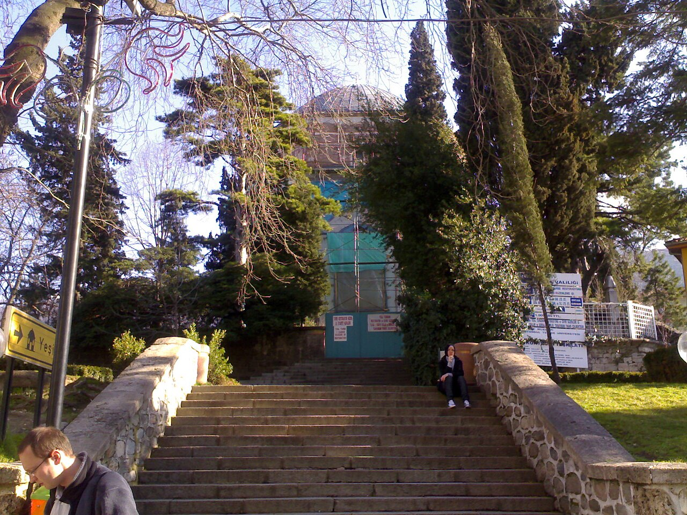

# 📍 Bursa - Seyahat ve Tefekkür Notları

  

## 📜 Şehrin Ruhu
> "Yeşil Bursa, Osmanlı'nın ilk payitahtı, Uludağ'ın eteklerinde kurulmuş manevi bir sığınaktır."

### 🌍 Şehrin Dokusu ve Tarihsel Arka Planı
Osmanlı Devleti'nin ilk başkenti olan Bursa, imparatorluğun kurucu kodlarını barındırır. İpekyolu'nun en önemli ticaret merkezlerinden biri olarak tarih boyunca parlamıştır.

### 🕌 Manevi Mimarlar ve Tarihî Şahsiyetler
- **Osman Gazi & Orhan Gazi:** Osmanlı Cihan Devleti'nin kurucu iradesi ve Bursa'nın fatihi; Tophane sırtlarındaki türbeleriyle şehre vakur bir mühür vururlar.
- **Emir Sultan (Şemseddin Muhammed Buharî):** Buhara'dan Anadolu'ya uzanan irfan köprüsü, Yıldırım Bayezid'in damadı ve Bursa'nın en büyük manevi sığınaklarından biri.
- **Somuncu Baba (Şeyh Hamid-i Velî):** Ulu Cami'nin açılış hutbesinde Fatiha Suresi'ni yedi farklı vecihle tefsir eden, tevazunun ve gönül erliğinin simgesi.
- **Aziz Mahmud Hüdayî'nin Mürşidi Üftade Hazretleri:** Celvetiye tarikatının kurucusu, "İlim amel ile, amel ihlas ile kemale erer" düsturuyla Bursa irfanını besleyen büyük velî.
- **Molla Fenarî & İsmail Hakkı Bursevî:** Osmanlı'nın ilk şeyhülislamı Molla Fenarî ile *Ruhu'l-Beyan* tefsirinin müellifi İsmail Hakkı Bursevî, şehrin ilim ve tefekkür ufkunu temsil eder.
- **Süleyman Çelebi:** Ulu Cami'nin ilk imamı ve asırlardır gönüllerde yankılanan *Vesiletü'n-Necat (Mevlid)* eserinin müellifi.

### 💬 Şehir Hakkında Edebi ve Tarihi Alıntılar
> "Bursa'da zaman, bir yeşil şadırvanda şırıldayan suyun musikisidir." — Ahmet Hamdi Tanpınar
>
> "Bursa, Osmanlı'nın dip diri ve taptaze kökü, maneviyatın beşiğidir." — Evliya Çelebi
>
> "Bursa'yı görmeyen, Osmanlı'nın ruhunu tam olarak anlayamaz." — Yahya Kemal Beyatlı
>

### 🕊️ Gezginin Not Defterinden (Manevi Boyut ve Tefekkür)
Ulu Cami'nin şadırvanından dökülen suyun sesinde zamanın ve mekanın ötesine geçer, sükuneti tefekkür edersiniz. Emir Sultan'ın ve Üftade'nin manevi huzurunda kalbinizi dinlendirirsiniz.

### 🍽️ Yöresel Lezzet Tavsiyeleri
- **Yerel Tatlar ve İkramlar:** Şehrin yerel esnaf lokantalarında ve pazar yerlerinde deneyimlenen bütçe dostu, kültürel dokuyu yansıtan eşsiz lezzetler (İskender Kebap, Cantık, Muradiye Çorbası, Kestane Şekeri ve Tahinli Pide).
- **Tefekkür Eşliğinde Çay/Kahve:** Şehrin tarihi kıraathanelerinde veya doğa manzaralı tepelerinde (Koza Han avlusu, Tophane sırtları) yudumlanan demli çaylar.

### ⛺ Konaklama ve Bütçe Stratejisi
- **Sıfır Konaklama Maliyeti (Modern Kervansaraylar):** GSB Seyahatsever projesi kapsamında şehirdeki KYK yurtlarında 5 gün boyunca ücretsiz konaklanarak bütçe korunmuştur.
- **Ulaşım ve Lojistik Planlama:** Rota optimizasyonuna uyularak komşu iller sırayla takip edilmiş, böylece hem yol maliyeti minimuma indirilmiş hem de karbon ayak izi azaltılmıştır.

### 💻 Yarı Göçebe Mesaisi (İlim Tahsili & Kütüphane)
- **Kütüphane Rutini:** Gündüz vakitlerinde şehrin İl Halk Kütüphanesinde zaman geçirilerek bilgisayar başında yazılım geliştirme ve ders çalışma faaliyetleri sürdürülmüştür.
  * *Seyyahın Kütüphane Notu:* Bursa İl Halk Kütüphanesi - Sessiz, çalışma disiplinine uygun, internet imkanı sunan verimli bir ilim yuvası.
- **Süre ve Uyum:** Kütüphane mesaisi bitiminde şehrin ruhuna karışmak üzere yollara düşülmüş, 5 günlük menzil süresiyle şehir sindirilerek keşfedilmiştir.

### 🧭 5 Günlük Menzil Rotası
- **1. Gün — Kuruluşun Kalbi (Hanlar Bölgesi & Tophane):** Sabah kütüphane mesaisi sonrası Ulu Cami'nin yirmi kubbesi altında tefekkür, Koza Han'da ipek dokusu eşliğinde çay molası, Kapalıçarşı ve gün batımında Osman Gazi ile Orhan Gazi türbelerinin bulunduğu Tophane Saat Kulesi seyri.
- **2. Gün — İrfan Tepeleri (Yeşil, Emir Sultan & Yıldırım):** Çelebi Mehmed'in mirası Yeşil Cami ve Yeşil Türbe'nin çinilerini temaşa, ardından Emir Sultan Külliyesi ve Yıldırım Bayezid Külliyesi'nde manevi duraklama; akşamüstü Irgandı Köprüsü'nde zanaat atölyeleri ziyareti.
- **3. Gün — Osmanlı Köy Dokusu ve Sultanlar (Cumalıkızık & Muradiye):** Sabah erken saatlerde UNESCO Mirası Cumalıkızık'ın Arnavut kaldırımlı dar sokaklarında yürüyüş; öğleden sonra Muradiye Külliyesi'ndeki şehzade türbeleri ve Üftade Hazretleri Dergâhı'nda sükunet.
- **4. Gün — Uludağ'ın Nefesi ve İnkaya:** Teleferik veya karayoluyla Uludağ'ın çam kokulu eteklerine çıkış, 600 yıllık İnkaya Çınarı gölgesinde okuma molası ve akşam Bursa kent merkezinde tarihi esnaf lokantasında yöresel lezzetler.
- **5. Gün — Marmara Kıyısında Veda (Mudanya & Tirilye):** Gündüz son kütüphane ve not derleme mesaisinin ardından Mudanya Mütareke Evi ve zeytin ağaçlarıyla çevrili tarihi Tirilye sokaklarında Marmara'ya karşı tefekkür dolu bir veda.

### ✨ Keşfedilesi Duraklar ve Landmarks
Bu şehrin havasını solumak, ruhuna dokunmak için mutlaka adımlanması gereken köşe taşları:
- [ ] **Bursa Ulu Camii**
- [ ] **Yeşil Türbe ve Camii**
- [ ] **Cumalıkızık Tarihi Köyü**
- [ ] **Emir Sultan Camii ve Türbesi**
- [ ] **Muradiye Külliyesi ve Koza Han**

### 📸 Menzil Fotoğraf Galerisi
<table>
  <tr>
    <td align="center" width="50%">
      
       <b>Payitahtın Kalbi:</b> Uludağ'ın eteklerinde Osmanlı'nın kurucu ruhunu yaşatan Bursa silüeti.
    </td>
    <td align="center" width="50%">
      
       <b>Yeşil ve İrfan:</b> Asırlık çınarlar, çiniler ve su musikisiyle örülü Bursa menzili.
    </td>
  </tr>
</table>

---
*Bu il bizzat deneyimlenmiş, yolları aşındırılmış ve seyahatnameye sevgiyle işlenmiştir.* ✅
