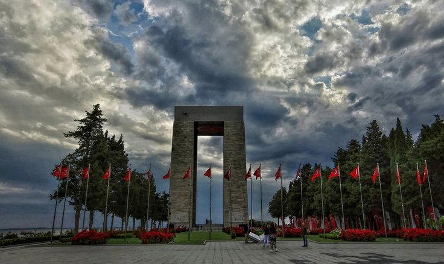
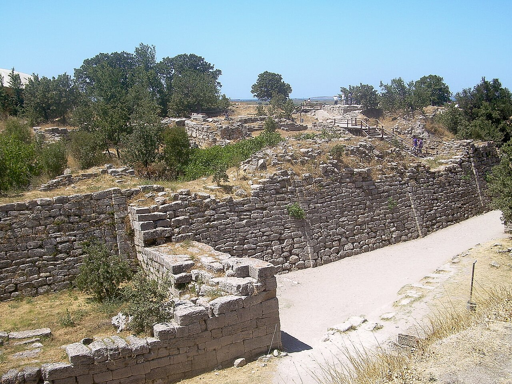

# 📍 Canakkale - Seyahat ve Sefer Dosyası

  

## 📜 Şehrin Ruhu
> "Tarihin yazıldığı, bir milletin bağımsızlık destanını kanıyla mühürlediği manevi boğaz."

### 🌍 Şehrin Dokusu ve Tarihsel Arka Planı
Asya ile Avrupa'yı dar bir su geçidiyle ayıran ve aynı zamanda ebediyen birbirine bağlayan Çanakkale, beş bin yıllık insanlık hafızasının en çarpıcı sahnelerinden biridir. Bir yakasında Homeros'un *İlyada* destanına ilham veren UNESCO Dünya Mirası Truva Antik Kenti ve Aristoteles'in felsefe okulu kurduğu Assos yükselirken; karşı yakasında, Gelibolu Yarımadası'nda 1915'te "Çanakkale Geçilmez" iradesini tarihe kazıyan eşsiz bir vatan müdafaası yatar. Fatih Sultan Mehmed'in boğazın kilidi olarak inşa ettirdiği Kilitbahir ve Çimenlik kaleleri, Osmanlı denizcilik tarihinin stratejik zekasını yansıtır. Bugün Bozcaada ve Gökçeada'nın rüzgarlı kıyıları, Kaz Dağları'nın serin etekleri ve boğazın serin feribot yolculuklarıyla Çanakkale; hem derin bir hüzün ve vefa hem de diri bir umut şehridir.

### 🕌 Manevi Mimarlar ve Kültürel Miras
- **57. Alay Şehitleri & Gazi Mustafa Kemal Atatürk:** Conkbayırı, Arıburnu ve Anafartalar'da "Ben size taarruzu emretmiyorum, ölmeyi emrediyorum!" kararlılığıyla vatanın istikbalini koruyan kahramanlar.
- **Yahya Çavuş & Koca Seyit:** Ertuğrul Koyu'nda ve Rumeli Mecidiye Tabyası'nda imkânsızı aşan iman ve cesaretin sembol isimleri.
- **Yazıcızade Mehmed & Ahmed Bican Efendiler:** Gelibolu'da 15. yüzyılda kaleme aldıkları *Muhammediye* ve *Envarü'l-Aşıkîn* eserleriyle asırlarca Anadolu'nun manevi dünyasını besleyen gönül ve kalem erleri.
- **Piri Reis:** Gelibolu'da yetişip dünya haritasını ve *Kitab-ı Bahriye*'yi kaleme alan büyük Osmanlı amirali ve deniz bilimcisi.
- **Mehmet Akif Ersoy:** "Şüheda fışkıracak toprağı sıksan, şüheda!" mısralarıyla Çanakkale şehitlerine ebedî bir abide diken İstiklal Şairimiz.

### 💬 Şehir Hakkında Edebi ve Tarihi Alıntılar
> "Vurulup tertemiz alnından, uzanmış yatıyor, / Bir hilâl uğruna, yâ Rab, ne güneşler batıyor!" — Mehmet Akif Ersoy
>
> "Çanakkale, bir milletin küllerinden doğuşunun ve 'insanlık onuru'nun taşa değil, göğe yazıldığı yerdir." — Tarih ve Tefekkür Notları
>
> "Gelibolu ve Çanakkale boğazı, cihan denizlerinin kilidi ve gazi yiğitlerin karargâhıdır." — Evliya Çelebi

### 🍽️ Yöresel Lezzetler
- **Çanakkale Peynir Helvası:** Fırınlanmış veya taze hâliyle yörenin en meşhur, hafif ve kadim tatlısı.
- **Ezine Peyniri:** Kaz Dağları'nın endemik bitki örtüsüyle beslenen sürülerin sütünden olgunlaştırılan coğrafi işaretli lezzet.
- **Boğaz Sardalyası & Asma Yaprağında Balık:** Boğazın serin sularından sofraya uzanan mevsimlik deniz bereketi.
- **Biga Köftesi & Domates Reçeli:** Yöresel esnaf lokantalarında ve ada kahvaltılarında tadılacak özgün tatlar.

### 📖 Planlanan Kütüphane Ofisi
- **Hedef İlim Durağı:** Çanakkale Mehmet Akif Ersoy İl Halk Kütüphanesi - Modern deniz manzaralı ferah çalışma ortamı.
- **Yarı Göçebe Mesai Planı:** Boğaz manzarasına karşı sabah saatlerinde yazılım geliştirme ve Çanakkale tarih okumaları; öğleden sonra feribotla karşı kıyıya geçerek tarihi yarımada ve antik kent keşifleri.

### 🧭 5 Günlük Planlanan Menzil Rotası
- **1. Gün — Boğazın İki Kilidi (Merkez & Kilitbahir):** Mehmet Akif Ersoy İl Halk Kütüphanesi mesaisi sonrası Çimenlik Kalesi, Nusret Mayın Gemisi, Tarihi Aynalı Çarşı ve feribotla Kilitbahir Kalesi ziyareti.
- **2. Gün — Şüheda İzinde Tefekkür (Gelibolu Yarımadası):** Şehitler Abidesi, 57. Alay Şehitliği, Conkbayırı, Seyit Onbaşı Anıtı ve Yahya Çavuş Şehitliği boyunca sessiz, vefa dolu tam gün yürüyüş.
- **3. Gün — Beş Bin Yıllık Hafıza (Truva & Troya Müzesi):** UNESCO Dünya Mirası Truva Antik Kenti ve çağdaş müzeciliğin ödüllü örneği Troya Müzesi'nde Anadolu arkeolojisi yolculuğu.
- **4. Gün — Felsefenin ve Taşın Kıyısı (Assos / Behramkale):** Athena Tapınağı, Behramkale'nin taş sokakları, Hüdavendigar Camii ve Antik Liman'da Midilli'ye karşı gün batımı.
- **5. Gün — Rüzgarın Adası (Bozcaada veya Gökçeada):** Sabah feribotuyla adaya geçiş, tarihi kale, rüzgar gülleri, taş sokaklarda okuma molası ve Çanakkale seferinin peynir helvası eşliğinde uğurlanması.

### ✨ Keşfedilesi Duraklar
- [ ] **Çanakkale Şehitler Abidesi ve 57. Alay Şehitliği**
- [ ] **Truva Antik Kenti ve Troya Müzesi**
- [ ] **Aynalı Çarşı ve Çimenlik Kalesi**
- [ ] **Kilitbahir Kalesi ve Rumeli Mecidiye Tabyası**
- [ ] **Assos (Behramkale) Antik Kenti ve Bozcaada**

### 📸 Menzil Fotoğraf Galerisi
<table>
  <tr>
    <td align="center" width="50%">
      
       <b>Destanın Boğazı:</b> Şüheda hatırasını ve bağımsızlık ruhunu taşıyan Çanakkale ufku.
    </td>
    <td align="center" width="50%">
      
       <b>Asırlar Arası Yolculuk:</b> Truva'dan Assos'a, kalelerden adalara uzanan kadim miras.
    </td>
  </tr>
</table>

---
*Henüz adımlanmamış bu kadim menzil, sıradaki sefer rotasında yer almaktadır.*
