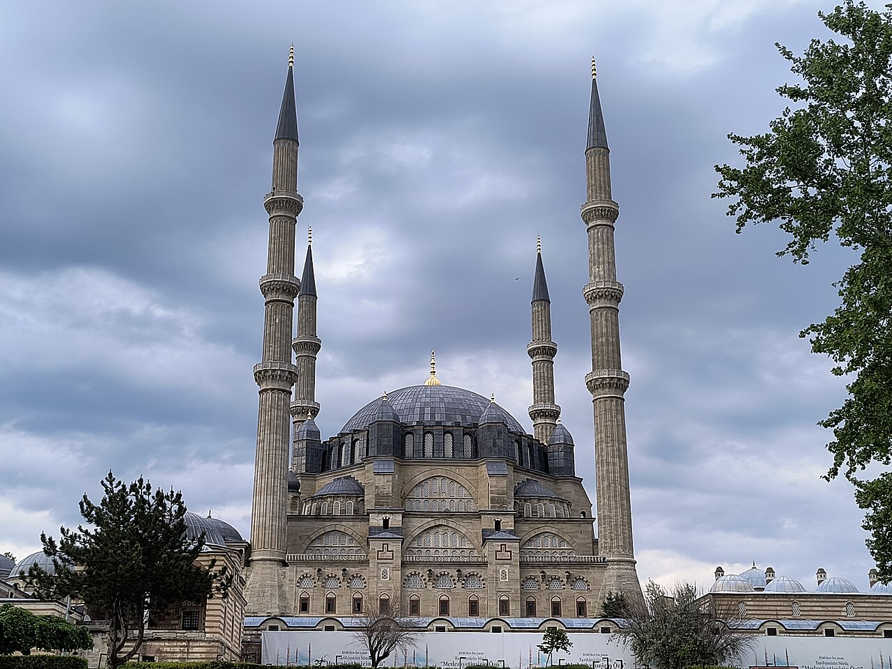
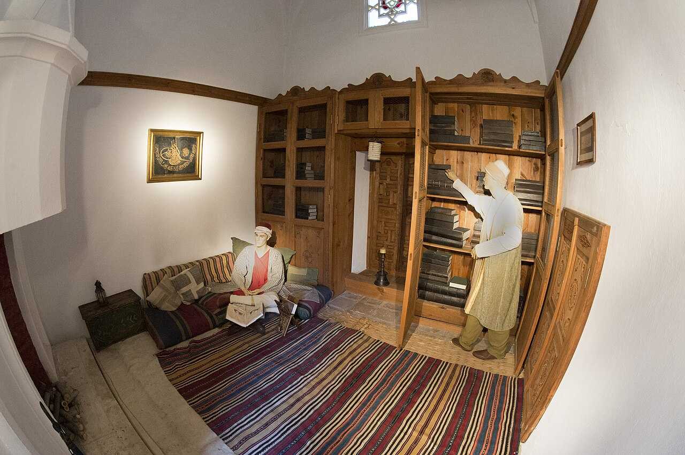

# 📍 Edirne - Seyahat ve Sefer Dosyası

  

## 📜 Şehrin Ruhu
> "Mimar Sinan'ın 'Ustalık eserim' dediği Selimiye ile taçlanmış, Osmanlı'nın Avrupa kapısı payitaht."

### 🌍 Şehrin Dokusu ve Tarihsel Arka Planı
Meriç, Tunca ve Arda nehirlerinin kucaklaştığı bereketli Trakya ovasında kurulu olan Edirne, Roma İmparatoru Hadrianus'un "Hadrianopolis" adıyla ihya ettiği ve 1361'deki fethinden İstanbul'un fethine dek yaklaşık bir asır boyunca Osmanlı Devleti'ne başkentlik yapmış müstesna bir payitahttır. Fatih Sultan Mehmed'in doğduğu, İstanbul'un fethi için dev şahi toplarının döküldüğü ve imparatorluğun Rumeli ufkunun çizildiği bu şehir, mimari şaheserleriyle adeta açık hava bir külliye gibidir. Selimiye Camii'nin göğe yükselen dört zarif minaresi, Üç Şerefeli Cami'nin yenilikçi revakları, Eski Cami'nin dev hat yazıları ve Tunca kıyısındaki II. Bayezid Darüşşifası; Edirne'yi estetik, şifa ve medeniyetin zirvesine yerleştirir.

### 🕌 Manevi Mimarlar ve Kültürel Miras
- **Mimar Sinan:** 80 yaşını aşmışken "Ustalık eserim" diyerek inşa ettiği Selimiye Camii ile dünya mimarlık tarihine tek kubbeli mekanın en kusursuz zirvesini armağan etmiştir.
- **Fatih Sultan Mehmed Han:** Edirne Sarayı'nda dünyaya gelen, burada ilim ve devlet terbiyesiyle yetişip İstanbul fethinin stratejisini kuran büyük hükümdar.
- **Sultan II. Bayezid:** Tunca Nehri kıyısında kurduğu külliye ve darüşşifada ruh hastalıklarını su sesi, musiki ve güzel kokuyla tedavi ettirerek çağının çok ötesinde bir şifa medeniyeti inşa etmiştir.
- **Hasan Sezaî Hazretleri:** Gülşenî tarikatının önde gelen mürşidi ve divan şairi; Edirne'deki dergâhı asırlardır şehrin manevi iklimini besler.
- **Şükrü Paşa:** Balkan Savaşları sırasında Edirne'yi destansı bir direnişle savunan kahraman kumandan.

### 💬 Şehir Hakkında Edebi ve Tarihi Alıntılar
> "Bütün ömrümde yaptığım camiler içinde ustalık eserim Selimiye'dir." — Mimar Sinan
>
> "Edirne, Rumeli'nin gül bahçesi, sultanların otağı ve su köprülerinin şehridir." — Evliya Çelebi
>
> "Edirne'de Meriç'in sularına vuran ikindi güneşi, Osmanlı'nın en vakur hatırasını bugüne taşır." — Ahmet Hamdi Tanpınar izleğinden

### 🍽️ Yöresel Lezzetler
- **Edirne Tava Ciğeri:** İncecik doğranmış yaprak ciğerin kızgın yağda çıtırlaşarak Karaağaç acı biberi ile buluştuğu tescilli efsane.
- **Badem Ezmesi & Kavala Kurabiyesi:** Osmanlı saray mutfağından günümüze taşınan zarif ve asil ikramlar.
- **Deva-i Misk Helvası:** 41 çeşit baharatla hazırlanan, Edirne'nin şifa ve saray kültürünü yansıtan kadim tatlısı.
- **Ciğer Sarma & Hardaliye:** Trakya sofralarının zenginliğini gösteren geleneksel lezzetler.

### 📖 Planlanan Kütüphane Ofisi
- **Hedef İlim Durağı:** Edirne İl Halk Kütüphanesi - Tarihi dokusu içinde sükunet dolu araştırma alanı.
- **Yarı Göçebe Mesai Planı:** Sabah saatlerinde Edirne İl Halk Kütüphanesi'nde yazılım ve araştırma mesaisi; öğleden sonra Selimiye'nin gölgesinde yürüyüş, nehir köprülerinde gün batımı ve tarihi çarşılarda gözlem.

### 🧭 5 Günlük Planlanan Menzil Rotası
- **1. Gün — Üç Büyük Cami ve Payitaht Meydanı:** Kütüphane mesaisi sonrası UNESCO Dünya Mirası Selimiye Camii, dev hat levhalarıyla Eski Cami, Üç Şerefeli Cami ve Arasta Çarşısı gezisi.
- **2. Gün — Şifa ve Musiki Medeniyeti (Tunca Kıyısı):** Sultan II. Bayezid Külliyesi ve Avrupa Ödüllü Sağlık Müzesi, Tunca Köprüsü, Sarayiçi (Kırkpınar Er Meydanı) ve Adalet Kasrı ziyareti.
- **3. Gün — Meriç'in Ötesi (Karaağaç & Lozan Anıtı):** Tarihi Meriç Köprüsü'nden yürüyerek Karaağaç'a geçiş, eski Tren Garı (Trakya Üniversitesi yerleşkesi), Lozan Anıtı ve asırlık ağaçların altında çay molası.
- **4. Gün — Kaleiçi, Çarşılar ve Müdafaa Hatırası:** Ali Paşa Çarşısı, Rüstem Paşa Kervansarayı, Kaleiçi tarihi ahşap konakları, Büyük Sinagog ve Şükrü Paşa Anıtı (Balkan Savaşı Müzesi).
- **5. Gün — Trakya'nın Kıyısına Uzanan Veda (Enez veya Uzunköprü):** Dünyanın en uzun taş köprüsü olan tarihi Uzunköprü'yü veya Saros Körfezi kıyısındaki antik Enez'i ziyaret ederek Edirne seferini tamamlama.

### ✨ Keşfedilesi Duraklar
- [ ] **Selimiye Camii ve Külliyesi**
- [ ] **Sultan II. Bayezid Külliyesi Sağlık Müzesi**
- [ ] **Meriç Köprüsü ve Karaağaç Tarihi Garı**
- [ ] **Eski Cami ve Üç Şerefeli Cami**
- [ ] **Sarayiçi, Adalet Kasrı ve Ali Paşa Çarşısı**

### 📸 Menzil Fotoğraf Galerisi
<table>
  <tr>
    <td align="center" width="50%">
      
       <b>Mimarinin Zirvesi:</b> Mimar Sinan'ın ustalık eseri Selimiye ile taçlanan Rumeli payitahtı.
    </td>
    <td align="center" width="50%">
      
       <b>Nehirler ve Köprüler:</b> Meriç ve Tunca kıyısında asırlık taş köprüler ve külliyeler.
    </td>
  </tr>
</table>

---
*Henüz adımlanmamış bu kadim menzil, sıradaki sefer rotasında yer almaktadır.*
