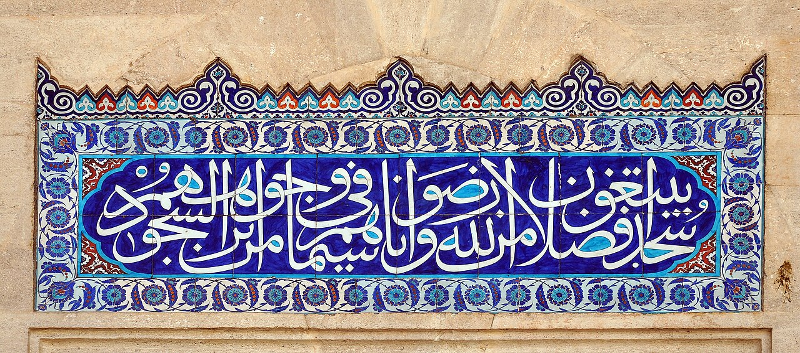

# 📍 Istanbul - Seyahat ve Tefekkür Notları

  

## 📜 Şehrin Ruhu
> "Yedi tepenin üstünde yükselen camileriyle, iki kıtayı birbirine bağlayan boğazıyla dünya tarihinin kalbidir."

### 🌍 Şehrin Dokusu ve Tarihsel Arka Planı
Roma, Bizans ve Osmanlı İmparatorluklarına başkentlik yapmış olan İstanbul, insanlık tarihinin en görkemli sahnesidir. Her caddesi, her taşı bir medeniyet vesikasıdır.

### 🕌 Manevi Mimarlar ve Tarihî Şahsiyetler
- **Ebu Eyyûb el-Ensarî (Eyüp Sultan):** Hz. Peygamber'in (s.a.v.) mihmandarı ve İstanbul'un asırlardır süren manevi muhafızı; Haliç kıyısındaki türbesi şehrin kalp atışıdır.
- **Fatih Sultan Mehmed Han:** 1453'te çağ açıp çağ kapatan, ilmi ve sanatı şehrin merkezine yerleştiren büyük cihangir ve banî.
- **Mimar Sinan:** Süleymaniye, Şehzadebaşı, Mihrimah Sultan ve Rüstem Paşa camileriyle İstanbul'un yedi tepesini taşla yazılmış bir senfoniye dönüştüren başmimar.
- **Aziz Mahmud Hüdayî:** Üsküdar sırtlarından Boğaz'ı selamlayan, "Sağlığımızda bizi, vefatımızdan sonra kabrimizi ziyaret edenler denizde boğulmasın" duasıyla gönüllerde yer eden büyük mürşid.
- **Merkez Efendi & Yahya Efendi:** Topkapı surları dışında ve Beşiktaş sırtlarında ilim, şifa ve gönül terbiyesi ocakları kuran İstanbul'un manevi direkleri.
- **Yahya Kemal Beyatlı & Ahmet Hamdi Tanpınar:** Aziz İstanbul'un semtlerini, Boğaziçi medeniyetini ve zaman estetiğini Türk edebiyatının zirvesine taşıyan fikir ve kalem ustaları.

### 💬 Şehir Hakkında Edebi ve Tarihi Alıntılar
> "Eğer dünya tek bir devlet olsaydı, başkenti İstanbul olurdu." — Napolyon Bonapart
>
> "İstanbul bir şâhâne şikâr yeridir ki, cihan mülkünde benzeri yoktur." — Evliya Çelebi
>
> "Sana dün bir tepeden baktım aziz İstanbul! Görmedim gezmediğim, sevmediğim hiçbir yer." — Yahya Kemal Beyatlı
>
> "İstanbul, Doğu ile Batı'nın, madde ile mananın nihai vuslat noktasıdır." — Cemil Meriç
>

### 🕊️ Gezginin Not Defterinden (Manevi Boyut ve Tefekkür)
Ayasofya ve Süleymaniye'nin kubbeleri altında, ilahi aşkın ve mimari dehanın harmanlanışını tefekkür edersiniz. Boğazın sularında iki kıtanın kucaklaşmasını izlerken, birliğin ve çokluğun sırrına erersiniz.

### 🍽️ Yöresel Lezzet Tavsiyeleri
- **Yerel Tatlar ve İkramlar:** Şehrin yerel esnaf lokantalarında ve pazar yerlerinde deneyimlenen bütçe dostu, kültürel dokuyu yansıtan eşsiz lezzetler (Sultanahmet Köftesi, Eminönü Balık Ekmek, Vefa Boza, Süleymaniye Kuru Fasulyesi ve Kanlıca Yoğurdu).
- **Tefekkür Eşliğinde Çay/Kahve:** Şehrin tarihi kıraathanelerinde veya doğa manzaralı tepelerinde (Pierre Loti, Üsküdar Sahili, Süleymaniye terasları) yudumlanan demli çaylar.

### ⛺ Konaklama ve Bütçe Stratejisi
- **Sıfır Konaklama Maliyeti (Modern Kervansaraylar):** GSB Seyahatsever projesi kapsamında şehirdeki KYK yurtlarında 5 gün boyunca ücretsiz konaklanarak bütçe korunmuştur.
- **Ulaşım ve Lojistik Planlama:** Rota optimizasyonuna uyularak komşu iller sırayla takip edilmiş, böylece hem yol maliyeti minimuma indirilmiş hem de karbon ayak izi azaltılmıştır.

### 💻 Yarı Göçebe Mesaisi (İlim Tahsili & Kütüphane)
- **Kütüphane Rutini:** Gündüz vakitlerinde şehrin İl Halk Kütüphanesinde zaman geçirilerek bilgisayar başında yazılım geliştirme ve ders çalışma faaliyetleri sürdürülmüştür.
  * *Seyyahın Kütüphane Notu:* Istanbul İl Halk Kütüphanesi - Sessiz, çalışma disiplinine uygun, internet imkanı sunan verimli bir ilim yuvası.
- **Süre ve Uyum:** Kütüphane mesaisi bitiminde şehrin ruhuna karışmak üzere yollara düşülmüş, 5 günlük menzil süresiyle şehir sindirilerek keşfedilmiştir.

### 🧭 5 Günlük Menzil Rotası
- **1. Gün — Suriçi'nin Kalbi (Tarihi Yarımada):** Sabah kütüphane çalışmasının ardından Ayasofya-i Kebir Cami-i Şerifi, Sultanahmet Meydanı, Yerebatan Sarnıcı ve Topkapı Sarayı avlularında asırlar arası yürüyüş.
- **2. Gün — İlim, Ticaret ve Yedi Tepe:** Süleymaniye Külliyesi'nin Haliç'e bakan avlusunda tefekkür, Mimar Sinan'ın türbesine ziyaret, Beyazıt Sahaflar Çarşısı, Kapalıçarşı ve Mısır Çarşısı üzerinden Eminönü iskelesine iniş.
- **3. Gün — Haliç'in Maneviyatı ve Galata:** Sabah Eyüp Sultan Camii ve Türbesi ziyareti, Pierre Loti Tepesi'nden Altın Boynuz seyri; öğleden sonra Fener-Balat sokakları, Karaköy ve Galata Kulesi çevresinde akşam yürüyüşü.
- **4. Gün — Anadolu Yakası'nın Sükuneti (Üsküdar & Kuzguncuk):** Vapur eşliğinde Üsküdar'a geçiş, Şemsipaşa Kütüphanesi'nde deniz kenarında okuma mesaisi, Mihrimah Sultan ve Aziz Mahmud Hüdayî ziyaretleri, Kuzguncuk sokakları ve Kız Kulesi karşısında gün batımı.
- **5. Gün — Boğaziçi ve Veda:** Ortaköy, Beşiktaş Yahya Efendi Dergâhı, Emirgan Korusu ve Rumeli Hisarı hattında Boğaz'ın iki kıtayı birleştiren rüzgarıyla İstanbul defterini mühürleme.

### ✨ Keşfedilesi Duraklar ve Landmarks
Bu şehrin havasını solumak, ruhuna dokunmak için mutlaka adımlanması gereken köşe taşları:
- [ ] **Ayasofya-i Kebir Cami-i Şerifi**
- [ ] **Topkapı Sarayı**
- [ ] **Galata Kulesi**
- [ ] **Süleymaniye Camii**
- [ ] **Sultanahmet Camii**

### 📸 Menzil Fotoğraf Galerisi
<table>
  <tr>
    <td align="center" width="50%">
      
       <b>Yedi Tepeli Aziz Şehir:</b> Kubbeler, minareler ve Boğaziçi'nin eşsiz buluşması.
    </td>
    <td align="center" width="50%">
      
       <b>Medeniyetler Kavşağı:</b> Asırların hatırasını taşıyan İstanbul menzillerinden bir kare.
    </td>
  </tr>
</table>

---
*Bu il bizzat deneyimlenmiş, yolları aşındırılmış ve seyahatnameye sevgiyle işlenmiştir.* ✅
