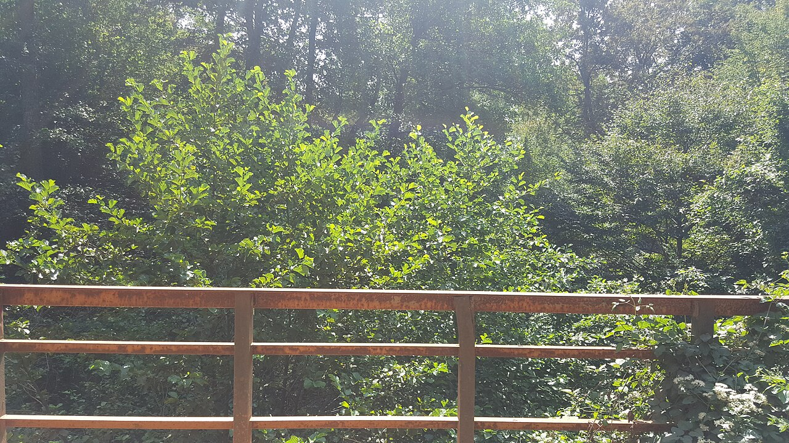
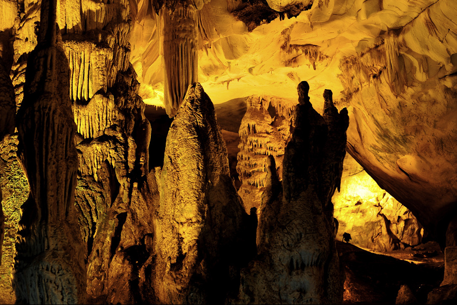

# 📍 Kirklareli - Seyahat ve Sefer Dosyası

  

## 📜 Şehrin Ruhu
> "Trakya'nın yeşil kalbi, Longoz Ormanları'nın büyüleyici biyoçeşitliliği ve huzurlu bozkırı."

### 🌍 Şehrin Dokusu ve Tarihsel Arka Planı
Istranca (Yıldız) Dağları'nın gür kayın ve meşe ormanlarıyla Karadeniz'in hırçın kıyıları arasında uzanan Kırklareli, Trakya'nın hem en bakir doğasını hem de en derin kadim geçmişini barındırır. Aşağı Pınar ve Kanlıgeçit höyükleriyle Neolitik ve Tunç çağlarından bu yana kesintisiz yerleşime sahne olan bu topraklar, Trak kabilelerinin tümülüslerinden Bizans dönemi Vize surlarına ve 1363 sonrası Osmanlı'nın "Kırk Kilise" adıyla kurduğu vakıf şehrine uzanan çok katmanlı bir mirasa sahiptir. Avrupa'nın en büyük su basar ormanlarından biri olan İğneada Longoz Ormanları Milli Parkı, milyonlarca yıllık sarkıtlarıyla Dupnisa Mağarası ve sakin Trakya kasabalarıyla Kırklareli; kalabalıktan uzak, tefekkür ve tabiat dostu bir keşif durağıdır.

### 🕌 Manevi Mimarlar ve Kültürel Miras
- **Hızır Bey (Köpürlü / Hızırbey Külliyesi Banîsi):** 1383 yılında inşa ettirdiği Hızırbey Camii, hamamı ve arastasıyla Kırklareli'nin Osmanlı şehir kimliğinin temelini atan hayırsever devlet adamı.
- **Sokollu Mehmet Paşa & Mimar Sinan:** Lüleburgaz'da yükselen Sokollu Mehmet Paşa Külliyesi, Mimar Sinan'ın Trakya güzergâhındaki kervan yollarına vurduğu muhteşem mimari mühürdür.
- **Kırklar Şehitliği & Gazi Baba:** Şehre adını veren "Kırklar" rivayetinin hatırasını yaşatan ve Rumeli fetihlerinin manevi iklimini bugüne taşıyan ziyaret makamları.
- **Trakya'nın Kıyıköy ve Vize Kültürü:** Kaya manastırları, antik tiyatroları ve sakin kasaba yaşamıyla "Cittaslow (Sakin Şehir)" unvanını hak eden kadim yerleşim geleneği.

### 💬 Şehir Hakkında Edebi ve Tarihi Alıntılar
> "Kırklareli, bağları ve bahçeleri bol, havası hoş, suyu tatlı, gönlü geniş insanların yurdudur." — Evliya Çelebi
>
> "Istranca ormanlarının derinliklerinde insan, zamanın hızını unutup tabiatın kendi musikisine kulak verir." — Trakya Seyahat Notları
>
> "Lüleburgaz'daki Sokollu Külliyesi, Rumeli yolcularına hem bedenen hem ruhen nefes aldıran bir kervansaray şaheseridir." — Mimarlık Tarihi Kayıtları

### 🍽️ Yöresel Lezzetler
- **Kırklareli Köftesi:** Yöresel baharat dengesi ve ızgara ustalığıyla Trakya'nın en sade ama en iddialı sofrası.
- **Hardaliye:** Siyah üzüm, hardal tohumu ve vişne yaprağıyla fermente edilen, alkolsüz, antioksidan deposu asırlık Kırklareli içeceği.
- **Kırklareli Eski Kaşarı & Keçi Peyniri:** Istranca yaylalarının zengin florasından süzülen süt ürünleri.
- **Sütlü Hamur Çorbası & Kaçamak:** Balkan ve Trakya göçmen mutfağının sıcak, doyurucu geleneksel tatları.

### 📖 Planlanan Kütüphane Ofisi
- **Hedef İlim Durağı:** Kırklareli İl Halk Kütüphanesi - Sakin ve odaklanmayı artıran kütüphane düzeni.
- **Yarı Göçebe Mesai Planı:** Sabah saatlerinde Kırklareli İl Halk Kütüphanesi'nde yazılım ve yazı mesaisi; öğleden sonra merkezdeki tarihi külliye, Yayla Mahallesi sokakları ve çevre doğa harikalarına yönelik seferler.

### 🧭 5 Günlük Planlanan Menzil Rotası
- **1. Gün — Kuruluşun İzleri (Merkez & Yayla Mahallesi):** Kütüphane mesaisi sonrası Hızırbey Camii ve Arastası, Kırklareli Müzesi, Aşağı Pınar Açık Hava Köy Müzesi ve tarihi Yayla Mahallesi konaklarında yürüyüş.
- **2. Gün — Su Basar Ormanların Büyüsü (İğneada Longoz Ormanları):** Mert Gölü'nde kano veya yürüyüş, Erikli Gölü, Limanköy Feneri ve Karadeniz kıyısında sakin bir tabiat günü.
- **3. Gün — Yeraltının Sarayı (Dupnisa Mağarası & Demirköy):** Trakya'nın turizme açık tek mağarası Dupnisa Mağarası ve Fatih Sultan Mehmed'in İstanbul fethi için top gülleleri döktürdüğü tarihi Demirköy Fatih Dökümhanesi ziyareti.
- **4. Gün — Sakin Şehir ve Kıyılar (Vize & Kıyıköy):** Cittaslow Vize'de Antik Tiyatro ve Gazi Süleyman Paşa Camii (Küçük Ayasofya); ardından Kıyıköy Aya Nikola Kaya Manastırı ve Pabuçdere kıyısında dinlenme.
- **5. Gün — Mimar Sinan'ın Rumeli Mührü (Lüleburgaz):** Lüleburgaz'da Sokollu Mehmet Paşa Külliyesi ve Taş Köprü ziyareti, hardaliye eşliğinde not derleme ve veda.

### ✨ Keşfedilesi Duraklar
- [ ] **İğneada Longoz Ormanları Milli Parkı**
- [ ] **Dupnisa Mağarası ve Demirköy Fatih Dökümhanesi**
- [ ] **Hızırbey Camii ve Tarihi Yayla Mahallesi**
- [ ] **Lüleburgaz Sokollu Mehmet Paşa Külliyesi**
- [ ] **Vize Antik Tiyatrosu ve Kıyıköy Kaya Manastırı**

### 📸 Menzil Fotoğraf Galerisi
<table>
  <tr>
    <td align="center" width="50%">
      
       <b>Trakya'nın Yeşil Kalbi:</b> Su basar ormanları ve Istranca Dağları'nın sükuneti.
    </td>
    <td align="center" width="50%">
      
       <b>Tarih ve Doğa Uyumu:</b> Dupnisa'dan Kıyıköy'e, Hızırbey'den Sokollu'ya uzanan rota.
    </td>
  </tr>
</table>

---
*Henüz adımlanmamış bu kadim menzil, sıradaki sefer rotasında yer almaktadır.*
