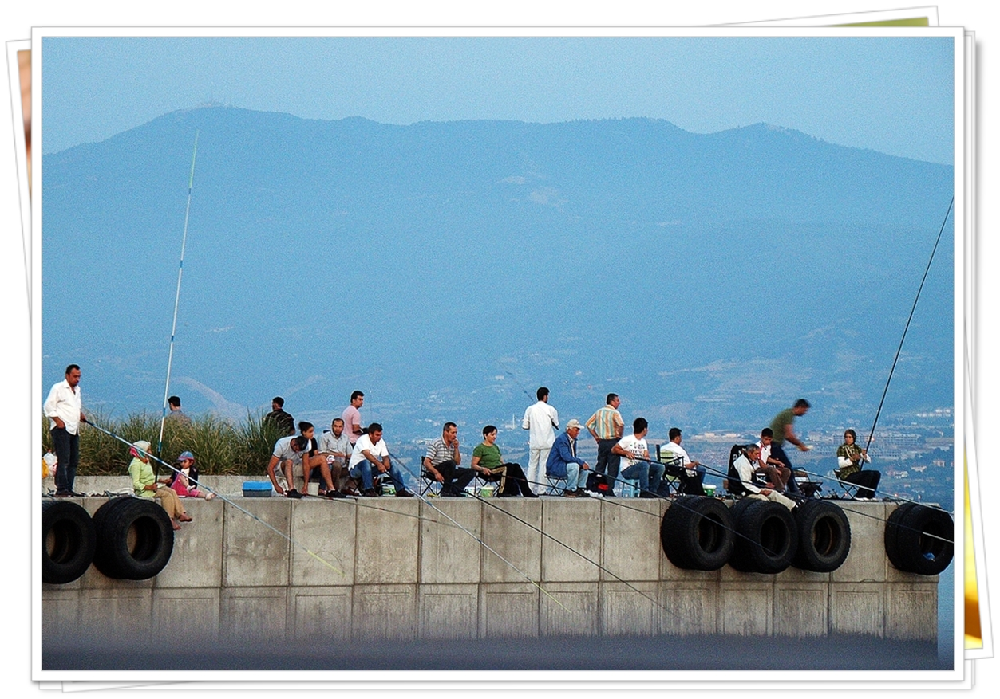

# 📍 Kocaeli - Seyahat ve Tefekkür Notları

  

## 📜 Şehrin Ruhu
> "Sanayinin gri çehresinin arkasında, asırlık çınarların ve körfezin mavi sularının fısıldadığı kadim bir tarih saklıdır."

### 🌍 Şehrin Dokusu ve Tarihsel Arka Planı
Antik dönemde Bithynia Krallığı'na başkentlik yapmış olan Nicomedia (Kocaeli), Osmanlı döneminde de payitahtın en önemli kapılarından biri olmuştur. Sanayi şehri kimliğinin gerisinde derin bir kültür barındırır.

### 🕌 Manevi Mimarlar ve Tarihî Şahsiyetler
- **Akçakoca Bey:** Osman Gazi ve Orhan Gazi döneminin alp gazisi, İzmit ve çevresini fethederek bölgeye "Koca-ili" adını kazandıran kurucu komutan.
- **Orhan Gazi & Süleyman Paşa:** İzmit'in fethinin ardından kılıç hakkı olarak camiye çevrilen Orhan Camii ile bölgede Osmanlı şehir kültürünü başlatan banîler.
- **Pertev Mehmet Paşa (Yeni Cuma Camii Banîsi):** Mimar Sinan'ın İzmit'e armağan ettiği zarif külliyenin hamisi ve Osmanlı devlet adamı.
- **Osman Hamdi Bey:** Türk müzeciliğinin ve çağdaş Türk resminin öncüsü; Eskihisar'daki köşkü bugün hâlâ sanat ve kültürün izlerini taşır.
- **Hannibal Barca:** Antik çağın efsanevi Kartacalı komutanı; ömrünün son yıllarını Gebze (Libyssa) topraklarında geçirmiş ve bölgenin kadim tarihine iz bırakmıştır.

### 💬 Şehir Hakkında Edebi ve Tarihi Alıntılar
> "Nicomedia, Roma'nın doğudaki en parlak tacı, asırların yorulmaz limanıdır." — Libanius
>
> "Kocaeli, payitahtın bağ ve bahçe kapısı, körfezin sükunet bulduğu konaktır." — Evliya Çelebi
>

### 🕊️ Gezginin Not Defterinden (Manevi Boyut ve Tefekkür)
Körfezin dalgalarında, zamanın akışını ve emeğin kutsallığını tefekkür edersiniz. Tarihi saat kulesinin gölgesinde, geçip giden anların ebediyetle olan bağını idrak edersiniz.

### 🍽️ Yöresel Lezzet Tavsiyeleri
- **Yerel Tatlar ve İkramlar:** Şehrin yerel esnaf lokantalarında ve pazar yerlerinde deneyimlenen bütçe dostu, kültürel dokuyu yansıtan eşsiz lezzetler (İzmit Pişmaniyesi, Kandıra Yoğurdu, Dartı, Mancarlı Pide ve Maşukiye Alabalığı).
- **Tefekkür Eşliğinde Çay/Kahve:** Şehrin tarihi kıraathanelerinde veya doğa manzaralı tepelerinde (Sekapark sahili, Kasr-ı Hümayun bahçesi) yudumlanan demli çaylar.

### ⛺ Konaklama ve Bütçe Stratejisi
- **Sıfır Konaklama Maliyeti (Modern Kervansaraylar):** GSB Seyahatsever projesi kapsamında şehirdeki KYK yurtlarında 5 gün boyunca ücretsiz konaklanarak bütçe korunmuştur.
- **Ulaşım ve Lojistik Planlama:** Rota optimizasyonuna uyularak komşu iller sırayla takip edilmiş, böylece hem yol maliyeti minimuma indirilmiş hem de karbon ayak izi azaltılmıştır.

### 💻 Yarı Göçebe Mesaisi (İlim Tahsili & Kütüphane)
- **Kütüphane Rutini:** Gündüz vakitlerinde şehrin İl Halk Kütüphanesinde zaman geçirilerek bilgisayar başında yazılım geliştirme ve ders çalışma faaliyetleri sürdürülmüştür.
  * *Seyyahın Kütüphane Notu:* Kocaeli İl Halk Kütüphanesi - Sessiz, çalışma disiplinine uygun, internet imkanı sunan verimli bir ilim yuvası.
- **Süre ve Uyum:** Kütüphane mesaisi bitiminde şehrin ruhuna karışmak üzere yollara düşülmüş, 5 günlük menzil süresiyle şehir sindirilerek keşfedilmiştir.

### 🧭 5 Günlük Menzil Rotası
- **1. Gün — Nicomedia'dan İzmit'e (Tarihi Merkez):** Sabah kütüphane mesaisi sonrası Kocaeli Saat Kulesi, Sultan Abdülaziz'in mirası Kasr-ı Hümayun, Orhan Camii ve Mimar Sinan eseri Pertev Mehmet Paşa (Yeni Cuma) Camii gezisi.
- **2. Gün — Körfez Kıyısı ve Denizcilik Mirası:** SEKA Kağıt Müzesi, Sekapark sahil yürüyüşü ve TCG Gayret Gemi Müzesi ziyareti; akşamüstü körfez gün batımında tefekkür.
- **3. Gün — Doğa ve Yayla Nefesi (Maşukiye & Kartepe):** Samanlı Dağları'nın eteklerindeki Maşukiye şelaleleri, Ormanya Doğal Yaşam Parkı ve Kartepe sırtlarından Sapanca ile İzmit Körfezi'nin çift manzaralı seyri.
- **4. Gün — Tarih ve Sanatın Batı Kapısı (Gebze & Eskihisar):** Fatih Sultan Mehmed'in son sefer menzili Hünkâr Çayırı, Eskihisar Kalesi, Osman Hamdi Bey Evi ve Müzesi ile Çoban Mustafa Paşa Külliyesi ziyareti.
- **5. Gün — Karadeniz'e Açılan Kıyı (Kandıra & Kerpe):** Son gün Kandıra üzerinden Karadeniz kıyısındaki Kerpe Kartal Kayalıkları ve Kefken Pembe Kayalar'da rüzgar eşliğinde veda yürüyüşü.

### ✨ Keşfedilesi Duraklar ve Landmarks
Bu şehrin havasını solumak, ruhuna dokunmak için mutlaka adımlanması gereken köşe taşları:
- [ ] **Kocaeli Saat Kulesi**
- [ ] **Tarihi Hünkâr Çayırı**
- [ ] **Gayret Gemi Müzesi**
- [ ] **Sekapark ve SEKA Kağıt Müzesi**
- [ ] **Kandıra Kerpe Kayalıkları**

### 📸 Menzil Fotoğraf Galerisi
<table>
  <tr>
    <td align="center" width="50%">
      
       <b>Körfezin Sükuneti:</b> Antik Nicomedia'dan günümüze uzanan kıyı ve emek şehri.
    </td>
    <td align="center" width="50%">
      
       <b>Yeşil ile Mavinin Kesişimi:</b> Samanlı Dağları, sahil şeridi ve tarihi mirasıyla Kocaeli.
    </td>
  </tr>
</table>

---
*Bu il bizzat deneyimlenmiş, yolları aşındırılmış ve seyahatnameye sevgiyle işlenmiştir.* ✅
