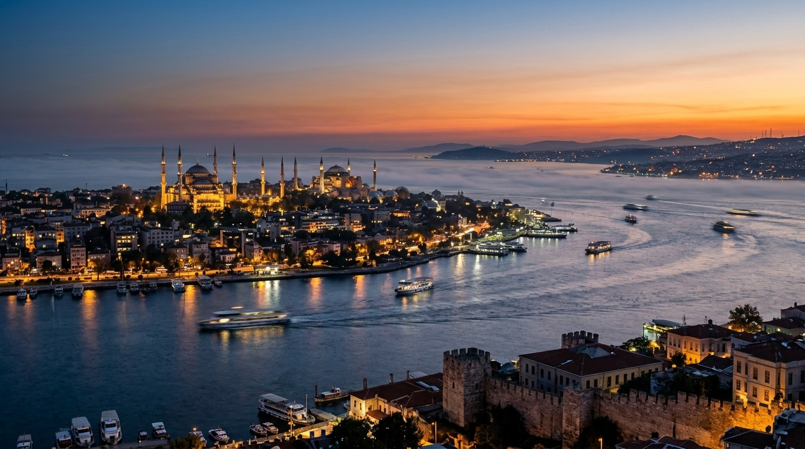
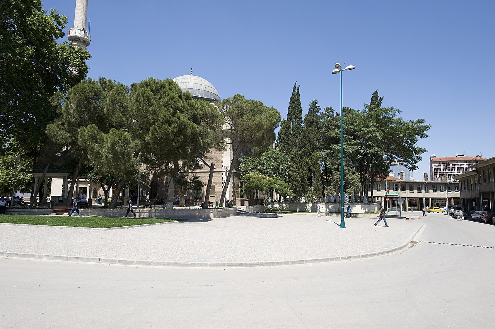
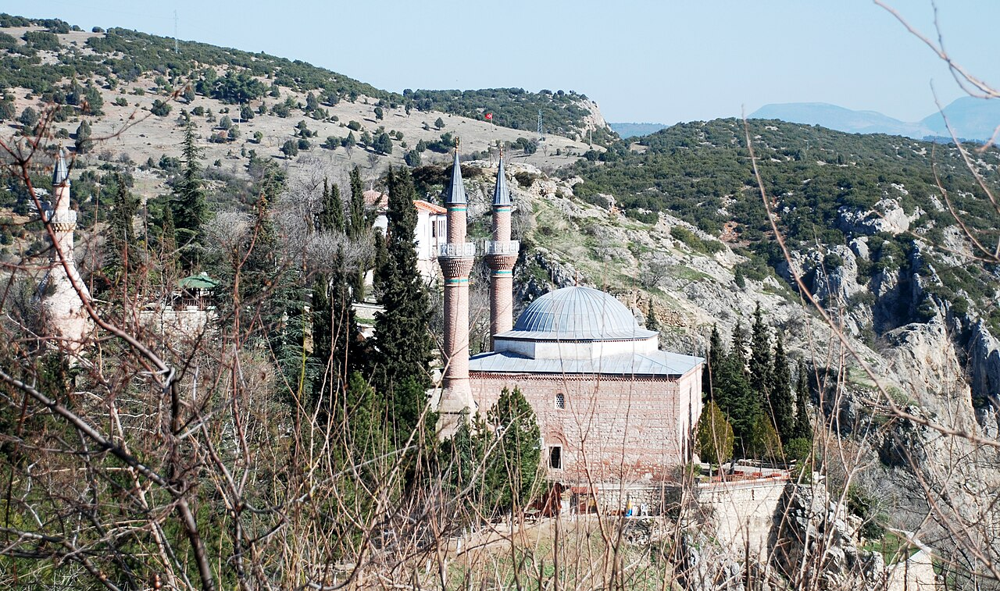
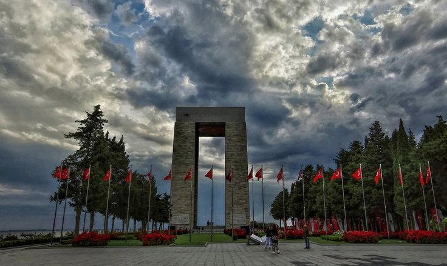
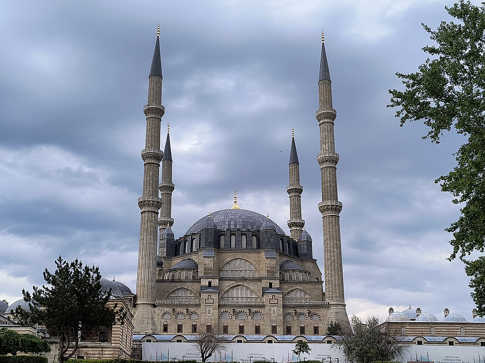
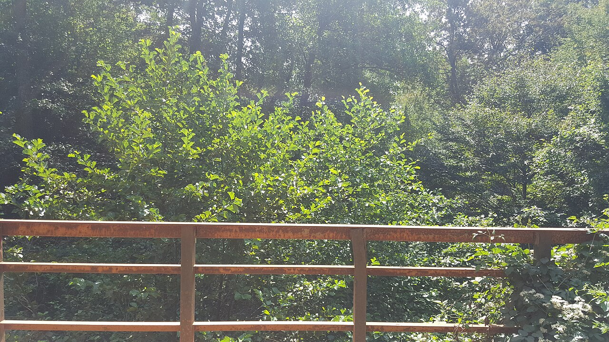
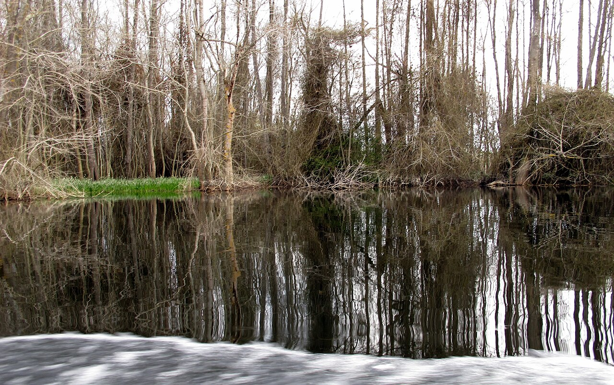
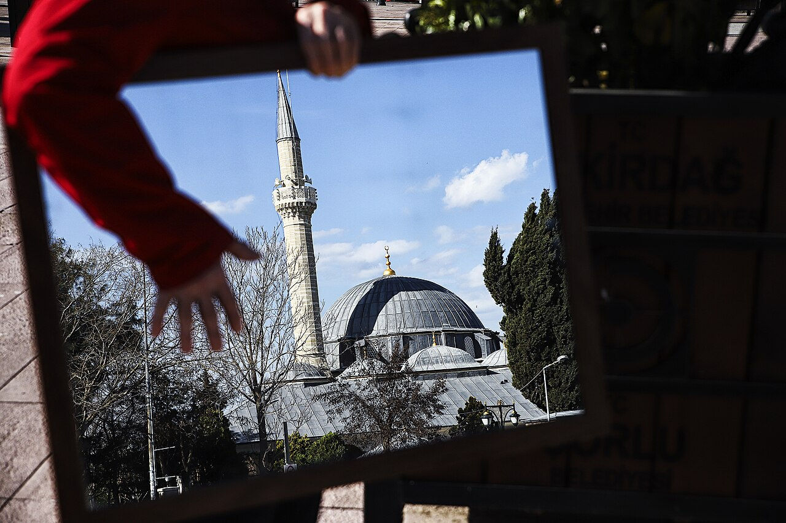
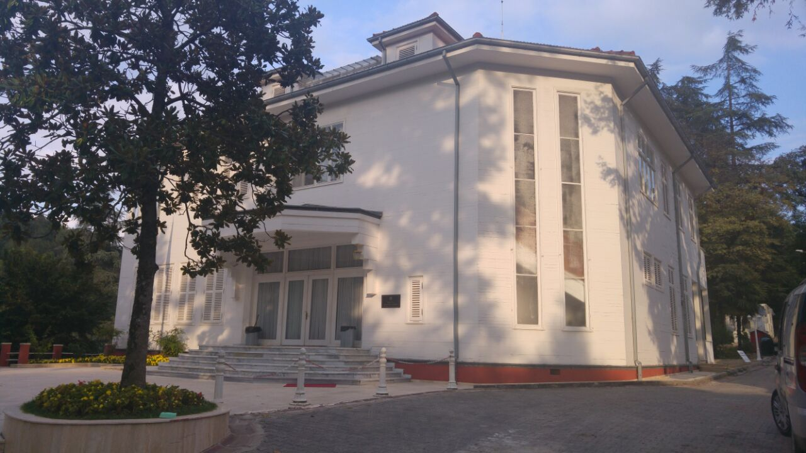

# 🏰 Marmara Bölgesi

> *Payitaht ve Tohum: Bir cihan imparatorluğunun mayalandığı iki kıtayı bağlayan kadim topraklar.*

**Keşif İlerlemesi:** `3 / 11 İl` (**%27.3**) &nbsp;•&nbsp; [🏠 Ana Sayfaya Dön](../README.md) &nbsp;•&nbsp; [🌐 Web Portalı](https://bahattinyunus.github.io/dijitalseyyah/)

---

## 🖼️ Bölge İlleri Görsel Rehberi

<table>
  <tr>
    <td align="center" width="33%" valign="top">
       
      <strong><a href="Balikesir/README.md">10 • Balıkesir</a></strong> 
      ⏳ Bekliyor • 📍 Zağnos Paşa Camii 🍽️ Höşmerim
    </td>
    <td align="center" width="33%" valign="top">
       
      <strong><a href="Bilecik/README.md">11 • Bilecik</a></strong> 
      ⏳ Bekliyor • 📍 Şeyh Edebali Türbesi 🍽️ Bilecik Güveci
    </td>
    <td align="center" width="33%" valign="top">
       
      <strong><a href="Bursa/README.md">16 • Bursa</a></strong> 
      ✅ Gezildi • 📍 Ulu Cami 🍽️ İskender Kebap
    </td>
  </tr>
  <tr>
    <td align="center" width="33%" valign="top">
       
      <strong><a href="Canakkale/README.md">17 • Çanakkale</a></strong> 
      ⏳ Bekliyor • 📍 Şehitler Abidesi 🍽️ Peynir Helvası
    </td>
    <td align="center" width="33%" valign="top">
       
      <strong><a href="Edirne/README.md">22 • Edirne</a></strong> 
      ⏳ Bekliyor • 📍 Selimiye Camii 🍽️ Edirne Tava Ciğeri
    </td>
    <td align="center" width="33%" valign="top">
       
      <strong><a href="Istanbul/README.md">34 • İstanbul</a></strong> 
      ✅ Gezildi • 📍 Ayasofya-i Kebir 🍽️ Sultanahmet Köftesi
    </td>
  </tr>
  <tr>
    <td align="center" width="33%" valign="top">
       
      <strong><a href="Kirklareli/README.md">39 • Kırklareli</a></strong> 
      ⏳ Bekliyor • 📍 İğneada Longoz Ormanları 🍽️ Kırklareli Köftesi
    </td>
    <td align="center" width="33%" valign="top">
       
      <strong><a href="Kocaeli/README.md">41 • Kocaeli</a></strong> 
      ✅ Gezildi • 📍 Saat Kulesi 🍽️ Pişmaniye
    </td>
    <td align="center" width="33%" valign="top">
       
      <strong><a href="Sakarya/README.md">54 • Sakarya</a></strong> 
      ⏳ Bekliyor • 📍 Sapanca Gölü 🍽️ Islama Köfte
    </td>
  </tr>
  <tr>
    <td align="center" width="33%" valign="top">
       
      <strong><a href="Tekirdag/README.md">59 • Tekirdağ</a></strong> 
      ⏳ Bekliyor • 📍 Namık Kemal Evi 🍽️ Tekirdağ Köftesi
    </td>
    <td align="center" width="33%" valign="top">
       
      <strong><a href="Yalova/README.md">77 • Yalova</a></strong> 
      ⏳ Bekliyor • 📍 Yürüyen Köşk 🍽️ Yalova Köftesi
    </td>
    <td width="33%"></td>
  </tr>
</table>

---

*Anadolu Seyahatnamesi — Dijital Seyyah Bölge Dosyası*
