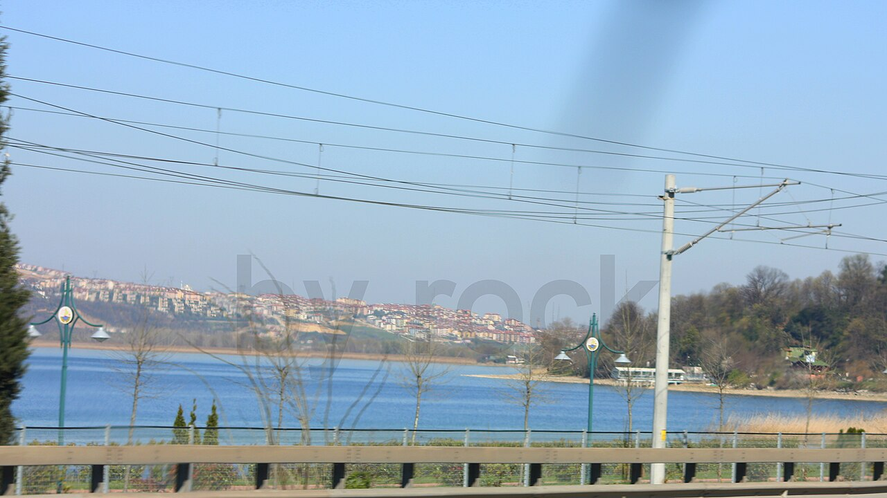
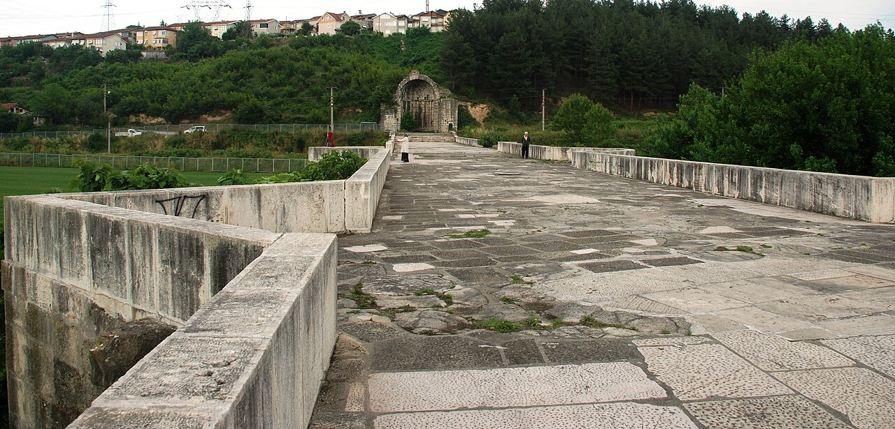

# 📍 Sakarya - Seyahat ve Sefer Dosyası

  

## 📜 Şehrin Ruhu
> "Sakarya Türküsü'nün döküldüğü ırmak, bereketli ovaları ve kadim Osmanlı kasabalarıyla köklü bir durak."

### 🌍 Şehrin Dokusu ve Tarihsel Arka Planı
Anadolu'yu boydan boya kat ederek Karadeniz'e dökülen kadim Sakarya Nehri'nin (Sangarios) hayat verdiği bu bereketli coğrafya, tarih boyunca Doğu ile Batı arasındaki ana geçiş koridorunun kilit noktası olmuştur. 6. yüzyılda Doğu Roma İmparatoru I. Justinianus tarafından yaptırılan ve bugün hâlâ ayakta duran görkemli Justinianus Köprüsü (Beşköprü), şehrin bin beş yüz yıllık mühendislik mirasına tanıklık eder. Osmanlı'nın kuruluş yıllarında Konuralp ve Samsa Çavuş gibi alp gazilerle Türk yurdu hâline gelen Sakarya; bir yanında dingin Sapanca Gölü, kuzeyinde Türkiye'nin en büyük tek parça su basar ormanı Acarlar Longozu, güneyinde ise yedi asırlık ahşap evleriyle Sakin Şehir Taraklı'yı barındırır. Kafkasya'dan Balkanlar'a, Karadeniz'den Anadolu'ya farklı kültürlerin kardeşçe harmanlandığı bu şehir, bereketin ve vefanın canlı bir mozaiğidir.

### 🕌 Manevi Mimarlar ve Kültürel Miras
- **Orhan Gazi & Konuralp Bey:** Adapazarı ve Akyazı havzasını Osmanlı sancağı altına alarak bölgedeki ilk cami ve vakıf geleneğini başlatan kurucu gaziler.
- **Şeyh Muslihiddin (Büyük Esence) & Taraklı İrfanı:** Bölgede 14. yüzyıldan bu yana ayakta kalan çivisiz ahşap cami geleneği ve Taraklı'daki Yunus Paşa Camii (1517) ile Anadolu'nun zarif vakıf kültürü.
- **Sait Faik Abasıyanık:** Adapazarı doğumlu büyük hikâyeci; sıradan insanın kalbine ve tabiatın inceliklerine açılan duru Türkçesiyle edebiyatımızın unutulmaz ismidir.
- **Necip Fazıl Kısakürek (Sakarya Türküsü):** "İnsan bu, su misali, kıvrım kıvrım akar ya; / Bir yanda akan benim, öbür yanda Sakarya." dizeleriyle bu ırmağı bir milletin tarihî şuurunun sembolü hâline getirmiştir.

### 💬 Şehir Hakkında Edebi ve Tarihi Alıntılar
> "İnsan bu, su misali, kıvrım kıvrım akar ya; / Bir yanda akan benim, öbür yanda Sakarya." — Necip Fazıl Kısakürek
>
> "Bir insanı sevmekle başlar her şey." — Sait Faik Abasıyanık (Adapazarı doğumlu büyük öykücü)
>
> "Taraklı'nın ahşap cumbalı sokaklarında yürürken, Osmanlı'nın ilk asırlarındaki huzur ve kanaat iklimi hâlâ nefes alır." — Anadolu Kültür Notları

### 🍽️ Yöresel Lezzetler
- **Adapazarı Islama Köftesi:** Kemik suyu ve kırmızı toz biberli sosla ıslatılıp ızgarada kızartılan ekmek dilimleri üzerinde sunulan, şehrin tescilli baş tacı.
- **Adapazarı Kabak Tatlısı:** Kireçte veya kendi suyunda ağır ağır pişirilip ceviz ve tahinle taçlandırılan efsanevi tatlı.
- **Uğut Tatlısı & Dartılı Keşkek:** Çimlendirilmiş buğdaydan şekersiz hazırlanan kadim Uğut tatlısı ile Taraklı ve Geyve yöresinin köklü sofraları.
- **Çerkez Tavuğu & Laz Böreği:** Sakarya'nın çok kültürlü sosyal dokusunu sofralara yansıtan özgün lezzetler.

### 📖 Planlanan Kütüphane Ofisi
- **Hedef İlim Durağı:** Sakarya İl Halk Kütüphanesi - Geniş çalışma masaları ve ferah ortamıyla verimli çalışma imkanı.
- **Yarı Göçebe Mesai Planı:** Gündüz Adapazarı merkezdeki İl Halk Kütüphanesi'nde yazılım ve okuma mesaisi; akşamüstü Sapanca Gölü kıyısında veya tarihi köprü çevresinde tefekkür yürüyüşleri.

### 🧭 5 Günlük Planlanan Menzil Rotası
- **1. Gün — Irmağın Hafızası (Adapazarı & Beşköprü):** Kütüphane mesaisi sonrası UNESCO Geçici Miras Listesi'ndeki Justinianus Köprüsü (Beşköprü), Sakarya Müzesi, Orhan Camii ve akşam meşhur Islama Köfte tadımı.
- **2. Gün — Gölün Sükuneti (Sapanca & Kırkpınar):** Sapanca Gölü sahil şeridi, Vecihi Kapısı, Rüstem Paşa Camii, Kırkpınar bahçeleri ve Maşukiye sınırındaki yaylalarda doğa yürüyüşü.
- **3. Gün — Su Basar Orman ve Karadeniz (Karasu & Acarlar Longozu):** Türkiye'nin en büyük tek parça longozu Acarlar Longozu'nda ahşap yürüyüş yolları ve nilüfer gözlemi; ardından Maden Deresi Şelalesi ve Karasu sahili.
- **4. Gün — Zamanın Durduğu Osmanlı Kasabası (Taraklı & Geyve):** Cittaslow Taraklı'nın üç asırlık ahşap konakları, Yunus Paşa Camii (Kurşunlu Cami), tarihi hamam ve Geyve Boğazı'ndan dönüş.
- **5. Gün — Doğal Miras ve Şifa (Poyrazlar Gölü & Kuzuluk):** Poyrazlar Gölü Tabiat Parkı'nda sabah okuma molası, Akyazı-Kuzuluk kaplıca bölgesi veya Pamukova bağlarında veda yürüyüşü.

### ✨ Keşfedilesi Duraklar
- [ ] **Sapanca Gölü ve Kırkpınar Sahili**
- [ ] **Justinianus Köprüsü (Beşköprü)**
- [ ] **Acarlar Longozu ve Maden Deresi**
- [ ] **Taraklı Tarihi Evleri ve Yunus Paşa Camii**
- [ ] **Poyrazlar Gölü Tabiat Parkı ve Sakarya Müzesi**

### 📸 Menzil Fotoğraf Galerisi
<table>
  <tr>
    <td align="center" width="50%">
      
       <b>Suyun ve Yeşilin Şehri:</b> Sapanca Gölü'nden Acarlar Longozu'na uzanan dingin tabiat.
    </td>
    <td align="center" width="50%">
      
       <b>Asırlık Miras:</b> Beşköprü'nün taş kemerleri ve Taraklı'nın cumbalı Osmanlı sokakları.
    </td>
  </tr>
</table>

---
*Henüz adımlanmamış bu kadim menzil, sıradaki sefer rotasında yer almaktadır.*
