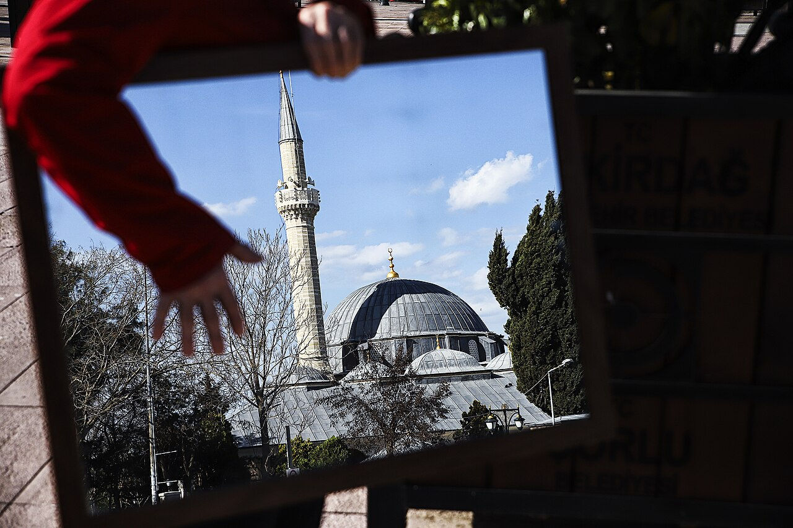
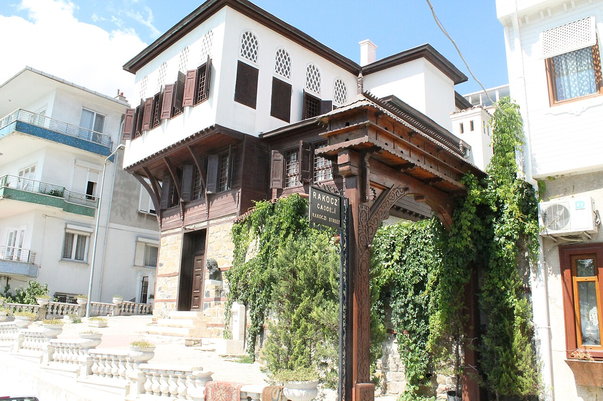

# 📍 Tekirdag - Seyahat ve Sefer Dosyası

  

## 📜 Şehrin Ruhu
> "Marmara'nın rüzgarlı kıyısı, vatan şairi Namık Kemal'in yurdu ve yamaç paraşütünün gözdesi."

### 🌍 Şehrin Dokusu ve Tarihsel Arka Planı
Marmara Denizi'nin kuzey kıyısında, Ganos (Işıklar) Dağları'nın denizle kucaklaştığı bereketli yamaçlarda uzanan Tekirdağ; antik çağda "Bisanthe" ve "Rhaedestus", Osmanlı döneminde ise "Rodoscuk" adıyla önemli bir liman ve tahıl ambarı olarak parlamıştır. 16. yüzyılda Mimar Sinan'ın inşa ettiği Rüstem Paşa Külliyesi ile estetik bir merkez kimliği kazanan şehir, 18. yüzyılda Macar özgürlük kahramanı II. Ferenc Rákóczi'ye kucak açarak Türk misafirperverliğinin Avrupa tarihine geçen en zarif örneklerinden birini sergilemiştir. Vatan ve hürriyet kavramlarını Türk edebiyatının merkezine yerleştiren Namık Kemal'in doğduğu bu rüzgarlı kıyı kenti; bugün uçsuz bucaksız ayçiçeği tarlaları, Şarköy bağları ve Uçmakdere'nin nefes kesen yamaçlarıyla gezginlere hem tarih hem ferahlık vadeder.

### 🕌 Manevi Mimarlar ve Kültürel Miras
- **Namık Kemal (Vatan Şairi):** 1840'ta Tekirdağ'da doğan, *Vatan yahut Silistre* eseri ve hürriyet kasidesiyle nesillere vatan sevgisini aşılayan büyük edip ve mütefekkir; adına kurulan müze ev şehrin kültür kalbidir.
- **Mimar Sinan & Rüstem Paşa:** 1553 tarihli Rüstem Paşa Camii ve Külliyesi, Tekirdağ'ın silüetine klasik Osmanlı mimarisinin dingin zarafetini nakşetmiştir.
- **II. Ferenc Rákóczi:** Osmanlı'ya sığınarak ömrünün son 15 yılını Tekirdağ'da geçiren Macar prensi; bugün Rákóczi Müzesi olarak korunan konağı Türk-Macar dostluğunun yaşayan anıtıdır.
- **Yahya Kemal & Trakya Kültür Köprüsü:** Bölgenin Balkanlar'dan Anadolu'ya uzanan zengin türkü, göç ve edebiyat mirası.

### 💬 Şehir Hakkında Edebi ve Tarihi Alıntılar
> "Vatanın bağrına düşman dayamış hançerini; / Yoğimiş kurtaracak bahtı kara mâderini." — Namık Kemal
>
> "Tekirdağ, denize nazır geniş meydanları, bağları ve temiz havasıyla Rumeli kıyısının ferahlık veren limanıdır." — Evliya Çelebi
>
> "Ganos yamaçlarından Marmara'ya bakarken rüzgar, insana hem hürriyetin hem de sükunetin dilini fısıldar." — Marmara Seyir Defteri

### 🍽️ Yöresel Lezzetler
- **Tekirdağ Köftesi:** Özel dinlendirilmiş kıyması, acı biber sosu ve piyazıyla Türkiye'nin en tanınmış esnaf lokantası klasiklerinden biri.
- **Hayrabolu Tatlısı:** Tuzsuz peynirle hazırlanan, bol şerbetli ve tahin-ceviz-kaymak üçlüsüyle sunulan efsanevi Trakya tatlısı.
- **Peynir Helvası & Tekirdağ Kirazı:** Bölgenin köklü mutfak geleneği ve haziran aylarında şenliklere konu olan meşhur kirazı.
- **Cizleme & Velibah:** Trakya köylerinin sıcak, emek dolu geleneksel hamur işleri.

### 📖 Planlanan Kütüphane Ofisi
- **Hedef İlim Durağı:** Tekirdağ Namık Kemal İl Halk Kütüphanesi - Huzurlu deniz havası eşliğinde çalışma olanağı.
- **Yarı Göçebe Mesai Planı:** Sabah saatlerinde Namık Kemal İl Halk Kütüphanesi'nde yazılım ve edebiyat okumaları; öğleden sonra sahil yürüyüşü, tarihi müzeler ve Ganos eteklerinde keşif.

### 🧭 5 Günlük Planlanan Menzil Rotası
- **1. Gün — Hürriyet ve Tarih Merkezi (Süleymanpaşa):** Kütüphane mesaisi sonrası Namık Kemal Evi, Rákóczi Müzesi, Mimar Sinan eseri Rüstem Paşa Camii ve Tekirdağ Arkeoloji ve Etnografya Müzesi ziyareti.
- **2. Gün — Gökyüzü ile Denizin Kesişimi (Uçmakdere & Ganos Dağları):** Nişantepe'den yamaç paraşütü manzaralarını ve Marmara Adası ufkunu seyir, asırlık çınarlar altındaki Uçmakdere köyünde çay ve okuma molası.
- **3. Gün — Kıyı ve Bağlar Rotası (Şarköy & Hoşköy):** Hora Feneri, Gaziköy ve Şarköy'ün uzun sahil şeridinde Marmara rüzgarı eşliğinde bisiklet veya yürüyüş.
- **4. Gün — Antik Liman ve Kıyı Sükuneti (Marmaraereğlisi / Perinthos):** Antik Perinthos kalıntıları, sahil kayalıkları ve dönüşte merkezde meşhur Tekirdağ köftesi ile Hayrabolu tatlısı ziyafeti.
- **5. Gün — Ayçiçeği Ovaları ve Veda (Hayrabolu & Malkara Hattı):** İç Trakya'nın geniş ovalarında son bir kültür turu, sahilde gün batımı eşliğinde Tekirdağ sefer notlarının derlenmesi.

### ✨ Keşfedilesi Duraklar
- [ ] **Namık Kemal Evi ve Kültür Merkezi**
- [ ] **Rákóczi Müzesi**
- [ ] **Mimar Sinan Eseri Rüstem Paşa Camii**
- [ ] **Uçmakdere ve Ganos Dağları Manzara Noktası**
- [ ] **Hora Feneri ve Şarköy Sahil Şeridi**

### 📸 Menzil Fotoğraf Galerisi
<table>
  <tr>
    <td align="center" width="50%">
      
       <b>Rüzgarlı Kıyı:</b> Ganos Dağları'nın eteklerinden Marmara'nın mavisine açılan ufuk.
    </td>
    <td align="center" width="50%">
      
       <b>Edebiyat ve Tarih:</b> Namık Kemal'den Rákóczi'ye, Rüstem Paşa'dan Şarköy'e uzanan miras.
    </td>
  </tr>
</table>

---
*Henüz adımlanmamış bu kadim menzil, sıradaki sefer rotasında yer almaktadır.*
