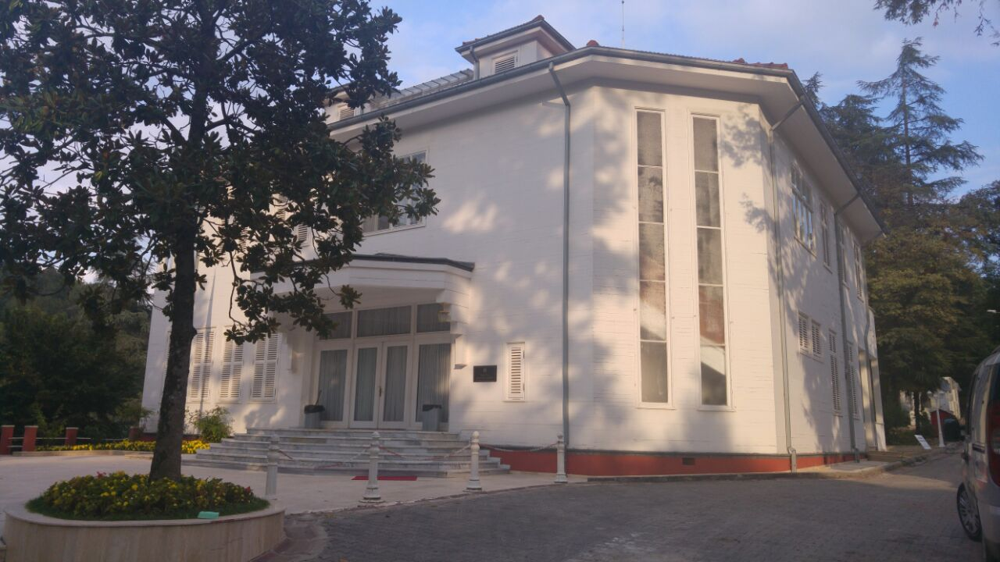
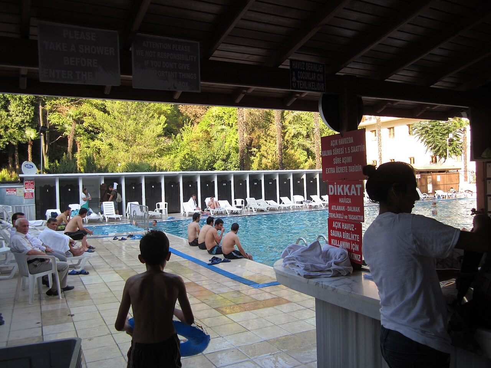

# 📍 Yalova - Seyahat ve Sefer Dosyası

  

## 📜 Şehrin Ruhu
> "Yeşilin her tonunu saklayan şifalı sular diyarı ve çevrecilik sembolü Yürüyen Köşk'ün yurdu."

### 🌍 Şehrin Dokusu ve Tarihsel Arka Planı
Samanlı Dağları'nın gür ormanları ile Marmara Denizi'nin dingin kıyısı arasına zarifçe yerleşmiş olan Yalova, yüzölçümü bakımından Türkiye'nin en küçük ili olmasına rağmen tabiat zenginliği ve şifa tarihi açısından bir kıta kadar cömerttir. Antik çağda "Pythia Therma" adıyla şifalı sıcak sularıyla ün salan Termal havzası, Roma ve Bizans imparatorlarından Osmanlı padişahlarına kadar asırlar boyunca şifa arayanların uğrak noktası olmuştur. Cumhuriyet döneminde Gazi Mustafa Kemal Atatürk'ün "Yalova benim kentimdir" sözüyle özel bir değer verdiği şehir, 1930 yılında bir çınar ağacının tek bir dalı bile kesilmesin diye raylar üzerinde kaydırılan Yürüyen Köşk ile tüm dünyaya emsalsiz bir tabiat sevgisi ve çevre bilinci dersi vermiştir. Canlı ağaç müzesi Karaca Arboretumu, çağlayan Sudüşen Şelalesi ve serin Erikli Yaylası ile Yalova, metropollerin hemen yanı başında bir nefeslenme ve tefekkür vahasıdır.

### 🕌 Manevi Mimarlar ve Kültürel Miras
- **Gazi Mustafa Kemal Atatürk & Yürüyen Köşk Hatırası:** "Ağaç kesilmeyecek, bina kaydırılacak!" talimatıyla doğaya saygının ebedî sembolü hâline gelen Yürüyen Köşk ve Termal Atatürk Köşkü'nün mirası.
- **Kara Kilise (Hersekzade Ahmed Paşa Külliyesi):** Altınova Hersek köyünde, II. Bayezid dönemi sadrazamlarından Hersekzade Ahmed Paşa'nın 1511'de yaptırdığı külliye; Anadolu'dan İstanbul'a uzanan hac ve kervan yolunun önemli bir menzilidir.
- **Hayrettin Karaca (Toprak Dede):** TEMA Vakfı'nın kurucusu ve Türkiye'nin ilk özel arboretumu olan Karaca Arboretumu'nun mimarı; Yalova topraklarında binlerce bitki türünü geleceğe emanet etmiştir.
- **Elmalık & Termal Şifa Geleneği:** Sultan Abdülmecid'in annesi Bezmiâlem Valide Sultan'ın şifa bulduğu ve ihya ettirdiği tarihi Valide Banyosu'nun asırlık vakıf kültürü.

### 💬 Şehir Hakkında Edebi ve Tarihi Alıntılar
> "Yalova benim kentimdir." — Gazi Mustafa Kemal Atatürk
>
> "Bir çınar dalının hatırına koca bir köşkün yerinden yürütülmesi, insanoğlunun tabiata gösterebileceği en zarif vefadır." — Yürüyen Köşk Anı Defteri
>
> "Termal vadisinde buharı tüten şifalı sular ve asırlık ağaçlar, yorgun yolcunun hem bedenine hem ruhuna dinginlik bağışlar." — Marmara Gezi Notları

### 🍽️ Yöresel Lezzetler
- **Yalova Köftesi & Pavlova / Yalova Sütlüsü:** Hafif, sütlü ve zarif Yalova Sütlüsü tatlısı ile şehrin yerel lokantalarındaki özgün köfte geleneği.
- **Termal Tatlısı & Yalova Kivisi:** Türkiye'nin kivi üretim merkezlerinden biri olan Yalova'nın taze mevsim meyveleri ve yöresel ikramları.
- **Milföylü Yalova Kebabı & Yaprak Pidesi:** Yörenin misafirperver sofralarını süsleyen geleneksel tatlar.

### 📖 Planlanan Kütüphane Ofisi
- **Hedef İlim Durağı:** Yalova İl Halk Kütüphanesi - Şehir merkezinde butik, sakin ve odaklanmaya uygun bir mekan.
- **Yarı Göçebe Mesai Planı:** Sabah saatlerinde Yalova İl Halk Kütüphanesi'nde yazılım geliştirme ve ders çalışma; öğleden sonra sahil şeridinde yürüyüş, Yürüyen Köşk bahçesinde okuma ve Termal ormanlarında dinlenme.

### 🧭 5 Günlük Planlanan Menzil Rotası
- **1. Gün — Çınarın Gölgesinde Vefa (Merkez & Yürüyen Köşk):** Kütüphane mesaisi sonrası Yürüyen Köşk ziyareti, ulu çınarın gölgesinde çay ve tefekkür, Yalova Kent Müzesi ve sahil yürüyüşü.
- **2. Gün — Şifalı Sular Vadisi (Termal & Gökçedere):** Tarihi Termal Kaplıcaları, Kurşunlu Hamam, Valide Banyosu, Atatürk Köşkü ve rengârenk botanik yürüyüş parkurlarında huzurlu bir gün.
- **3. Gün — Canlı Ağaç Müzesi ve Çağlayanlar (Karaca Arboretumu & Sudüşen):** Hayrettin Karaca'nın mirası Karaca Arboretumu'nda dünya florasını keşif; ardından Üvezpınar üzerinden Sudüşen Şelalesi'ne doğa yürüyüşü.
- **4. Gün — Yayla Serinliği (Çınarcık, Teşvikiye & Erikli Yaylası):** Delmece Yaylası, Erikli Çifte Şelaleler ve Teşvikiye Kent Ormanı'nda çam kokulu patikalarda yürüyüş ve kamp ruhu.
- **5. Gün — Tarihî Menzil ve Veda (Altınova & Hersek):** Hersekzade Ahmed Paşa Camii ve Hersek Lagünü Kuş Gözlem Alanı ziyareti; feribot iskelesinde Marmara'ya karşı Yalova notlarını tamamlama.

### ✨ Keşfedilesi Duraklar
- [ ] **Yürüyen Köşk ve Tarihi Çınar**
- [ ] **Yalova Termal Kaplıcaları ve Atatürk Köşkü**
- [ ] **Sudüşen Şelalesi ve Erikli Çifte Şelaleler**
- [ ] **Karaca Arboretumu**
- [ ] **Hersekzade Ahmed Paşa Camii ve Hersek Lagünü**

### 📸 Menzil Fotoğraf Galerisi
<table>
  <tr>
    <td align="center" width="50%">
      
       <b>Doğaya Saygının Anıtı:</b> Bir çınar dalı için raylar üzerinde yürütülen tarihi köşk.
    </td>
    <td align="center" width="50%">
      
       <b>Şifa ve Yeşil:</b> Termal vadisinden Sudüşen Şelalesi'ne uzanan dingin tabiat.
    </td>
  </tr>
</table>

---
*Henüz adımlanmamış bu kadim menzil, sıradaki sefer rotasında yer almaktadır.*
