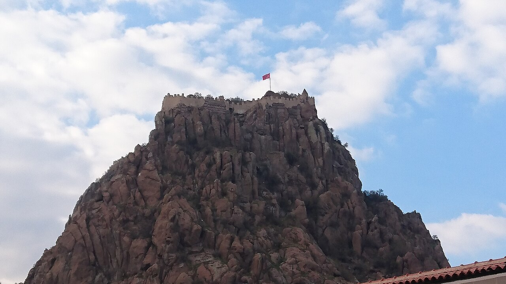
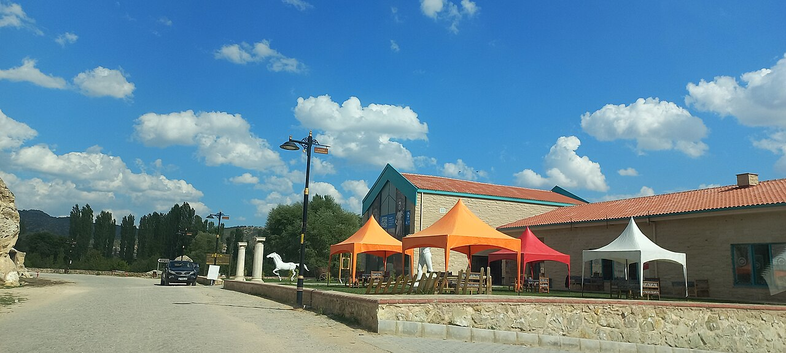

  

# 📍 Afyonkarahisar - Sefer Öncesi Menzil Dosyası

## 📜 Seyyahın Beklentisi
> "Karahisar Kalesi'nin heybeti, Mevleviliğin ikinci büyük ocağı ve Anadolu'nun kavşak noktası. Henüz adımlanmamış her yol, içinde koca bir hikaye saklar."

### 🌍 Şehrin Dokusu ve Tarihsel Arka Planı
İç Ege'nin kapısı ve Anadolu'nun en stratejik yol kavşağı olan Afyonkarahisar; Hititlerden (Hapanuwa) Friglere, Romalılardan Bizans'a, Selçuklulardan Sahipataoğulları'na ve Osmanlı'ya uzanan beş bin yıllık bir medeniyet katmanına sahiptir. Volkanik bir kaya kütlesinin tepesine 226 metre yükseklikte kurulan Karahisar Kalesi, yüzyıllar boyunca hem kervan yollarını hem de şehrin hafızasını gözetlemiştir. Kırk ahşap direkli Selçuklu şaheseri Ulu Cami, Konya'dan sonra Mevleviliğin en önemli ikinci merkezi sayılan Mevlevihane (Türbe Camii), UNESCO Dünya Mirası Geçici Listesi'ndeki gizemli Frig Vadisi (Ayazini, Aslantaş, Yılantaş) ve 1922 Büyük Taarruz'un başlangıç noktası Kocatepe ile Afyonkarahisar; hem tarih, hem tasavvuf, hem de termal şifa ve gastronomi başkentidir.

### 💬 Şehir Hakkında Edebi ve Tarihi Alıntılar
> "Karahisar-ı Sahib'in kalesi göklere baş çekmiş bir şahin yuvası gibidir; eteğinde kırk direkli ulu bir mabet ve gönülleri ısıtan şifalı ılıcalar uzanır." — Evliya Çelebi, Seyahatnâme
>
> "Kocatepe'nin sisli şafağında bir milletin kaderi yeniden yazıldı; taş ve toprak şahittir ki bu dağlar istiklalin ilk nefesidir." — Millî Mücadele Hatıratları
>
> "Frig Vadisi'nin kayalarına oyulmuş sessizlikte, rüzgâr hâlâ kadim medeniyetlerin ezgisini taşır." — Anadolu Gezi Notları

### 🕌 Manevi Mimarlar ve Tarihî Şahsiyetler
- **Sultan Divani (Mehmed Semâî Çelebi):** Hz. Mevlânâ'nın yedinci göbekten torunu; Afyonkarahisar Mevlevihanesi'ni kurarak şehri Konya'dan sonra Mevleviliğin ikinci büyük irfan ocağı haline getiren büyük mutasavvıf.
- **Sahip Ata Fahreddin Ali:** Anadolu Selçuklu veziri; Ulu Cami'den hamamlara, medreselerden vakıf eserlerine kadar Afyonkarahisar'ın imar ve ilim kimliğini şekillendiren devlet adamı.
- **Gedik Ahmet Paşa:** Fatih Sultan Mehmed döneminin kudretli sadrazamı; Afyon'da inşa ettirdiği Imaret Camii ve külliyesiyle şehrin klasik Osmanlı silüetini mühürleyen hayırsever.
- **Abdürrahim Mısrî (Mısrî Sultan):** Halvetî-Mısrî geleneğinin Anadolu'daki mühim temsilcilerinden, şehrin manevi koruyucularından biri.
- **Gazi Mustafa Kemal Atatürk ve Büyük Taarruz Kahramanları:** 26 Ağustos 1922 sabahı Kocatepe'den Büyük Taarruz'u yöneterek Anadolu'nun kurtuluşunu müjdeleyen komuta kademesi ve şehitler.

### 🍽️ Planlanan Yöresel Lezzet Durakları
UNESCO Yaratıcı Şehirler Ağı'nda "Gastronomi Şehri" unvanını taşıyan Afyonkarahisar'da tadılması planlanan lezzetler:
- **Ana Yemekler ve Hamur İşleri:** Baharatı ve ustalığıyla tescilli **Afyon Sucuğu**, taş fırından sıcak **Haşhaşlı Çörek** ve **Bükme**, ağır ateşte pişen **Keşkek**, **Ağzı Açık**, **Sakala Çarpan Çorbası** ve **Tandırlık / Çullama Köfte**.
- **Tatlılar ve Süt Ürünleri:** Manda sütünden yapılan eşsiz **Afyon Kaymağı** eşliğinde **Kaymaklı Ekmek Kadayıfı** (vişneli veya sade) ve **Afyon Lokumu**.
- **Çay & Tefekkür Molası:** Tarihi Uzun Çarşı ve Taşhan (Yemeniciler Çarşısı) avlusunda demli çay veya haşhaşlı kahve eşliğinde şehir gözlemi.

### 💻 Planlanan Yarı Göçebe Mesaisi (İlim Tahsili & Kütüphane)
- **Hedef Kütüphane:** *Afyonkarahisar Gedik Ahmet Paşa İl Halk Kütüphanesi* — Tarihi dokuya yakın konumu, sakin okuma salonları ve çalışma disiplinine elverişli atmosferiyle gündüz yazılım/araştırma mesaisi için ideal bir durak.
- **Konaklama Planı:** GSB Seyahatsever programı kapsamında şehirdeki KYK yurtlarında bütçe dostu 5 günlük menzil konaklaması hedeflenmektedir.

### 🧭 Planlanan 5 Günlük Menzil Rotası
- **1. Gün – Kalenin Gölgesinde İlk Selam:** Sabah Gedik Ahmet Paşa İl Halk Kütüphanesi'nde mesai; öğleden sonra Tarihi Afyon Konakları (Kale çevresi), 40 ahşap direkli Ulu Cami, Mevlevi Camii ve Türbesi (Sultan Divani), Taşhan ve Uzun Çarşı yürüyüşü.
- **2. Gün – Karahisar Kalesi ve Müze Günü:** Sabah erken saatte 500'ü aşkın basamakla Karahisar Kalesi'ne tırmanış ve şehri kuş bakışı tefekkür; ardından Gedik Ahmet Paşa Külliyesi, Afyonkarahisar Arkeoloji Müzesi ve Zafer Müzesi ziyareti.
- **3. Gün – Gizemli Frig Vadisi Keşfi:** Ayazini Metropolis'i, kayalara oyulmuş şapeller, Avdalaz Kalesi, Emre Gölü kıyısında yürüyüş, Aslantaş ve Yılantaş anıtları; akşam dönüşte termal kaplıcalarda dinlenme.
- **4. Gün – Kocatepe ve Başkomutan Tarihî Millî Parkı:** Sabah kütüphane mesaisi sonrası Kocatepe Anıtı, Büyük Taarruz Şehitliği ve İstiklal Tanıtım Merkezi'nde tarih bilinci ve dua vakti.
- **5. Gün – Sandıklı / Eber veya Bolvadin Kırkgöz ve Veda:** Akdağ Tabiat Parkı veya Eber Gölü sazlıkları keşfi; dönüşte kaymaklı ekmek kadayıfı ve Uzun Çarşı'dan haşhaşlı çörek eşliğinde İç Ege'ye veda.

### ✨ Keşfedilecek Duraklar ve Landmarks
- [ ] **Afyon Kalesi (Karahisar Kalesi)**
- [ ] **Mevlevi Camii ve Türbesi (Sultan Divani)**
- [ ] **Afyon Ulu Camii (Kırk Direkli Cami)**
- [ ] **Frig Vadisi & Ayazini Ören Yeri**
- [ ] **Kocatepe Anıtı & Zafer Müzesi**
- [ ] **Tarihi Taşhan & Gedik Ahmet Paşa Külliyesi**

### 📸 Menzil Fotoğraf Galerisi
<table>
  <tr>
    <td align="center" width="50%">
       
      <i>Volkanik kayalığın zirvesinde nöbet tutan Karahisar Kalesi</i>
    </td>
    <td align="center" width="50%">
       
      <i>Frig Vadisi'nin kadim kayaları ve Selçuklu mirası</i>
    </td>
  </tr>
</table>

---
*Durum: Henüz adımlanmamış menzil — Sefer öncesi araştırma ve rota planlaması tamamlanmıştır. Gelecek rüzgârlarla yollarımızın kesişmesi dileğiyle...*
