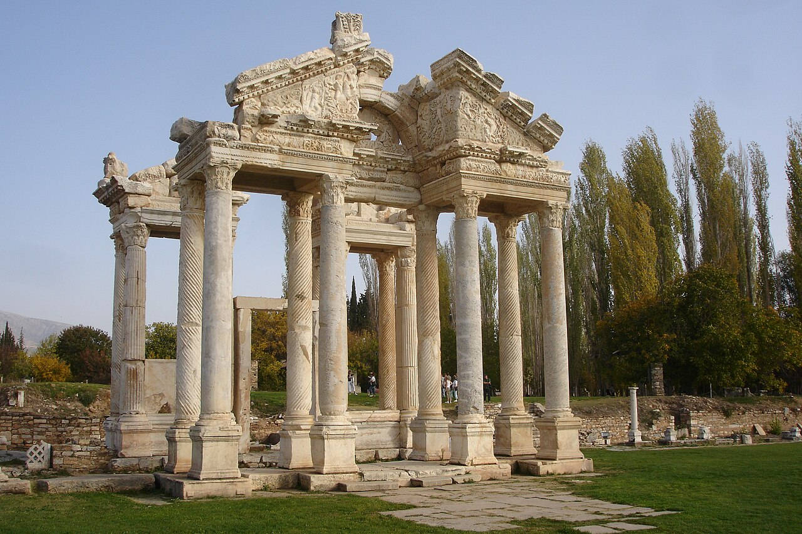
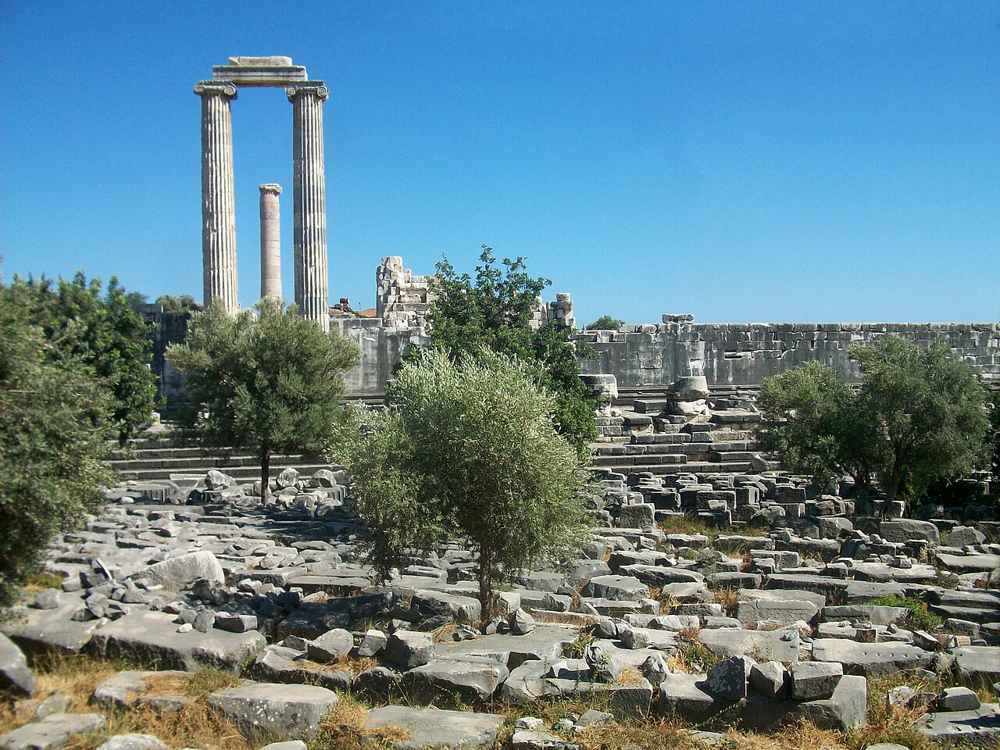

  

# 📍 Aydin - Sefer Öncesi Menzil Dosyası

## 📜 Seyyahın Beklentisi
> "Gökyüzünün altındaki en güzel yeryüzü; bereketli Menderes Ovası ve antik mermerlerin zarafeti. Henüz adımlanmamış her yol, içinde koca bir hikaye saklar."

### 🌍 Şehrin Dokusu ve Tarihsel Arka Planı
Herodot'un "Gökyüzünün altındaki en güzel yeryüzü" sözüyle ölümsüzleştirdiği Aydın; Büyük Menderes Nehri'nin bereketli alüvyonları üzerinde yükselen, İyonya ve Karya uygarlıklarının en parlak bilim, felsefe ve sanat merkezlerini barındıran eşsiz bir Ege şehridir. Bilimin ve doğa felsefesinin öncüleri Thales, Anaksimandros ve Anaksimenes'in şehri Milet; heykeltıraşlık ekolüyle UNESCO Dünya Mirası Listesi'ne giren Aphrodisias; kehanet merkezi Didim Apollon Tapınağı; planlı kent mimarisinin ilk örneği Priene; Tralleis ve Nysa antik kentleri hep bu topraklardadır. Türk-İslam döneminde ise Aydınoğulları Beyliği'nin ilim ve gaza geleneğiyle yoğrulan şehir, zeytin ve incir ağaçlarının gölgesinde sükûnetle yaşamaya devam etmektedir.

### 💬 Şehir Hakkında Edebi ve Tarihi Alıntılar
> "Aydın ve çevresi, benim bildiğim kadarıyla gökyüzünün altındaki en güzel yeryüzüdür; havası mutedil, toprağı her türlü meyveye cömerttir." — Herodot
>
> "Dağlarından yağ, ovalarından bal akar; zeytini şifa, inciri bereket, efesi yiğitliktir." — Ege Halk Deyişi
>
> "Milet'in taşlarında insan aklının ilk kez evrene 'neden?' diye sorduğu o büyük uyanışın yankısı durur." — Anadolu Düşünce Tarihi Notları

### 🕌 Manevi Mimarlar ve Tarihî Şahsiyetler
- **Aydınoğlu Mehmed Bey ve Gazi Umur Bey:** 14. yüzyılda Batı Anadolu'da ilmi, ticareti ve denizciliği himaye eden, şehre adını veren Aydınoğulları Beyliği'nin kurucu ve kahraman beyleri.
- **Üveys Paşa ve Cihanoğlu Ailesi:** 16.–18. yüzyıllarda Aydın ve Koçarlı'da zarif külliyeler, medreseler, kütüphaneler ve hanlar inşa ederek bölgenin mimari hafızasını zenginleştiren Osmanlı banileri.
- **Yörük Ali Efe ve Çete Emir Ayşe:** Millî Mücadele yıllarında Malgaç Baskını ile Aydın cephesinde işgale karşı destansı bir direniş sergileyen Ege efeleri.
- **Thales, Anaksimandros ve Anaksimenes (Milet Okulu):** Milet topraklarında yetişerek matematik, astronomi ve doğa felsefesinin temellerini atan ilk filozoflar.
- **Adnan Menderes:** Aydın'ın Çakırbeyli köyünden çıkarak Türkiye'nin çok partili demokrasi tarihine damga vuran devlet adamı.

### 🍽️ Planlanan Yöresel Lezzet Durakları
Zeytinyağlı Ege mutfağının en saf ve bereketli örneklerini sunan Aydın'da hedeflenen lezzetler:
- **Ana Yemekler ve Otlar:** Odun ateşinde pişen meşhur **Çine Köftesi**, **Yuvarlama**, **Paşa Böreği**, **Zeytinyağlı Börülce**, **Şevketi Bostan**, **Kırlı Kızartması** ve **Keşkek**.
- **Tatlılar ve Meyveler:** Coğrafi işaretli **Aydın İnciri**, tahin ve cevizle taçlanan çıtır **Aydın Kabak Tatlısı**, **İncir Uyutması** ve **Pelvize**.
- **Çay & Tefekkür Molası:** Tarihi Zincirlihan avlusunda veya Dilek Yarımadası'nın çam gölgelerinde, ardından Bafa Gölü kıyısında gün batımı eşliğinde çay.

### 💻 Planlanan Yarı Göçebe Mesaisi (İlim Tahsili & Kütüphane)
- **Hedef Kütüphane:** *Aydın İl Halk Kütüphanesi* — Şehir merkezinde, üniversite ve kent hayatının kesiştiği ferah okuma salonlarıyla gündüz yazılım geliştirme ve ders çalışmaya son derece elverişli bir durak.
- **Konaklama Planı:** GSB Seyahatsever projesi kapsamında Aydın merkezdeki KYK yurtlarında 5 gün boyunca ücretsiz konaklayarak bütçe dostu bir Ege seferi planlanmaktadır.

### 🧭 Planlanan 5 Günlük Menzil Rotası
- **1. Gün – Aydın Merkez, Tralleis ve Zincirlihan:** Sabah Aydın İl Halk Kütüphanesi'nde ilk mesai; öğleden sonra Tralleis Antik Kenti (Üç Gözler), Aydın Arkeoloji Müzesi, Süleyman Bey ve Ramazan Paşa camileri ile Tarihi Zincirlihan'da akşam çayı.
- **2. Gün – UNESCO Harikası Aphrodisias ve Karacasu:** Sabah erken yola çıkarak Karacasu'da çömlek atölyelerini ziyaret; ardından stadyumu, Tetrapylon'u ve Ara Güler'in objektifiyle dünyaya tanıttığı Aphrodisias Antik Kenti ve Müzesi.
- **3. Gün – Milet, Priene ve Didim (İyonya Üçgeni):** Felsefenin beşiği Milet Antik Kenti ve zarif İlyas Bey Camii, dağ yamacındaki Priene Antik Kenti ve dev sütunlarıyla Didim Apollon Tapınağı; dönüşte Bafa Gölü'nde gün batımı.
- **4. Gün – Kuşadası, Güvercinada ve Dilek Yarımadası:** Sabah kütüphane mesaisi sonrası Kuşadası Güvercinada Kalesi, Öküz Mehmed Paşa Kervansarayı ve Dilek Yarımadası Büyük Menderes Deltası Millî Parkı'nda doğa yürüyüşü.
- **5. Gün – Nysa, Sultanhisar, Yörük Ali Efe ve Veda:** Antik kütüphanesiyle ünlü Nysa Antik Kenti, Yenipazar'da Yörük Ali Efe Evi Müzesi ve pidesi; akşam Çine Köftesi ve incir eşliğinde Menderes Ovası'na veda.

### ✨ Keşfedilecek Duraklar ve Landmarks
- [ ] **Aphrodisias Antik Kenti & Müzesi**
- [ ] **Didim Apollon Tapınağı**
- [ ] **Milet Antik Kenti & İlyas Bey Camii**
- [ ] **Priene Antik Kenti**
- [ ] **Güvercinada Kalesi & Dilek Yarımadası Millî Parkı**
- [ ] **Tralleis, Nysa & Tarihi Zincirlihan**

### 📸 Menzil Fotoğraf Galerisi
<table>
  <tr>
    <td align="center" width="50%">
       
      <i>Aphrodisias'ın mermer zarafeti ve bereketli Menderes ufku</i>
    </td>
    <td align="center" width="50%">
       
      <i>Milet'ten Güvercinada'ya uzanan kadim Ege hikâyesi</i>
    </td>
  </tr>
</table>

---
*Durum: Henüz adımlanmamış menzil — Sefer öncesi araştırma ve rota planlaması tamamlanmıştır. Gelecek rüzgârlarla yollarımızın kesişmesi dileğiyle...*
