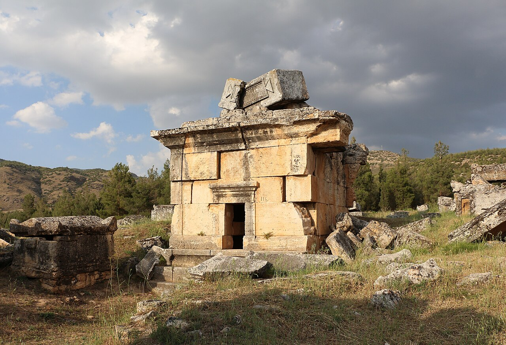

  

# 📍 Denizli - Seyahat ve Tefekkür Notları

## 📜 Şehrin Ruhu
> "Pamukkale'nin beyaz travertenleriyle doğanın ve tarihin beyaz bir rüya gibi birleştiği şehir."

### 🌍 Şehrin Dokusu ve Tarihsel Arka Planı
Hierapolis ve Laodikeia antik kentlerine ev sahipliği yapan Denizli, tekstil geleneğini antik dönemden bugüne taşıyan, bereketli topraklara sahip bir Ege durağıdır. Büyük Menderes ve Çürüksu (Lykos) vadilerinin kesişiminde kurulan bu kadim coğrafya; Frig, Lidya, Hellenistik, Roma, Bizans, Selçuklu ve Osmanlı katmanlarını bir arada barındırır. Kaleiçi Çarşısı'ndan Buldan dokumalarına, Akhan Kervansarayı'ndan şifalı termal sularına kadar Denizli, hem ticaretin hem de şifanın tarih boyunca aktığı müstesna bir Anadolu menzilidir.

### 💬 Şehir Hakkında Edebi ve Tarihi Alıntılar
> "Denizli, suyun taşa can verdiği, beyaz travertenlerin göğe gülümsediği yerdir." — Evliya Çelebi
>
> "Hierapolis, şifalı suların ve beyaz pamuk yığınlarının sinesinde uyuyan bir tarihtir." — Strabon
>
> "Lykos Vadisi'nin ak suları, yünü de ruhu da arındıran bir bereket taşır." — Anadolu Seyahat Notları

### 🕌 Manevi Mimarlar ve Tarihî Şahsiyetler
- **Server Gazi:** Denizli'nin fethi sırasında şehit düşen ve bugün şehre hâkim tepede türbesiyle manevi bir bekçi gibi duran Selçuklu komutanı ve gönül eri.
- **Mehmed Gazi:** Anadolu Selçukluları döneminde bölgenin Türk-İslam yurdu olmasında öncülük eden, Akhan ve çevresindeki fetih ruhunun simge isimlerinden.
- **Fatma Yıldız Hanım ve Denizli Ahi Geleneği:** Denizli'nin köklü dokumacılık ve debbağlık esnaf kültürünü asırlar boyu ahlak ve kardeşlik ekseninde yaşatan Ahi teşkilatı mirası.
- **Müftü Ahmet Hulusi Efendi:** 15 Mayıs 1919'da İzmir'in işgalinin hemen ardından Denizli'de Millî Mücadele fetvasını vererek Ege'de direniş ateşini yakan âlim ve vatansever.
- **Özay Gönlüm:** Yaren bağlaması ve Ege türküleriyle Denizli'nin sözlü hafızasını, mizahını ve insan sıcaklığını bütün Türkiye'ye taşıyan halk ozanı.

### 🕊️ Gezginin Not Defterinden (Manevi Boyut ve Tefekkür)
Hierapolis antik havuzunun şifalı sularında, doğanın yaratılış harikalarını ve asırlar boyu süregelen şifa arayışını tefekkür edersiniz.

### 🍽️ Yöresel Lezzet Tavsiyeleri
- **Yerel Tatlar ve İkramlar:** Şehrin yerel esnaf lokantalarında ve pazar yerlerinde deneyimlenen bütçe dostu, kültürel dokuyu yansıtan eşsiz lezzetler.
  - *Öne Çıkanlar:* Sakız ağacı odununda ağır ağır pişen meşhur **Denizli Kebabı** (Kaleiçi Çarşısı'nda), efsanevi **Zafer Gazozu**, çıtır **Tavas Pidesi**, **Çameli Fasulyesi**, **Yen Böreği** ve **Kuyu Tandırı**.
- **Tefekkür Eşliğinde Çay/Kahve:** Şehrin tarihi kıraathanelerinde veya doğa manzaralı tepelerinde yudumlanan demli çaylar; özellikle Bağbaşı Yaylası ve Bayramyeri çevresindeki tarihi çay ocakları.

### ⛺ Konaklama ve Bütçe Stratejisi
- **Sıfır Konaklama Maliyeti (Modern Kervansaraylar):** GSB Seyahatsever projesi kapsamında şehirdeki KYK yurtlarında 5 gün boyunca ücretsiz konaklanarak bütçe korunmuştur.
- **Ulaşım ve Lojistik Planlama:** Rota optimizasyonuna uyularak komşu iller sırayla takip edilmiş, böylece hem yol maliyeti minimuma indirilmiş hem de karbon ayak izi azaltılmıştır.

### 💻 Yarı Göçebe Mesaisi (İlim Tahsili & Kütüphane)
- **Kütüphane Rutini:** Gündüz vakitlerinde şehrin İl Halk Kütüphanesinde zaman geçirilerek bilgisayar başında yazılım geliştirme ve ders çalışma faaliyetleri sürdürülmüştür.
  * *Seyyahın Kütüphane Notu:* Denizli İl Halk Kütüphanesi - Sessiz, çalışma disiplinine uygun, internet imkanı sunan verimli bir ilim yuvası.
- **Süre ve Uyum:** Kütüphane mesaisi bitiminde şehrin ruhuna karışmak üzere yollara düşülmüş, 5 günlük menzil süresiyle şehir sindirilerek keşfedilmiştir.

### 🧭 5 Günlük Menzil Rotası
- **1. Gün – Şehir Merkezi, Kaleiçi ve Kütüphane Uyumu:** Sabah Denizli İl Halk Kütüphanesi'nde ilk mesai; öğleden sonra Tarihi Kaleiçi Çarşısı, Bayramyeri, Denizli Horozu Heykeli, Atatürk ve Etnografya Müzesi yürüyüşü ve akşam Kaleiçi'nde Denizli Kebabı.
- **2. Gün – Beyaz Cennet Pamukkale ve Hierapolis:** Sabah erken saatte Pamukkale Travertenleri'nde gün ışığı yürüyüşü, Hierapolis Antik Tiyatrosu, Antik Havuz (Kleopatra Havuzu), Nekropol ve Karahayıt'ın kızıl şifalı suları.
- **3. Gün – Lykos Vadisi'nin İncisi Laodikeia ve Akhan:** Sabah kütüphane mesaisi; öğleden sonra sütunlu caddeleriyle büyüleyen Laodikeia Antik Kenti ve 13. yüzyıl Selçuklu yadigârı Akhan Kervansarayı ziyareti.
- **4. Gün – Yeraltı Pamukkale ve Yayla Serinliği:** Honaz istikametinde Kaklık Mağarası'nın yeraltı travertenleri; ardından teleferikle Bağbaşı Yaylası'na çıkarak çam kokuları eşliğinde tefekkür ve okuma vakti.
- **5. Gün – Buldan Dokumaları, Server Gazi ve Veda:** Tarihi Buldan evleri ve el dokuması bez çarşısı turu; dönüşte Server Gazi Türbesi ziyareti ve şehre hâkim tepeden Lykos Vadisi'ne veda.

### ✨ Keşfedilesi Duraklar ve Landmarks
Bu şehrin havasını solumak, ruhuna dokunmak için mutlaka adımlanması gereken köşe taşları:
- [ ] **Pamukkale Travertenleri**
- [ ] **Hierapolis Antik Kenti**
- [ ] **Laodikeia Antik Kenti**
- [ ] **Kaklık Mağarası**
- [ ] **Akhan Kervansarayı & Tarihi Kaleiçi Çarşısı**
- [ ] **Bağbaşı Yaylası & Teleferik**

### 📸 Menzil Fotoğraf Galerisi
<table>
  <tr>
    <td align="center" width="50%">
       
      <i>Pamukkale'nin beyaz traverten terasları ve Hierapolis ufku</i>
    </td>
    <td align="center" width="50%">
       
      <i>Lykos Vadisi'nde tarih, şifalı sular ve Ege sükûneti</i>
    </td>
  </tr>
</table>

---
*Bu il bizzat deneyimlenmiş, yolları aşındırılmış ve seyahatnameye sevgiyle işlenmiştir.* ✅
