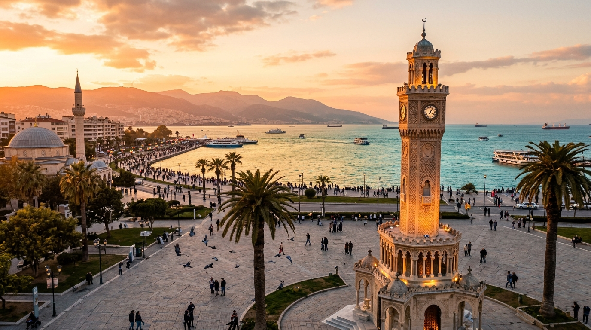
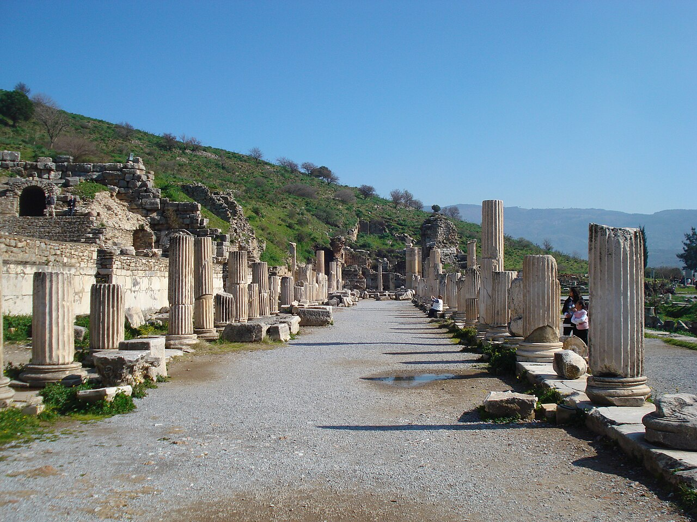

  

# 📍 Izmir - Seyahat ve Tefekkür Notları

## 📜 Şehrin Ruhu
> "Ege'nin incisi İzmir, körfezin serin imbat rüzgarıyla yıkanan, hoşgörünün ve özgürlüğün simgesi kadim kent."

### 🌍 Şehrin Dokusu ve Tarihsel Arka Planı
Smyrna adıyla 8500 yıllık bir geçmişe sahip olan İzmir, İpekyolu'nun batıya açılan en büyük liman kenti olmuş, kozmopolit yapısıyla tarih boyunca ticaretin ve kültürün kalbi sayılmıştır. Yeşilova Höyüğü'nden Bayraklı (Eski Smyrna) kalıntılarına, Kadifekale'den Agora'ya, Efes ve Bergama gibi UNESCO Dünya Mirası harikalarından Kemeraltı'nın asırlık hanlarına uzanan bu kıyı medeniyeti; denizle bilginin, ticaret ahlakıyla sanatın buluşma noktasıdır.

### 💬 Şehir Hakkında Edebi ve Tarihi Alıntılar
> "İzmir, Akdeniz'in incisidir, suyun ve mermerin rüya gördüğü yerdir." — Victor Hugo
>
> "Güzel İzmir! Körfezinin mavi sularında tarihin ve güneşin seviştiği şehir." — Halikarnas Balıkçısı
>
> "İzmir, her sokağında denizin kokusunu ve özgürlüğün nefesini taşıyan şehirdir." — Atilla İlhan

### 🕌 Manevi Mimarlar ve Tarihî Şahsiyetler
- **Çaka Bey:** 1081'de İzmir'i fethederek ilk Türk donanmasını kuran ve Ege'de Türk denizcilik tarihini başlatan öncü bey.
- **Umur Bey (Aydınoğlu Gazi Umur Bey):** İzmir ve çevresinde deniz gazalarının ve ilim himayesinin simgesi, Düstûrnâme'nin kahramanı.
- **Kızlarağası Hacı Beşir Ağa ve Hisar Camii Banileri:** Kemeraltı'nın ticari ve manevi merkezini hanlar, şadırvanlar ve camilerle nakış gibi ören Osmanlı vakıf medeniyeti temsilcileri.
- **Hasan Tahsin (Osman Nevres):** 15 Mayıs 1919'da Konak'ta işgale karşı ilk kurşunu sıkarak Millî Mücadele'nin kıvılcımını ateşleyen gazeteci ve şehit.
- **Homeros ve Herakleitos:** Meles Çayı kıyısında destanlar fısıldayan Homeros ile Efes'te "Aynı nehirde iki kez yıkanılmaz" diyerek zamanın akışını tefekkür eden filozof Herakleitos.

### 🕊️ Gezginin Not Defterinden (Manevi Boyut ve Tefekkür)
Kordon boyunda batan güneşi izlerken, Akdeniz uygarlıklarının ortak ruhunu ve zamanın dalgalar halinde akışını tefekkür edersiniz. Efes'in mermer caddelerinde yürürken insanlığın geçici görkemini idrak edersiniz.

### 🍽️ Yöresel Lezzet Tavsiyeleri
- **Yerel Tatlar ve İkramlar:** Şehrin yerel esnaf lokantalarında ve pazar yerlerinde deneyimlenen bütçe dostu, kültürel dokuyu yansıtan eşsiz lezzetler.
  - *Öne Çıkanlar:* Sabahın erken saatlerinde sıcak **İzmir Boyozu ve Haşlanmış Yumurta**, **Çeşme Kumrusu**, **İzmir Tulum Peyniri**, Kemeraltı'nda **Şambali**, **Söğüş**, **İzmir Köfte**, **İzmir Bombası** ve Ege otlarıyla hazırlanan zeytinyağlılar.
- **Tefekkür Eşliğinde Çay/Kahve:** Şehrin tarihi kıraathanelerinde veya doğa manzaralı tepelerinde yudumlanan demli çaylar; özellikle Kızlarağası Hanı avlusunda fincanda pişen dibek kahvesi ve Tarihi Asansör terasında gün batımı çayı.

### ⛺ Konaklama ve Bütçe Stratejisi
- **Sıfır Konaklama Maliyeti (Modern Kervansaraylar):** GSB Seyahatsever projesi kapsamında şehirdeki KYK yurtlarında 5 gün boyunca ücretsiz konaklanarak bütçe korunmuştur.
- **Ulaşım ve Lojistik Planlama:** Rota optimizasyonuna uyularak komşu iller sırayla takip edilmiş, böylece hem yol maliyeti minimuma indirilmiş hem de karbon ayak izi azaltılmıştır. Şehir içinde İZBAN, metro ve körfez vapurları ekonomik ve keyifli bir ulaşım ağı sunmuştur.

### 💻 Yarı Göçebe Mesaisi (İlim Tahsili & Kütüphane)
- **Kütüphane Rutini:** Gündüz vakitlerinde şehrin İl Halk Kütüphanesinde zaman geçirilerek bilgisayar başında yazılım geliştirme ve ders çalışma faaliyetleri sürdürülmüştür.
  * *Seyyahın Kütüphane Notu:* Izmir İl Halk Kütüphanesi - Sessiz, çalışma disiplinine uygun, internet imkanı sunan verimli bir ilim yuvası. (Ayrıca neoklasik mimarisiyle İzmir Milli Kütüphane ve Atatürk İl Halk Kütüphanesi de ayrı bir ilham kaynağıdır.)
- **Süre ve Uyum:** Kütüphane mesaisi bitiminde şehrin ruhuna karışmak üzere yollara düşülmüş, 5 günlük menzil süresiyle şehir sindirilerek keşfedilmiştir.

### 🧭 5 Günlük Menzil Rotası
- **1. Gün – Konak, Kemeraltı ve Körfez Selamı:** Sabah kütüphane mesaisi; öğleden sonra Tarihi Saat Kulesi, Yalı Camii, Kemeraltı Çarşısı, Hisar Camii, Kızlarağası Hanı'nda kahve molası ve akşam Kordon Boyu'nda gün batımı.
- **2. Gün – Kadim Smyrna, Agora ve Tarihi Asansör:** Smyrna Agorası ve Kadifekale'den körfez panoraması; ardından Dario Moreno Sokağı, Tarihi Asansör ve vapurla Karşıyaka sahil yürüyüşü.
- **3. Gün – Efes, Celsus Kütüphanesi ve Şirince:** İZBAN ile Selçuk'a yolculuk; Efes Antik Kenti'nde Celsus Kütüphanesi ve Büyük Tiyatro tefekkürü, İsa Bey Camii ve akşamüstü zeytinlikler arasındaki Şirince köyü.
- **4. Gün – Bergama Akropolü ve Asklepion:** Sabah erken yola çıkarak parşömenin doğduğu Pergamon (Bergama) Akropolü, dünyanın ilk şifahanelerinden Asklepion ve Kızıl Avlu ziyareti.
- **5. Gün – Urla, Klazomenai ve Veda İmbatı:** Sabah kütüphane notlarının toparlanması; öğleden sonra Urla Sanat Sokağı, antik zeytinyağı işliği Klazomenai ve körfez vapurunda İzmir'e veda.

### ✨ Keşfedilesi Duraklar ve Landmarks
Bu şehrin havasını solumak, ruhuna dokunmak için mutlaka adımlanması gereken köşe taşları:
- [ ] **Tarihi Saat Kulesi**
- [ ] **Efes Antik Kenti**
- [ ] **Kemeraltı Çarşısı**
- [ ] **Tarihi Asansör**
- [ ] **Kadifekale & Smyrna Agorası**
- [ ] **Bergama (Pergamon) & Şirince**

### 📸 Menzil Fotoğraf Galerisi
<table>
  <tr>
    <td align="center" width="50%">
       
      <i>İmbat rüzgârının yıkadığı İzmir Körfezi ve simge silüeti</i>
    </td>
    <td align="center" width="50%">
       
      <i>Mermer caddelerden Kemeraltı sokaklarına uzanan 8500 yıllık hafıza</i>
    </td>
  </tr>
</table>

---
*Bu il bizzat deneyimlenmiş, yolları aşındırılmış ve seyahatnameye sevgiyle işlenmiştir.* ✅
