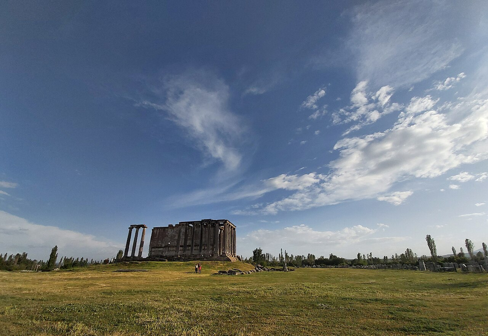
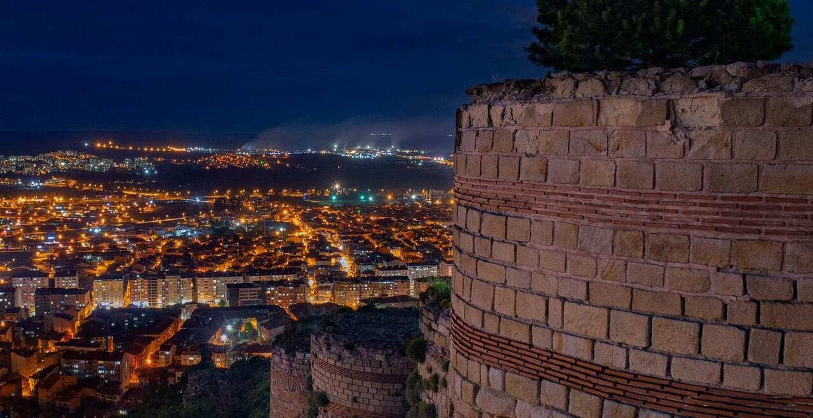

  

# 📍 Kutahya - Sefer Öncesi Menzil Dosyası

## 📜 Seyyahın Beklentisi
> "Çininin nakış nakış işlendiği sabır şehri, Germiyanoğulları'nın yadigarı ve Mevlevi ocağı. Henüz adımlanmamış her yol, içinde koca bir hikaye saklar."

### 🌍 Şehrin Dokusu ve Tarihsel Arka Planı
Antik çağda "Kotiaeion" adıyla anılan Kütahya; Frig, Roma, Bizans, Anadolu Selçuklu, Germiyanoğulları ve Osmanlı medeniyetlerinin izlerini taşıyan, sanatla sükûnetin harmanlandığı kadim bir İç Ege şehridir. Çavdarhisar'da bulunan ve dünyanın ilk ticaret borsasını (Macellum) barındıran Aizanoi Antik Kenti ile antik çağın zarafetini; Germiyanoğulları'nın başkentliğini yaptığı asırlardan kalan Vacidiye Medresesi, Dönenler Camii (Mevlevihane) ve Ulu Cami ile Türk-İslam sanatının derinliğini yaşatır. Evliya Çelebi'nin ata yurdu, Osmanlı şehzadelerinin sancak şehri ve UNESCO Yaratıcı Şehirler Ağı'nda "Zanaat ve Halk Sanatları" şehri olan Kütahya; toprağı ateşle, sabrı firuze ve kobalt mavisiyle buluşturan çini ustalarının diyarıdır.

### 💬 Şehir Hakkında Edebi ve Tarihi Alıntılar
> "Kütahya'nın suyu ve havası latif, halkı garip dostu, çinisi ve kâsesi cihanda misilsizdir." — Evliya Çelebi, Seyahatnâme
>
> "Çini, toprağın duasıdır; sabırla yoğrulur, fırında sınanır ve asırlarca solmayan bir maviye dönüşür." — Kütahya Zanaat Kültürü Notları
>
> "Germiyan sokaklarında yürürken ahşap cumbaların gölgesinde bir şehzade sancağının vakarını hissedersiniz." — Anadolu Seyahat Defteri

### 🕌 Manevi Mimarlar ve Tarihî Şahsiyetler
- **Evliya Çelebi:** Büyük Türk seyyahının baba ocağı Kütahya'dır; Seyahatnâme'de şehre duyduğu derin sevgi ve gurur her satırda hissedilir.
- **Ergün Çelebi:** Hz. Mevlânâ'nın torunlarından, Kütahya Mevlevihanesi'ni (Dönenler Camii) kuran ve şehrin tasavvuf atmosferini besleyen büyük veli.
- **Germiyanoğlu II. Yakup Bey:** Türkçenin ve ilmin hamisi; kurduğu külliye (bugünkü Çini Müzesi) ve vakıflarıyla Kütahya'ya kalıcı bir medeniyet mührü vuran bilge bey.
- **Şeyhî (Yusuf Sinan):** Germiyan sarayında yetişen, *Harnâme* ve *Hüsrev ü Şîrîn* eserleriyle Türk edebiyatına yön veren büyük divan şairi ve hekim.
- **Sıtkı Olçar ve Ahmet Yakupoğlu:** Kütahya çini sanatını dünyaya tanıtan UNESCO Yaşayan İnsan Hazinesi Sıtkı Olçar ile şehrin silüetini fırçasına ve neyine taşıyan hezarfen sanatçı Ahmet Yakupoğlu.
- **Lajos Kossuth:** 1850-1851 yıllarında Osmanlı'ya sığınan Macar özgürlük önderi; Kütahya'daki evi bugün Türk-Macar dostluğunun müzesidir.

### 🍽️ Planlanan Yöresel Lezzet Durakları
Anadolu'nun köklü ev mutfağını koruyan Kütahya'da tadılması planlanan lezzetler:
- **Ana Yemekler ve Hamur İşleri:** Çini kâselerde sunulan **Cimcik Aşı**, **Sini Mantısı**, ağır ateşte pişen **Kütahya Güveci**, **Sıkıcık Çorbası**, **Tirit**, **Ispanaklı Şibit** ve **Haşhaşlı Gözleme**.
- **Tatlılar:** **Hekim / Yufka Tatlısı**, **Tosunum** ve şerbetli yöresel **Sütlü İncir Tatlısı**.
- **Çay & Tefekkür Molası:** Tarihi Germiyan Sokağı'ndaki restore edilmiş konak avlularında ve Kütahya Kalesi'ndeki döner gazino/seyir terasında şehir manzaralı çay.

### 💻 Planlanan Yarı Göçebe Mesaisi (İlim Tahsili & Kütüphane)
- **Hedef Kütüphane:** *Kütahya Vahit Paşa İl Halk Kütüphanesi* — 1811'de kurulan tarihi yazma eserler geleneğinin devamı olan, huzurlu okuma salonları ve köklü ilim atmosferiyle odaklanmaya son derece uygun bir çalışma limanı.
- **Konaklama Planı:** GSB Seyahatsever kapsamında şehirdeki KYK yurtlarında 5 gün boyunca ücretsiz konaklayarak hem gündüz yazılım mesaisi hem de akşamüstü şehir keşfi dengesi kurulması hedeflenmektedir.

### 🧭 Planlanan 5 Günlük Menzil Rotası
- **1. Gün – Germiyan Sokağı, Çini Müzesi ve Mevlevihane:** Sabah Vahit Paşa İl Halk Kütüphanesi'nde çalışma; öğleden sonra Germiyan Sokağı'nın tarihi konakları, Çini Müzesi (Yakup Bey Külliyesi), Dönenler Camii (Mevlevihane) ve Ulu Cami ziyareti.
- **2. Gün – Aizanoi Antik Kenti (İkinci Efes):** Çavdarhisar'a yolculuk; Anadolu'nun en iyi korunmuş Zeus Tapınağı, dünyanın ilk borsası (Macellum), Roma köprüleri ve stadyum-tiyatro kompleksinde tarih yolculuğu.
- **3. Gün – Kütahya Kalesi, Kossuth Evi ve Çini Atölyeleri:** Sabah 72 burçlu Kütahya Kalesi'nden panoramik şehir seyri; ardından Macar Evi (Kossuth Müzesi), Kent Tarihi Müzesi, Çinili Cami ve geleneksel çini atölyelerinde ustalarla sohbet.
- **4. Gün – Domaniç, Hayme Ana ve Frigya Sınırı:** Sabah kütüphane mesaisi sonrası Osmanlı'nın kuruluş yurdu Domaniç'te Hayme Ana Türbesi ve kayın ormanları ya da Frig Vadisi'nin Kütahya ayağındaki kaya anıtları keşfi.
- **5. Gün – Dumlupınar Şehitliği, Yoncalı Termal ve Veda:** Dumlupınar Kurtuluş Savaşı Şehitliği'nde dua ve tarih bilinci; akşam Yoncalı kaplıcalarının şifalı sularında yorgunluk atarak çini diyarına veda.

### ✨ Keşfedilecek Duraklar ve Landmarks
- [ ] **Aizanoi Antik Kenti (Zeus Tapınağı & Macellum)**
- [ ] **Kütahya Kalesi**
- [ ] **Dönenler Camii (Kütahya Mevlevihanesi)**
- [ ] **Kütahya Çini Müzesi & Ulu Cami**
- [ ] **Tarihi Germiyan Sokağı & Kossuth (Macar) Evi**
- [ ] **Domaniç Hayme Ana Türbesi & Dumlupınar Şehitliği**

### 📸 Menzil Fotoğraf Galerisi
<table>
  <tr>
    <td align="center" width="50%">
       
      <i>Aizanoi Zeus Tapınağı'ndan Germiyan konaklarına uzanan kadim miras</i>
    </td>
    <td align="center" width="50%">
       
      <i>Firuze çinilerin sabırla nakşedildiği sanat ve sükûnet şehri</i>
    </td>
  </tr>
</table>

---
*Durum: Henüz adımlanmamış menzil — Sefer öncesi araştırma ve rota planlaması tamamlanmıştır. Gelecek rüzgârlarla yollarımızın kesişmesi dileğiyle...*
