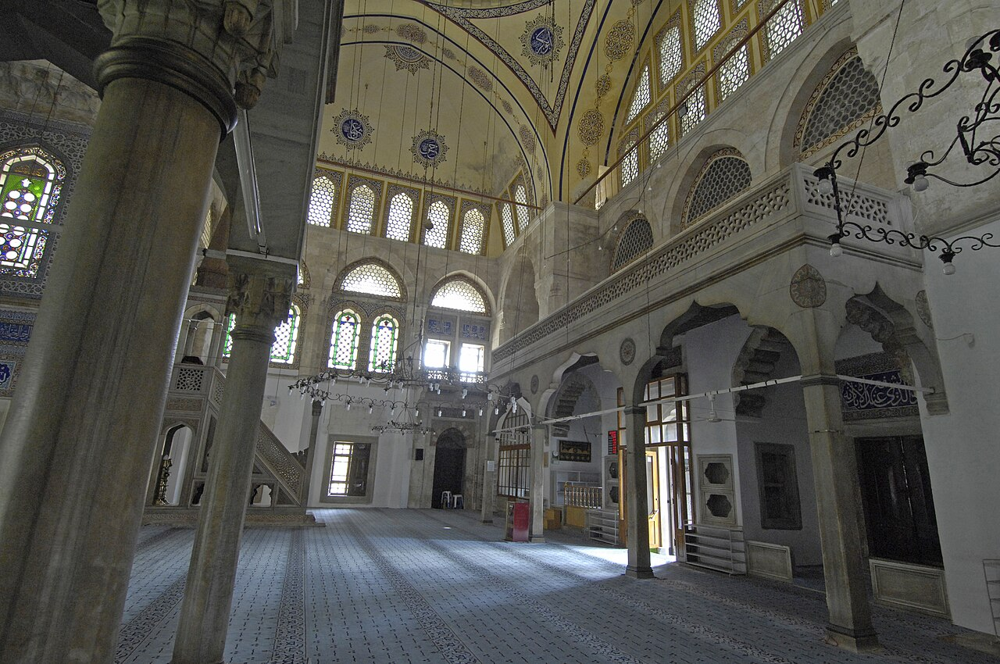
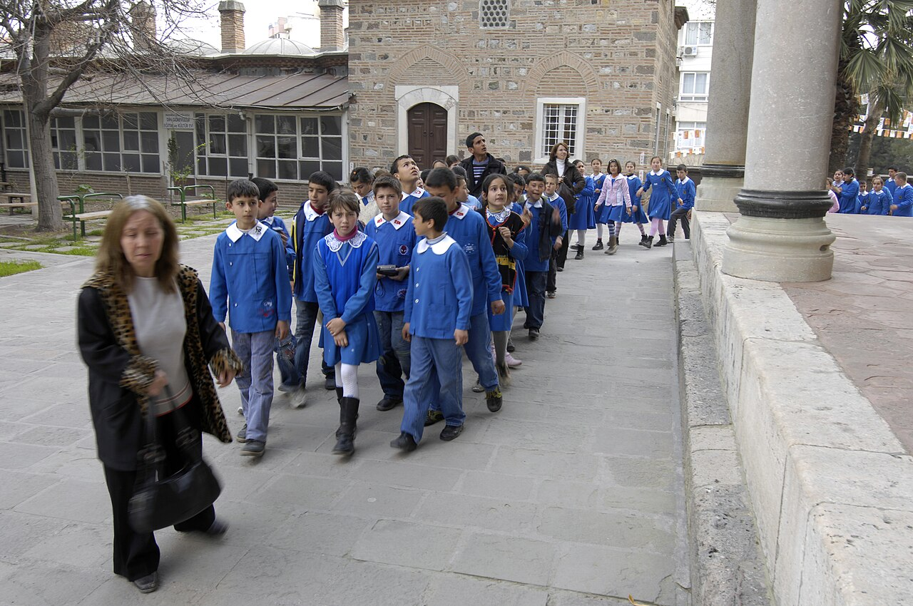

  

# 📍 Manisa - Sefer Öncesi Menzil Dosyası

## 📜 Seyyahın Beklentisi
> "Şehzadeler şehri; Mimar Sinan'ın Muradiye'si ve Spil Dağı'nın şifalı rüzgarları. Henüz adımlanmamış her yol, içinde koca bir hikaye saklar."

### 🌍 Şehrin Dokusu ve Tarihsel Arka Planı
Spil Dağı'nın heybetli eteklerine yaslanan ve bereketli Gediz Ovası'na bakan Manisa (antik Magnesia ad Sipylum), insanlık tarihinin en köklü devlet ve ticaret geleneklerine ev sahipliği yapar. Tarihte madeni parayı ilk kez basan Lidya Krallığı'nın başkenti Sardes, Kral Yolu'nun başlangıç noktası olarak bugün hâlâ görkemini korur. Saruhanoğulları Beyliği'nin ardından Osmanlı İmparatorluğu'nun en gözde "Şehzadeler Sancağı" olan Manisa'da Fatih Sultan Mehmed, Kanuni Sultan Süleyman, II. Selim, III. Murad ve III. Mehmed gibi cihan padişahları devlet tecrübesi kazanmıştır. Mimar Sinan'ın Ege'deki tek eseri olan Muradiye Camii, UNESCO Küresel Jeoparkı Kula Volkanik Jeoparkı, Aigai Antik Kenti ve asırlık Mesir Macunu geleneğiyle Manisa, hem imparatorluk vakarı hem de tabiat harikaları barındıran müstesna bir menzildir.

### 💬 Şehir Hakkında Edebi ve Tarihi Alıntılar
> "Manisa, Spil Dağı'nın şifalı rüzgârlarıyla yıkanan, şehzadelerin devlet terbiyesi aldığı bağlık bahçelik bir cennettir." — Evliya Çelebi, Seyahatnâme
>
> "Sardes'in altın taşıyan Paktolos sularında bir zamanlar dünyanın en zengin krallığı yükselirdi; geriye zamanın öğrettiği o büyük sükûnet kaldı." — Herodot'tan Mülhem
>
> "Manisa lâlesi Spil'in kayalıklarında baharı müjdelerken, şehrin her taşında bir şehzadenin düşü uyanır." — Ege Kültür Notları

### 🕌 Manevi Mimarlar ve Tarihî Şahsiyetler
- **Saruhan Bey:** 14. yüzyılda Manisa ve çevresini fethederek Saruhanoğulları Beyliği'ni kuran ve bölgeyi ilimle imar eden öncü bey.
- **Merkez Efendi (Musa Muslihiddin):** Kanuni'nin annesi Hafsa Sultan'ın şifası için 41 çeşit baharattan **Mesir Macunu**'nu terkip eden, Sultan Külliyesi Darüşşifası'nın başhekimi ve büyük Halvetî mutasavvıfı.
- **Mimar Sinan:** Manisa'daki Muradiye Camii ve Külliyesi'nin tasarımını yaparak Ege topraklarına eşsiz bir mimari imza bırakan Koca Sinan.
- **Şehzade Mehmed (Fatih) ve Şehzade Süleyman (Kanuni):** Manisa Sarayı'nda ilim, sanat ve devlet yönetimi tahsil ederek cihan tarihine yön veren Osmanlı sultanları.
- **Ahmet Bedevi (Manisa Tarzanı):** Millî Mücadele'nin ardından Spil Dağı'nı ve Manisa'yı binlerce ağaçla yeşerten, sade ve doğa dostu yaşamıyla Türkiye'nin ilk çevre gönüllüsü.

### 🍽️ Planlanan Yöresel Lezzet Durakları
Osmanlı saray mutfağı ile Ege'nin bereketli bağ kültürünü birleştiren Manisa'da hedeflenen lezzetler:
- **Ana Yemekler:** Pide üzerinde sumaklı soğan ve tereyağıyla sunulan tescilli **Manisa Kebabı**, toprak kapta ağır pişen **Kula Güveci**, **Akhisar Köftesi**, **Odun Köfte**, **Börülce Tarator** ve **Sinkonta**.
- **Tatlılar ve Şifalı İkramlar:** 41 çeşit baharatın şifa terkibi **Mesir Macunu**, **Höşmerim**, **Sultaniye Üzümü**, **Şevketi Bostan** ve **Alaşehir Kapaması**.
- **Çay & Tefekkür Molası:** Tarihi Yeni Han (Kurşunlu Han) avlusunda veya Spil Dağı'nın çam kokulu seyir noktalarında, Kula'nın tarihi sokaklarında çay molası.

### 💻 Planlanan Yarı Göçebe Mesaisi (İlim Tahsili & Kütüphane)
- **Hedef Kütüphane:** *Manisa İl Halk Kütüphanesi* — Merkezi konumu, ferah çalışma salonları ve dingin atmosferiyle gündüz yazılım geliştirme ve okuma mesaileri için son derece verimli bir ilim durağı. (Ayrıca tarihi Muradiye Yazma Eser Kütüphanesi de mutlaka ziyaret edilmeli.)
- **Konaklama Planı:** GSB Seyahatsever programı kapsamında Manisa'daki KYK yurtlarında 5 gün boyunca ücretsiz konaklayarak komşu İzmir-Uşak-Kütahya hattında bütçe dostu rota akışı planlanmaktadır.

### 🧭 Planlanan 5 Günlük Menzil Rotası
- **1. Gün – Şehzadeler Merkezi, Muradiye ve Sultan Külliyesi:** Sabah Manisa İl Halk Kütüphanesi'nde çalışma; öğleden sonra Mimar Sinan eseri Muradiye Camii, Sultan Camii ve Hafsa Sultan Şifahanesi (Tıp Tarihi Müzesi), Ulu Cami, Yeni Han ve Ağlayan Kaya (Niobe).
- **2. Gün – Spil Dağı Millî Parkı ve Yılkı Atları:** Sabah serinliğinde Spil Dağı'na çıkış; endemik Manisa Lâlesi rotası, Sülüklü Göl, yılkı atları ve Gediz Ovası'na karşı uzun bir tefekkür yürüyüşü.
- **3. Gün – Lidya Başkenti Sardes ve Kurşunlu Kaplıcaları:** Salihli istikametinde Sardes Antik Kenti (Artemis Tapınağı, Gymnasium ve Antik Sinagog), Kral Yolu kalıntıları ve Bintepeler Lidya Tümülüsleri ziyareti.
- **4. Gün – UNESCO Jeoparkı Kula ve Kuladokya:** Türkiye'nin ilk UNESCO Küresel Jeoparkı Kula Volkanik Jeoparkı, Kula Peribacaları (Kuladokya), tarihi Osmanlı Kula Evleri, Yunus Emre ve Tabduk Emre Türbesi ziyareti.
- **5. Gün – Aigai Antik Kenti veya Akhisar ve Veda:** Sabah kütüphane mesaisi; öğleden sonra Yuntdağı eteklerindeki Aigai Antik Kenti'nde yürüyüş ve akşam Manisa Kebabı eşliğinde Şehzadeler Şehri'ne veda.

### ✨ Keşfedilecek Duraklar ve Landmarks
- [ ] **Muradiye Camii & Külliyesi (Mimar Sinan)**
- [ ] **Sultan Camii & Hafsa Sultan Şifahanesi**
- [ ] **Spil Dağı Millî Parkı & Ağlayan Kaya (Niobe)**
- [ ] **Sardes Antik Kenti & Bintepeler Tümülüsleri**
- [ ] **Kula Volkanik Jeoparkı, Kuladokya & Tarihi Kula Evleri**
- [ ] **Manisa Mevlevihanesi & Aigai Antik Kenti**

### 📸 Menzil Fotoğraf Galerisi
<table>
  <tr>
    <td align="center" width="50%">
       
      <i>Spil Dağı'nın gölgesinde Şehzadeler Şehri Manisa ve Muradiye silüeti</i>
    </td>
    <td align="center" width="50%">
       
      <i>Sardes'in antik sütunlarından Kula'nın volkanik tarihine uzanan miras</i>
    </td>
  </tr>
</table>

---
*Durum: Henüz adımlanmamış menzil — Sefer öncesi araştırma ve rota planlaması tamamlanmıştır. Gelecek rüzgârlarla yollarımızın kesişmesi dileğiyle...*
