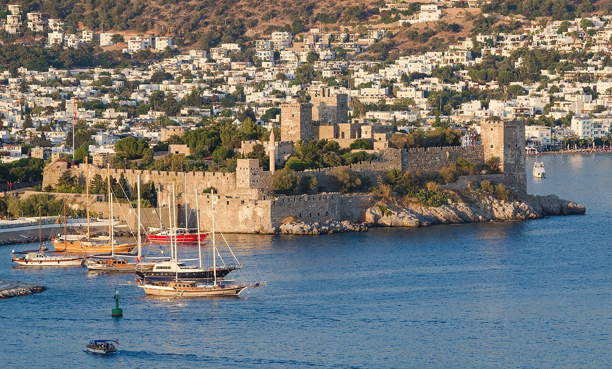
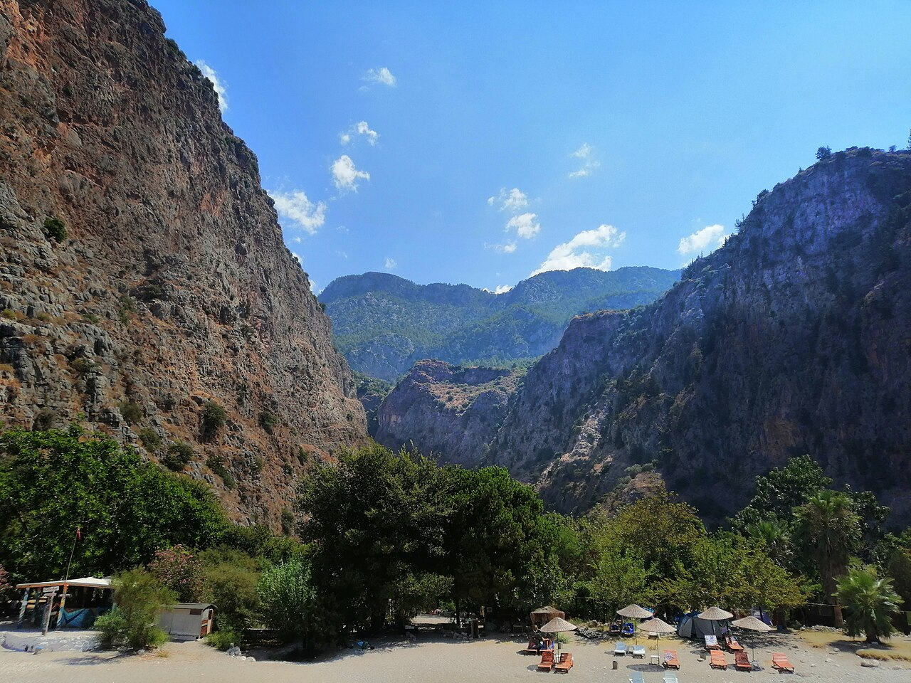

  

# 📍 Mugla - Seyahat ve Tefekkür Notları

## 📜 Şehrin Ruhu
> "Turkuaz koyları, yeşil çam ormanları ve beyaz Muğla evleriyle doğanın en cömert davrandığı yeryüzü cenneti."

### 🌍 Şehrin Dokusu ve Tarihsel Arka Planı
Karya medeniyetinden bugüne uzanan Muğla, tarihi evleri, yaylaları ve dünyanın en güzel kıyıleriyle tarih boyunca seyyahların uğrak noktası olmuştur. Karya ve Likya uygarlıklarının kesiştiği bu coğrafya; Halikarnassos'tan Knidos'a, Stratonikeia'dan Kaunos'a kadar yüzlerce antik kente, Menteşeoğulları Beyliği'nin zarif cami ve medreselerine, karakteristik bacalarıyla ünlü Arasta ve Saburhane konaklarına ev sahipliği yapar.

### 💬 Şehir Hakkında Edebi ve Tarihi Alıntılar
> "Muğla, dağların denizle kucaklaştığı, insanın doğayla uyum içinde yaşadığı masaldır." — Halikarnas Balıkçısı
>
> "Karya toprakları, güneşin ve denizin ebedi vatanıdır." — Heredot
>
> "Mavi yolculuk, sadece bir deniz gezisi değil; insanın kendi iç sularına doğru açıldığı bir sükûnet seferidir." — Azra Erhat

### 🕌 Manevi Mimarlar ve Tarihî Şahsiyetler
- **Menteşe Bey ve İlyas Bey:** Muğla ve Güneybatı Anadolu'yu Türk-İslam yurdu yapan, Balat ve Beçin'de mimari şaheserler bırakan Menteşeoğulları Beyliği'nin öncüleri.
- **Şahidi İbrahim Dede:** Muğla'nın manevi mimarı, 16. yüzyıl Mevlevi şeyhi, *Tuhfe-i Şâhidî* adlı meşhur manzum sözlüğün müellifi; türbesi Muğla merkezde gönüllere huzur vermektedir.
- **Herodot (Halikarnassoslu):** Tarih ilminin babası sayılan ve Bodrum topraklarında doğup dünyayı gezen ilk büyük seyyah-tarihçi.
- **Cevat Şakir Kabaağaçlı (Halikarnas Balıkçısı):** Sürgün geldiği Bodrum'u dünya edebiyatına armağan eden, Anadolu'nun deniz kültürünü ve mavi hümanizmasını kaleme alan yazar.
- **Nail Çakırhan:** Geleneksel Ula/Akyaka ahşap mimarisini modern yaşamla buluşturarak Ağa Han Mimarlık Ödülü'nü kazanan ve bölgenin mimari kimliğini koruyan usta.

### 🕊️ Gezginin Not Defterinden (Manevi Boyut ve Tefekkür)
Kayaköy'ün terk edilmiş hüzünlü sokaklarında zamanın geçiciliğini ve sessizliğin sesini tefekkür edersiniz. Saklıkent Kanyonu'nun serin sularında doğanın gücünü hissedersiniz.

### 🍽️ Yöresel Lezzet Tavsiyeleri
- **Yerel Tatlar ve İkramlar:** Şehrin yerel esnaf lokantalarında ve pazar yerlerinde deneyimlenen bütçe dostu, kültürel dokuyu yansıtan eşsiz lezzetler.
  - *Öne Çıkanlar:* **Çökertme Kebabı**, **Muğla Köftesi**, sabahın köründe toplanan çiçeklerle yapılan **Kabak Çiçeği Dolması**, **Zeytinyağlı Börülce**, **Büryan / Muğla Saraylısı** ve **Muğla Tarhanası**.
- **Tefekkür Eşliğinde Çay/Kahve:** Şehrin tarihi kıraathanelerinde veya doğa manzaralı tepelerinde yudumlanan demli çaylar; özellikle Arasta Çarşısı'ndaki tarihi Yağcılar Hanı ve Azmak Nehri kenarındaki gölgelik çay bahçeleri.

### ⛺ Konaklama ve Bütçe Stratejisi
- **Sıfır Konaklama Maliyeti (Modern Kervansaraylar):** GSB Seyahatsever projesi kapsamında şehirdeki KYK yurtlarında 5 gün boyunca ücretsiz konaklanarak bütçe korunmuştur.
- **Ulaşım ve Lojistik Planlama:** Rota optimizasyonuna uyularak komşu iller sırayla takip edilmiş, böylece hem yol maliyeti minimuma indirilmiş hem de karbon ayak izi azaltılmıştır.

### 💻 Yarı Göçebe Mesaisi (İlim Tahsili & Kütüphane)
- **Kütüphane Rutini:** Gündüz vakitlerinde şehrin İl Halk Kütüphanesinde zaman geçirilerek bilgisayar başında yazılım geliştirme ve ders çalışma faaliyetleri sürdürülmüştür.
  * *Seyyahın Kütüphane Notu:* Mugla İl Halk Kütüphanesi - Sessiz, çalışma disiplinine uygun, internet imkanı sunan verimli bir ilim yuvası.
- **Süre ve Uyum:** Kütüphane mesaisi bitiminde şehrin ruhuna karışmak üzere yollara düşülmüş, 5 günlük menzil süresiyle şehir sindirilerek keşfedilmiştir.

### 🧭 5 Günlük Menzil Rotası
- **1. Gün – Menteşe, Saburhane ve Şahidi Dede:** Sabah Muğla İl Halk Kütüphanesi'nde çalışma; öğleden sonra Tarihi Muğla Evleri (Saburhane), Arasta Çarşısı, Kurşunlu Camii, Şahidi İbrahim Dede Türbesi ve Karabağlar Yaylası'nda serin akşam.
- **2. Gün – Akyaka, Azmak ve Gökova Körfezi:** Çam ormanları içinden Akyaka'ya iniş; buz gibi Azmak Nehri kıyısında yürüyüş, Nail Çakırhan mimarisi incelemesi ve Sedir Adası / Gökova seyri.
- **3. Gün – Dalyan, Kaunos ve İztuzu:** Sazlıklar arasından geçerek Kaunos Kaya Mezarları ve Antik Kenti'ne yolculuk, ardından caretta carettaların yuvası İztuzu Plajı'nda gün batımı tefekkürü.
- **4. Gün – Fethiye, Kayaköy ve Saklıkent:** Sabah erken saatte Kayaköy Hayalet Şehir'in sessiz sokakları, Ölüdeniz ve Babadağ manzarası; öğleden sonra Saklıkent Kanyonu'nun serin sularında yürüyüş.
- **5. Gün – Stratonikeia, Bodrum veya Datça Ufku:** "Gladyatörler Şehri" Stratonikeia ve Osmanlı köy dokusunun iç içe geçtiği ören yeri gezisi; vaktin elverdiğince Bodrum Kalesi ya da Knidos fenerinde Ege'ye veda.

### ✨ Keşfedilesi Duraklar ve Landmarks
Bu şehrin havasını solumak, ruhuna dokunmak için mutlaka adımlanması gereken köşe taşları:
- [ ] **Kayaköy Hayalet Şehir**
- [ ] **Saklıkent Kanyonu**
- [ ] **Tarihi Muğla Evleri**
- [ ] **Ölüdeniz & Kelebekler Vadisi**
- [ ] **Dalyan Kaunos Kral Mezarları**
- [ ] **Bodrum Kalesi & Stratonikeia Antik Kenti**

### 📸 Menzil Fotoğraf Galerisi
<table>
  <tr>
    <td align="center" width="50%">
       
      <i>Dağların denizle kucaklaştığı Muğla kıyıları ve turkuaz sular</i>
    </td>
    <td align="center" width="50%">
       
      <i>Tarihi Muğla bacalarından antik Karya taşlarına uzanan sükûnet</i>
    </td>
  </tr>
</table>

---
*Bu il bizzat deneyimlenmiş, yolları aşındırılmış ve seyahatnameye sevgiyle işlenmiştir.* ✅
