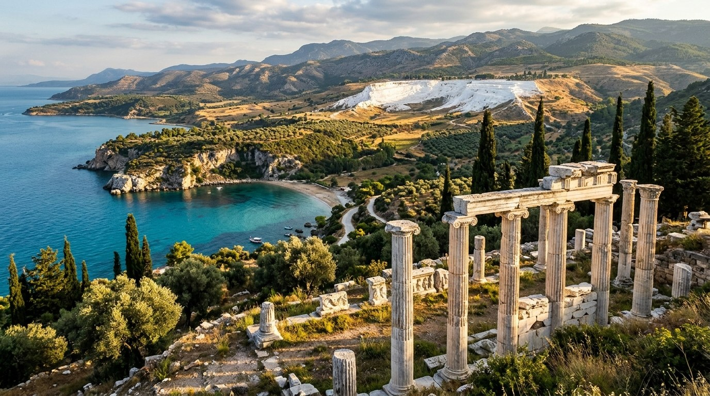
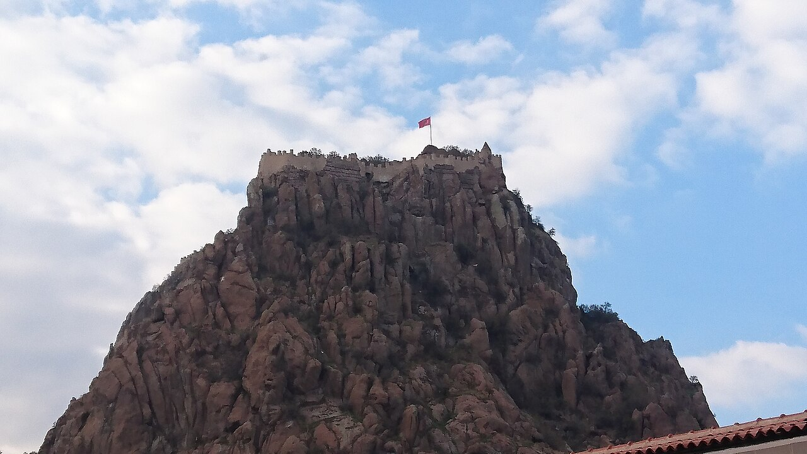
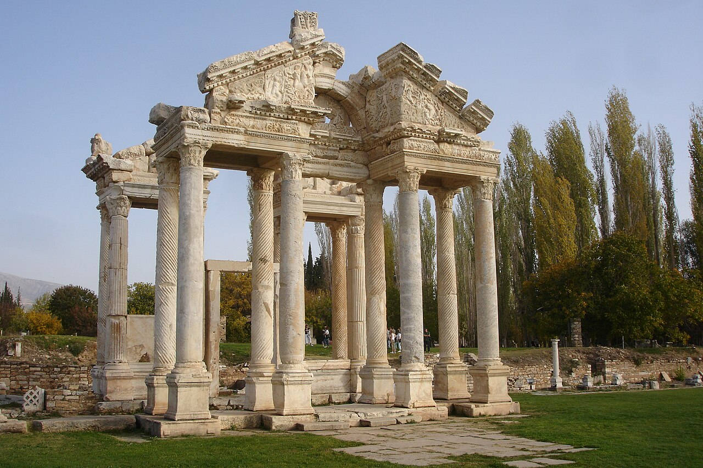
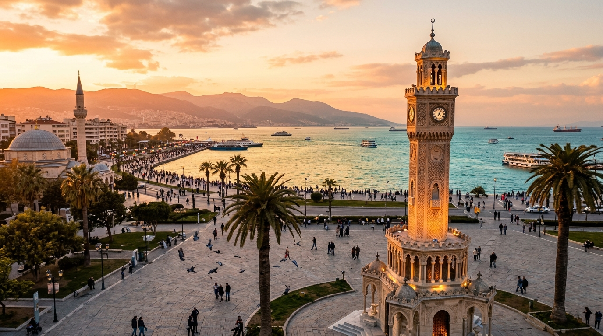
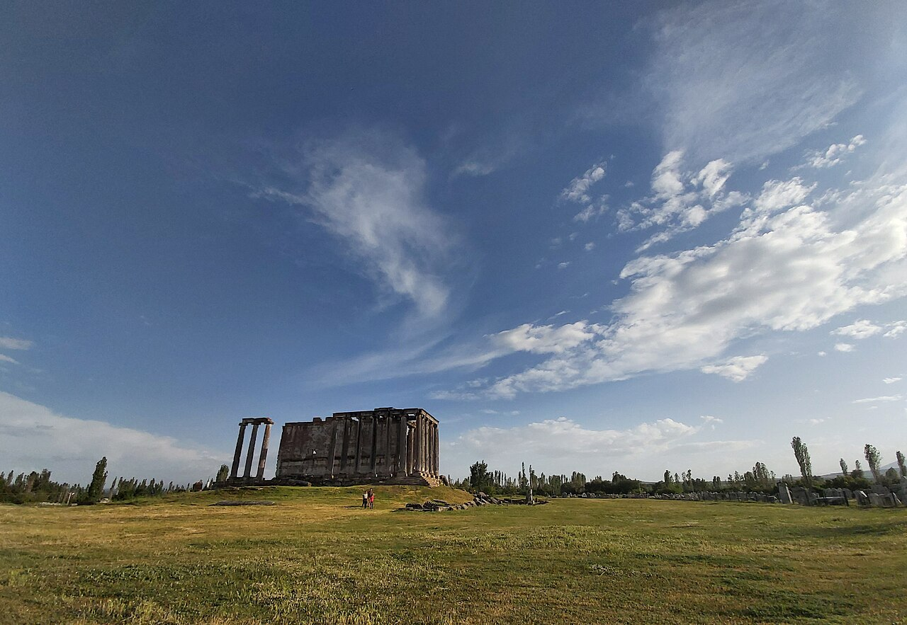
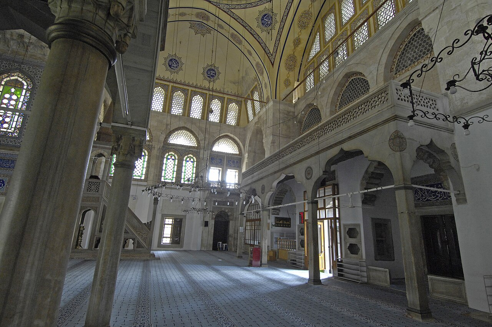
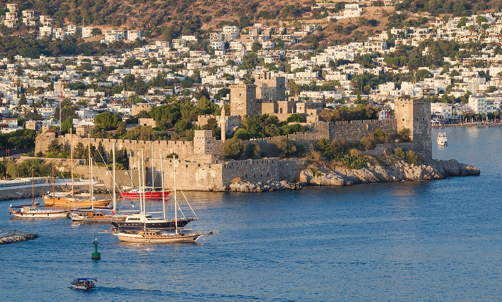
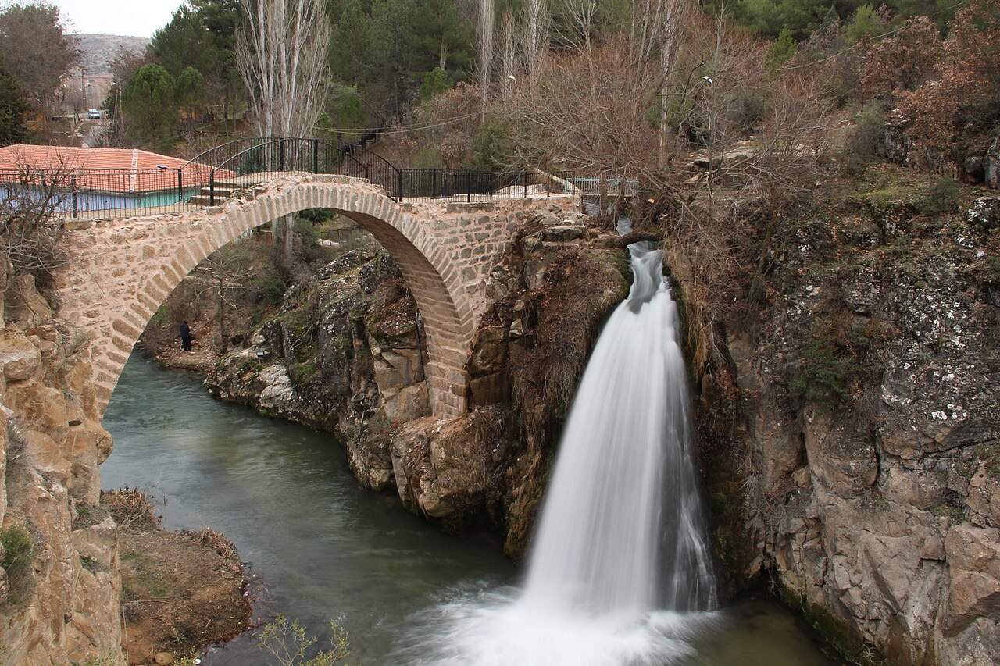

# 🌊 Ege Bölgesi

> *Zamanın Çizgileri & Zeytin Dalı: Antik mermerlerden turkuaz koylara uzanan bilgelik coğrafyası.*

**Keşif İlerlemesi:** `3 / 8 İl` (**%37.5**) &nbsp;•&nbsp; [🏠 Ana Sayfaya Dön](../README.md) &nbsp;•&nbsp; [🌐 Web Portalı](https://bahattinyunus.github.io/dijitalseyyah/)

---

## 🖼️ Bölge İlleri Görsel Rehberi

<table>
  <tr>
    <td align="center" width="33%" valign="top">
       
      <strong><a href="Afyonkarahisar/README.md">03 • Afyonkarahisar</a></strong> 
      ⏳ Bekliyor • 📍 Afyon Kalesi 🍽️ Afyon Sucuğu
    </td>
    <td align="center" width="33%" valign="top">
       
      <strong><a href="Aydin/README.md">09 • Aydın</a></strong> 
      ⏳ Bekliyor • 📍 Aphrodisias Antik Kenti 🍽️ İncir
    </td>
    <td align="center" width="33%" valign="top">
       
      <strong><a href="Denizli/README.md">20 • Denizli</a></strong> 
      ✅ Gezildi • 📍 Pamukkale Travertenleri 🍽️ Denizli Kebabı
    </td>
  </tr>
  <tr>
    <td align="center" width="33%" valign="top">
       
      <strong><a href="Izmir/README.md">35 • İzmir</a></strong> 
      ✅ Gezildi • 📍 Saat Kulesi 🍽️ İzmir Boyozu
    </td>
    <td align="center" width="33%" valign="top">
       
      <strong><a href="Kutahya/README.md">43 • Kütahya</a></strong> 
      ⏳ Bekliyor • 📍 Aizanoi Antik Kenti 🍽️ Kütahya Güveci
    </td>
    <td align="center" width="33%" valign="top">
       
      <strong><a href="Manisa/README.md">45 • Manisa</a></strong> 
      ⏳ Bekliyor • 📍 Muradiye Camii 🍽️ Manisa Kebabı
    </td>
  </tr>
  <tr>
    <td align="center" width="33%" valign="top">
       
      <strong><a href="Mugla/README.md">48 • Muğla</a></strong> 
      ✅ Gezildi • 📍 Ölüdeniz 🍽️ Muğla Köftesi
    </td>
    <td align="center" width="33%" valign="top">
       
      <strong><a href="Usak/README.md">64 • Uşak</a></strong> 
      ⏳ Bekliyor • 📍 Ulubey Kanyonu 🍽️ Tarhana Çorbası
    </td>
    <td width="33%"></td>
  </tr>
</table>

---

*Anadolu Seyahatnamesi — Dijital Seyyah Bölge Dosyası*
