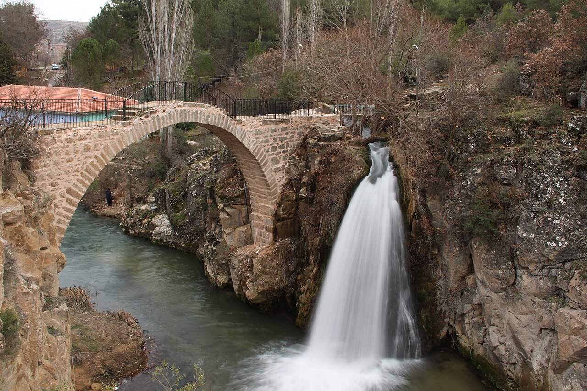
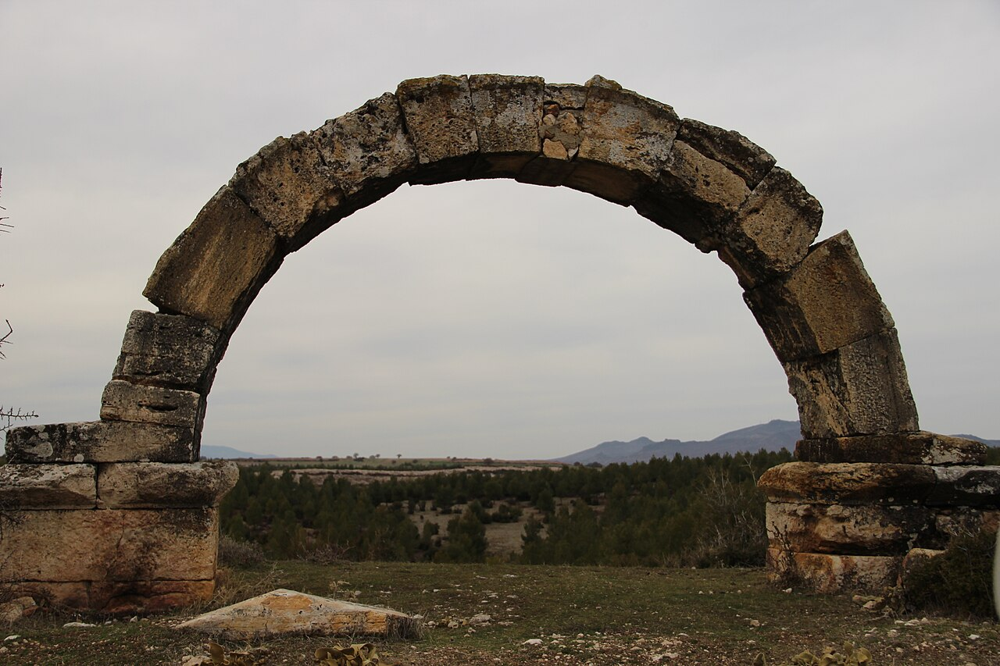

  

# 📍 Usak - Sefer Öncesi Menzil Dosyası

## 📜 Seyyahın Beklentisi
> "Dünyanın en uzun ikinci kanyonuna sahip, Karun Hazineleri'nin saklandığı kadim halı ve kilim diyarı. Henüz adımlanmamış her yol, içinde koca bir hikaye saklar."

### 🌍 Şehrin Dokusu ve Tarihsel Arka Planı
İç Ege ile İç Anadolu arasında doğal bir köprü kuran Uşak (antik Temenothyrai); Lidya, Frig, Pers, Roma, Germiyanoğulları ve Osmanlı katmanlarının sessiz ve vakur birleşimidir. Dünyaca ünlü **Karun Hazineleri**'ne (başta Kanatlı Denizatı Broşu olmak üzere) ev sahipliği yapan Uşak Arkeoloji Müzesi, insanlığın zenginlik ve fânilik üzerine binlerce yıllık ibretini gözler önüne serer. ABD'deki Büyük Kanyon'un ardından dünyanın en uzun ikinci kanyon sistemi olan **Ulubey Kanyonları**, derin vadilerin ortasındaki **Blaundos Antik Kenti** ve 2500 yıllık **Clandras Köprüsü** ile Uşak, henüz keşfedilmeyi bekleyen saklı bir tabiat ve tarih hazinesidir. Aynı zamanda "Uşak Halısı" ile Rönesans tablolarına kadar giren bu şehir, Cumhuriyet döneminin ilk şeker fabrikasını kuran müteşebbis ruhuyla "İlkler Şehri" olarak da anılır.

### 💬 Şehir Hakkında Edebi ve Tarihi Alıntılar
> "Uşak'ın halısı cihan saraylarını süsler, halkı misafirperver, toprağı bereketli ve havası hoş bir beldedir." — Evliya Çelebi, Seyahatnâme
>
> "Karun'un hazineleri bir müze vitrininde sessizce dururken, insana asıl zenginliğin gönül tokluğu olduğunu fısıldar." — Anadolu Tefekkür Notları
>
> "Ulubey Kanyonu'nun uçsuz bucaksız kıvrımlarına baktığınızda, suyun sabırla taşı nasıl bir sanat eserine dönüştürdüğüne şahit olursunuz." — Ege Doğa Günlükleri

### 🕌 Manevi Mimarlar ve Tarihî Şahsiyetler
- **Hacım Sultan:** Hacı Bektaş-ı Veli'nin halifelerinden; Uşak'ın Sivaslı ilçesine bağlı Hacım köyündeki zaviyesi ve türbesiyle bölgenin manevi hayatına asırlarca ışık tutan Anadolu ereni.
- **Halvetî-Uşşâkî Geleneği ve Hasan Hüsâmeddin Uşşâkî:** Uşşâkî tarikatının piri; ilmi ve tasavvufi mirasıyla Uşak'ın adını gönül coğrafyasına nakşeden büyük mutasavvıf.
- **Nuri Şeker:** Cumhuriyet'in ilk yıllarında halkın birikimiyle Türkiye'nin ilk şeker fabrikasını Uşak'ta kurarak yerli sanayi ve dayanışmanın sembolü olan vizyoner öncü.
- **Besim Atalay:** Uşak doğumlu dilbilimci ve müellif; *Dîvânu Lugâti't-Türk*'ü Türkçeye kazandırarak kültür tarihimize eşsiz bir hizmet sunan ilim insanı.
- **Halid Ziya Uşaklıgil:** Kökleri Uşak'a uzanan, modern Türk romanının kurucularından büyük edebiyatçı.

### 🍽️ Planlanan Yöresel Lezzet Durakları
Ege ve İç Anadolu mutfak kültürünün en sıcak buluşmasını sunan Uşak'ta tadılması planlanan lezzetler:
- **Ana Yemekler ve Çorbalar:** 21 gün fermente edilerek hazırlanan coğrafi işaretli **Uşak Tarhana Çorbası**, **Döndürme Böreği**, **Ebeli Köftesi**, **Alacatene**, **Keşkek**, **Çömlek Eti** ve **Demir Tatlısı**.
- **Tatlılar ve Yöresel Ürünler:** Tahinle kavrulan **Cendere Tatlısı**, **Höşmerim** ve **Gelincik Şurubu**.
- **Çay & Tefekkür Molası:** Ulubey Kanyonu cam terasında kanyon manzarasına karşı veya Tarihi Bedesten ve Clandras Köprüsü kenarında su sesi eşliğinde demli çay.

### 💻 Planlanan Yarı Göçebe Mesaisi (İlim Tahsili & Kütüphane)
- **Hedef Kütüphane:** *Uşak İl Halk Kütüphanesi* — Sessiz, nezih ve odaklanmaya son derece elverişli çalışma salonlarıyla gündüz yazılım geliştirme ve ders çalışmaya uygun dingin bir ilim yuvası.
- **Konaklama Planı:** GSB Seyahatsever kapsamında şehirdeki KYK yurtlarında 5 gün boyunca ücretsiz konaklayarak Afyonkarahisar–Uşak–Manisa–Denizli koridorunda ekonomik bir geçiş planlanmaktadır.

### 🧭 Planlanan 5 Günlük Menzil Rotası
- **1. Gün – Şehir Merkezi, Karun Hazineleri ve Uşak Halısı:** Sabah Uşak İl Halk Kütüphanesi'nde mesai; öğleden sonra Uşak Arkeoloji Müzesi'nde Karun Hazineleri incelemesi, Atatürk ve Etnografya Müzesi, Ulu Cami, Burma Cami ve Tarihi Bedesten yürüyüşü.
- **2. Gün – Ulubey Kanyonu ve Blaundos Antik Kenti:** Sabah erken saatte Ulubey Kanyonu Cam Teras ve kanyon içi yürüyüş parkuru; öğleden sonra üç tarafı uçurumlarla çevrili yarımada üzerindeki Blaundos Antik Kenti'nde gün batımı tefekkürü.
- **3. Gün – Clandras Köprüsü, Taşyaran Vadisi ve Doğa:** Karahallı'da 2500 yıllık Frig dönemi yadigârı Clandras Köprüsü ve şelalesi, Pepouza kalıntıları; ardından suyun kayaları nakış gibi oyduğu Taşyaran Vadisi Tabiat Parkı.
- **4. Gün – Hacım Sultan, Eşme Kilimleri ve Kütüphane:** Sabah kütüphane mesaisi; öğleden sonra Sivaslı'da Hacım Sultan Türbesi ziyareti veya Eşme'de geleneksel kilim dokuma kültürünü yerinde gözlemleme.
- **5. Gün – Tarihi Uşak Evleri, Bedesten ve Veda:** Tarihi Aybey ve Işık Mahallesi sokaklarında eski Uşak evleri arasında yürüyüş, sıcak bir kâse Uşak Tarhanası ve Döndürme Böreği eşliğinde İlkler Şehri'ne veda.

### ✨ Keşfedilecek Duraklar ve Landmarks
- [ ] **Ulubey Kanyonu & Cam Teras**
- [ ] **Blaundos Antik Kenti**
- [ ] **Uşak Arkeoloji Müzesi (Karun Hazineleri)**
- [ ] **Clandras Köprüsü & Şelalesi**
- [ ] **Taşyaran Vadisi Tabiat Parkı**
- [ ] **Uşak Ulu Camii, Tarihi Bedesten & Hacım Sultan Türbesi**

### 📸 Menzil Fotoğraf Galerisi
<table>
  <tr>
    <td align="center" width="50%">
       
      <i>Dünyanın en uzun ikinci kanyonu Ulubey'de doğanın sabır sanatı</i>
    </td>
    <td align="center" width="50%">
       
      <i>Blaundos'un sütunlarından Clandras Köprüsü'ne uzanan kadim Ege izleri</i>
    </td>
  </tr>
</table>

---
*Durum: Henüz adımlanmamış menzil — Sefer öncesi araştırma ve rota planlaması tamamlanmıştır. Gelecek rüzgârlarla yollarımızın kesişmesi dileğiyle...*
