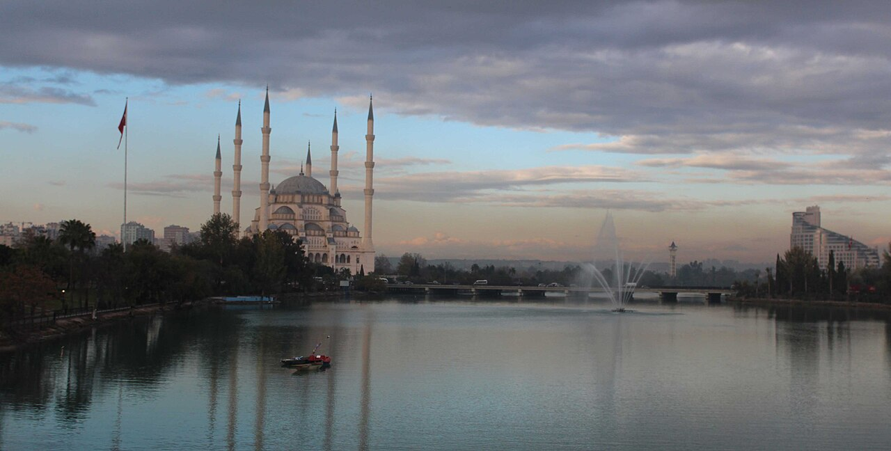

# 📍 Adana - Seyahat ve Tefekkür Notları

  

## 📜 Şehrin Ruhu
> "Torosların gölgesinde, Seyhan Nehri'nin bereketli toprakları üzerinde yükselen, sıcakkanlı ve coşkulu şehir."

### 🌍 Şehrin Dokusu ve Tarihsel Arka Planı
Kilikya bölgesinin en önemli kenti olan Adana, Hititlerden bugüne tarımın, ticaretin ve kültürün merkezi olmuştur. Çukurova'nın bereketli toprakları şehre hayat vermiştir.

### 💬 Şehir Hakkında Edebi ve Tarihi Alıntılar
> "Adana, Çukurova'nın altın kalbi, Seyhan'ın nazlı gelinidir." — Yaşar Kemal
>
> "Taşköprü, nehrin üzerine kurulmuş taştan bir gerdanlık gibidir." — Evliya Çelebi
>

### 🕌 Manevi Mimarlar ve Tarihî Şahsiyetler
- **Ramazanoğlu Halil Bey ve Pîrî Mehmet Paşa:** Çukurova'da Ramazanoğulları Beyliği'nin mimari ve kültürel mührünü vuran; Adana Ulu Camii, Yağ Camii ve Ramazanoğlu Medresesi ile şehre Türk-İslam kimliği kazandıran baniler.
- **Karacaoğlan:** Toroslar'ın ve Çukurova'nın bağrından kopup gelen, doğayı ve insan sevgisini en duru Türkçe ile dile getiren büyük halk ozanı.
- **Yaşar Kemal & Orhan Kemal:** Çukurova'nın toprağını, ırgatların emeğini ve Adana sokaklarının nabzını dünya edebiyatına taşıyan iki büyük kalem.
- **Abidin Dino:** Çukurova'nın rengini, ışığını ve bereketini resim sanatına nakşeden usta sanatçı.

### 🕊️ Gezginin Not Defterinden (Manevi Boyut ve Tefekkür)
Seyhan kıyısında asırlık Taşköprü'nün üzerinde durup altından akan suya bakarken, nehirler gibi akıp giden insan ömrünü ve tarihin sabitliğini tefekkür edersiniz.

### 🍽️ Yöresel Lezzet Tavsiyeleri
- **Yerel Tatlar ve İkramlar:** Şehrin yerel esnaf lokantalarında ve pazar yerlerinde deneyimlenen bütçe dostu, kültürel dokuyu yansıtan eşsiz lezzetler; özellikle zırh kıymasıyla hazırlanan **Adana Kebabı**, ferahlatıcı **Şalgam Suyu**, sabahın erken saatlerinde içilen **Şırdan ve Kelle Paça**, közlenmiş **Analı Kızlı** çorbası ve sıcak akşamlarda **Bici Bici**.
- **Tefekkür Eşliğinde Çay/Kahve:** Şehrin tarihi kıraathanelerinde veya doğa manzaralı tepelerinde yudumlanan demli çaylar; Kazancılar Çarşısı'nda ve Seyhan Baraj Gölü kıyısında gün batımı eşliğinde çay molası.

### ⛺ Konaklama ve Bütçe Stratejisi
- **Sıfır Konaklama Maliyeti (Modern Kervansaraylar):** GSB Seyahatsever projesi kapsamında şehirdeki KYK yurtlarında 5 gün boyunca ücretsiz konaklanarak bütçe korunmuştur.
- **Ulaşım ve Lojistik Planlama:** Rota optimizasyonuna uyularak komşu iller sırayla takip edilmiş, böylece hem yol maliyeti minimuma indirilmiş hem de karbon ayak izi azaltılmıştır.

### 💻 Yarı Göçebe Mesaisi (İlim Tahsili & Kütüphane)
- **Kütüphane Rutini:** Gündüz vakitlerinde şehrin İl Halk Kütüphanesinde zaman geçirilerek bilgisayar başında yazılım geliştirme ve ders çalışma faaliyetleri sürdürülmüştür.
  * *Seyyahın Kütüphane Notu:* Adana İl Halk Kütüphanesi - Sessiz, çalışma disiplinine uygun, internet imkanı sunan verimli bir ilim yuvası.
- **Süre ve Uyum:** Kütüphane mesaisi bitiminde şehrin ruhuna karışmak üzere yollara düşülmüş, 5 günlük menzil süresiyle şehir sindirilerek keşfedilmiştir.

### 🧭 5 Günlük Menzil Rotası
- **1. Gün – Seyhan'ın İki Yakası ve Tarihi Çekirdek:** Sabah İl Halk Kütüphanesi mesaisi; ikindi sonrası **Tarihi Taşköprü** üzerinden yürüyüş, **Sabancı Merkez Camii** ve Merkez Park'ta gün batımı tefekkürü.
- **2. Gün – Ramazanoğlu Mirası ve Çarşı Kültürü:** Kütüphane sonrası **Adana Ulu Camii**, **Ramazanoğlu Konağı**, **Büyük Saat Kulesi**, **Kazancılar Çarşısı** ve **Yağ Camii** rotasında asırlık esnaf dokusunu solumak.
- **3. Gün – Sinema, Müze ve Tepebağ Sokakları:** **Adana Arkeoloji Müzesi (Müze Kompleksi)**, **Adana Sinema Müzesi** ve tarihi **Tepebağ Evleri** arasında kültürel yürüyüş.
- **4. Gün – Torosların Kapısı (Varda Köprüsü & Kapıkaya Kanyonu):** Karaisalı yönünde **Varda (Alman) Köprüsü** ve **Kapıkaya Kanyonu** yürüyüşü ile Çukurova sıcağından Toros serinliğine geçiş.
- **5. Gün – Anavarza'nın İzinde ve Veda:** **Anavarza Antik Kenti** veya **Seyhan Baraj Gölü** kıyısında son okumalar, seyahatname notlarının temize çekilmesi ve bir sonraki Akdeniz menziline hazırlık.

### ✨ Keşfedilesi Duraklar ve Landmarks
Bu şehrin havasını solumak, ruhuna dokunmak için mutlaka adımlanması gereken köşe taşları:
- [ ] **Tarihi Taşköprü**
- [ ] **Sabancı Merkez Camii**
- [ ] **Adana Ulu Camii**
- [ ] **Büyük Saat Kulesi ve Kazancılar Çarşısı**
- [ ] **Varda (Alman) Köprüsü**
- [ ] **Adana Müze Kompleksi**

### 📸 Menzil Fotoğraf Galerisi
<table>
  <tr>
    <td align="center" width="50%">
       
      <b>Seyhan Nehri ve Adana'nın Tarihi Silüeti</b>
    </td>
    <td align="center" width="50%">
       
      <b>Çukurova'nın Mirası ve Mimari Dokusu</b>
    </td>
  </tr>
</table>

---
*Bu il bizzat deneyimlenmiş, yolları aşındırılmış ve seyahatnameye sevgiyle işlenmiştir.* ✅
