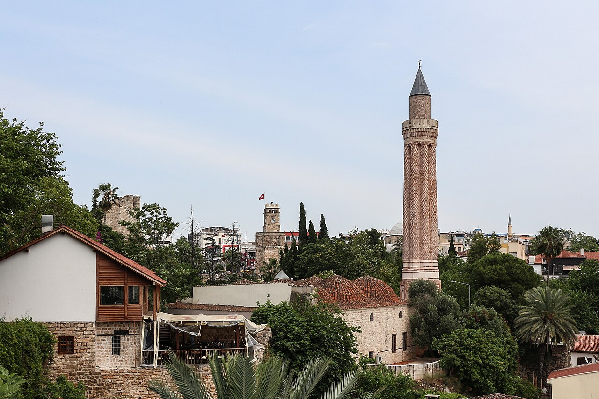

# 📍 Antalya - Seyahat ve Tefekkür Notları

  

## 📜 Şehrin Ruhu
> "Akdeniz'in parlayan güneşi, antik limanları, heybetli surları ve eşsiz doğasıyla tarihin ve coğrafyanın zirvesi."

### 🌍 Şehrin Dokusu ve Tarihsel Arka Planı
Bergama Kralı Attalos tarafından kurulan Attaleia (Antalya), Bizans, Selçuklu ve Osmanlı dönemlerinde Akdeniz'in en stratejik liman kenti olmuştur.

### 💬 Şehir Hakkında Edebi ve Tarihi Alıntılar
> "Hiç şüphe yoktur ki Antalya, dünyanın en güzel yeridir." — Mustafa Kemal Atatürk
>
> "Antalya'nın surları ve bahçeleri öyle bir süsle donanmıştır ki, giren kendini cennette sanır." — İbn Battûta
>

### 🕌 Manevi Mimarlar ve Tarihî Şahsiyetler
- **Sultan I. Gıyaseddin Keyhüsrev & I. Alâeddin Keykubad:** 1207'de Antalya'yı fethederek Anadolu Selçuklu Devleti'ni Akdeniz'e açan, **Yivli Minare** ve tersanelerle şehre kalıcı İslam mimarisi mührünü vuran sultanlar.
- **Ahi Yusuf (Yivli Minare Çevresi):** Antalya'nın fethinden sonra esnaf ahlakını ve fütüvvet kültürünü Kaleiçi sokaklarına yerleştiren manevi önder.
- **Elmalılı Muhammed Hamdi Yazır:** Antalya'nın Elmalı ilçesinde yetişmiş, *Hak Dini Kur'an Dili* tefsiriyle İslam ilim dünyasına silinmez bir eser bırakmış büyük müfessir.
- **Vahib-i Ümmî & Sinan-ı Ümmî:** Elmalı irfan geleneğinin kurucuları; Niyâzî-i Mısrî gibi gönül sultanlarının yetişmesine vesile olan tasavvuf büyükleri.

### 🕊️ Gezginin Not Defterinden (Manevi Boyut ve Tefekkür)
Kaleiçi'nin dar sokaklarında yürürken, asırlar boyu bu limana sığınmış gemicileri ve zamanın geçici limanlar olduğunu tefekkür edersiniz.

### 🍽️ Yöresel Lezzet Tavsiyeleri
- **Yerel Tatlar ve İkramlar:** Şehrin yerel esnaf lokantalarında ve pazar yerlerinde deneyimlenen bütçe dostu, kültürel dokuyu yansıtan eşsiz lezzetler; tahinli **Antalya Piyazı**, **Hibeş**, **Şiş Köfte**, **Cive Yemeği** ve turunçgil diyarının mirası **Turunç & Bergamot Reçeli** ile tahinli **Kabak Tatlısı**.
- **Tefekkür Eşliğinde Çay/Kahve:** Şehrin tarihi kıraathanelerinde veya doğa manzaralı tepelerinde yudumlanan demli çaylar; Karaalioğlu Parkı falezlerinden Beydağları'na karşı gün batımı çayı.

### ⛺ Konaklama ve Bütçe Stratejisi
- **Sıfır Konaklama Maliyeti (Modern Kervansaraylar):** GSB Seyahatsever projesi kapsamında şehirdeki KYK yurtlarında 5 gün boyunca ücretsiz konaklanarak bütçe korunmuştur.
- **Ulaşım ve Lojistik Planlama:** Rota optimizasyonuna uyularak komşu iller sırayla takip edilmiş, böylece hem yol maliyeti minimuma indirilmiş hem de karbon ayak izi azaltılmıştır.

### 💻 Yarı Göçebe Mesaisi (İlim Tahsili & Kütüphane)
- **Kütüphane Rutini:** Gündüz vakitlerinde şehrin İl Halk Kütüphanesinde zaman geçirilerek bilgisayar başında yazılım geliştirme ve ders çalışma faaliyetleri sürdürülmüştür.
  * *Seyyahın Kütüphane Notu:* Antalya İl Halk Kütüphanesi - Sessiz, çalışma disiplinine uygun, internet imkanı sunan verimli bir ilim yuvası.
- **Süre ve Uyum:** Kütüphane mesaisi bitiminde şehrin ruhuna karışmak üzere yollara düşülmüş, 5 günlük menzil süresiyle şehir sindirilerek keşfedilmiştir.

### 🧭 5 Günlük Menzil Rotası
- **1. Gün – Kaleiçi ve Selçuklu Mirası:** Sabah İl Halk Kütüphanesi mesaisi; ikindi sonrası **Hadrian Kapısı (Üçkapılar)**, **Yivli Minare Külliyesi**, **Kesik Minare**, **Hıdırlık Kulesi** ve tarihi **Kaleiçi Yat Limanı** yürüyüşü.
- **2. Gün – Şelaleler ve Falezler:** Kütüphane sonrası **Yukarı ve Aşağı Düden Şelalesi**, Lara falezleri ve **Karaalioğlu Parkı**'nda Beydağları silüetini izleme.
- **3. Gün – Pamfilya'nın Görkemi (Perge & Aspendos):** **Antalya Arkeoloji Müzesi** ziyareti, ardından **Perge Antik Kenti** veya **Aspendos Tiyatrosu** ile antik Akdeniz tarihine yolculuk.
- **4. Gün – Torosların Serinliği (Termessos & Kurşunlu):** Güllük Dağı eteklerindeki **Termessos Antik Kenti** ve **Kurşunlu Şelalesi Tabiat Parkı**'nda doğa ve tarih tefekkürü.
- **5. Gün – Konyaaltı Kıyısı ve Seyahatname Notları:** Konyaaltı sahil bandında sabah yürüyüşü, kütüphanede haftalık çalışma kapanışı ve bir sonraki menzile doğru yola çıkış.

### ✨ Keşfedilesi Duraklar ve Landmarks
Bu şehrin havasını solumak, ruhuna dokunmak için mutlaka adımlanması gereken köşe taşları:
- [ ] **Kaleiçi Tarihi Semti**
- [ ] **Hadrian Kapısı (Üçkapılar)**
- [ ] **Yivli Minare**
- [ ] **Düden Şelalesi**
- [ ] **Antalya Arkeoloji Müzesi**
- [ ] **Aspendos ve Perge Antik Kentleri**

### 📸 Menzil Fotoğraf Galerisi
<table>
  <tr>
    <td align="center" width="50%">
       
      <b>Antalya Falezleri ve Tarihi Liman Manzarası</b>
    </td>
    <td align="center" width="50%">
       
      <b>Yivli Minare, Antik Kentler ve Akdeniz Mavisi</b>
    </td>
  </tr>
</table>

---
*Bu il bizzat deneyimlenmiş, yolları aşındırılmış ve seyahatnameye sevgiyle işlenmiştir.* ✅
