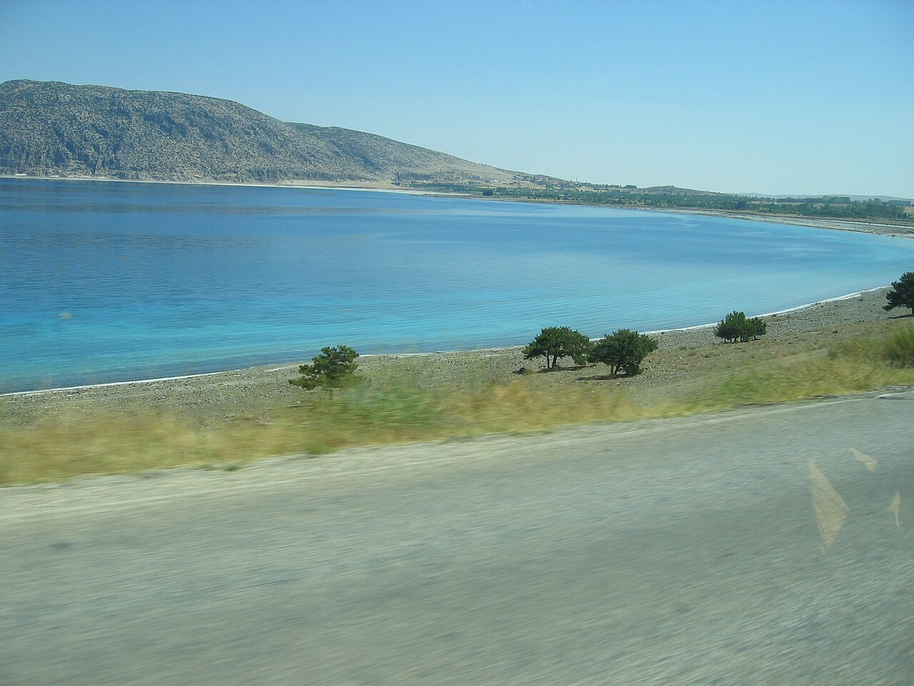
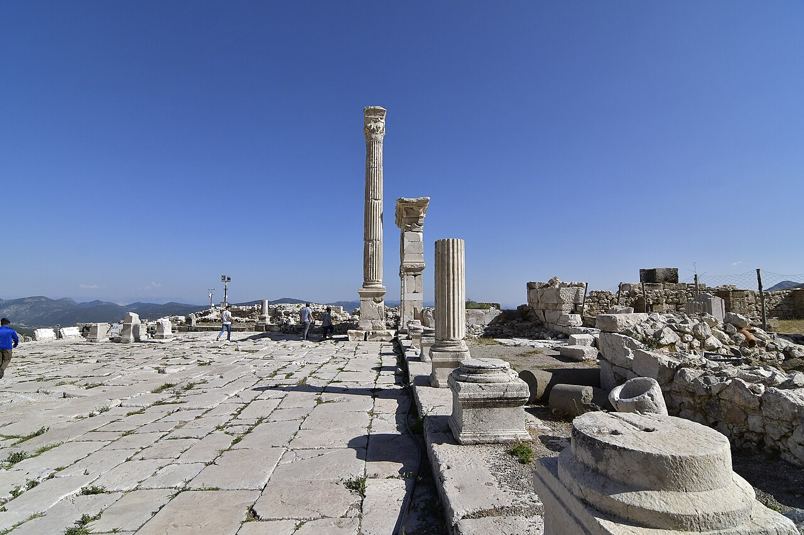

# 📍 Burdur - Seyahat Öncesi Keşif Dosyası

  

## 📜 Seyyahın Beklentisi
> "Henüz adımlanmamış her yol, içinde koca bir hikaye saklar; Göller Yöresi'nin incisi Salda'nın turkuaz sularında ve Sagalassos'un iki bin yıldır akan çeşmesinde zamanın nabzını dinlemeyi bekleyen bir durak."

### 🌍 Şehrin Dokusu ve Tarihsel Arka Planı
Göller Yöresi'nin kalbinde yer alan Burdur, Neolitik çağın en önemli yerleşimlerinden **Hacılar** ve **Kuruçay Höyükleri** ile 9000 yılı aşan bir insanlık hafızasına sahiptir. Antik dönemde **Pisidya** uygarlığının göz bebeği olan coğrafya, Ağlasun sırtlarındaki **Sagalassos** ve Gölhisar'daki **Kibyra** antik kentleriyle Roma döneminin en görkemli dağ şehirlerini barındırır. Selçuklu ve Hamitoğulları dönemlerinde Türk-İslam kimliğine kavuşan Burdur, Teke Yöresi'nin sipsi, cura ve boğaz havalarıyla yoğrulmuş zengin Yörük kültürünün de canlı taşıyıcısıdır.

### 💬 Şehir Hakkında Edebi ve Tarihi Alıntılar
> "Sagalassos, bulutların arasında kurulu bir kartal yuvası; Antoninler Çeşmesi ise tarihin hiç susmayan berrak sesidir." — Gezgin Notları
>
> "Teke Yöresi'nin sipsisi çaldığında, Toroslar'ın rüzgârı göllerin yüzeyine nakşolur." — Anadolu Folklor Mirası

### 🕌 Manevi Mimarlar ve Tarihî Şahsiyetler
- **Şeyhülislam Dürrizâde Abdullah Efendi & Burdurlu Derviş Mehmed Paşa:** Osmanlı ilmiye ve devlet geleneğinde Burdur'un adını temsil eden âlim ve devlet adamları.
- **Mehmet Akif Ersoy:** Millî Mücadele yıllarında Burdur Milletvekili olarak şehri Birinci Meclis'te temsil eden, hatırası bugün şehrin üniversitesinde ve kültür hayatında yaşayan İstiklal Şairi.
- **Hamitoğlu Dündar Bey:** 14. yüzyılda Burdur Ulu Camii'ni inşa ettirerek şehre kalıcı bir Beylikler Dönemi mührü vuran yönetici.
- **Teke Yöresi Halk Ozanları (Tepeli Hasan, Kadir Türen vb.):** Sipsi ve üç telli cura geleneğini kuşaktan kuşağa aktaran gönül insanları.

### 🍽️ Yöresel Lezzet Rehberi
- **Burdur Şiş:** Şehrin coğrafi işaretli imzası; özel baharatsız dana/keçi kıymasından şişte pişirilip sıcak pide ve közlenmiş biberle sunulan eşsiz lezzet.
- **Ceviz Ezmesi:** İnce çekilmiş ceviz, şeker ve irmikle hazırlanan, Burdur'un asırlık tatlı mirası.
- **Testi Kebabı & Burdur Muhallebisi:** Yöresel esnaf lokantalarında deneyimlenmesi planlanan geleneksel ana yemek ve tatlılar.
- **Tefekkür Eşliğinde Çay/Kahve:** Salda Gölü'nün beyaz hidromanyezit kumsalına bakan seyir noktalarında veya Susamlık Tepesi'nde Burdur Gölü'ne karşı demli çay molası.

### ⛺ Planlanan Konaklama ve Lojistik
- **Modern Kervansaraylar (KYK / Seyahatsever):** GSB Seyahatsever programı kapsamında Burdur merkezdeki KYK yurtlarında bütçe dostu 5 günlük konaklama planı.
- **Rota Bağlantısı:** Isparta veya Antalya hattından Göller Yöresi geçişiyle karbon ayak izini ve yol maliyetini en aza indiren ardışık seyahat düzeni.

### 💻 Planlanan Kütüphane Mesaisi (Yarı Göçebe Ofis)
- **Hedef İlim Yuvası:** **Burdur İl Halk Kütüphanesi** — Göller Yöresi'nin sükûnetini yansıtan sessiz çalışma salonları, düzenli internet erişimi ve odaklanmaya elverişli ortamıyla gündüz yazılım/ders mesaisi için seçilen merkez.
- **Çalışma Ritmi:** Sabah 09:00–14:30 arası kütüphane disiplini, ikindi sonrasında ise antik kentler, göl kıyıları ve tarihi konaklara doğru keşif yürüyüşleri.

### 🧭 Planlanan 5 Günlük Menzil Rotası
- **1. Gün – Burdur Merkez ve Arkeoloji:** Sabah Burdur İl Halk Kütüphanesi'nde ilk mesai; ardından Türkiye'nin en zengin bölge müzelerinden **Burdur Arkeoloji Müzesi**, **Burdur Ulu Camii**, **Saat Kulesi** ve **Taş Oda & Baki Bey Konakları**.
- **2. Gün – Bulutların Üstündeki Kent (Sagalassos):** Ağlasun ilçesine geçiş; 1700 metre rakımda **Sagalassos Antik Kenti**, hâlâ gürül gürül akan **Antoninler Çeşmesi** ve **İnsuyu Mağarası** ziyareti.
- **3. Gün – Mars'ın Yeryüzündeki İkizi (Salda Gölü):** Yeşilova yönünde **Salda Gölü**'nün turkuaz sularında doğa tefekkürü, göl ekosisteminin korunma hikâyesi ve çevredeki Yörük köyleri.
- **4. Gün – Gladyatörler ve Medusa'nın Şehri (Kibyra):** Gölhisar'da **Kibyra Antik Kenti** (ünlü Medusa mozaiği, Odeion ve stadyum) ile Antik Pisidya-Likya sınır hattının keşfi.
- **5. Gün – Lisinia Yaban Hayatı, Burdur Gölü ve Veda:** **Burdur Gölü** kıyısında sabah yürüyüşü, **Lisinia Doğa** projesi ziyareti, kütüphanede notların derlenmesi ve bir sonraki menzile hareket.

### ✨ Keşfedilecek Duraklar ve Landmarks
Bu kadim şehre ayak basıldığında mutlaka adımlanması planlanan köşe taşları:
- [ ] **Salda Gölü (Yeşilova)**
- [ ] **Sagalassos Antik Kenti ve Antoninler Çeşmesi (Ağlasun)**
- [ ] **Kibyra Antik Kenti (Gölhisar)**
- [ ] **Burdur Arkeoloji Müzesi**
- [ ] **İnsuyu Mağarası**
- [ ] **Burdur Ulu Camii ve Tarihi Taş Oda Konağı**

### 📸 Menzil Fotoğraf Galerisi
<table>
  <tr>
    <td align="center" width="50%">
       
      <b>Salda Gölü'nün Turkuaz Suları ve Göller Yöresi</b>
    </td>
    <td align="center" width="50%">
       
      <b>Sagalassos Antoninler Çeşmesi ve Antik Miras</b>
    </td>
  </tr>
</table>

---
*Henüz adımlanmamış bu kadim Akdeniz menzili, gelecek rüzgarlarla yollarımızın kesişmesi ve seyahatnameye bizzat işlenmesi dileğiyle keşif dosyası olarak hazırlanmıştır.*
