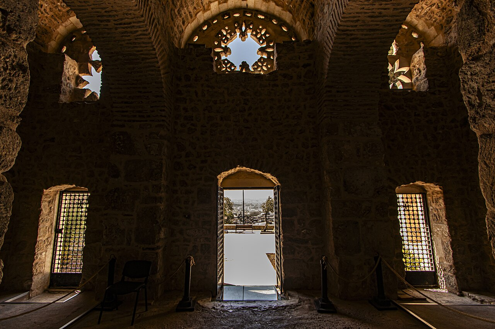

# 📍 Hatay - Seyahat ve Tefekkür Notları

  

## 📜 Şehrin Ruhu
> "Dinlerin ve dillerin kardeşçe kucaklaştığı, tarihin en eski yerleşim yerlerinden biri olan hoşgörü başkenti."

### 🌍 Şehrin Dokusu ve Tarihsel Arka Planı
Antik çağın en büyük metropollerinden biri olan Antakya (Hatay), ilk Hristiyanların toplandığı ve İslamiyet'in Anadolu'daki ilk camisinin inşa edildiği mukaddes bir şehirdir.

### 💬 Şehir Hakkında Edebi ve Tarihi Alıntılar
> "Hatay benim şahsi meselemdir." — Mustafa Kemal Atatürk
>
> "Medeniyetlerin beşiği, dinlerin ve dillerin kardeşçe kucaklaştığı mukaddes toprak." — Cemil Meriç
>

### 🕌 Manevi Mimarlar ve Tarihî Şahsiyetler
- **Habib-i Neccar (r.a.):** Kur'an-ı Kerim'de Yâsîn Suresi'nde anılan, hakikat uğruna canını feda eden ve Anadolu'nun ilk camisinde kabri bulunan büyük mümin.
- **Ebû Ubeyde bin Cerrâh (r.a.):** Antakya'nın fethini gerçekleştiren, "Ümmetin Emîni" lakaplı sahabe komutan.
- **Cemil Meriç:** Reyhanlı doğumlu, Doğu ile Batı arasında köprü kuran *Bu Ülke* ve *Mağaradakiler* müellifi büyük mütefekkir.
- **Tayfur Sökmen:** Hatay Devleti'nin ilk ve tek Cumhurbaşkanı olarak şehrin anavatana katılış sürecine öncülük eden devlet adamı.

### 🕊️ Gezginin Not Defterinden (Manevi Boyut ve Tefekkür)
Habib-i Neccar Camii'nin manevi ikliminde, inancın ve sevginin birleştirici gücünü tefekkür eder, Titus Tüneli'nin devasa kayalarında insan azmini görürsünüz.

### 🍽️ Yöresel Lezzet Tavsiyeleri
- **Yerel Tatlar ve İkramlar:** Şehrin yerel esnaf lokantalarında ve pazar yerlerinde deneyimlenen bütçe dostu, kültürel dokuyu yansıtan eşsiz lezzetler; UNESCO Gastronomi Şehri mirası **Antakya Künefesi**, **Tepsi Kebabı**, **Kağıt Kebabı**, **Humus**, **Muhammara**, **Oruk (İçli Köfte)** ve **Biberli Ekmek**.
- **Tefekkür Eşliğinde Çay/Kahve:** Şehrin tarihi kıraathanelerinde veya doğa manzaralı tepelerinde yudumlanan demli çaylar; Asi Nehri çevresinde ve Harbiye şelalelerinin serinliğinde kakuleli kahve ve demli çay molası.

### ⛺ Konaklama ve Bütçe Stratejisi
- **Sıfır Konaklama Maliyeti (Modern Kervansaraylar):** GSB Seyahatsever projesi kapsamında şehirdeki KYK yurtlarında 5 gün boyunca ücretsiz konaklanarak bütçe korunmuştur.
- **Ulaşım ve Lojistik Planlama:** Rota optimizasyonuna uyularak komşu iller sırayla takip edilmiş, böylece hem yol maliyeti minimuma indirilmiş hem de karbon ayak izi azaltılmıştır.

### 💻 Yarı Göçebe Mesaisi (İlim Tahsili & Kütüphane)
- **Kütüphane Rutini:** Gündüz vakitlerinde şehrin İl Halk Kütüphanesinde zaman geçirilerek bilgisayar başında yazılım geliştirme ve ders çalışma faaliyetleri sürdürülmüştür.
  * *Seyyahın Kütüphane Notu:* Hatay İl Halk Kütüphanesi - Sessiz, çalışma disiplinine uygun, internet imkanı sunan verimli bir ilim yuvası.
- **Süre ve Uyum:** Kütüphane mesaisi bitiminde şehrin ruhuna karışmak üzere yollara düşülmüş, 5 günlük menzil süresiyle şehir sindirilerek keşfedilmiştir.

### 🧭 5 Günlük Menzil Rotası
- **1. Gün – Kadim Antakya ve Manevi Çekirdek:** Sabah İl Halk Kütüphanesi mesaisi; ikindi sonrası **Habib-i Neccar Camii**, tarihi **Kurtuluş Caddesi** ve **Uzun Çarşı** rotasında medeniyet izlerini adımlamak.
- **2. Gün – Mozaikler ve İlk Mağara Kilise:** Kütüphane sonrası dünyanın en zengin mozaik koleksiyonlarından birini barındıran **Hatay Arkeoloji Müzesi** ve ardından **St. Pierre Kilisesi** ziyareti.
- **3. Gün – Samandağ ve Roma Mühendisliği:** **Titus Tüneli**, **Beşikli Mağara** ve **Vakıflı Köyü** rotasında Akdeniz rüzgarı eşliğinde tarih yolculuğu.
- **4. Gün – Harbiye Şelaleleri ve Payas Külliyesi:** **Harbiye (Defne) Şelaleleri**'nde doğa molası, kuzeyde ise Mimar Sinan eseri **Sokollu Mehmet Paşa Külliyesi (Payas)** ve **İskenderun Sahili**.
- **5. Gün – Cemil Meriç'in İzinde ve Veda:** Reyhanlı ve Amik Ovası ufkunda tefekkür, kütüphanede son okumalar ve seyahatname notlarının tamamlanması.

### ✨ Keşfedilesi Duraklar ve Landmarks
Bu şehrin havasını solumak, ruhuna dokunmak için mutlaka adımlanması gereken köşe taşları:
- [ ] **Habib-i Neccar Camii**
- [ ] **Titus Tüneli**
- [ ] **Hatay Arkeoloji Müzesi**
- [ ] **St. Pierre Kilisesi**
- [ ] **Beşikli Mağara ve Samandağ Sahili**
- [ ] **Payas Sokollu Mehmet Paşa Külliyesi**

### 📸 Menzil Fotoğraf Galerisi
<table>
  <tr>
    <td align="center" width="50%">
       
      <b>Medeniyetler Beşiği Hatay'ın Kadim Dokusu</b>
    </td>
    <td align="center" width="50%">
       
      <b>Titus Tüneli, Mozaikler ve Hoşgörü İklimi</b>
    </td>
  </tr>
</table>

---
*Bu il bizzat deneyimlenmiş, yolları aşındırılmış ve seyahatnameye sevgiyle işlenmiştir.* ✅
