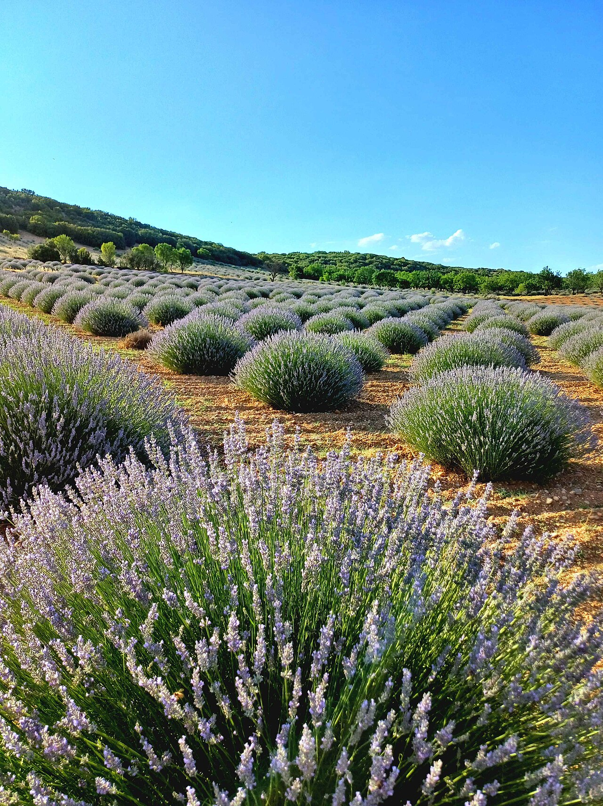

# 📍 Isparta - Seyahat ve Tefekkür Notları

  

## 📜 Şehrin Ruhu
> "Güllerin ve lavantaların kokusuyla bezenmiş, göller yöresinin incisi, doğa harikası şehir."

### 🌍 Şehrin Dokusu ve Tarihsel Arka Planı
Pisidya bölgesinde yer alan Isparta, Selçuklu ve Hamitoğulları beyliği dönemlerinde önemli bir kültür merkezi olmuş, günümüzde gül tarımıyla dünyaya açılmıştır.

### 💬 Şehir Hakkında Edebi ve Tarihi Alıntılar
> "Isparta, güllerin kokusunda cennet bahçelerinden bir esintidir." — Evliya Çelebi
>
> "Eğirdir, dağların arasında mavi bir ayna gibidir." — Seyyah İbn Battûta
>

### 🕌 Manevi Mimarlar ve Tarihî Şahsiyetler
- **Şeyhülislam Burhaneddin-i Eğirdirî ve Pîrî Halife Sultan:** Eğirdir ve Isparta havalisinde ilim ve irfan halkaları kuran gönül sultanları.
- **Halil Hamit Paşa:** Osmanlı sadrazamı olarak Isparta'ya kendi adını taşıyan köklü kütüphaneyi ve vakıf eserlerini armağan eden devlet adamı.
- **Müftüzâde İsmail Efendi:** 19. yüzyıl sonunda Bulgaristan'dan getirdiği gül fidanlarıyla Isparta'yı "Güller Diyarı"na dönüştüren öncü isim.
- **Mimar Sinan'ın İzinde Firdevs Bey:** Isparta'nın en zarif klasik Osmanlı eseri olan **Firdevs Bey (Mimar Sinan) Camii**'nin banisi.

### 🕊️ Gezginin Not Defterinden (Manevi Boyut ve Tefekkür)
Eğirdir Gölü'nün sakin sularında, doğanın sunduğu huzuru ve yaratılışın estetiğini tefekkür edersiniz.

### 🍽️ Yöresel Lezzet Tavsiyeleri
- **Yerel Tatlar ve İkramlar:** Şehrin yerel esnaf lokantalarında ve pazar yerlerinde deneyimlenen bütçe dostu, kültürel dokuyu yansıtan eşsiz lezzetler; özellikle taş fırında pişen **Isparta Kebabı (Fırın Kebap)**, düğün sofralarının baş tacı **Kabune Pilavı**, Eğirdir'in **Sazan Dolması** ve yörenin imzası **Gül Lokumu, Gül Reçeli ve Gül Şerbeti**.
- **Tefekkür Eşliğinde Çay/Kahve:** Şehrin tarihi kıraathanelerinde veya doğa manzaralı tepelerinde yudumlanan demli çaylar; Eğirdir Yeşilada kıyısında veya Akpınar Seyir Terası'nda göle nazır çay keyfi.

### ⛺ Konaklama ve Bütçe Stratejisi
- **Sıfır Konaklama Maliyeti (Modern Kervansaraylar):** GSB Seyahatsever projesi kapsamında şehirdeki KYK yurtlarında 5 gün boyunca ücretsiz konaklanarak bütçe korunmuştur.
- **Ulaşım ve Lojistik Planlama:** Rota optimizasyonuna uyularak komşu iller sırayla takip edilmiş, böylece hem yol maliyeti minimuma indirilmiş hem de karbon ayak izi azaltılmıştır.

### 💻 Yarı Göçebe Mesaisi (İlim Tahsili & Kütüphane)
- **Kütüphane Rutini:** Gündüz vakitlerinde şehrin İl Halk Kütüphanesinde zaman geçirilerek bilgisayar başında yazılım geliştirme ve ders çalışma faaliyetleri sürdürülmüştür.
  * *Seyyahın Kütüphane Notu:* Isparta İl Halk Kütüphanesi - Sessiz, çalışma disiplinine uygun, internet imkanı sunan verimli bir ilim yuvası.
- **Süre ve Uyum:** Kütüphane mesaisi bitiminde şehrin ruhuna karışmak üzere yollara düşülmüş, 5 günlük menzil süresiyle şehir sindirilerek keşfedilmiştir.

### 🧭 5 Günlük Menzil Rotası
- **1. Gün – Şehir Merkezi ve Osmanlı Mirası:** Sabah İl Halk Kütüphanesi mesaisi; ikindi sonrası **Firdevs Bey (Mimar Sinan) Camii**, **Üzüm Pazarı**, **Kutlubey Ulu Camii** ve **Isparta Etnografya Halı Müzesi**.
- **2. Gün – Yedi Renkli Eğirdir Gölü:** Kütüphane sonrası **Eğirdir Kalesi**, **Hızırbey Camii**, **Dündar Bey Medresesi**, **Yeşilada** yürüyüşü ve gölde gün batımı tefekkürü.
- **3. Gün – Morun ve Gülün İzinde:** **Kuyucak Lavanta Köyü** (Keçiborlu) ve **Güneykent Gül Bahçeleri** rotasında Göller Yöresi'nin kokusunu ve kırsal yaşamını keşif.
- **4. Gün – Pisidya'nın Kanyonu ve Milli Park:** Sütçüler yönünde **Yazılı Kanyon Tabiat Parkı** (Epiktetos'un "Hür İnsan" yazıtı) ve **Kovada Gölü Milli Parkı** yürüyüşü.
- **5. Gün – Yalvaç Antiocheia ve Veda:** **Pisidia Antiocheia Antik Kenti** veya **Gökçay Mesireliği**'nde son okumalar, seyahatname notlarının tamamlanması.

### ✨ Keşfedilesi Duraklar ve Landmarks
Bu şehrin havasını solumak, ruhuna dokunmak için mutlaka adımlanması gereken köşe taşları:
- [ ] **Eğirdir Gölü**
- [ ] **Kuyucak Lavanta Köyü**
- [ ] **Yazılı Kanyon**
- [ ] **Kovada Gölü Milli Parkı**
- [ ] **Firdevs Bey (Mimar Sinan) Camii**
- [ ] **Dündar Bey Medresesi (Eğirdir)**

### 📸 Menzil Fotoğraf Galerisi
<table>
  <tr>
    <td align="center" width="50%">
       
      <b>Göller Yöresi'nin İncisi Eğirdir ve Isparta</b>
    </td>
    <td align="center" width="50%">
       
      <b>Gül ve Lavanta Kokulu Toros Etekleri</b>
    </td>
  </tr>
</table>

---
*Bu il bizzat deneyimlenmiş, yolları aşındırılmış ve seyahatnameye sevgiyle işlenmiştir.* ✅
