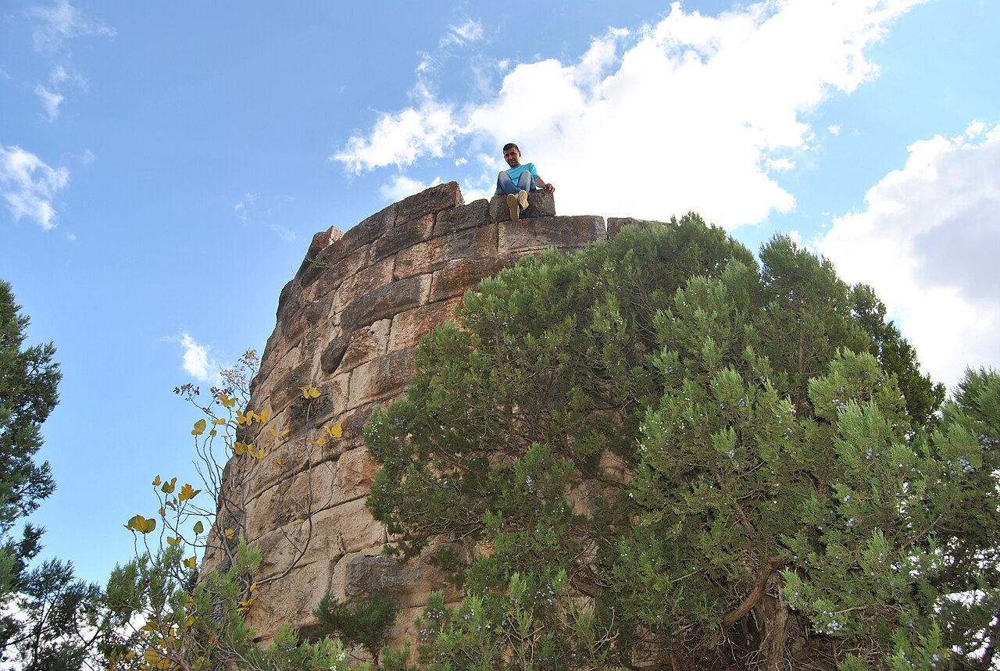
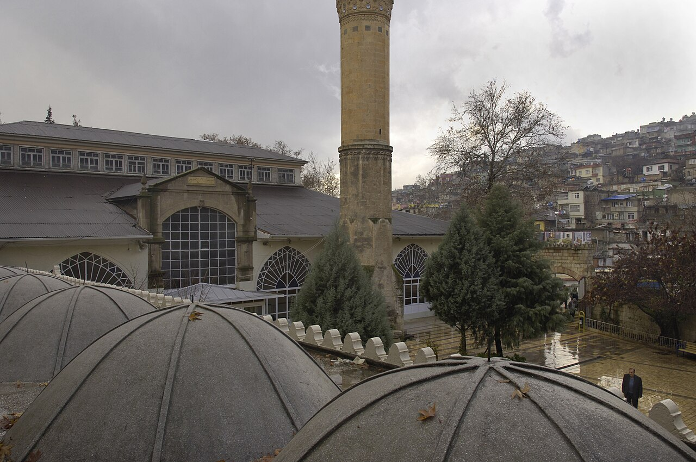

# 📍 Kahramanmaraş - Seyahat Öncesi Keşif Dosyası

  

## 📜 Seyyahın Beklentisi
> "Henüz adımlanmamış her yol, içinde koca bir hikaye saklar; Yedi Güzel Adam'ın şiir ocağında, istiklalin kahraman kalesinde ve Eshab-ı Kehf'in asırlık sükûnetinde edebiyat ile tarihin izini sürmeyi bekleyen bir durak."

### 🌍 Şehrin Dokusu ve Tarihsel Arka Planı
Ahir Dağı'nın eteklerine yaslanan Kahramanmaraş, Geç Hitit döneminin **Gurgum** krallığından Roma'nın **Germanicia** kentine, Anadolu Selçukluları'ndan **Dulkadiroğulları Beyliği**'ne kadar kesintisiz bir medeniyet mirası taşır. 1920'de kendi imkânlarıyla yürüttüğü direnişle İstiklal Madalyası alan ve "Kahraman" unvanını kazanan şehir, aynı zamanda modern Türk edebiyatının en güçlü damarlarından biri olan **Yedi Güzel Adam** geleneğinin doğduğu, UNESCO Edebiyat Şehri unvanlı bir kültür başkentidir.

### 💬 Şehir Hakkında Edebi ve Tarihi Alıntılar
> "Maraş, bir şehirden fazlasıdır; bir şiir iklimi, bir direniş ahlakı ve kalbin Anadolu'ya açılan kapısıdır." — Yedi Güzel Adam Mirası
>
> "Bir de kuşlar var hâkim bey, her şeyin başı onlar; gökyüzü Maraş'ın üstünde başka türlü bir genişlik taşır." — Cahit Zarifoğlu'nun İzinde

### 🕌 Manevi Mimarlar ve Tarihî Şahsiyetler
- **Yedi Güzel Adam (Cahit Zarifoğlu, Erdem Bayazıt, Rasim Özdenören, Nuri Pakdil, Alaeddin Özdenören, Mehmet Akif İnan, Ali Kutlay):** Maraş Lisesi sıralarından başlayarak Türk düşünce, şiir ve öykü dünyasına yön veren edebiyat ve fikir çınarları.
- **Sütçü İmam & Rıdvan Hoca:** Maraş Millî Mücadelesi'nin kıvılcımını yakan, "Hürriyeti olmayan bir milletin cuma namazı kılması caiz değildir" diyerek bağımsızlık ruhunu ateşleyen öncüler.
- **Alâüddevle Bozkurt Bey (Dulkadiroğulları):** Kahramanmaraş Ulu Camii, Taş Medrese ve Hatuniye Camii ile şehre mimari kimliğini kazandıran beylik lideri.
- **Abdurrahim Karakoç & Âşık Mahzuni Şerif:** Elbistan ve Afşin topraklarından yükselip Anadolu'nun sevdasını, acısını ve hicvini dizelere döken büyük halk ozanları.

### 🍽️ Yöresel Lezzet Rehberi
- **Maraş Dondurması:** Ahir Dağı'nın keçi sütü ve dağ salebiyle dövülerek hazırlanan dünyaca ünlü geleneksel lezzet.
- **Maraş Tarhanası:** Yoğurt ve dövmenin güneş altında çiğlerde kurutulmasıyla elde edilen, cips gibi de tüketilen şifa kaynağı.
- **Eli Böğründe (Yanyana) & Maraş Paçası:** Odun fırınında ağır ağır pişen kuzu etli sebze yemeği ve sarımsaklı-sumaklı meşhur kelle paça.
- **İçli Köfte, Sömelek Köfte & Ravanda Şerbeti:** Tarihi Kapalı Çarşı çevresindeki esnaf lokantalarında deneyimlenecek köklü mutfak mirası.

### ⛺ Planlanan Konaklama ve Lojistik
- **Modern Kervansaraylar (KYK / Seyahatsever):** GSB Seyahatsever programı dahilinde Kahramanmaraş merkezdeki KYK yurtlarında 5 günlük ücretsiz konaklama planı.
- **Rota Bağlantısı:** Osmaniye – Adana veya Gaziantep – Adıyaman hattıyla bütünleşik, şehir içi ve ilçe ulaşımında toplu taşıma odaklı lojistik kurgu.

### 💻 Planlanan Kütüphane Mesaisi (Yarı Göçebe Ofis)
- **Hedef İlim Yuvası:** **Kahramanmaraş İl Halk Kütüphanesi (ve Yedi Güzel Adam Edebiyat Müzesi Çevresi)** — Edebiyat ve düşünce iklimi içinde sessiz çalışma salonları, yüksek odaklanma ve araştırma imkânı sunan verimli bir ilim mekânı.
- **Çalışma Ritmi:** Sabah yazılım ve okuma mesaisi; ikindi vakti tarihi çarşılarda, bakırcıların çekiç sesleri arasında ve edebiyat duraklarında yürüyüş.

### 🧭 Planlanan 5 Günlük Menzil Rotası
- **1. Gün – Yedi Güzel Adam ve Tarihi Çekirdek:** Sabah İl Halk Kütüphanesi mesaisi; ikindi sonrası **Yedi Güzel Adam Edebiyat Müzesi**, **Kahramanmaraş Ulu Camii**, **Taş Medrese**, **Tarihi Kapalı Çarşı & Bakırcılar Çarşısı** ve **Maraş Kalesi**.
- **2. Gün – Mozaikler ve Millî Mücadele Hafızası:** Kütüphane sonrası **Kahramanmaraş Arkeoloji Müzesi**, **Germanicia Antik Kenti Mozaikleri**, **Sütçü İmam Türbesi** ve **Kurtuluş Panorama Müzesi**.
- **3. Gün – Asırlık Uykunun Mekânı (Afşin Eshab-ı Kehf):** Kuzeye doğru **Afşin Eshab-ı Kehf Külliyesi** (Selçuklu ribatı, mescidi ve kervansarayı ile manevi tefekkür) ve Elbistan Pınarbaşı kaynağı.
- **4. Gün – Ahir Dağı ve Başkonuş Yaylası:** Toroslar'ın sedir ve köknar ormanları arasında **Başkonuş Yaylası**, **Ali Kayası Cam Teras** ve **Menzelet Baraj Gölü** manzarası.
- **5. Gün – Geleneksel El Sanatları ve Veda:** Tarihi **Taş Han**'da kahve molası, sim sırma ve ahşap oymacılığı atölyelerine uğrama, kütüphanede notların temize çekilmesi ve yola çıkış.

### ✨ Keşfedilecek Duraklar ve Landmarks
Bu kadim şehre ayak basıldığında mutlaka adımlanması planlanan köşe taşları:
- [ ] **Yedi Güzel Adam Edebiyat Müzesi**
- [ ] **Kahramanmaraş Kalesi ve Tarihi Kapalı Çarşı**
- [ ] **Kahramanmaraş Ulu Camii ve Taş Medrese**
- [ ] **Eshab-ı Kehf Külliyesi (Afşin)**
- [ ] **Germanicia Antik Kenti Mozaikleri ve Arkeoloji Müzesi**
- [ ] **Başkonuş Yaylası ve Ali Kayası**

### 📸 Menzil Fotoğraf Galerisi
<table>
  <tr>
    <td align="center" width="50%">
       
      <b>Ahir Dağı'nın Gölgesinde Şiir ve Direniş Şehri</b>
    </td>
    <td align="center" width="50%">
       
      <b>Dulkadiroğlu Mirası, Eshab-ı Kehf ve Edebiyat İklimi</b>
    </td>
  </tr>
</table>

---
*Henüz adımlanmamış bu kadim Akdeniz menzili, gelecek rüzgarlarla yollarımızın kesişmesi ve seyahatnameye bizzat işlenmesi dileğiyle keşif dosyası olarak hazırlanmıştır.*
