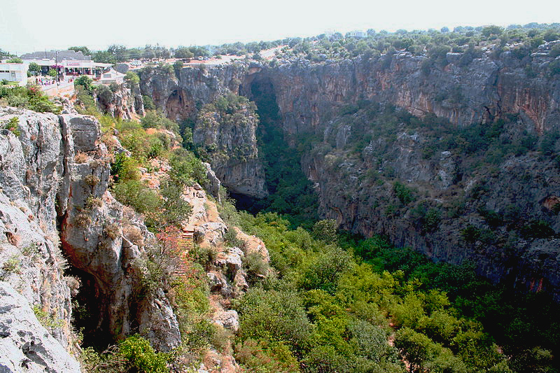

# 📍 Mersin - Seyahat ve Tefekkür Notları

  

## 📜 Şehrin Ruhu
> "Akdeniz kıyısında uzanan palmiyeleri, Kızkalesi ve antik kentleriyle tarihin denizle buluştuğu liman kent."

### 🌍 Şehrin Dokusu ve Tarihsel Arka Planı
Yumuktepe höyüğüyle 9000 yıllık geçmişe sahip olan Mersin, Klikya'nın kapısı olmuş ve Osmanlı'nın son döneminde büyük bir ticaret limanına dönüşmüştür.

### 💬 Şehir Hakkında Edebi ve Tarihi Alıntılar
> "Mersin, Akdeniz'in parlayan yıldızı, tarihin denizle kucaklaştığı yerdir." — Özdemir İnce
>
> "Kızkalesi, dalgaların ortasında yükselen bir efsane abidesidir." — Evliya Çelebi
>

### 🕌 Manevi Mimarlar ve Tarihî Şahsiyetler
- **Hz. Danyal (a.s.) ve Lokman Hekim:** Tarsus'un kadim tarihinde makamı ve hikmet mirasıyla şehre manevi derinlik katan peygamber ve bilge.
- **Bilâl-i Habeşî (r.a.) Makamı ve Ashab-ı Kehf (Tarsus):** Kur'an kıssalarının ve erken İslam tarihinin Anadolu'daki en güçlü yankılarından biri olan Tarsus'un manevi mirası.
- **Halife Me'mûn:** Abbâsî halifesi olarak Tarsus'ta vefat edip defnedilen, ilim ve tercüme hareketlerinin öncüsü.
- **Karacaoğlan (Mut & Toros Yaylaları):** Mersin'in Mut ilçesi ve Toros yaylalarında sazının teli hâlâ çınlayan büyük halk şairi.

### 🕊️ Gezginin Not Defterinden (Manevi Boyut ve Tefekkür)
Kizkalesi'nin açıklarında denizin dalgalarını dinlerken, insan yapısı kalelerin bile zamanın aşındırmasına karşı duramayacağını tefekkür edersiniz.

### 🍽️ Yöresel Lezzet Tavsiyeleri
- **Yerel Tatlar ve İkramlar:** Şehrin yerel esnaf lokantalarında ve pazar yerlerinde deneyimlenen bütçe dostu, kültürel dokuyu yansıtan eşsiz lezzetler; sacda hazırlanan **Mersin Tantunisi**, havuçtan yapılan **Cezerye**, çöven kökü köpüğüyle sunulan **Kerebiç**, **Tarsus Humusu**, **Sıkma-Börek** ve **Tarsus Şalgamı**.
- **Tefekkür Eşliğinde Çay/Kahve:** Şehrin tarihi kıraathanelerinde veya doğa manzaralı tepelerinde yudumlanan demli çaylar; Mersin Kültür Park sahil şeridinde ve Tarsus Şelalesi kıyısında serin bir mola.

### ⛺ Konaklama ve Bütçe Stratejisi
- **Sıfır Konaklama Maliyeti (Modern Kervansaraylar):** GSB Seyahatsever projesi kapsamında şehirdeki KYK yurtlarında 5 gün boyunca ücretsiz konaklanarak bütçe korunmuştur.
- **Ulaşım ve Lojistik Planlama:** Rota optimizasyonuna uyularak komşu iller sırayla takip edilmiş, böylece hem yol maliyeti minimuma indirilmiş hem de karbon ayak izi azaltılmıştır.

### 💻 Yarı Göçebe Mesaisi (İlim Tahsili & Kütüphane)
- **Kütüphane Rutini:** Gündüz vakitlerinde şehrin İl Halk Kütüphanesinde zaman geçirilerek bilgisayar başında yazılım geliştirme ve ders çalışma faaliyetleri sürdürülmüştür.
  * *Seyyahın Kütüphane Notu:* Mersin İl Halk Kütüphanesi - Sessiz, çalışma disiplinine uygun, internet imkanı sunan verimli bir ilim yuvası.
- **Süre ve Uyum:** Kütüphane mesaisi bitiminde şehrin ruhuna karışmak üzere yollara düşülmüş, 5 günlük menzil süresiyle şehir sindirilerek keşfedilmiştir.

### 🧭 5 Günlük Menzil Rotası
- **1. Gün – Mersin Merkez ve 9000 Yıllık Höyük:** Sabah İl Halk Kütüphanesi mesaisi; ikindi sonrası **Yumuktepe Höyüğü**, **Mersin Deniz Müzesi**, **Muğdat Camii** ve palmiyeli sahil yürüyüşü.
- **2. Gün – Tarsus'un Manevi ve Kadim Rotası:** **Tarsus Ulu Camii**, **Makam-ı Danyal Camii**, **Nusret Mayın Gemisi Parkı**, **Kleopatra Kapısı**, **St. Paul Kuyusu** ve **Tarsus Eshab-ı Kehf Mağarası**.
- **3. Gün – Kilikya'nın Kıyısında (Kızkalesi & Kanlıdivane):** Erdemli-Silifke hattında **Kanlıdivane Antik Kenti**, **Adamkayalar** ve gün batımında **Kızkalesi (Korykos)** seyri.
- **4. Gün – Yer Altı ve Gök Arasında (Cennet-Cehennem & Astım Mağarası):** **Cennet ve Cehennem Obrukları**, **Astım Mağarası** ve **Narlıkuyu Mozaik Müzesi** rotası.
- **5. Gün – Soli Pompeiopolis ve Veda:** Mezitli'deki **Soli Pompeiopolis Sütunlu Caddesi** ziyareti, kütüphanede çalışma haftasının kapatılması ve seyahatname notlarının güncellenmesi.

### ✨ Keşfedilesi Duraklar ve Landmarks
Bu şehrin havasını solumak, ruhuna dokunmak için mutlaka adımlanması gereken köşe taşları:
- [ ] **Kızkalesi (Deniz Kalesi)**
- [ ] **Cennet ve Cehennem Obrukları**
- [ ] **Kanlıdivane Antik Kenti**
- [ ] **Tarsus Eshab-ı Kehf Mağarası ve Makam-ı Danyal**
- [ ] **Yumuktepe Höyüğü**
- [ ] **Soli Pompeiopolis Antik Kenti**

### 📸 Menzil Fotoğraf Galerisi
<table>
  <tr>
    <td align="center" width="50%">
       
      <b>Akdeniz'in Ortasında Yükselen Kızkalesi</b>
    </td>
    <td align="center" width="50%">
       
      <b>Kilikya'nın Antik İzleri ve Tarsus'un Derinliği</b>
    </td>
  </tr>
</table>

---
*Bu il bizzat deneyimlenmiş, yolları aşındırılmış ve seyahatnameye sevgiyle işlenmiştir.* ✅
