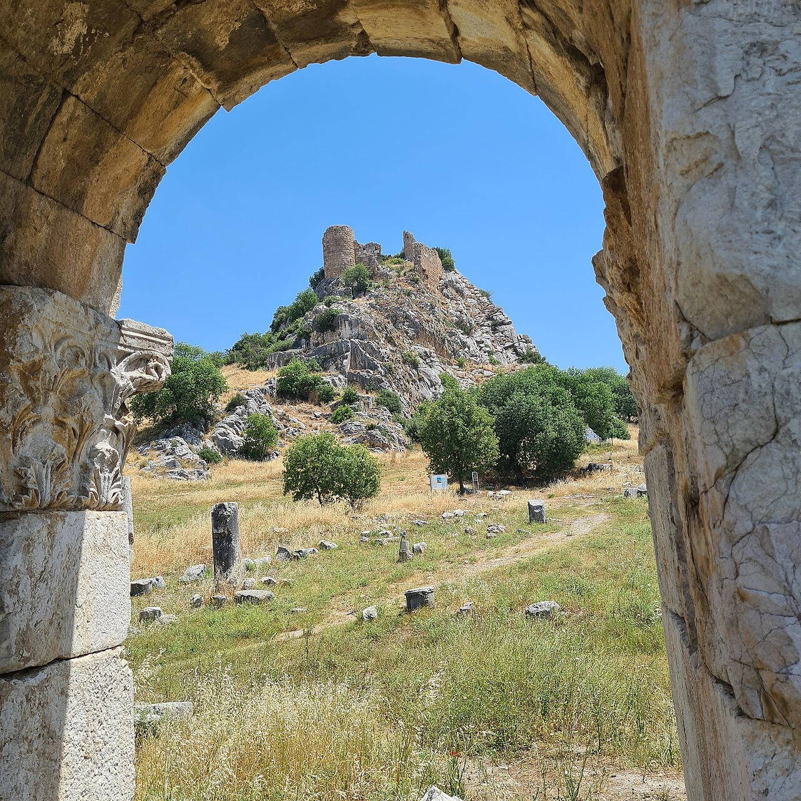
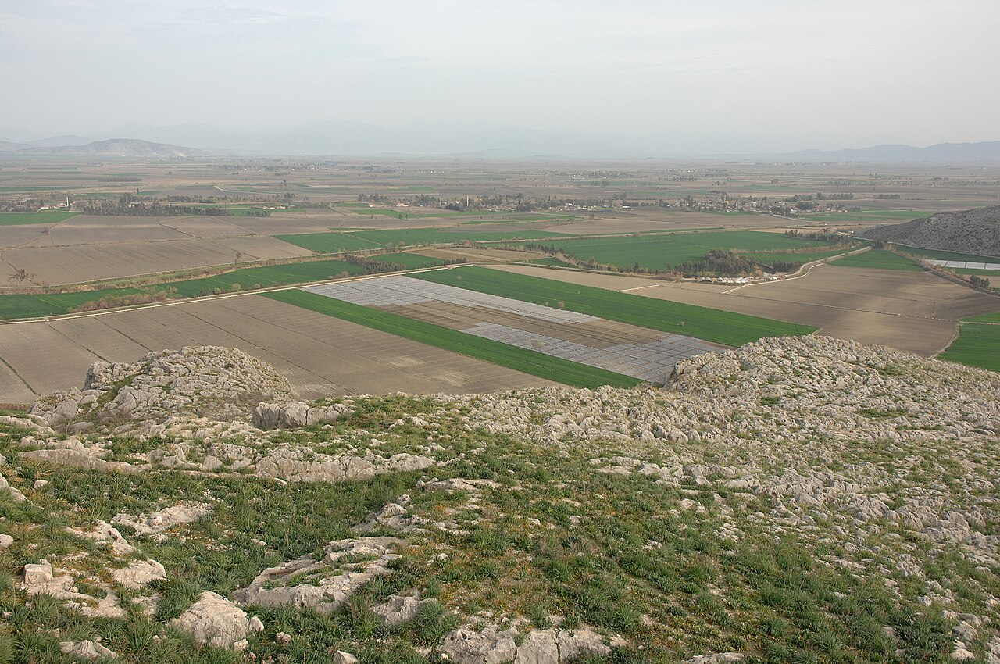

# 📍 Osmaniye - Seyahat Öncesi Keşif Dosyası

  

## 📜 Seyyahın Beklentisi
> "Henüz adımlanmamış her yol, içinde koca bir hikaye saklar; Çukurova'nın doğu kapısında, Hitit hiyerogliflerinin sırrını çözen Karatepe-Aslantaş kabartmalarında ve kaleler kuşağında tarihin nöbetini izlemeyi bekleyen bir durak."

### 🌍 Şehrin Dokusu ve Tarihsel Arka Planı
Amanos (Nur) Dağları ile Ceyhan Nehri'nin bereketli ovası arasında uzanan Osmaniye, tarih boyunca Anadolu ile Suriye ve Mezopotamya'yı birbirine bağlayan stratejik geçitlerin bekçisi olmuştur. Kadirli yakınlarındaki **Karatepe-Aslantaş Açık Hava Müzesi**, M.Ö. 8. yüzyıldan kalma Fenike ve Luvi dillerindeki çift dilli yazıtlarıyla Hitit hiyerogliflerinin çözülmesini sağlayan dünya çapında bir arkeolojik hazinedir. "Kaleler Diyarı" olarak anılan şehirde **Toprakkale**, **Bodrumkale (Kastabala)** ve **Hemite Kalesi** ovaya hâkim tepelerde asırlardır nöbet tutar.

### 💬 Şehir Hakkında Edebi ve Tarihi Alıntılar
> "Karatepe'nin taşlarına kazınmış o çift dilli yazıtlar, Anadolu'nun unutulmuş dilini yeniden insanlığa konuşturmuştur." — Arkeoloji Tarihi Notları
>
> "Hemite'nin sırtlarından Çukurova'ya bakınca, toprağın bereketi ile Toroslar'ın vakarı tek bir ufukta birleşir." — Çukurova Seyahat Notları

### 🕌 Manevi Mimarlar ve Tarihî Şahsiyetler
- **Prof. Dr. Halet Çambel:** Karatepe-Aslantaş kazılarını ömrü boyunca sürdürerek Türkiye'nin ilk açık hava müzesini kuran, bölgenin kilim ve kültür mirasını da koruyan öncü arkeolog.
- **Yaşar Kemal:** Osmaniye'nin Hemite (Gökçedam) köyünde doğup büyüyen, çocukluk hafızasındaki Çukurova'yı ve Toros efsanelerini *İnce Memed* ile dünya edebiyatına armağan eden büyük romancı.
- **Karacaoğlan:** Osmaniye, Düziçi ve Bahçe yaylalarında izleri ve şelalesiyle anılan, Akdeniz'in duru Türkçe şairi.
- **Kadirli Ala Cami Mirası:** Roma tapınağı, Bizans kilisesi ve Dulkadiroğlu camisi katmanlarını tek bünyede barındıran, medeniyet sürekliliğinin simgesi.

### 🍽️ Yöresel Lezzet Rehberi
- **Osmaniye Yer Fıstığı:** Türkiye'nin yer fıstığı başkenti olan şehrin coğrafi işaretli ürünü; taze kavrulmuşu ve ezmesiyle yol azığının vazgeçilmezi.
- **Tırşık Çorbası (Andırın/Kadirli Usulü):** Yabani yılan pancarı otunun yoğurt ve unla mayalanarak uzun saatler pişirilmesiyle yapılan şifalı yöresel çorba.
- **Bayram Kömbesi & Etli Kömbe:** Özel baharatlarla yoğrulup taş fırında pişen, Çukurova misafirperverliğinin sembolü.
- **Toğga Çorbası, Zorkun Tava & Şalgam:** Yayla serinliğinde veya şehir merkezindeki esnaf lokantalarında tadılması planlanan yerel lezzetler.

### ⛺ Planlanan Konaklama ve Lojistik
- **Modern Kervansaraylar (KYK / Seyahatsever):** GSB Seyahatsever programı kapsamında Osmaniye merkezdeki KYK yurtlarında 5 gün boyunca ücretsiz ve güvenli konaklama planı.
- **Rota Bağlantısı:** Adana – Hatay – Kahramanmaraş üçgeninin tam kavşak noktasında yer alan Osmaniye, Doğu Akdeniz rotasının en verimli geçiş menzilidir.

### 💻 Planlanan Kütüphane Mesaisi (Yarı Göçebe Ofis)
- **Hedef İlim Yuvası:** **Osmaniye Emine Keskiner İl Halk Kütüphanesi** — Sessiz, düzenli çalışma ortamı ve bilgisayar başında kodlama/okuma mesaisine elverişli salonlarıyla gündüz ofisi olarak planlanan merkez.
- **Çalışma Ritmi:** Sabah kütüphane disiplini ve teknik üretim; ikindi sonrasında kaleler, antik kentler ve Ceyhan kıyısında keşif yürüyüşleri.

### 🧭 Planlanan 5 Günlük Menzil Rotası
- **1. Gün – Şehir Merkezi ve Kaleler Kuşağı:** Sabah Emine Keskiner İl Halk Kütüphanesi mesaisi; ikindi sonrası **Toprakkale Kalesi**, **Osmaniye Kent Müzesi** ve **Envar-ül Hamit Camii** ziyareti.
- **2. Gün – Hitit Hiyerogliflerinin Anahtarı (Karatepe-Aslantaş):** Kadirli yönünde **Karatepe-Aslantaş Açık Hava Müzesi ve Milli Parkı** (Aslantaş Baraj Gölü kıyısında kabartmalar), ardından **Kadirli Ala Cami**.
- **3. Gün – Sütunlu Cadde ve Yaşar Kemal'in Köyü:** **Kastabala (Hierapolis) Antik Kenti** (tiyatro, sütunlu cadde ve Bodrumkale), ardından Ceyhan kıyısında **Hemite (Gökçedam) Köyü** ve **Yaşar Kemal Kültür Evi**.
- **4. Gün – Amanoslar'ın Serinliği (Zorkun & Karacaoğlan):** Çukurova sıcağından **Zorkun Yaylası** çam ormanlarına çıkış; **Düziçi Karacaoğlan Şelalesi** ve **Sabun Çayı Şelalesi** yürüyüşü.
- **5. Gün – Kuş Cenneti ve Veda:** **Kırmıtlı Kuş Cenneti**'nde (Ceyhan Nehri sulak alanı) sabah gözlemi, yer fıstığı çarşısından yol azığı temini, kütüphanede son notların yazımı ve yola çıkış.

### ✨ Keşfedilecek Duraklar ve Landmarks
Bu kadim şehre ayak basıldığında mutlaka adımlanması planlanan köşe taşları:
- [ ] **Karatepe-Aslantaş Açık Hava Müzesi ve Milli Parkı**
- [ ] **Kastabala (Hierapolis) Antik Kenti ve Bodrumkale**
- [ ] **Toprakkale Kalesi**
- [ ] **Hemite (Gökçedam) Köyü ve Yaşar Kemal Kültür Evi**
- [ ] **Kadirli Ala Cami**
- [ ] **Zorkun Yaylası ve Karacaoğlan Şelalesi**

### 📸 Menzil Fotoğraf Galerisi
<table>
  <tr>
    <td align="center" width="50%">
       
      <b>Karatepe-Aslantaş Kabartmaları ve Amanos Etekleri</b>
    </td>
    <td align="center" width="50%">
       
      <b>Kastabala Antik Kenti ve Çukurova'nın Doğu Kapısı</b>
    </td>
  </tr>
</table>

---
*Henüz adımlanmamış bu kadim Akdeniz menzili, gelecek rüzgarlarla yollarımızın kesişmesi ve seyahatnameye bizzat işlenmesi dileğiyle keşif dosyası olarak hazırlanmıştır.*
