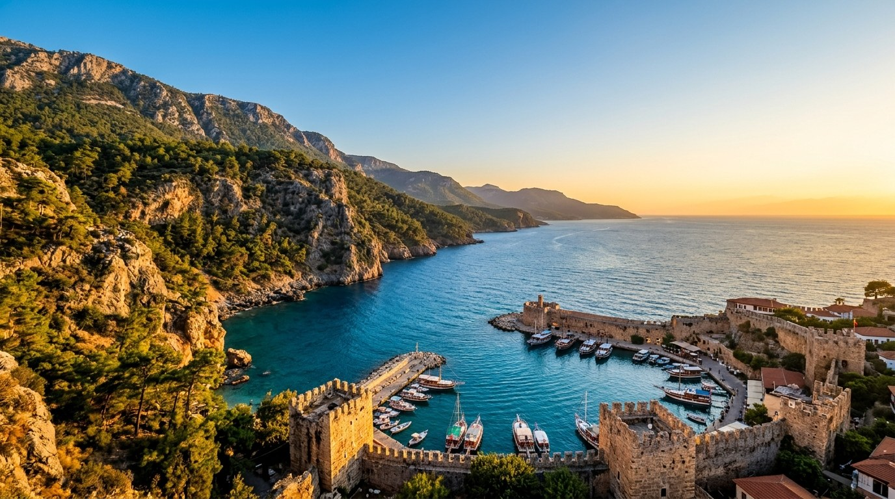
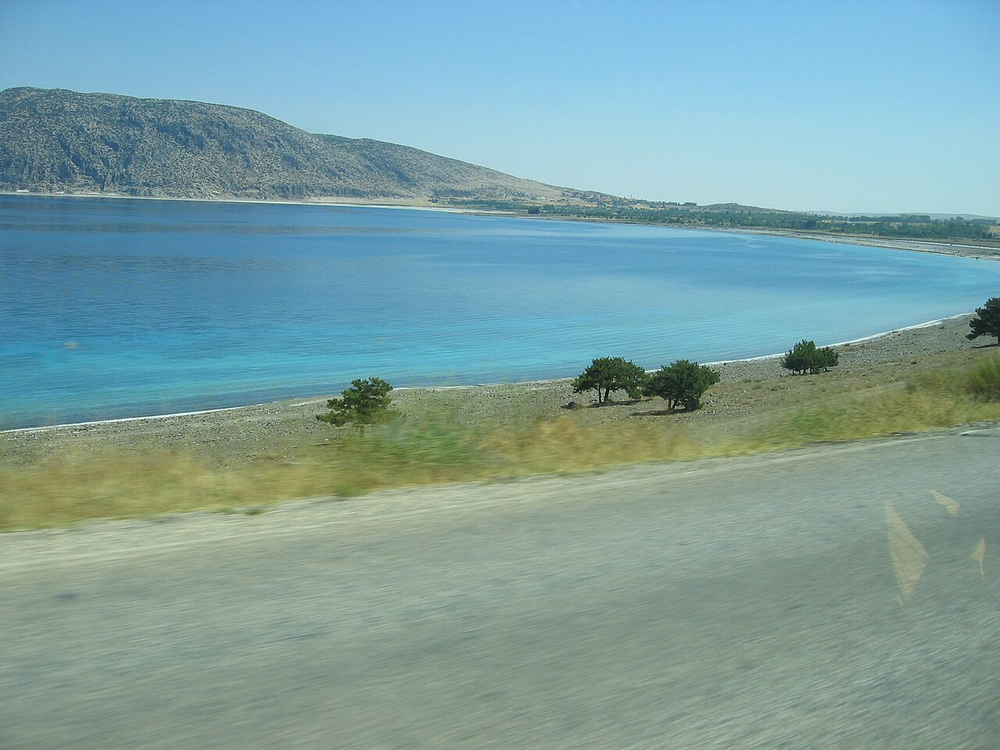
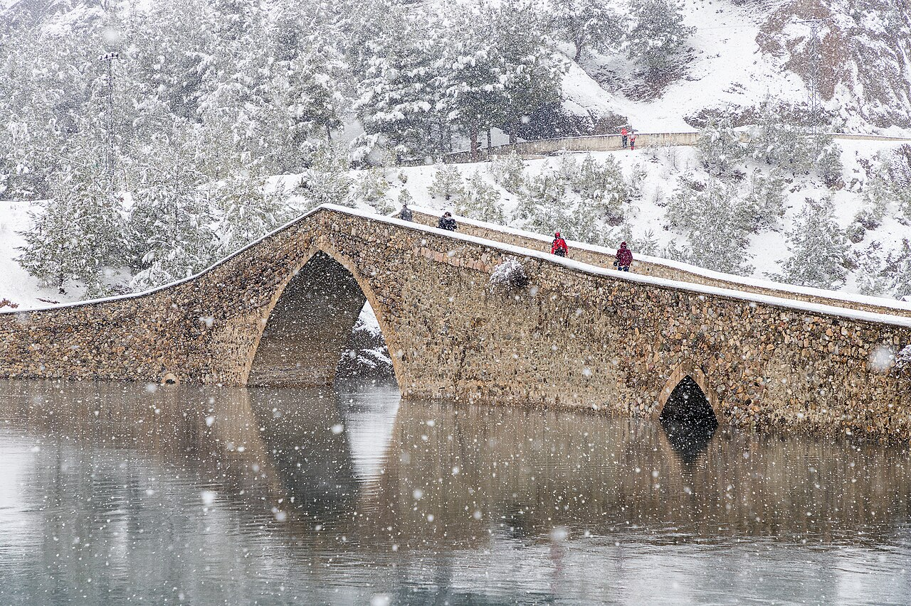
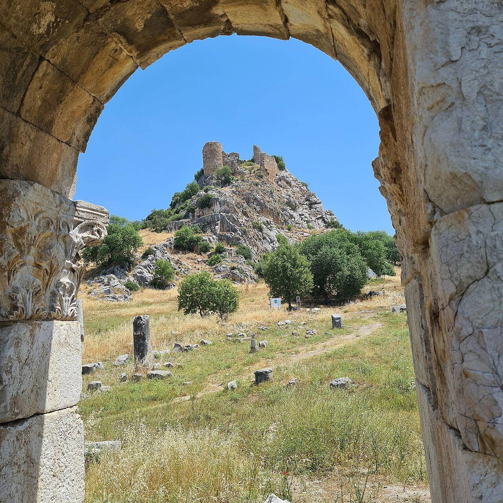

# ☀️ Akdeniz Bölgesi

> *Sıcaklık & Antik Limanlar: Torosların heybetiyle kucaklaşan bin yıllık limanlar ve bereket ovaları.*

**Keşif İlerlemesi:** `5 / 8 İl` (**%62.5**) &nbsp;•&nbsp; [🏠 Ana Sayfaya Dön](../README.md) &nbsp;•&nbsp; [🌐 Web Portalı](https://bahattinyunus.github.io/dijitalseyyah/)

---

## 🖼️ Bölge İlleri Görsel Rehberi

<table>
  <tr>
    <td align="center" width="33%" valign="top">
       
      <strong><a href="Adana/README.md">01 • Adana</a></strong> 
      ✅ Gezildi • 📍 Taşköprü 🍽️ Adana Kebap
    </td>
    <td align="center" width="33%" valign="top">
       
      <strong><a href="Antalya/README.md">07 • Antalya</a></strong> 
      ✅ Gezildi • 📍 Kaleiçi 🍽️ Antalya Piyazı (Tahinli)
    </td>
    <td align="center" width="33%" valign="top">
       
      <strong><a href="Burdur/README.md">15 • Burdur</a></strong> 
      ⏳ Bekliyor • 📍 Salda Gölü 🍽️ Burdur Şiş
    </td>
  </tr>
  <tr>
    <td align="center" width="33%" valign="top">
       
      <strong><a href="Hatay/README.md">31 • Hatay</a></strong> 
      ✅ Gezildi • 📍 Habib-i Neccar Camii 🍽️ Künefe
    </td>
    <td align="center" width="33%" valign="top">
       
      <strong><a href="Isparta/README.md">32 • Isparta</a></strong> 
      ✅ Gezildi • 📍 Eğirdir Gölü 🍽️ Isparta Kebabı (Fırın Kebap)
    </td>
    <td align="center" width="33%" valign="top">
       
      <strong><a href="Kahramanmaras/README.md">46 • Kahramanmaraş</a></strong> 
      ⏳ Bekliyor • 📍 Maraş Kalesi 🍽️ Maraş Dondurması
    </td>
  </tr>
  <tr>
    <td align="center" width="33%" valign="top">
       
      <strong><a href="Mersin/README.md">33 • Mersin</a></strong> 
      ✅ Gezildi • 📍 Kızkalesi 🍽️ Tantuni
    </td>
    <td align="center" width="33%" valign="top">
       
      <strong><a href="Osmaniye/README.md">80 • Osmaniye</a></strong> 
      ⏳ Bekliyor • 📍 Kastabala Antik Kenti 🍽️ Osmaniye Yer Fıstığı
    </td>
    <td width="33%"></td>
  </tr>
</table>

---

*Anadolu Seyahatnamesi — Dijital Seyyah Bölge Dosyası*
