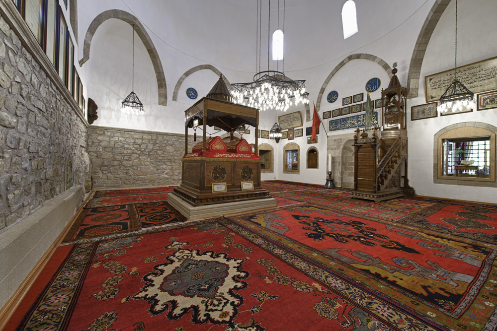

# 📍 Aksaray - Seyahat ve Tefekkür Notları

  

## 📜 Şehrin Ruhu
> "Ihlara Vadisi'nin dik yamaçları arasında, Melendiz Çayı'nın şırıltısıyla demlenen bozkırın mistik kapısı."

### 🌍 Şehrin Dokusu ve Tarihsel Arka Planı
Kapadokya'nın batı kapısı olan Aksaray, Selçuklu döneminde İpekyolu'nun en güvenli ve zengin konaklama merkezlerinden biri olmuştur. Neolitik çağın Anadolu'daki en eski yerleşimlerinden Aşıklı Höyük'ten, Hititlerin ve Kapadokya Krallığı'nın izlerine, II. Kılıç Arslan'ın "Şehr-i Süleha" (Salihler Şehri) diye adlandırdığı ve imar ettiği Selçuklu kervansaraylarına kadar uzanan derin bir hafızaya sahiptir. Hasan Dağı'nın vakur gölgesinde şekillenen şehir, Sultanhanı Kervansarayı ile Anadolu ticaret ve ilim yollarının kalbi olmuş; taş işçiliği, vakıf kültürü ve tasavvuf geleneğiyle bozkırda sarsılmaz bir medeniyet kurmuştur.

### 🕌 Manevi Mimarlar ve Tarihî Şahsiyetler
- **Somuncu Baba (Şeyh Hamid-i Veli Hazretleri):** Bursa Ulu Camii'nin açılış hutbesinin ardından şöhretten kaçarak Aksaray'a yerleşen, Hacı Bayram-ı Veli'nin mürşidi ve gönül mimarı. Ervah Kabristanı'nın sırtlarında yer alan külliyesi, şehrin en dingin manevi durağıdır.
- **Taptuk Emre:** Yunus Emre'nin dergâhında kırk yıl eğri odun dahi taşımadan piştiği büyük mutasavvıfın adı Aksaray'ın Ekecik bölgesindeki yerleşim ve rivayetlerde yaşatılır.
- **Cemaleddin Aksarayî:** XIV. yüzyılda Zinciriye Medresesi'nde dersler vererek Anadolu'da ilim geleneğini güçlendiren büyük müderris ve tabip; Molla Fenari'nin de hocasıdır.
- **II. Kılıç Arslan:** Aksaray'ı saraylar, medreseler ve kervansaraylarla donatarak şehre "Darü'z-Zafer" ve "Darü'r-Ribat" unvanlarını kazandıran Anadolu Selçuklu Sultanı.

### 💬 Şehir Hakkında Edebi ve Tarihi Alıntılar
> "Aksaray, Selçuklu'nun adil kalesi, bozkırın ortasındaki ilim yuvasıdır." — İbn Battûta
>
> "Ihlara, yer altında akan nehrin ve kayalara oyulmuş mabetlerin vadisidir." — Evliya Çelebi

### 🕊️ Gezginin Not Defterinden (Manevi Boyut ve Tefekkür)
Ihlara Vadisi'nin derinliklerinde yürürken, doğanın sabırla kayayı nasıl oyduğunu ve ilk Hristiyanların sığındığı mağaralardaki tefekkür dünyasını hissedersiniz. Akşam ezanına doğru Somuncu Baba Külliyesi'nin avlusunda oturup Ervah Kabristanı'ndan şehrin ışıklarını seyrederken, "şöhret afettir" düsturuyla sırrını ekmek kokusuna gizleyen dervişlerin tevazusu kalbinize dokunur.

### 🍽️ Yöresel Lezzet Tavsiyeleri
- **Yerel Tatlar ve İkramlar:** Şehrin yerel esnaf lokantalarında ve pazar yerlerinde deneyimlenen bütçe dostu, kültürel dokuyu yansıtan eşsiz lezzetler. Özellikle taş fırında ağır ağır pişen **Aksaray Tava**, **Sıkma ve Gözleme**, **Soğanlama**, **Bamya Çorbası** ve meşhur **Aksaray Malaklısı** yöresinin köy yoğurduyla sunulan **Şerbetli İnce Elek Tatlısı** mutlaka tadılmalıdır.
- **Tefekkür Eşliğinde Çay/Kahve:** Şehrin tarihi kıraathanelerinde, Ihlara Vadisi içindeki Melendiz Çayı kenarındaki ahşap sedirlerde veya Somuncu Baba çevresindeki çay bahçelerinde yudumlanan demli çaylar.

### ⛺ Konaklama ve Bütçe Stratejisi
- **Sıfır Konaklama Maliyeti (Modern Kervansaraylar):** GSB Seyahatsever projesi kapsamında şehirdeki KYK yurtlarında 5 gün boyunca ücretsiz konaklanarak bütçe korunmuştur.
- **Ulaşım ve Lojistik Planlama:** Rota optimizasyonuna uyularak komşu iller sırayla takip edilmiş, böylece hem yol maliyeti minimuma indirilmiş hem de karbon ayak izi azaltılmıştır.

### 💻 Yarı Göçebe Mesaisi (İlim Tahsili & Kütüphane)
- **Kütüphane Rutini:** Gündüz vakitlerinde şehrin İl Halk Kütüphanesinde zaman geçirilerek bilgisayar başında yazılım geliştirme ve ders çalışma faaliyetleri sürdürülmüştür.
  * *Seyyahın Kütüphane Notu:* Aksaray İl Halk Kütüphanesi - Sessiz, çalışma disiplinine uygun, internet imkanı sunan verimli bir ilim yuvası.
- **Süre ve Uyum:** Kütüphane mesaisi bitiminde şehrin ruhuna karışmak üzere yollara düşülmüş, 5 günlük menzil süresiyle şehir sindirilerek keşfedilmiştir.

### 🧭 5 Günlük Menzil Rotası
- **1. Gün — Şehir Merkezi ve Selçuklu Mirası:** Sabah İl Halk Kütüphanesi'nde çalışma; öğleden sonra **Eğri Minare (Kızıl Minare)**, **Ulu Camii**, **Zinciriye Medresesi** ve tarihi çarşı yürüyüşü.
- **2. Gün — Somuncu Baba ve Manevi Tefekkür:** Sabah mesaisi sonrası **Somuncu Baba Külliyesi ve Türbesi**, **Ervah Kabristanı** ve **Cemaleddin Aksarayî Türbesi** ziyareti; gün batımında Hasan Dağı manzarası.
- **3. Gün — Ihlara Vadisi ve Belisırma:** Tüm gün doğa ve tarih yürüyüşü; **Ihlara Vadisi**'nden başlayarak Melendiz Çayı boyunca **Ağaçaltı ve Yılanlı Kiliseleri**, **Belisırma** molası ve **Selime Katedrali** keşfi.
- **4. Gün — İpekyolu'nun İncisi Sultanhanı:** Sabah kütüphane oturumu; öğleden sonra Anadolu'nun en görkemli Selçuklu hanı **Sultanhanı Kervansarayı**'na yolculuk ve taş işçiliği incelemesi.
- **5. Gün — Güzelyurt, Aşıklı Höyük ve Veda:** **Güzelyurt (Gelveri)** taş konakları, **Yüksek Kilise**, **Manastır Vadisi** ve insanlık tarihinin en eski yerleşimlerinden **Aşıklı Höyük** ziyaretiyle şehre veda.

### ✨ Keşfedilesi Duraklar ve Landmarks
Bu şehrin havasını solumak, ruhuna dokunmak için mutlaka adımlanması gereken köşe taşları:
- [ ] **Ihlara Vadisi**
- [ ] **Somuncu Baba Türbesi**
- [ ] **Eğri Minare**
- [ ] **Sultanhanı Kervansarayı**
- [ ] **Selime Katedrali ve Güzelyurt**
- [ ] **Zinciriye Medresesi ve Ulu Camii**

### 📸 Menzil Fotoğraf Galerisi
<table>
  <tr>
    <td width="50%" align="center">
       
      <b>Ihlara Vadisi ve Bozkırın Kapısı:</b> Melendiz Çayı ile kayaların asırlık sohbeti
    </td>
    <td width="50%" align="center">
       
      <b>Selçuklu ve Tasavvuf İzleri:</b> Eğri Minare, Sultanhanı ve Somuncu Baba'nın dinginliği
    </td>
  </tr>
</table>

---
*Bu il bizzat deneyimlenmiş, yolları aşındırılmış ve seyahatnameye sevgiyle işlenmiştir.* ✅
