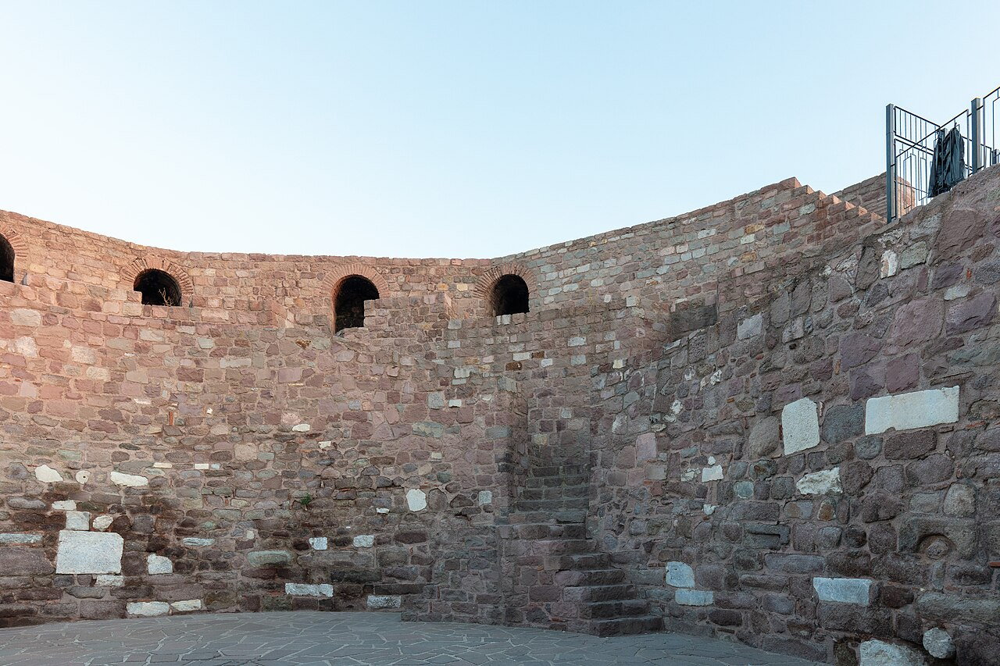

# 📍 Ankara - Seyahat ve Tefekkür Notları

  

## 📜 Şehrin Ruhu
> "Vakur ve tarihi Ankara, Türkiye Cumhuriyeti'nin kalbi, bozkırın ortasında yükselen azim ve kararlılık abidesi."

### 🌍 Şehrin Dokusu ve Tarihsel Arka Planı
Hititlerden Friglere, Romalılardan Selçuklulara uzanan tarihiyle Ankara, 1923'te Türkiye Cumhuriyeti'nin başkenti ilan edilerek modern tarihin dönüm noktası olmuştur. Roma döneminden kalma Augustus Tapınağı'nın hemen bitişiğinde Hacı Bayram-ı Veli Camii'nin yükselmesi, bu şehrin katmanlı medeniyet hafızasının en somut nişanesidir. Bir yanda Ahi Cumhuriyeti döneminin esnaf ahlakı ve Hamamönü'nün ahşap konakları, diğer yanda Ulus'taki Birinci ve İkinci Meclis binalarından Anıtkabir'e uzanan Milli Mücadele ruhu, Ankara'yı yalnızca idari bir merkez değil, derin bir tarih ve irfan başkenti kılar.

### 🕌 Manevi Mimarlar ve Tarihî Şahsiyetler
- **Hacı Bayram-ı Veli Hazretleri:** Bayramiyye tarikatının kurucusu, Anadolu'da Türkçeyi, imeceyi ve gönül birliğini mayalayan büyük mutasavvıf; İstanbul'un fethini müjdeleyen Akşemseddin'in mürşidi.
- **Gazi Mustafa Kemal Atatürk:** Milli Mücadele'yi Ankara'dan yöneten ve Türkiye Cumhuriyeti'ni bozkırın kalbinde inşa eden kurucu lider; ebedi istirahatgâhı Anıtkabir, şehrin manevi ufkunu belirler.
- **Mehmet Âkif Ersoy:** İstiklal Marşı'nı Ankara'da, bugün müze olan **Taceddin Dergâhı**'nda kaleme alan milli şair.
- **Ahi Şerafeddin (Arslanhane):** XIV. yüzyılda Ankara'da Ahilik teşkilatının önderliğini yapan ve adını şehrin en eski ahşap direkli Selçuklu camilerinden Arslanhane Camii'ne veren gönül eri.

### 💬 Şehir Hakkında Edebi ve Tarihi Alıntılar
> "Ankara, bozkırın kalbinde yanan sönmez bir meşaledir." — Yahya Kemal Beyatlı
>
> "Ankara Kalesi, asırlar boyu bozkırın ufkunu bekleyen vakur bir nöbetçidir." — Ahmet Hamdi Tanpınar

### 🕊️ Gezginin Not Defterinden (Manevi Boyut ve Tefekkür)
Anıtkabir'de kurucu iradenin büyüklüğünü ve milletin bağımsızlık aşkını tefekkür eder; Ankara Kalesi'nin surlarından bozkırın ufkunu izlerken geçmiş medeniyetleri düşünürsünüz. Taceddin Dergâhı'nın sessiz avlusunda İstiklal Marşı'nın yazıldığı odaya bakmak ve hemen ardından Hacı Bayram Camii'nin taş duvarlarına yaslanıp Augustus Tapınağı ile yan yana duran tarihe şahit olmak, Ankara'nın dışarıdan soğuk sanılan çehresinin ardındaki sıcak ruhu ortaya çıkarır.

### 🍽️ Yöresel Lezzet Tavsiyeleri
- **Yerel Tatlar ve İkramlar:** Şehrin yerel esnaf lokantalarında ve pazar yerlerinde deneyimlenen bütçe dostu, kültürel dokuyu yansıtan eşsiz lezzetler. Özellikle meşhur **Ankara Tava**, **Beypazarı Kurusu ve Güveci**, Ulus'un tarihi lokantalarında tadılan **Aspava**, **Çubuk Turşusu**, **Ankara Simidi** (pekmezli ve çıtır) ve **Öllüğün Körü** şehrin mutfak mirasını yansıtır.
- **Tefekkür Eşliğinde Çay/Kahve:** Şehrin tarihi kıraathanelerinde, Hamamönü'nün kumda kahve yapan avlularında, Ankara Kalesi surlarına bakan teraslarda veya Eymir Gölü kıyısında yudumlanan demli çaylar.

### ⛺ Konaklama ve Bütçe Stratejisi
- **Sıfır Konaklama Maliyeti (Modern Kervansaraylar):** GSB Seyahatsever projesi kapsamında şehirdeki KYK yurtlarında 5 gün boyunca ücretsiz konaklanarak bütçe korunmuştur.
- **Ulaşım ve Lojistik Planlama:** Rota optimizasyonuna uyularak komşu iller sırayla takip edilmiş, böylece hem yol maliyeti minimuma indirilmiş hem de karbon ayak izi azaltılmıştır.

### 💻 Yarı Göçebe Mesaisi (İlim Tahsili & Kütüphane)
- **Kütüphane Rutini:** Gündüz vakitlerinde şehrin İl Halk Kütüphanesinde zaman geçirilerek bilgisayar başında yazılım geliştirme ve ders çalışma faaliyetleri sürdürülmüştür.
  * *Seyyahın Kütüphane Notu:* Ankara İl Halk Kütüphanesi - Sessiz, çalışma disiplinine uygun, internet imkanı sunan verimli bir ilim yuvası. (Ayrıca Milli Kütüphane ve Cumhurbaşkanlığı Millet Kütüphanesi de şehirdeki ilim mesaisi için eşsiz alternatiflerdir.)
- **Süre ve Uyum:** Kütüphane mesaisi bitiminde şehrin ruhuna karışmak üzere yollara düşülmüş, 5 günlük menzil süresiyle şehir sindirilerek keşfedilmiştir.

### 🧭 5 Günlük Menzil Rotası
- **1. Gün — Cumhuriyetin Kalbi ve Ulus:** Sabah kütüphane mesaisi; öğleden sonra **Anıtkabir**, **I. ve II. TBMM (Kurtuluş Savaşı ve Cumhuriyet Müzeleri)** ve **Etnografya Müzesi** ziyareti.
- **2. Gün — Kadim Ankara ve Kale Yamaçları:** **Ankara Kalesi**, **Anadolu Medeniyetleri Müzesi**, **Arslanhane (Ahi Şerafeddin) Camii** ve **Rahmi M. Koç Müzesi** yürüyüşü.
- **3. Gün — Maneviyat ve Edebiyat Ekseni:** **Hacı Bayram-ı Veli Camii ve Türbesi**, **Augustus Tapınağı**, **Hamamönü Tarihi Evleri** ve Mehmet Âkif'in izinde **Taceddin Dergâhı**.
- **4. Gün — Doğa, Göller ve Modern Ankara:** Sabah Millet Kütüphanesi'nde verimli çalışma; öğleden sonra **Eymir Gölü**'nde bisiklet/yürüyüş, **Kuğulu Park** ve **Atakule** panoraması.
- **5. Gün — Beypazarı veya Gordion Kaçamağı:** Tarihi ipek yolu kasabası **Beypazarı** (İnözü Vadisi, Yaşayan Müze) ya da UNESCO listesindeki Frig başkenti **Gordion Antik Kenti** ziyaretiyle Ankara menzilinin tamamlanması.

### ✨ Keşfedilesi Duraklar ve Landmarks
Bu şehrin havasını solumak, ruhuna dokunmak için mutlaka adımlanması gereken köşe taşları:
- [ ] **Anıtkabir**
- [ ] **Ankara Kalesi**
- [ ] **Hacı Bayram-ı Veli Camii ve Türbesi**
- [ ] **Anadolu Medeniyetleri Müzesi**
- [ ] **Taceddin Dergâhı ve Hamamönü**
- [ ] **Arslanhane (Ahi Şerafeddin) Camii**

### 📸 Menzil Fotoğraf Galerisi
<table>
  <tr>
    <td width="50%" align="center">
       
      <b>Bozkırın Vakur Başkenti:</b> Cumhuriyet iradesi ve kadim surların buluşması
    </td>
    <td width="50%" align="center">
       
      <b>Medeniyet Katmanları:</b> Hacı Bayram-ı Veli, Ankara Kalesi ve Hamamönü sokakları
    </td>
  </tr>
</table>

---
*Bu il bizzat deneyimlenmiş, yolları aşındırılmış ve seyahatnameye sevgiyle işlenmiştir.* ✅
