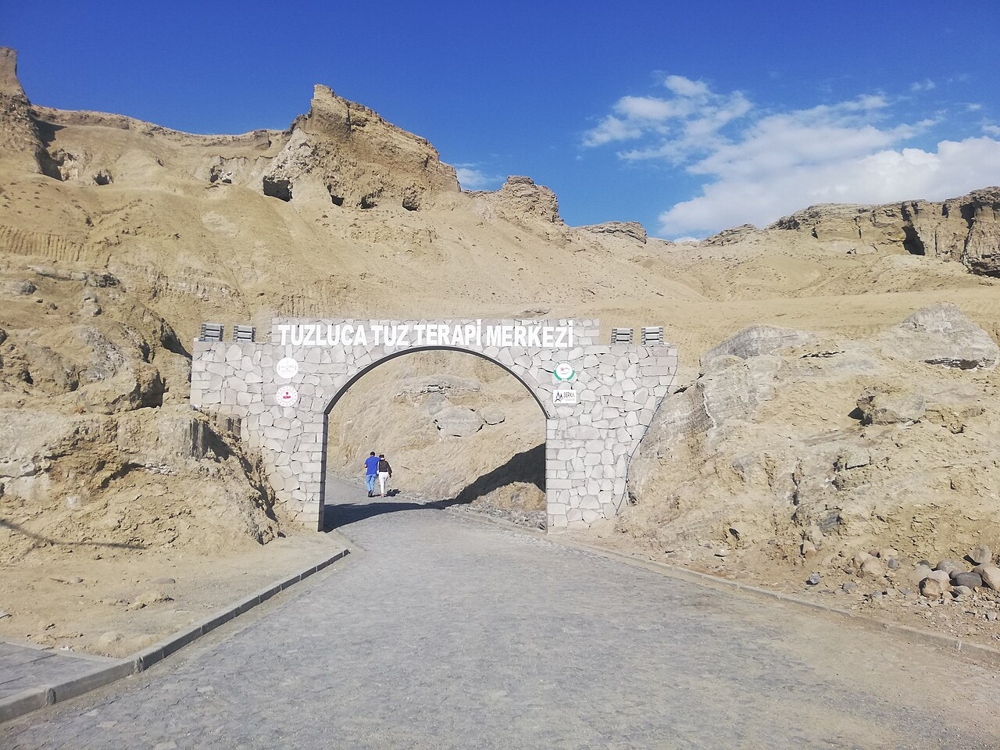
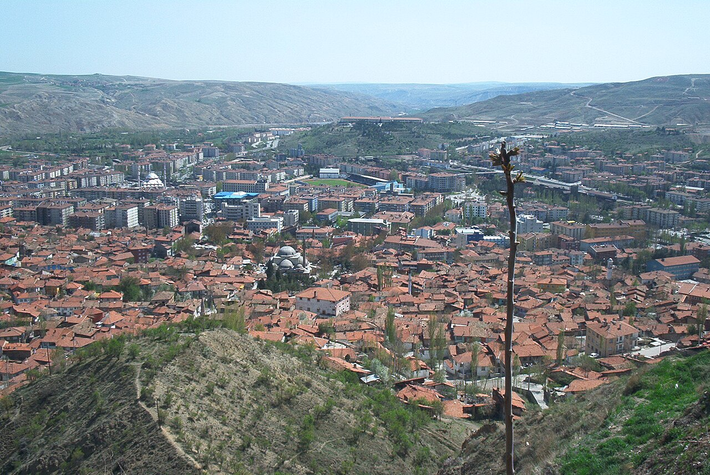

# 📍 Cankiri - Seyahat ve Keşif Dosyası (Planlanan Rota)

  

## 📜 Seyyahın Beklentisi ve Şehrin Ruhu
> "Henüz adımlanmamış her yol, içinde koca bir hikaye saklar; Çankırı'da o hikâye, Yaren meclislerinin edep çemberinde, beş bin yıllık tuz galerilerinde ve Ilgaz'ın çam kokulu rüzgârında demlenir."

### 🌍 Şehrin Dokusu ve Tarihsel Arka Planı
İç Anadolu ile Batı Karadeniz'in kucaklaştığı eşikte, Acıçay ve Tatlıçay vadilerinin arasında yükselen Çankırı (kadim adıyla *Gangra*); Hititler, Paflagonyalılar, Romalılar, Danişmendliler, Anadolu Selçukluları, Candaroğulları ve Osmanlıların izlerini taşıyan vakur bir Anadolu kentidir. 1074 yılında Emir Karatekin Bey tarafından fethedilerek Anadolu'daki ilk Türk-İslam şehirlerinden biri olan Çankırı; XIII. yüzyılda inşa edilen **Taş Mescit (Cemaleddin Ferruh Darüşşifası ve Darülhadisi)** ile Selçuklu'nun şifa ve ilim geleneğini günümüze ulaştırır. Hititlerden bu yana işlenen devasa **Tuz Mağarası**, Kurtuluş Savaşı'nda İnebolu'dan Ankara'ya cephane taşıyan **İstiklal Yolu** üzerindeki stratejik konumu ve UNESCO Somut Olmayan Kültürel Miras Listesi'ndeki **Yaren Kültürü** ile Çankırı, keşfedilmeyi bekleyen sahici bir kültür hazinesidir.

### 🕌 Manevi Mimarlar, Tasavvuf ve Ahilik Mirası
- **Yaren Kültürü ve Ahilik Geleneği:** Ahilik teşkilatının İç Anadolu'daki en canlı sosyal uzantısı olan Çankırı Yaren meclisleri; Başağa, Küçük Başağa ve Reis öncülüğünde kış gecelerinde toplanan, edep, dayanışma, musiki, orta oyunu ve toplumsal ahlakı nesilden nesle aktaran eşsiz bir gönül mektebidir.
- **Emir Karatekin Bey:** Malazgirt sonrası Çankırı'yı fetheden ve şehrin kalesinde medfun bulunan ilk Türk fatihi; şehrin tarihi hafızasının kurucu ismidir.
- **Atabey Cemaleddin Ferruh:** 1235 yılında Taş Mescit Darüşşifası'nı yaptırarak Çankırı'yı Selçuklu tıp ve hadis eğitiminin merkezlerinden biri hâline getiren devlet adamı.
- **Ahmet Mecbur Efendi ve Hacı Murad-ı Veli (Eldivan):** Bölgenin tasavvuf hayatını ve irfan geleneğini şekillendiren, halkın gönlünde derin izler bırakmış manevi önderler.

### 💬 Şehir Hakkında Edebi ve Tarihi Alıntılar
> "Ilgaz, Anadolu'nun sen yüce bir dağısın; baharda yeryüzünde o cennetin bağısın." — Ahmet Cemil (Ilgaz Türküsü)
>
> "Çankırı'da Yaren meclisine giren, yalnızca saz ve söz değil; dostluğun, adaletin ve Anadolu terbiyesinin canlı kitabını okur." — Anadolu Kültür Notları

### 🍽️ Keşfedilmeyi Bekleyen Yöresel Lezzetler
- **Yaren Sofrası ve Ana Yemekler:** Meşhur **Sarımsaklı Et**, ağır ateşte pişen **Çankırı Güveci**, **Tutar (Cızlama / Gözleme)**, **Yoka (Yufka) Ekmeği** ile sunulan **Tirit**, **Bütün Et**, **Mıhlama** ve **Tarhana Çorbası**.
- **Tatlılar ve İkramlar:** Çıtır dokusuyla **Yumurta Tatlısı**, **Höşmerim**, **Hışır Tatlısı** ve Çankırı'nın meşhur **Kaya Tuzu** ile yapılan yöresel peynir/ekmek çeşitleri.
- **Tefekkür Eşliğinde Çay/Kahve:** Tarihi Çamaşırhane (Buğday Pazarı Medresesi) avlusunda veya Ilgaz yaylalarının serin çam gölgesinde demlenecek çaylar.

### 💻 Planlanan Yarı Göçebe Mesaisi (Kütüphane Ofisi)
- **Hedef Çalışma Noktası:** **Çankırı İl Halk Kütüphanesi** (ve tarihi dokuyu solumak için **Buğday Pazarı Medresesi** çevresi).
- **Çalışma ve Keşif Dengesi:** GSB Seyahatsever programı kapsamında KYK yurdunda 5 günlük sıfır maliyetli konaklama; sabahları kütüphanede yazılım ve okuma mesaisi, öğleden sonraları şehrin sokakları, tuz galerileri ve Ilgaz eteklerinde yürüyüş.

### 🧭 Planlanan 5 Günlük Menzil Rotası
- **1. Gün — Şehir Merkezi ve Selçuklu/Osmanlı Mirası:** Sabah kütüphane yerleşimi; öğleden sonra **Çankırı Kalesi (Emir Karatekin Türbesi)**, **Taş Mescit (Şifahane)**, **Sultan Süleyman (Büyük) Camii**, **Buğday Pazarı Medresesi** ve **Tarihi Çamaşırhane**.
- **2. Gün — Yeraltı Tuz Krallığı:** Sabah çalışma oturumu; öğleden sonra 5.000 yıllık **Çankırı Tuz Mağarası** (Tuz Mağarası Galerileri ve heykelleri) ve **Çankırı Müzesi** (paleontoloji ve arkeoloji koleksiyonu) gezisi.
- **3. Gün — Ilgaz Dağı Milli Parkı ve İstiklal Yolu:** Tam gün doğa ve tarih rotası; **Ilgaz Dağı Milli Parkı**, **Kadınçayırı Tabiat Parkı** yürüyüşü ve Milli Mücadele'nin kahramanlık hattı **İstiklal Yolu** durakları.
- **4. Gün — Çerkeş, Kurşunlu ve Eldivan:** Sabah mesaisi sonrası **Eldivan Bülbül Pınarı**, **Hacı Murad-ı Veli Türbesi** veya **Korgun / Alpsarı Göleti** çevresinde dingin bir öğleden sonra.
- **5. Gün — Sakaeli Kaya Mezarları ve Yaren Kültürü:** Orta ilçesinde **Sakaeli Kaya Mezarları ve Peri Bacaları** keşfi; akşamında mümkün olursa bir **Yaren Evi** ziyareti ve geleneksel sohbet kültürüyle Çankırı'ya veda.

### ✨ Adımlanmayı Bekleyen Duraklar (Landmarks Checklist)
- [ ] **Çankırı Tuz Mağarası**
- [ ] **Taş Mescit (Cemaleddin Ferruh Darüşşifası)**
- [ ] **Çankırı Kalesi ve Emir Karatekin Türbesi**
- [ ] **Sultan Süleyman (Büyük) Camii ve Buğday Pazarı Medresesi**
- [ ] **Ilgaz Dağı Milli Parkı**
- [ ] **Çankırı Müzesi ve Tarihi Çamaşırhane**
- [ ] **Sakaeli Kaya Mezarları ve Peri Bacaları**

### 📸 Menzil Fotoğraf Galerisi
<table>
  <tr>
    <td width="50%" align="center">
       
      <b>Beş Bin Yıllık Beyaz Galeri:</b> Çankırı Tuz Mağarası ve Ilgaz'ın dorukları
    </td>
    <td width="50%" align="center">
       
      <b>Edep ve Taş İşçiliği:</b> Taş Mescit, tarihi konaklar ve Yaren kültürünün izleri
    </td>
  </tr>
</table>

---
*Henüz adımlanmamış bu vakur Anadolu durağı, gelecek seferlerin seyir defterine yazılmayı ve Yaren meclislerinin sıcaklığıyla keşfedilmeyi bekliyor.*
