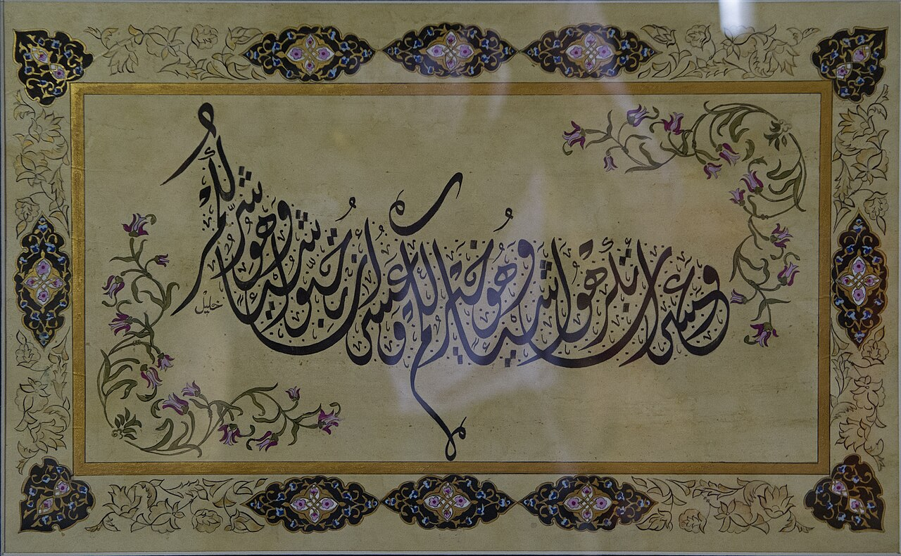

# 📍 Eskisehir - Seyahat ve Tefekkür Notları

  

## 📜 Şehrin Ruhu
> "Porsuk Çayı'nın iki yakasında yükselen, gençliğin, sanatın ve Odunpazarı'nın tarihi evlerinin harmanlandığı kültür şehri."

### 🌍 Şehrin Dokusu ve Tarihsel Arka Planı
Frigya döneminin önemli yerleşimlerinden olan Eskişehir (Dorylaion), Selçuklu ve Osmanlı döneminde de stratejik bir geçiş noktası ve kültür merkezi olmuştur. Anadolu'da Türkçenin gönül diliyle mayalandığı Sivrihisar ve Mihalıççık havzası, Osmanlı'nın ilk hutbesinin okunduğu Karacahisar Kalesi, Kırım ve Balkan muhacirlerinin şehre kattığı zarif şehir kültürü ve Cumhuriyet döneminin demiryolu ile havacılık hamleleri Eskişehir'e kendine has bir kimlik kazandırmıştır. Bugün Porsuk Çayı boyunca uzanan modern yaşam ile Odunpazarı'nın cumbalı Osmanlı evleri aynı gökyüzü altında ahenkle yaşar.

### 🕌 Manevi Mimarlar ve Tarihî Şahsiyetler
- **Yunus Emre:** Mihalıççık ilçesindeki Sarıköy (Yunus Emre) beldesinde medfun, "Sevelim, sevilelim" diyerek Anadolu irfanını Türkçe şiirin zirvesine taşıyan gönül sultanı.
- **Nasreddin Hoca:** Eskişehir'in Sivrihisar ilçesine bağlı Hortu köyünde doğan, ince mizahıyla Anadolu insanına hikmet ve tebessüm miras bırakan bilge.
- **Seyyid Battal Gazi:** Seyitgazi ilçesinde yer alan görkemli külliyesiyle Anadolu'nun fethinde ve alp-eren geleneğinde müstesna bir yere sahip destansı kahraman.
- **Şeyh Edebali ve Osman Gazi'nin İzleri:** Osmanlı Beyliği'nin ilk önemli fetihlerinden Karacahisar'da ilk cuma hutbesini okuyan Dursun Fakih ile erken Osmanlı hafızasının köşe taşları.

### 💬 Şehir Hakkında Edebi ve Tarihi Alıntılar
> "Eskişehir, Porsuk'un suladığı modern bir vaha, Anadolu'nun gülen yüzüdür." — Yılmaz Büyükerşen
>
> "Odunpazarı, ahşabın ve taşın en güzel komşuluk yaptığı tarihi mahalledir." — Evliya Çelebi

### 🕊️ Gezginin Not Defterinden (Manevi Boyut ve Tefekkür)
Odunpazarı'nın Arnavut kaldırımlı sokaklarında yürürken, geçmişin sıcak mahalle kültürünü ve ahşap konaklardaki yaşanmışlıkları tefekkür edersiniz. Kurşunlu Külliyesi'nin avlusunda lületaşı ustalarının sabrına şahit olurken, Porsuk kıyısında akşam serinliğinde yürümek; bir şehrin hem köklerine sadık kalıp hem de çağdaş, yaşanabilir bir sanat kentine dönüşebileceğini kanıtlar.

### 🍽️ Yöresel Lezzet Tavsiyeleri
- **Yerel Tatlar ve İkramlar:** Şehrin yerel esnaf lokantalarında ve pazar yerlerinde deneyimlenen bütçe dostu, kültürel dokuyu yansıtan eşsiz lezzetler. Kırım Tatar mutfağının armağanı çıtır **Çibörek**, **Balaban Köfte**, **Met Helvası**, **Haşhaşlı Çörek** ve **Boza** Eskişehir sofralarının vazgeçilmezleridir.
- **Tefekkür Eşliğinde Çay/Kahve:** Şehrin tarihi kıraathanelerinde, Odunpazarı'ndaki restore edilmiş konakların bahçelerinde veya Porsuk Çayı kenarındaki Adalar bölgesinde yudumlanan demli çaylar.

### ⛺ Konaklama ve Bütçe Stratejisi
- **Sıfır Konaklama Maliyeti (Modern Kervansaraylar):** GSB Seyahatsever projesi kapsamında şehirdeki KYK yurtlarında 5 gün boyunca ücretsiz konaklanarak bütçe korunmuştur.
- **Ulaşım ve Lojistik Planlama:** Rota optimizasyonuna uyularak komşu iller sırayla takip edilmiş, böylece hem yol maliyeti minimuma indirilmiş hem de karbon ayak izi azaltılmıştır.

### 💻 Yarı Göçebe Mesaisi (İlim Tahsili & Kütüphane)
- **Kütüphane Rutini:** Gündüz vakitlerinde şehrin İl Halk Kütüphanesinde zaman geçirilerek bilgisayar başında yazılım geliştirme ve ders çalışma faaliyetleri sürdürülmüştür.
  * *Seyyahın Kütüphane Notu:* Eskisehir İl Halk Kütüphanesi - Sessiz, çalışma disiplinine uygun, internet imkanı sunan verimli bir ilim yuvası.
- **Süre ve Uyum:** Kütüphane mesaisi bitiminde şehrin ruhuna karışmak üzere yollara düşülmüş, 5 günlük menzil süresiyle şehir sindirilerek keşfedilmiştir.

### 🧭 5 Günlük Menzil Rotası
- **1. Gün — Odunpazarı ve Sanat Sokakları:** Sabah kütüphane çalışması; öğleden sonra **Odunpazarı Tarihi Evleri**, **Kurşunlu Camii ve Külliyesi**, **Lületaşı Müzesi**, **Atlıhan El Sanatları Çarşısı** ve **Odunpazarı Modern Müze (OMM)**.
- **2. Gün — Porsuk, Adalar ve Kent Kültürü:** **Porsuk Çayı** yürüyüşü ve gondol/bot turu, **Adalar**, **Haller Gençlik Merkezi**, **Devrim Arabası** (TÜRASAŞ) ve **Kentpark**.
- **3. Gün — Sazova ve Bilim:** Sabah ilim mesaisi; öğleden sonra **Sazova Bilim Kültür ve Sanat Parkı** (Masal Şatosu, Bilim Deney Merkezi, Türk Dünyası Bilim Kültür ve Sanat Merkezi).
- **4. Gün — Frig Vadisi ve Seyitgazi:** **Yazılıkaya (Midas Anıtı)**'nda Frig medeniyetinin kaya anıtları ve dönüşte **Seyyid Battal Gazi Külliyesi** ziyareti.
- **5. Gün — Yunus Emre ve Sivrihisar:** Mihalıççık'ta **Yunus Emre Türbesi ve Külliyesi**'nde manevi tefekkür; ardından ahşap direkli **Sivrihisar Ulu Camii** ve tarihi taş sokaklarla Eskişehir'e veda.

### ✨ Keşfedilesi Duraklar ve Landmarks
Bu şehrin havasını solumak, ruhuna dokunmak için mutlaka adımlanması gereken köşe taşları:
- [ ] **Odunpazarı Tarihi Evleri**
- [ ] **Sazova Bilim Kültür ve Sanat Parkı**
- [ ] **Porsuk Çayı ve Adalar**
- [ ] **Kurşunlu Külliyesi ve Lületaşı Müzesi**
- [ ] **Yunus Emre Türbesi (Mihalıççık)**
- [ ] **Yazılıkaya (Midas Anıtı) ve Seyyid Battal Gazi Külliyesi**

### 📸 Menzil Fotoğraf Galerisi
<table>
  <tr>
    <td width="50%" align="center">
       
      <b>Porsuk'un İki Yakası:</b> Gençliğin, kültürün ve suyun dingin buluşması
    </td>
    <td width="50%" align="center">
       
      <b>Odunpazarı'nın Renkli Sokakları:</b> Ahşap cumbalar ve taş kaldırımlarda zaman yolculuğu
    </td>
  </tr>
</table>

---
*Bu il bizzat deneyimlenmiş, yolları aşındırılmış ve seyahatnameye sevgiyle işlenmiştir.* ✅
