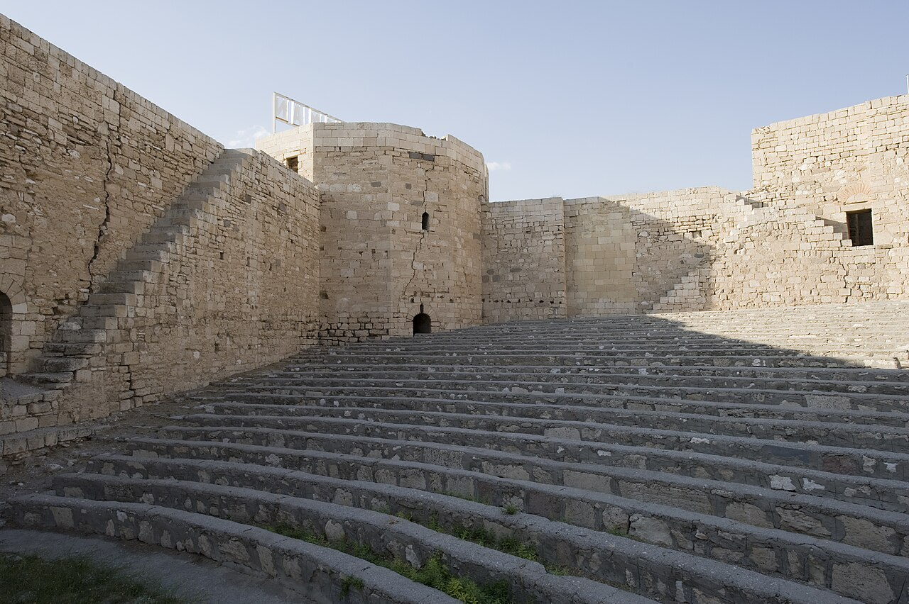
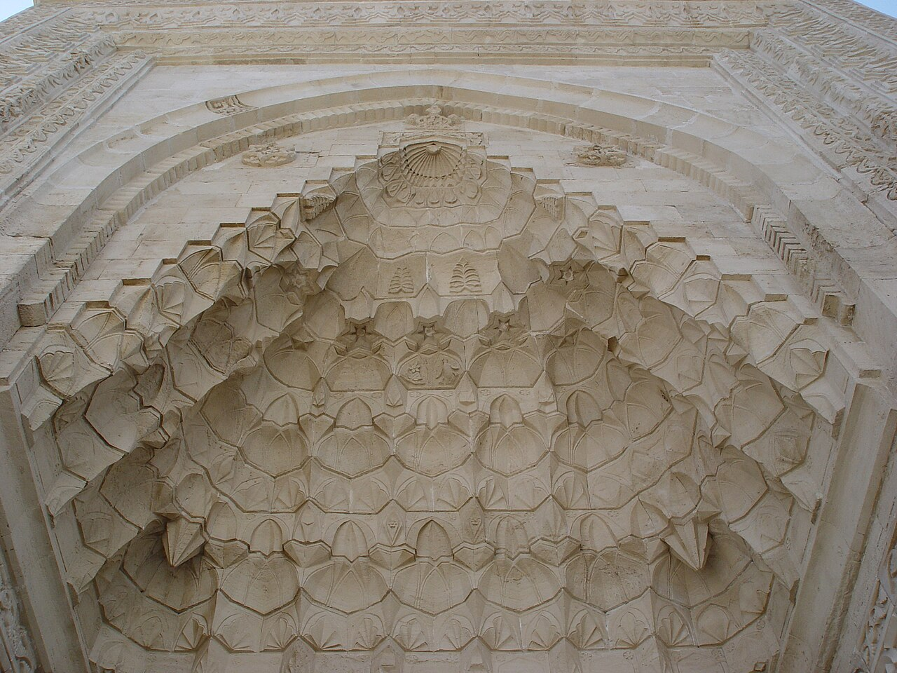

# 📍 Karaman - Seyahat ve Keşif Dosyası (Planlanan Rota)

  

## 📜 Seyyahın Beklentisi ve Şehrin Ruhu
> "Henüz adımlanmamış her yol, içinde koca bir hikaye saklar; Karaman'da o hikâye, 1277'de Türkçeyi devlet dili ilan eden fermanın gür sesinde, Yunus Emre'nin duru nefesinde ve Taşkale'nin kayalara oyulmuş sabrında yankılanır."

### 🌍 Şehrin Dokusu ve Tarihsel Arka Planı
İç Anadolu bozkırının Toros Dağları'na yaslandığı bereketli eşikte kurulan Karaman (kadim adıyla *Larende*); Hitit, Frig, Roma ve Bizans dönemlerinin ardından XIII–XV. yüzyıllarda Anadolu Selçuklu'nun en güçlü varisi olan **Karamanoğulları Beyliği**'ne başkentlik yapmıştır. 13 Mayıs 1277'de Karamanoğlu Mehmet Bey'in *"Bugünden sonra divanda, dergâhta, bargâhta, mecliste ve meydanda Türkçeden başka dil kullanılmayacaktır"* fermanıyla tarihe **Türk Dilinin Başkenti** olarak geçen şehir; Hatuniye Medresesi'nin zarif taç kapısı, Aktekke'nin dingin avlusu, Karadağ'daki erken Hristiyanlık mirası **Binbirkilise** ve kayalara oyulmuş yüzlerce yıllık **Taşkale Tahıl Ambarları** ile keşfedilmeyi bekleyen eşsiz bir medeniyet merkezidir.

### 🕌 Manevi Mimarlar, Tasavvuf ve Ahilik Mirası
- **Karamanoğlu Mehmet Bey:** Anadolu'da Türkçenin resmi ve edebi dil olarak kökleşmesini sağlayan büyük devlet adamı; kültür tarihimizin dönüm noktalarından biridir.
- **Yunus Emre:** Karaman'daki Kirişçi Mahallesi'nde bulunan **Yunus Emre Camii ve Türbesi** ile şehrin gönül hafızasında yaşayan, Türkçeyi ilahi aşkın ve insan sevgisinin dili kılan büyük mutasavvıf.
- **Mümine Hatun (Mâder-i Mevlânâ):** Hazreti Mevlânâ'nın Larende yıllarında burada vefat eden annesi; Karamanoğlu Alâeddin Bey tarafından yaptırılan **Aktekke (Mâder-i Mevlânâ) Camii**'nde medfundur.
- **Şeyh Edebali ve Piri Reis'in Kökleri:** Osmanlı'nın manevi kurucusu Şeyh Edebali'nin ve büyük denizci-kartograf Piri Reis'in ailesinin Larende (Karaman) bağlantıları, şehrin Anadolu tarihindeki merkezi rolünü gösterir.

### 💬 Şehir Hakkında Edebi ve Tarihi Alıntılar
> "Bugünden sonra divanda, dergâhta, bargâhta, mecliste ve meydanda Türkçeden başka dil kullanılmayacaktır." — Karamanoğlu Mehmet Bey (13 Mayıs 1277)
>
> "İlim ilim bilmektir / İlim kendin bilmektir / Sen kendini bilmezsin / Ya nice okumaktır." — Yunus Emre

### 🍽️ Keşfedilmeyi Bekleyen Yöresel Lezzetler
- **Bozkır ve Toros Mutfağı:** Taş fırında ağır ateşte pişen **Calla (Karaman Güveci)**, ince bulgur ve etle hazırlanan **Batırık**, **Arabaşı Çorbası**, **Lokur**, **Sıkma ve Börek** çeşitleri, **Zülbiye** ve **İlisıra Dolması**.
- **Tatlılar ve Coğrafi İşaretli Ürünler:** **Karaman Divle Obruk Peyniri** (mağarada olgunlaşan dünya çapında lezzet), **Karaman Elması**, **Kuymak (Karaman usulü pekmezli)** ve **Guymak / Aside**.
- **Tefekkür Eşliğinde Çay/Kahve:** Aktekke Camii meydanında, Hatuniye Medresesi'nin serin taş avlusunda veya Taşkale'nin yüksek kayalıklarına karşı yudumlanacak çaylar.

### 💻 Planlanan Yarı Göçebe Mesaisi (Kütüphane Ofisi)
- **Hedef Çalışma Noktası:** **Karaman Karamanoğlu Mehmetbey İl Halk Kütüphanesi**.
- **Çalışma ve Keşif Dengesi:** GSB Seyahatsever kapsamında KYK yurdunda 5 günlük bütçe dostu konaklama; gündüzleri kütüphanede yazılım geliştirme ve okuma rutini, öğleden sonraları Karamanoğlu mirası, vadiler ve Toros eteklerinde derinlikli keşif.

### 🧭 Planlanan 5 Günlük Menzil Rotası
- **1. Gün — Türkçenin ve Karamanoğulları'nın Kalbi:** Sabah kütüphane yerleşimi; öğleden sonra **Aktekke (Mâder-i Mevlânâ) Camii**, **Yunus Emre Camii ve Türbesi**, **Hatuniye Medresesi**, **Karaman Müzesi** ve **Karaman Kalesi**.
- **2. Gün — Taş İşçiliği ve Tarihi Konaklar:** Sabah mesaisi sonrası **İbrahim Bey İmareti**, **Arapzade ve Hacıbeyler Camileri**, **Tartanzade Konağı**, **Çeşmeli Kilise** ve **Tarihi Gazi Kültür Sanat Merkezi**.
- **3. Gün — Taşkale, Manazan ve İncesu Mağarası:** Tam gün doğa ve insan emeği rotası; 250'den fazla kaya oyma **Taşkale Tahıl Ambarları**, **Taş Mescit**, beş katlı **Manazan Mağaraları** ve sarkıtlarıyla **İncesu Mağarası**.
- **4. Gün — Karadağ ve Binbirkilise:** Sönmüş volkan Karadağ eteklerindeki **Madenşehri** ve **Üçkuyu (Binbirkilise)** antik kalıntıları; ardından **Değle Ören Yeri** ve yılkı atları gözlemi.
- **5. Gün — Ermenek veya Gödet Vadisi ve Veda:** Torosların saklı cenneti **Ermenek (Turkuaz Gölü, Tol Medrese, Zeyve Pazarı)** ya da merkeze yakın **Gödet Barajı ve Fisandon** rotasıyla Karaman keşfinin tamamlanması.

### ✨ Adımlanmayı Bekleyen Duraklar (Landmarks Checklist)
- [ ] **Aktekke (Mâder-i Mevlânâ) Camii**
- [ ] **Yunus Emre Camii ve Türbesi**
- [ ] **Hatuniye Medresesi ve Karaman Kalesi**
- [ ] **Taşkale Tahıl Ambarları ve Manazan Mağaraları**
- [ ] **İncesu Mağarası**
- [ ] **Binbirkilise (Karadağ / Madenşehri)**
- [ ] **Ermenek Turkuaz Gölü ve Tol Medrese**

### 📸 Menzil Fotoğraf Galerisi
<table>
  <tr>
    <td width="50%" align="center">
       
      <b>Türkçenin Başkenti:</b> Karaman'ın tarihi dokusu ve kayalara oyulan Taşkale mirası
    </td>
    <td width="50%" align="center">
       
      <b>İrfan ve Sabır Coğrafyası:</b> Aktekke, Hatuniye Medresesi ve Torosların serin vadileri
    </td>
  </tr>
</table>

---
*Henüz adımlanmamış bu kadim dil ve gönül başkenti, gelecek seferlerin seyir defterine yazılmayı ve Yunus'un izinde tefekkürle keşfedilmeyi bekliyor.*
