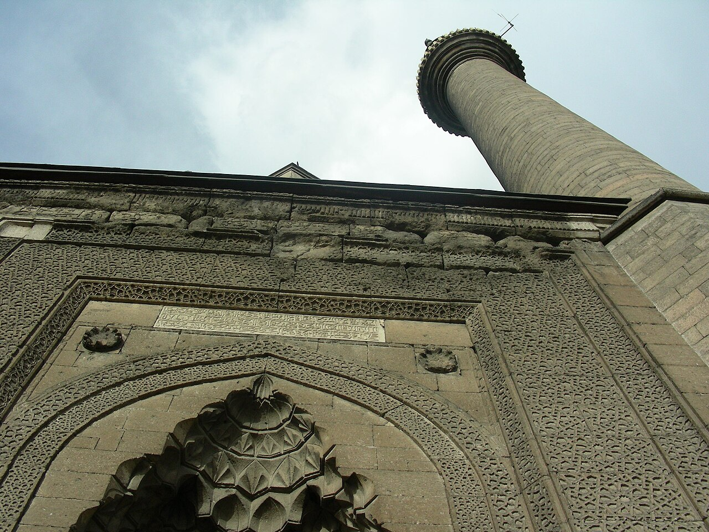

# 📍 Kayseri - Seyahat ve Keşif Dosyası (Planlanan Rota)

  

## 📜 Seyyahın Beklentisi ve Şehrin Ruhu
> "Henüz adımlanmamış her yol, içinde koca bir hikaye saklar; Kayseri'de o hikâye, Erciyes'in karlı zirvesine yaslanan altı bin yıllık ticaret dehasında, Selçuklu şifahanelerinin merhametinde ve Mimar Sinan'ın taşla kurduğu ebedi ahenkte saklıdır."

### 🌍 Şehrin Dokusu ve Tarihsel Arka Planı
İç Anadolu'nun en görkemli zirvesi **Erciyes Dağı**'nın (3.917 m) eteklerinde kurulan Kayseri (*Mazaka / Caesarea*); Anadolu'da yazılı tarihin başladığı **Kültepe (Kaniş-Karum)** çivi yazılı tabletlerinden (MÖ 2000) Hitit, Kapadokya, Roma ve Bizans dönemlerine, oradan da Anadolu Selçuklu Devleti'nin ikinci başkenti ("Makarr-ı Ulema" — Alimler Yurdu) olduğu altın çağa uzanan muazzam bir geçmişe sahiptir. 1206'da inşa edilen ve dünyanın en eski tıp fakültesi ve hastanesi kabul edilen **Gevher Nesibe Darüşşifası**, şehrin ortasında vakur bir nöbetçi gibi duran **Kayseri Kalesi**, **Hunat Hatun Külliyesi**, **Sahabiye Medresesi** ve Osmanlı ticaretinin nabzını tutan **Kapalı Çarşı** ile Kayseri, hem taş mimarinin hem de Anadolu girişimciliğinin başkentidir.

### 🕌 Manevi Mimarlar, Tasavvuf ve Ahilik Mirası
- **Seyyid Burhaneddin-i Veli (Muhakkik-i Tirmizî):** Hazreti Mevlânâ'nın dokuz yıl boyunca manevi eğitimini üstlenen büyük mürşit; Kayseri'deki türbesi şehrin en derin huzur ve tefekkür makamıdır.
- **Mimar Sinan (Koca Sinan):** Kayseri'nin **Ağırnas** köyünde doğan, Süleymaniye'den Selimiye'ye Osmanlı medeniyetinin gökyüzüne vurduğu taş mührün mimarı; Ağırnas'taki doğduğu ev ve yeraltı su tünelleri şehrin gururudur.
- **Gevher Nesibe Sultan ve Mahperi Hunat Hatun:** Biri tıp ve şifa tarihine adını altın harflerle yazdıran Selçuklu prensesi; diğeri Kayseri'ye Anadolu'nun ilk külliyelerinden birini armağan eden banidir.
- **Davud-i Kayserî ve Ahilik Geleneği:** Osmanlı'nın ilk medresesi İznik Medresesi'nin başmüderrisi Davud-i Kayserî bu topraklarda yetişmiş; Kayseri esnafı ise asırlardır Ahilik ahlakını ticaretin kalbine yerleştirmiştir.

### 💬 Şehir Hakkında Edebi ve Tarihi Alıntılar
> "Kayseri, Erciyes'in beyaz başlığı altında ilmin, ticaretin ve taş işçiliğinin asırlık kalesidir." — Evliya Çelebi
>
> "Gevher Nesibe'nin taş duvarlarında, Selçuklu'nun insanı merkeze alan merhamet ve bilim anlayışı hâlâ nefes alır." — Medeniyet Tarihi Notları

### 🍽️ Keşfedilmeyi Bekleyen Yöresel Lezzetler
- **Efsanevi Kayseri Mutfağı:** Bir kaşığa kırk tane sığacak incelikte açılan **Kayseri Mantısı**, kat kat kıymalı ve sarımsaklı yoğurtlu **Kayseri Yağlaması (Şebit)**, çemenli **Kayseri Pastırması** ve **Sucuğu**, **Develi Cıvıklısı**, **Kurşun Aşı**, **Pöç Kebabı** ve **Fırın Ağzı**.
- **Tatlılar ve İçecekler:** **Nevzine Tatlısı** (tahinli ve pekmezli), **Aside**, **Gilaburu Suyu** (Kayseri'nin şifalı yöresel meyvesi).
- **Tefekkür Eşliğinde Çay/Kahve:** Hunat Hatun Külliyesi'nin taş avlusunda, Tarihi Kapalı Çarşı'nın ara sokaklarındaki çay ocaklarında veya Talas'ın tarihi konaklarına bakan teraslarda yudumlanacak çaylar.

### 💻 Planlanan Yarı Göçebe Mesaisi (Kütüphane Ofisi)
- **Hedef Çalışma Noktası:** **Kayseri 75. Yıl İl Halk Kütüphanesi** (ve ayrıca **Şehir Kütüphanesi / Meryem Ana Kilisesi Kütüphanesi** ile **Raşid Efendi Eski Eserler Kütüphanesi** ziyareti).
- **Çalışma ve Keşif Dengesi:** GSB Seyahatsever programı kapsamında KYK yurdunda 5 günlük ücretsiz konaklama; sabahları kütüphanede yazılım ve ders mesaisi, öğleden sonraları Selçuklu eserleri, Talas, Ağırnas ve Erciyes eteklerinde verimli yürüyüşler.

### 🧭 Planlanan 5 Günlük Menzil Rotası
- **1. Gün — Selçuklu Çekirdeği ve Çarşılar:** Sabah kütüphane yerleşimi; öğleden sonra **Kayseri Kalesi ve Arkeoloji Müzesi**, **Hunat Hatun Külliyesi**, **Gevher Nesibe Tıp Tarihi Müzesi**, **Sahabiye Medresesi**, **Ulu Camii** ve **Tarihi Kapalı Çarşı**.
- **2. Gün — İrfan, Kümbetler ve Eski Mahalleler:** **Seyyid Burhaneddin Türbesi**, **Döner Kümbet**, **Atatürk Evi**, **Kayseri Lisesi (Milli Mücadele Müzesi)** ve **Tarihi Talas (Ali Saip Paşa Sokağı, Yaman Dede Kültür Evi)**.
- **3. Gün — Kültepe, Ağırnas ve Koramaz Vadisi:** Anadolu'nun ilk yazılı belgelerinin çıktığı **Kültepe (Kaniş-Karum)**, Mimar Sinan'ın doğduğu **Ağırnas (Mimar Sinan Evi)** ve UNESCO Geçici Listesi'ndeki **Koramaz Vadisi**.
- **4. Gün — Erciyes, Sultan Sazlığı ve Soğanlı Vadisi:** **Erciyes Dağı**'nın serin etekleri, 300'den fazla kuş türüne ev sahipliği yapan **Sultan Sazlığı Milli Parkı** ve kaya oyma kiliseleriyle **Soğanlı Vadisi** (Yeşilhisar).
- **5. Gün — Kapuzbaşı Şelaleleri (Yahyalı) ve Veda:** Aladağlar Milli Parkı sınırlarında dağın bağrından fışkıran **Kapuzbaşı Takım Şelaleleri**'nde doğa yürüyüşüyle Kayseri seferine unutulmaz bir final.

### ✨ Adımlanmayı Bekleyen Duraklar (Landmarks Checklist)
- [ ] **Gevher Nesibe Darüşşifası ve Tıp Tarihi Müzesi**
- [ ] **Kayseri Kalesi, Hunat Hatun Külliyesi ve Kapalı Çarşı**
- [ ] **Seyyid Burhaneddin Türbesi ve Döner Kümbet**
- [ ] **Kültepe (Kaniş-Karum) Ören Yeri**
- [ ] **Ağırnas (Mimar Sinan Evi) ve Koramaz Vadisi**
- [ ] **Erciyes Dağı ve Tarihi Talas Sokakları**
- [ ] **Soğanlı Vadisi, Sultan Sazlığı ve Kapuzbaşı Şelaleleri**

### 📸 Menzil Fotoğraf Galerisi
<table>
  <tr>
    <td width="50%" align="center">
       
      <b>Erciyes'in Vakur Gölgesi:</b> Selçuklu kaleleri, kümbetler ve altı bin yıllık ticaret şehri
    </td>
    <td width="50%" align="center">
       
      <b>Şifa, Sanat ve Doğa:</b> Gevher Nesibe, Hunat Hatun, Mimar Sinan'ın Ağırnas'ı ve Kapuzbaşı
    </td>
  </tr>
</table>

---
*Henüz adımlanmamış bu kadim ilim ve ticaret şehri, gelecek seferlerin seyir defterine yazılmayı ve Erciyes'in gölgesinde keşfedilmeyi bekliyor.*
