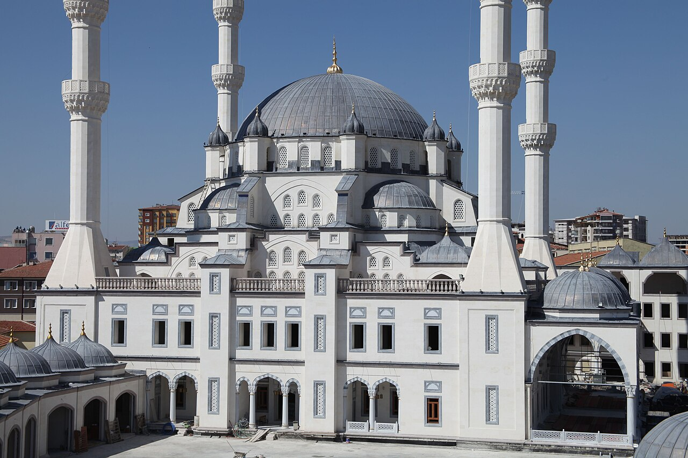

# 📍 Kirikkale - Seyahat ve Tefekkür Notları

  

## 📜 Şehrin Ruhu
> "Bozkırın ortasında Kızılırmak'ın sularıyla hayat bulan, cumhuriyetin sanayi hamleleriyle gelişmiş mütevazı şehir."

### 🌍 Şehrin Dokusu ve Tarihsel Arka Planı
Tarih boyunca İpekyolu üzerinde önemli bir geçiş noktası olan Kırıkkale bölgesi, cumhuriyet döneminde kurulan savunma sanayi fabrikalarıyla şehirleşmiştir. Kızılırmak'ın bereketli vadisi boyunca Hitit, Roma, Selçuklu ve Osmanlı kervanlarına geçit veren bu topraklar, XIII. yüzyılda inşa edilen Çeşnigir Köprüsü ile Anadolu'nun doğusunu batısına bağlamıştır. 1920'lerde küçük bir köy iken Makine ve Kimya Endüstrisi (MKE) fabrikalarının kurulmasıyla Cumhuriyet Türkiye'sinin stratejik sanayi ve kavşak kentine dönüşen Kırıkkale, kırk üç ilin geçiş güzergâhında sessiz ama vakur bir duraktır.

### 🕌 Manevi Mimarlar ve Tarihî Şahsiyetler
- **Hasan Dede Hazretleri:** XVI. yüzyılda yaşamış, Hacı Bektaş-ı Veli geleneğinden gelen büyük Anadolu ereni; kendi adını taşıyan köydeki camisi ve türbesi, Kırıkkale'nin en önemli manevi ziyaretgâhıdır.
- **Koçubaba (Koçu Baba):** Balışeyh ilçesine bağlı Koçubaba köyünde medfun, XIV–XV. yüzyıl Anadolu irfan geleneğinin izlerini taşıyan tasavvuf büyüğü.
- **Haydar Sultan (Haydar Dede):** Keskin ilçesinde külliyesi bulunan, Hoca Ahmed Yesevi ocağının Anadolu'daki temsilcilerinden kabul edilen Horasan ereni.
- **Hacı Taşan:** Keskinli büyük bozlak ustası; Orta Anadolu'nun yanık türkü geleneğini ve Abdal müziğini yaşatan gönül ozanı.

### 💬 Şehir Hakkında Edebi ve Tarihi Alıntılar
> "Çeşnigir Köprüsü, Kızılırmak'ın hırçın sularına vurulmuş Selçuklu mührüdür." — Evliya Çelebi

### 🕊️ Gezginin Not Defterinden (Manevi Boyut ve Tefekkür)
Kızılırmak üzerindeki tarihi Çeşnigir Köprüsü'nden akan nehre bakarken, asırlar boyu bu kalede nöbet tutan askerleri ve tarihin nöbetleşe geçen doğasını düşünürsünüz. Büyük şehirlerin gürültüsünden uzak, gösterişsiz ama samimi bu Anadolu kentinde; bir yanda savunma sanayiinin alın terini, diğer yanda Keskin'in bozlak tınılarını ve Hasan Dede'nin sükûnetini aynı gün içinde hissetmek insana derin bir denge duygusu verir.

### 🍽️ Yöresel Lezzet Tavsiyeleri
- **Yerel Tatlar ve İkramlar:** Şehrin yerel esnaf lokantalarında ve pazar yerlerinde deneyimlenen bütçe dostu, kültürel dokuyu yansıtan eşsiz lezzetler. Özellikle taş fırında kuzu etiyle pişen meşhur **Keskin Tava**, **Tuvalak (Köfteli Çorba)**, **Yoğurtlu Tarhana**, **Katmer** ve **Sızgıt** şehrin sofrasını şenlendirir.
- **Tefekkür Eşliğinde Çay/Kahve:** Şehrin tarihi kıraathanelerinde veya Çeşnigir Kanyonu'nun Kızılırmak'a bakan seyir teraslarında yudumlanan demli çaylar.

### ⛺ Konaklama ve Bütçe Stratejisi
- **Sıfır Konaklama Maliyeti (Modern Kervansaraylar):** GSB Seyahatsever projesi kapsamında şehirdeki KYK yurtlarında 5 gün boyunca ücretsiz konaklanarak bütçe korunmuştur.
- **Ulaşım ve Lojistik Planlama:** Rota optimizasyonuna uyularak komşu iller sırayla takip edilmiş, böylece hem yol maliyeti minimuma indirilmiş hem de karbon ayak izi azaltılmıştır.

### 💻 Yarı Göçebe Mesaisi (İlim Tahsili & Kütüphane)
- **Kütüphane Rutini:** Gündüz vakitlerinde şehrin İl Halk Kütüphanesinde zaman geçirilerek bilgisayar başında yazılım geliştirme ve ders çalışma faaliyetleri sürdürülmüştür.
  * *Seyyahın Kütüphane Notu:* Kirikkale İl Halk Kütüphanesi - Sessiz, çalışma disiplinine uygun, internet imkanı sunan verimli bir ilim yuvası.
- **Süre ve Uyum:** Kütüphane mesaisi bitiminde şehrin ruhuna karışmak üzere yollara düşülmüş, 5 günlük menzil süresiyle şehir sindirilerek keşfedilmiştir.

### 🧭 5 Günlük Menzil Rotası
- **1. Gün — Şehir Merkezi ve Sanayi Hafızası:** Sabah kütüphane mesaisi; öğleden sonra **MKE Silah Sanayi Müzesi**, **Nur Camii** ve şehir merkezi yürüyüşü.
- **2. Gün — Kızılırmak ve Çeşnigir Kanyonu:** **Çeşnigir Köprüsü ve Kanyonu**'nda doğa yürüyüşü, cam seyir terasında gün batımı ve Kızılırmak kıyısında tefekkür.
- **3. Gün — Maneviyat Durakları:** **Hasandede Camii ve Türbesi** ziyareti; öğleden sonra **Celal Bayar Parkı**'nda Kızılırmak kenarında kitap okuma ve dinlenme.
- **4. Gün — Keskin, Rahmi Pehlivanlı ve Bozlak Kültürü:** Sabah kütüphane çalışması; öğleden sonra Keskin'de **Sulu Mağara**, **Rahmi Pehlivanlı Müzesi** (Kralların Ressamı) ve **Taş Mektep** ziyareti.
- **5. Gün — Balışeyh, Ceritkale ve Veda:** **Ballı Camii (Selçuklu eseri)**, **Ceritkale Kaya Mezarları** ve **Obaköy Yeşil Vadi** doğa gezisiyle Kırıkkale menzilinin tamamlanması.

### ✨ Keşfedilesi Duraklar ve Landmarks
Bu şehrin havasını solumak, ruhuna dokunmak için mutlaka adımlanması gereken köşe taşları:
- [ ] **Çeşnigir Köprüsü ve Kanyonu**
- [ ] **Hasandede Camii ve Türbesi**
- [ ] **MKE Silah Sanayi Müzesi**
- [ ] **Sulu Mağara ve Keskin Taş Mektep**
- [ ] **Ceritkale Kaya Mezarları**

### 📸 Menzil Fotoğraf Galerisi
<table>
  <tr>
    <td width="50%" align="center">
       
      <b>Kızılırmak'taki Selçuklu Mührü:</b> Çeşnigir Köprüsü ve kanyonun dingin suları
    </td>
    <td width="50%" align="center">
       
      <b>Bozkırın Mütevazı Durağı:</b> Hasandede'nin sükûneti ve Cumhuriyet mirası
    </td>
  </tr>
</table>

---
*Bu il bizzat deneyimlenmiş, yolları aşındırılmış ve seyahatnameye sevgiyle işlenmiştir.* ✅
