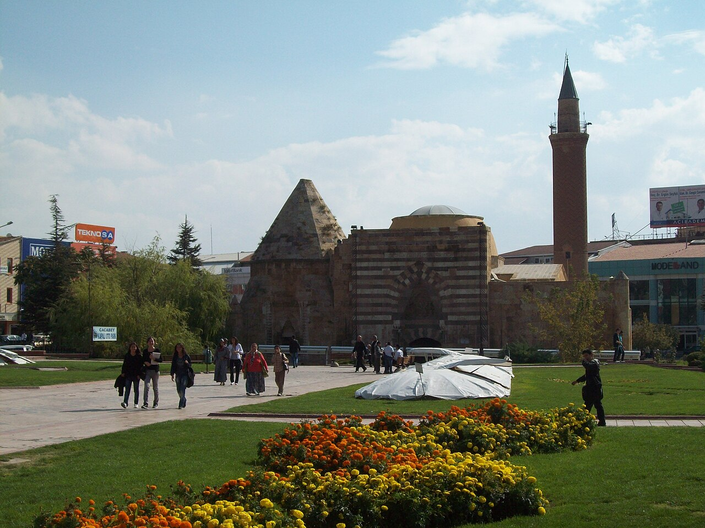
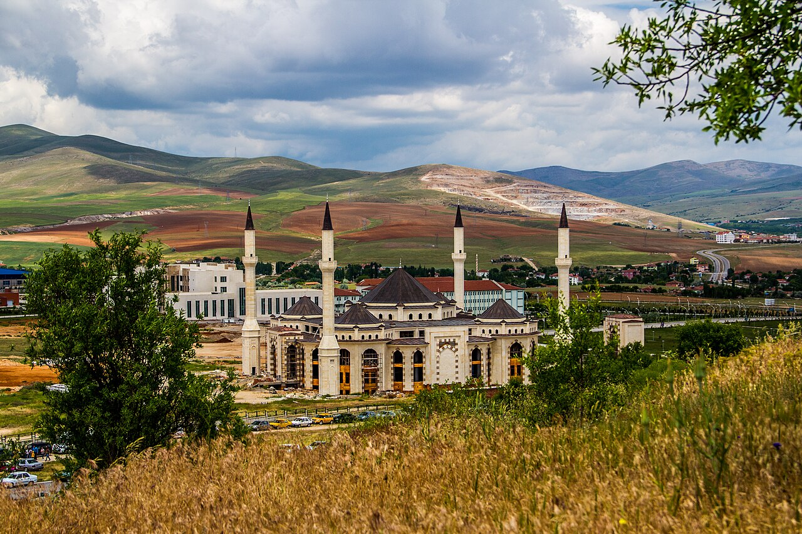

# 📍 Kirsehir - Seyahat ve Keşif Dosyası (Planlanan Rota)

  

## 📜 Seyyahın Beklentisi ve Şehrin Ruhu
> "Henüz adımlanmamış her yol, içinde koca bir hikaye saklar; Kırşehir'de o hikâye, Ahi Evran'ın alın teriyle yoğurduğu kardeşlik ahlakında, Cacabey'in yıldızlara bakan kubbesinde ve Neşet Ertaş'ın bozkırı titreten tezene sesinde yaşar."

### 🌍 Şehrin Dokusu ve Tarihsel Arka Planı
İç Anadolu'nun tam ortasında, Kızılırmak yayının bereketli topraklarında kurulan Kırşehir (eski adıyla *Gülşehir / Mokissos*); Hititlerin Kaman Kalehöyük'teki katmanlarından Roma ve Bizans'a, özellikle XIII. yüzyılda Anadolu Selçuklu döneminin en parlak ilim, tasavvuf ve esnaf teşkilatlanması merkezine dönüşmüştür. 1272 yılında Kırşehir Emiri Nureddin Cibril bin Cacabey tarafından gökbilim (astronomi) eğitimi için inşa edilen **Cacabey Medresesi**, tarihin en eski rasathanelerinden biridir. Aynı asırda **Ahi Evran-ı Veli**'nin kurduğu Ahilik teşkilatı ve **Âşık Paşa**'nın Türkçe aşkı, Kırşehir'i "Ozanlar, Alimler ve Ahiler Diyarı" kılmış; UNESCO Yaratıcı Şehirler Ağı'na **Müzik Şehri** olarak adını yazdırmıştır.

### 🕌 Manevi Mimarlar, Tasavvuf ve Ahilik Mirası
- **Ahi Evran-ı Veli Hazretleri:** Anadolu'da Ahilik teşkilatının kurucusu; *"Eline, beline, diline sahip ol; alnın açık, kapın açık, sofran açık olsun"* ilkeleriyle esnaf ahlakını, mesleki dayanışmayı ve sosyal adaleti asırlar boyu ayakta tutan büyük gönül mimarı.
- **Neşet Ertaş (Bozkırın Tezenesi) ve Muharrem Ertaş:** Abdal müzik geleneğini ve Orta Anadolu bozlaklarını tüm dünyaya duyuran, tevazusu ve *"Kalpten kalbe bir yol vardır görülmez"* diyen irfanıyla milletin gönlünde taht kuran büyük ozanlar.
- **Âşık Paşa:** 1330 yılında kaleme aldığı 12 bin beyitlik **Garibnâme** ile *"Türk diline kimsene bakmaz idi"* diyerek Anadolu'da Türkçenin edebi ve tasavvufi bayrağını yükselten büyük mutasavvıf; mermer türbesi şehrin en zarif anıtlarındandır.
- **Süleyman Türkmanî ve Yunus Emre / Hacı Bektaş Havzası:** Kırşehir, Hacı Bektaş-ı Veli ve Taptuk Emre manevi ikliminin hemen yanı başında Anadolu tasavvufunun en verimli kavşaklarından biri olmuştur.

### 💬 Şehir Hakkında Edebi ve Tarihi Alıntılar
> "Hak ile sabır dileyip bize gelen bizdendir; akıl ve ahlak ile çalışıp bizi geçen bizdendir." — Ahi Evran-ı Veli
>
> "Gönül dağı yağmur yağmur boran olunca / Akar can özümden sel gizli gizli..." — Neşet Ertaş
>
> "Türk diline kimsene bakmaz idi / Türklere hergiz gönül akmaz idi..." — Âşık Paşa (Garibnâme)

### 🍽️ Keşfedilmeyi Bekleyen Yöresel Lezzetler
- **Bozkırın Bereketli Sofrası:** Meşhur **Kırşehir Köftesi (Çullama)**, **Madımak**, **Çömlekte Kuru Fasulye**, **Tandırlı Çorba**, **Kesme Aşı**, **Boru Mantısı**, **Lepe** ve **Kaman Cevizi** (ince kabuklu, dünyaca ünlü coğrafi işaretli lezzet).
- **Tatlılar ve İkramlar:** **Pelte (Pekmez Peltesi)**, **Hoşmerim**, **Sütlü Pilav** ve **Aside**.
- **Tefekkür Eşliğinde Çay/Kahve:** Ahi Evran Külliyesi çevresindeki tarihi kıraathanelerde, Cacabey Meydanı'nda veya Kaman Japon Bahçesi'nin huzurlu gölet kenarında yudumlanacak çaylar.

### 💻 Planlanan Yarı Göçebe Mesaisi (Kütüphane Ofisi)
- **Hedef Çalışma Noktası:** **Kırşehir Aşık Paşa İl Halk Kütüphanesi**.
- **Çalışma ve Keşif Dengesi:** GSB Seyahatsever kapsamında KYK yurdunda 5 günlük ücretsiz konaklama; gündüzleri Âşık Paşa Kütüphanesi'nde yazılım ve çalışma mesaisi, öğleden sonraları Ahilik mirası, bozlak müzesi ve bozkırın doğal güzelliklerini sindirerek keşif.

### 🧭 Planlanan 5 Günlük Menzil Rotası
- **1. Gün — Ahilik ve Gökbilimin Kalbi:** Sabah kütüphane yerleşimi; öğleden sonra **Ahi Evran-ı Veli Camii, Türbesi ve Külliyesi**, **Ahilik Müzesi**, **Cacabey Gökbilim Medresesi** ve **Kapucu Camii**.
- **2. Gün — İrfan, Dil ve Bozkırın Tezenesi:** **Âşık Paşa Türbesi**, **Neşet Ertaş Gönül Sultanları Kültür Evi** ve **Bağbaşı Mezarlığı**'nda Neşet Ertaş ile Muharrem Ertaş'ın kabirlerini ziyaret; akşamüstü **Kentpark** yürüyüşü.
- **3. Gün — Kaman, Kalehöyük ve Japon Bahçesi:** **Kaman Kalehöyük Arkeoloji Müzesi** ve hemen yanındaki Japonya dışındaki en büyük Japon bahçelerinden **Prens Mikasa Anı Bahçesi** ziyareti; dönüşte taze Kaman cevizi molası.
- **4. Gün — Mucur Yeraltı Şehri ve Seyfe Gölü:** Sabah kütüphane oturumu; öğleden sonra **Mucur Yeraltı Şehri** ve flamingoların uğrak noktası **Seyfe Gölü Kuş Cenneti**'nde gün batımı.
- **5. Gün — Kesikköprü, Hirfanlı ve Veda:** Kızılırmak üzerindeki 1248 tarihli **Kesikköprü ve Kervansarayı**, **Hirfanlı Baraj Gölü** kıyısı ve **Terme Kaplıcaları** rotasıyla Kırşehir seferine veda.

### ✨ Adımlanmayı Bekleyen Duraklar (Landmarks Checklist)
- [ ] **Ahi Evran-ı Veli Külliyesi ve Ahilik Müzesi**
- [ ] **Cacabey Gökbilim Medresesi**
- [ ] **Âşık Paşa Türbesi**
- [ ] **Neşet Ertaş Gönül Sultanları Kültür Evi**
- [ ] **Kaman Kalehöyük Arkeoloji Müzesi ve Japon Bahçesi**
- [ ] **Mucur Yeraltı Şehri ve Seyfe Gölü Kuş Cenneti**
- [ ] **Kesikköprü ve Kervansarayı**

### 📸 Menzil Fotoğraf Galerisi
<table>
  <tr>
    <td width="50%" align="center">
       
      <b>Ahiler ve Gökbilim Şehri:</b> Cacabey Medresesi'nin kubbesi ve Ahi Evran'ın emaneti
    </td>
    <td width="50%" align="center">
       
      <b>Bozkırın Tezenesi ve Tarihi:</b> Âşık Paşa'nın zarafeti, Neşet Ertaş'ın yurdu ve Kalehöyük
    </td>
  </tr>
</table>

---
*Henüz adımlanmamış bu ahilik, ilim ve bozlak yurdu, gelecek seferlerin seyir defterine yazılmayı ve bozkırın tezenesi eşliğinde keşfedilmeyi bekliyor.*
