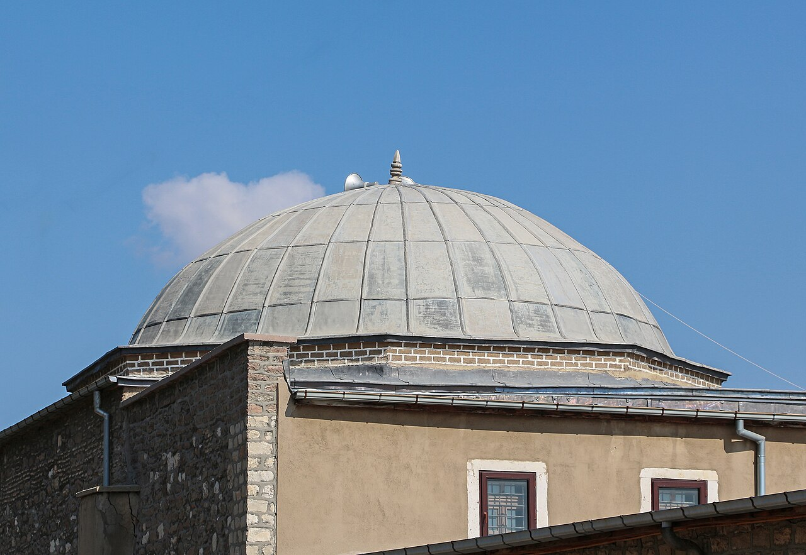

# 📍 Konya - Seyahat ve Tefekkür Notları

  

## 📜 Şehrin Ruhu
> "Hazreti Mevlana'nın hoşgörü ve aşk iklimiyle demlenmiş, Selçuklu'nun muhteşem payitahtı, irfan merkezi."

### 🌍 Şehrin Dokusu ve Tarihsel Arka Planı
Anadolu Selçuklu Devleti'ne uzun yıllar başkentlik yapan Konya, yetiştirdiği alimler, sufiler ve bıraktığı eşsiz mimari eserlerle İslam medeniyetinin kurucu şehirlerindendir. İnsanlık tarihinin en eski kent yerleşimlerinden Çatalhöyük'ten (MÖ 7400) Hitit, Frig, Roma ve Bizans katmanlarına uzanan bu kadim ova, I. Alâeddin Keykubad döneminde "Darü'l-Mülk" (Saltanat Yurdu) olarak altın çağını yaşamıştır. Karatay'ın firuze çinileri, İnce Minare'nin taşa işlenen sülüs hatları ve Alaeddin Tepesi'nin vakur silüeti, Konya'yı bozkırın ortasında yükselen bir sanat ve hikmet şehrine dönüştürmüştür.

### 🕌 Manevi Mimarlar ve Tarihî Şahsiyetler
- **Mevlânâ Celâleddîn-i Rûmî:** XIII. yüzyılda Mesnevi ve Divan-ı Kebir ile tüm insanlığa ilahi aşkı, tevazuyu ve merhameti öğreten büyük mutasavvıf; Kubbe-i Hadra (Yeşil Kubbe) şehrin manevi kalbidir.
- **Şems-i Tebrizî:** Mevlânâ'nın gönül dünyasında büyük bir uyanışa vesile olan meczup ve arif; şehir merkezindeki makamı derin bir hürmetle ziyaret edilir.
- **Sadreddin Konevî:** Muhyiddin İbnü'l-Arabî'nin manevi mirasını Anadolu'ya taşıyan, hadis ve tasavvuf ilminde zirve isim; Mevlânâ'nın yakın dostu ve cenaze namazını kıldıran büyük alim.
- **Nasreddin Hoca (Akşehir) ve I. Alâeddin Keykubad:** Biri Akşehir'deki türbesiyle Anadolu'nun hikmetli gülüşünü, diğeri ise medrese, han ve kervansaraylarıyla Selçuklu'nun imar dehasını temsil eder.

### 💬 Şehir Hakkında Edebi ve Tarihi Alıntılar
> "Gel, gel, ne olursan ol, yine gel..." — Mevlânâ Celâleddîn-i Rûmî
>
> "Konya, Selçuklu medeniyetinin ruhunu taşa nakşettiği mukaddes şehirdir." — Ahmet Hamdi Tanpınar
>
> "Konya, maneviyatın göğe yükseldiği, dervişlerin sema ettiği huzur yurdudur." — Evliya Çelebi

### 🕊️ Gezginin Not Defterinden (Manevi Boyut ve Tefekkür)
Mevlana Türbesi'nin yeşil kubbesi altında, ilahi aşkı, 'hamdım, piştim, yandım' diyen dervişlerin sabrını tefekkür edersiniz. Sabahın erken saatlerinde Karatay Medresesi'nin çini kubbesine başınızı kaldırıp bakarken, Selçuklu ustalarının gökyüzünün yıldızlarını kubbeye nasıl nakşettiğini ve bir medeniyetin estetiği ibadet şuuruyla nasıl yoğurduğunu hissedersiniz.

### 🍽️ Yöresel Lezzet Tavsiyeleri
- **Yerel Tatlar ve İkramlar:** Şehrin yerel esnaf lokantalarında ve pazar yerlerinde deneyimlenen bütçe dostu, kültürel dokuyu yansıtan eşsiz lezzetler. Özellikle incecik hamuruyla taş fırından çıkan **Etli Ekmek**, **Bıçakarası**, **Mevlana Böreği**, ağır ateşte lokum gibi pişen **Fırın Kebabı**, düğünlerin vazgeçilmezi **Bamya Çorbası**, **Tirit** ve **Höşmerim / Sac Arası** tatlısı Konya mutfağının baş tacıdır.
- **Tefekkür Eşliğinde Çay/Kahve:** Şehrin tarihi kıraathanelerinde, Bedesten Çarşısı'nın taş kemerleri altında, Sille'nin dere kenarında veya Meram Bağları'nın serin gölgesinde yudumlanan demli çaylar.

### ⛺ Konaklama ve Bütçe Stratejisi
- **Sıfır Konaklama Maliyeti (Modern Kervansaraylar):** GSB Seyahatsever projesi kapsamında şehirdeki KYK yurtlarında 5 gün boyunca ücretsiz konaklanarak bütçe korunmuştur.
- **Ulaşım ve Lojistik Planlama:** Rota optimizasyonuna uyularak komşu iller sırayla takip edilmiş, böylece hem yol maliyeti minimuma indirilmiş hem de karbon ayak izi azaltılmıştır.

### 💻 Yarı Göçebe Mesaisi (İlim Tahsili & Kütüphane)
- **Kütüphane Rutini:** Gündüz vakitlerinde şehrin İl Halk Kütüphanesinde zaman geçirilerek bilgisayar başında yazılım geliştirme ve ders çalışma faaliyetleri sürdürülmüştür.
  * *Seyyahın Kütüphane Notu:* Konya İl Halk Kütüphanesi - Sessiz, çalışma disiplinine uygun, internet imkanı sunan verimli bir ilim yuvası.
- **Süre ve Uyum:** Kütüphane mesaisi bitiminde şehrin ruhuna karışmak üzere yollara düşülmüş, 5 günlük menzil süresiyle şehir sindirilerek keşfedilmiştir.

### 🧭 5 Günlük Menzil Rotası
- **1. Gün — İrfan ve Payitaht Ekseni:** Sabah İl Halk Kütüphanesi'nde çalışma; öğleden sonra **Mevlana Müzesi ve Türbesi**, **Sultan Selim Camii**, **Şems-i Tebrizî Camii ve Türbesi** ve **Tarihi Bedesten Çarşısı**.
- **2. Gün — Selçuklu Medreseleri ve Alaeddin Tepesi:** **Alaeddin Camii**, **Karatay Medresesi (Çini Eserler Müzesi)**, **İnce Minareli Medrese**, **Sahip Ata Külliyesi** ve **Sadreddin Konevî Camii ve Türbesi**.
- **3. Gün — Kadim Tarih ve Sille:** Sabah kütüphane mesaisi; öğleden sonra beş bin yıllık **Sille Mahallesi** (Aya Elenia Kilisesi, taş köprüler) ve **Tropikal Kelebek Bahçesi**; akşam **Meram Bağları** yürüyüşü.
- **4. Gün — Çatalhöyük ve Bozkırın Mirası:** UNESCO Dünya Mirası **Çatalhöyük Neolitik Kenti** ziyareti; dönüşte **Konya Bilim Merkezi** veya **Zazadin Hanı** keşfi.
- **5. Gün — Beyşehir veya Tuz Gölü / Kilistra:** Ahşap direkli **Eşrefoğlu Camii** ve **Beyşehir Gölü** kıyısında gün batımı (ya da **Tuz Gölü** / **Meke Gölü** rotası) ile Konya menziline veda.

### ✨ Keşfedilesi Duraklar ve Landmarks
Bu şehrin havasını solumak, ruhuna dokunmak için mutlaka adımlanması gereken köşe taşları:
- [ ] **Mevlana Müzesi ve Türbesi**
- [ ] **Karatay Medresesi**
- [ ] **İnce Minareli Medrese**
- [ ] **Tuz Gölü**
- [ ] **Çatalhöyük Neolitik Kenti**
- [ ] **Sille Tarihi Mahallesi ve Eşrefoğlu Camii (Beyşehir)**

### 📸 Menzil Fotoğraf Galerisi
<table>
  <tr>
    <td width="50%" align="center">
       
      <b>Kubbe-i Hadra'nın Gölgesinde:</b> Hazreti Mevlânâ'nın huzur iklimi ve payitaht silüeti
    </td>
    <td width="50%" align="center">
       
      <b>Taşa ve Çiniye Nakşedilen Ruh:</b> Karatay, İnce Minare ve bozkırın kadim hafızası
    </td>
  </tr>
</table>

---
*Bu il bizzat deneyimlenmiş, yolları aşındırılmış ve seyahatnameye sevgiyle işlenmiştir.* ✅
