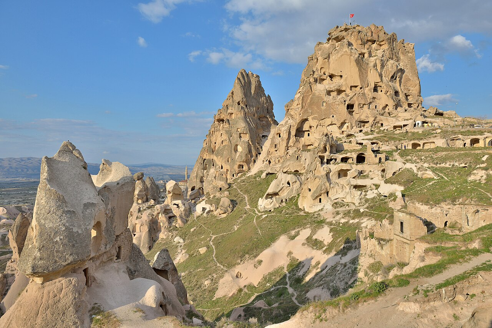

# 📍 Nevsehir - Seyahat ve Tefekkür Notları

  

## 📜 Şehrin Ruhu
> "Kapadokya'nın masalsı vadilerinde, peri bacalarının rüzgarla fısıldaştığı, zamanın ve mekanın ötesinde bir rüya coğrafyası."

### 🌍 Şehrin Dokusu ve Tarihsel Arka Planı
Hititlerden ilk Hristiyan sığınaklarına kadar uzanan Kapadokya, volkanik tüflerin aşınmasıyla oluşan peri bacalarıyla dünya miraslarının en özgün olanıdır. Erciyes, Hasan ve Güllüdağ'ın milyonlarca yıl önce püskürttüğü lav ve küllerin rüzgâr ve yağmurla yontulması sonucu ortaya çıkan bu eşsiz coğrafya; Kaymaklı ve Derinkuyu gibi kat kat yeraltı şehirlerine, Göreme'nin kaya oyma manastırlarına, Avanos'un Kızılırmak çamurundan doğan çömlekçilik geleneğine ve Selçuklu-Osmanlı külliyelerine kucak açmıştır. Eski adı Muşkara olan şehir, Lale Devri'nin ünlü sadrazamı Damat İbrahim Paşa'nın imar faaliyetleriyle "Nevşehir" (Yeni Şehir) adını alarak bugünkü kimliğine kavuşmuştur.

### 🕌 Manevi Mimarlar ve Tarihî Şahsiyetler
- **Hacı Bektaş-ı Veli Hazretleri:** XIII. yüzyılda Horasan'dan gelip Sulucakarahöyük'e (Hacıbektaş) yerleşen, "Eline, beline, diline sahip ol" ve "İncinsen de incitme" düsturlarıyla Anadolu birliğini ve hoşgörüsünü mayalayan büyük mutasavvıf.
- **Damat İbrahim Paşa:** XVIII. yüzyılda doğduğu Muşkara köyünü cami, medrese, hamam, han ve kütüphane içeren **Kurşunlu Külliyesi** ile baştan imar ederek Nevşehir'i kuran Osmanlı sadrazamı.
- **Büyük Basileios ve Kapadokyalı Kilise Babaları:** IV. yüzyılda Göreme ve çevresinde manastır yaşamını ve teoloji geleneğini şekillendiren kadim dönem düşünürleri.

### 💬 Şehir Hakkında Edebi ve Tarihi Alıntılar
> "Kapadokya, taşın rüya gördüğü, rüzgarın ise o rüyayı fısıldadığı büyülü coğrafyadır." — Ahmet Hamdi Tanpınar
>
> "Ürgüp ve Göreme vadileri, yeryüzünün en benzersiz yaratılış mucizeleridir." — Evliya Çelebi

### 🕊️ Gezginin Not Defterinden (Manevi Boyut ve Tefekkür)
Balonların gökyüzünde süzülüşünü izlerken, insan ruhunun özgürlük arayışını ve yeryüzünün eşsiz sanatını tefekkür edersiniz. Hacıbektaş Dergâhı'nın avlusunda "Aslanlı Çeşme" başında durup asırlarca aş kaynayan Kara Kazan'a bakarken, ya da Kızılçukur Vadisi'nde gün batımının kayaları kızıla boyadığı o sessiz dakikada, hem doğanın hem de Anadolu irfanının zamanı aşan nefesi kalbinizi sarar.

### 🍽️ Yöresel Lezzet Tavsiyeleri
- **Yerel Tatlar ve İkramlar:** Şehrin yerel esnaf lokantalarında ve pazar yerlerinde deneyimlenen bütçe dostu, kültürel dokuyu yansıtan eşsiz lezzetler. Avanos çömleğinde ağır ağır pişen **Testi Kebabı**, **Nevşehir Tava**, **Düğün Çorbası**, **Ağpakla (Çömlekte Kuru Fasulye)**, **Nevşehir Simidi**, **Kabak Çekirdeği** (sütlü kavrulmuş) ve **Köftür / Aside** tatlısı yöre mutfağının yıldızlarıdır.
- **Tefekkür Eşliğinde Çay/Kahve:** Şehrin tarihi kıraathanelerinde, Uçhisar ve Göreme'nin vadiye bakan taş teraslarında veya Kızılçukur gün batımı noktasında yudumlanan demli çaylar.

### ⛺ Konaklama ve Bütçe Stratejisi
- **Sıfır Konaklama Maliyeti (Modern Kervansaraylar):** GSB Seyahatsever projesi kapsamında şehirdeki KYK yurtlarında 5 gün boyunca ücretsiz konaklanarak bütçe korunmuştur.
- **Ulaşım ve Lojistik Planlama:** Rota optimizasyonuna uyularak komşu iller sırayla takip edilmiş, böylece hem yol maliyeti minimuma indirilmiş hem de karbon ayak izi azaltılmıştır.

### 💻 Yarı Göçebe Mesaisi (İlim Tahsili & Kütüphane)
- **Kütüphane Rutini:** Gündüz vakitlerinde şehrin İl Halk Kütüphanesinde zaman geçirilerek bilgisayar başında yazılım geliştirme ve ders çalışma faaliyetleri sürdürülmüştür.
  * *Seyyahın Kütüphane Notu:* Nevsehir İl Halk Kütüphanesi - Sessiz, çalışma disiplinine uygun, internet imkanı sunan verimli bir ilim yuvası.
- **Süre ve Uyum:** Kütüphane mesaisi bitiminde şehrin ruhuna karışmak üzere yollara düşülmüş, 5 günlük menzil süresiyle şehir sindirilerek keşfedilmiştir.

### 🧭 5 Günlük Menzil Rotası
- **1. Gün — Nevşehir Merkez ve Uçhisar:** Sabah kütüphane mesaisi; öğleden sonra **Damat İbrahim Paşa (Kurşunlu) Külliyesi**, **Nevşehir Kalesi**, **Uçhisar Kalesi** ve **Güvercinlik Vadisi** gün batımı.
- **2. Gün — Göreme ve Vadiler Yürüyüşü:** Şafakta balon seyri; **Göreme Açık Hava Müzesi**, **Paşabağları (Rahipler Vadisi)**, **Zelve Ören Yeri** ve **Kızılçukur / Güllüdere Vadisi** yürüyüşü.
- **3. Gün — Avanos ve Ürgüp:** Sabah kütüphane oturumu; öğleden sonra **Avanos** çömlek atölyeleri ve Kızılırmak sallanan köprü, **Devrent (Hayal) Vadisi**, **Ürgüp Üç Güzeller** ve **Mustafapaşa (Sinasos)** taş konakları.
- **4. Gün — Yeraltı Şehirleri ve Derin Tarih:** **Kaymaklı Yeraltı Şehri** ve **Derinkuyu Yeraltı Şehri** keşfi; öğleden sonra **Ortahisar Kalesi** ve **Sarıhan Kervansarayı**.
- **5. Gün — Hacıbektaş İrfan Ziyareti ve Veda:** **Hacı Bektaş-ı Veli Müzesi ve Külliyesi**, **Beştaşlar** ve **Çilehane (Deliklitaş)** ziyaretiyle manevi bir final.

### ✨ Keşfedilesi Duraklar ve Landmarks
Bu şehrin havasını solumak, ruhuna dokunmak için mutlaka adımlanması gereken köşe taşları:
- [ ] **Göreme Açık Hava Müzesi**
- [ ] **Uçhisar Kalesi**
- [ ] **Kaymaklı Yeraltı Şehri**
- [ ] **Ihlara Vadisi (Sınır)**
- [ ] **Hacı Bektaş-ı Veli Külliyesi**
- [ ] **Avanos, Paşabağları ve Kızılçukur Vadisi**

### 📸 Menzil Fotoğraf Galerisi
<table>
  <tr>
    <td width="50%" align="center">
       
      <b>Taşın Rüya Gördüğü Coğrafya:</b> Göreme vadileri ve şafak vaktinde süzülen balonlar
    </td>
    <td width="50%" align="center">
       
      <b>Binlerce Yıllık Hafıza:</b> Uçhisar, yeraltı şehirleri ve Hacıbektaş'ın dingin ışığı
    </td>
  </tr>
</table>

---
*Bu il bizzat deneyimlenmiş, yolları aşındırılmış ve seyahatnameye sevgiyle işlenmiştir.* ✅
