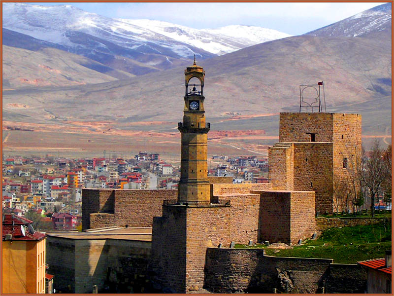
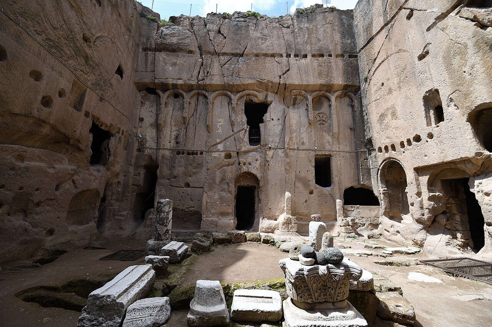

# 📍 Nigde - Seyahat ve Keşif Dosyası (Planlanan Rota)

  

## 📜 Seyyahın Beklentisi ve Şehrin Ruhu
> "Henüz adımlanmamış her yol, içinde koca bir hikaye saklar; Niğde'de o hikâye, Aladağlar'ın sarp doruklarından süzülen serin rüzgârda, Selçuklu taç kapılarındaki ışık-gölge mucizesinde ve Gümüşler Manastırı'nın tebessüm eden duvarlarında gizlidir."

### 🌍 Şehrin Dokusu ve Tarihsel Arka Planı
Kapadokya'nın güney kapısı, Torosların en görkemli uzantısı **Aladağlar** ile **Bolkar Dağları**'nın eteğinde kurulan Niğde (kadim adıyla *Nakita / Nahita*); Hititlerin **Tyana (Kemerhisar)** krallığından Roma döneminin görkemli su kemerlerine ve Roma Havuzu'na, Anadolu Selçukluları ve İlhanlılar döneminin ise en zarif taş mimari eserlerine ev sahipliği yapar. 1223'te inşa edilen **Alâeddin Camii**'nin doğu taç kapısında sabah güneşinin düşmesiyle ortaya çıkan "taçlı kadın silüeti", **Hüdavent Hatun Türbesi**'nin yüksek kabartma taş işçiliği, **Sungurbey Camii**'nin Gotik ve İslam mimarisini harmanlayan eşsiz üslubu ve **Gümüşler Manastırı**'ndaki Anadolu'da tek örnek olan "Tebessüm Eden Meryem Ana" freski, Niğde'yi keşfedilmemiş bir açık hava müzesi kılar.

### 🕌 Manevi Mimarlar, Tasavvuf ve Selçuklu Mirası
- **Hüdavent Hatun:** Anadolu Selçuklu Sultanı IV. Kılıç Arslan'ın kızı; 1312'de Niğde'de kendi adına yaptırdığı sekizgen türbe, insan, kuş, sfenks ve bitkisel motifli taş oymalarıyla Türk-İslam sanat tarihinin başyapıtlarındandır.
- **Emir Seyfeddin Sungur Ağa (Sungurbey):** XIV. yüzyılda Niğde'ye adını veren camiyi inşa ettirerek şehrin mimari kimliğine unutulmaz bir zarafet kazandıran İlhanlı/Selçuklu valisi.
- **Üstad Sıddık ve Kardeşi Gazi:** Alâeddin Camii'nin taş işçiliğine ruh üfleyen ve taç kapıya güneşin açısıyla belirip kaybolan gölge sanatını işleyen Selçuklu mimarları.
- **Şehit Ömer Halisdemir ve Milli Mücadele Hafızası:** Bor ilçesine bağlı Çukurkuyu beldesinden yetişen kahramanlık mirası ve Anadolu'nun vatan savunmasındaki vakur duruşu şehrin manevi hafızasında derin bir yere sahiptir.

### 💬 Şehir Hakkında Edebi ve Tarihi Alıntılar
> "Niğde, Selçuklu taş işçiliğinin en ince, en zarif ve en gizemli mücevherlerini saklayan sessiz bir payitahttır." — Sanat Tarihi Notları
>
> "Aladağlar'ın eteklerinde, bozkırın sarısıyla karlı zirvelerin beyazı arasında Niğde, seyyaha hem dağın heybetini hem tarihin sükûnetini sunar." — Anadolu Gezi Defteri

### 🍽️ Keşfedilmeyi Bekleyen Yöresel Lezzetler
- **Niğde ve Bor Mutfağı:** Taş fırında kuzu eti, biber ve domatesle pişen meşhur **Niğde Tava**, **Söğürme**, **Mazaklı Köftesi**, **Mangır Çorbası**, **Bor Söğüşü**, **Üzüm Boranisi** ve **Kaygana**.
- **Tatlılar ve Yöresel Ürünler:** **Niğde Elması** (Amasya ve misket aromalı), **Niğde Gazozu**, **Cevizli Köfter**, **Tahinli Pide** ve **Halveter Tatlısı**.
- **Tefekkür Eşliğinde Çay/Kahve:** Niğde Kalesi'nin Saat Kulesi manzaralı tepesinde, Sungurbey çevresindeki çay bahçelerinde veya Çamardı/Aladağlar eteklerindeki yayla sularının başında yudumlanacak çaylar.

### 💻 Planlanan Yarı Göçebe Mesaisi (Kütüphane Ofisi)
- **Hedef Çalışma Noktası:** **Niğde Sungurbey İl Halk Kütüphanesi**.
- **Çalışma ve Keşif Dengesi:** GSB Seyahatsever kapsamında KYK yurdunda 5 günlük sıfır maliyetli konaklama; sabahları kütüphanede yazılım ve okuma mesaisi, öğleden sonraları Selçuklu anıtları, antik Tyana ve Aladağlar eteklerinde derinlikli keşif.

### 🧭 Planlanan 5 Günlük Menzil Rotası
- **1. Gün — Selçuklu Taş Şaheserleri:** Sabah kütüphane yerleşimi; öğleden sonra **Niğde Kalesi ve Saat Kulesi**, **Alâeddin Camii** (sabah/öğle ışık-gölge detayı), **Rahmaniye Camii**, **Sungurbey Camii**, **Ak Medrese (Niğde Müzesi)** ve **Hüdavent Hatun Türbesi**.
- **2. Gün — Gümüşler Manastırı ve Tarih Katmanları:** Sabah mesaisi sonrası kaya içine oyulmuş **Gümüşler Manastırı** (Tebessüm Eden Meryem Ana freski ve yeraltı geçitleri) ve **Eski Niğde Evleri (Cullaz Sokağı)** yürüyüşü.
- **3. Gün — Antik Tyana ve Bor:** **Kemerhisar (Tyana Antik Kenti)** Roma Su Kemerleri ve **Roma Havuzu (Köşk Höyük)**; ardından **Bor** ilçesinde **Sarı Saltuk / Kale Camii** ve yöresel mutfak durağı.
- **4. Gün — Aladağlar Milli Parkı (Çamardı):** Türkiye'nin en görkemli dağ silsilelerinden **Aladağlar Milli Parkı**'nda **Demirkazık** etekleri, **Emli Vadisi** veya **Çiniligöl / Karagöl** (Ulukışla-Bolkarlar) doğa yürüyüşü.
- **5. Gün — Narlıgöl, Çiftehan ve Veda:** Kalp şeklindeki krater gölü **Narlıgöl (Acıgöl)** seyri ve termal su kaynağı **Çiftehan** (veya **Öküz Mehmet Paşa Kervansarayı — Ulukışla**) ziyaretiyle Niğde menzilinin tamamlanması.

### ✨ Adımlanmayı Bekleyen Duraklar (Landmarks Checklist)
- [ ] **Alâeddin Camii ve Niğde Kalesi (Saat Kulesi)**
- [ ] **Hüdavent Hatun Türbesi ve Sungurbey Camii**
- [ ] **Ak Medrese ve Niğde Müzesi**
- [ ] **Gümüşler Manastırı**
- [ ] **Tyana Su Kemerleri ve Roma Havuzu (Kemerhisar)**
- [ ] **Aladağlar Milli Parkı (Demirkazık & Emli Vadisi)**
- [ ] **Narlıgöl Krater Gölü ve Öküz Mehmet Paşa Kervansarayı**

### 📸 Menzil Fotoğraf Galerisi
<table>
  <tr>
    <td width="50%" align="center">
       
      <b>Torosların Sarp Eşiği:</b> Aladağlar'ın heybeti ve Niğde'nin vakur kale silüeti
    </td>
    <td width="50%" align="center">
       
      <b>Taşa İşlenen Zarafet:</b> Hüdavent Hatun, Alâeddin Camii ve Gümüşler Manastırı
    </td>
  </tr>
</table>

---
*Henüz adımlanmamış bu Selçuklu mücevheri ve dağ şehri, gelecek seferlerin seyir defterine yazılmayı ve Aladağlar'ın serinliğinde keşfedilmeyi bekliyor.*
