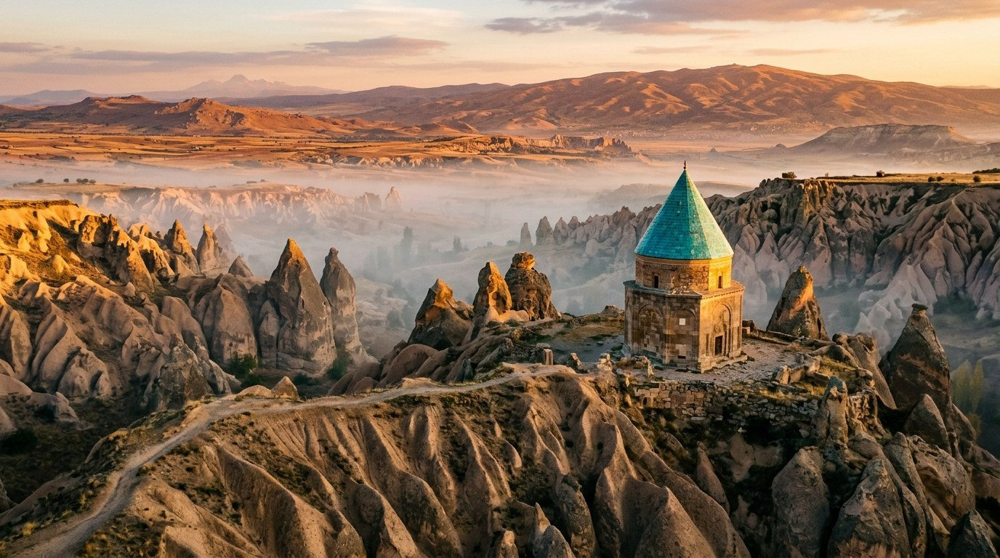
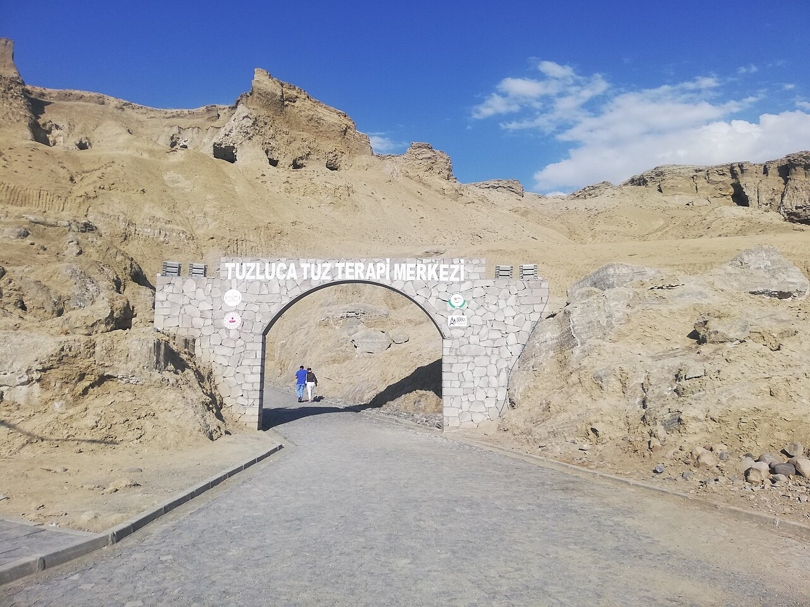
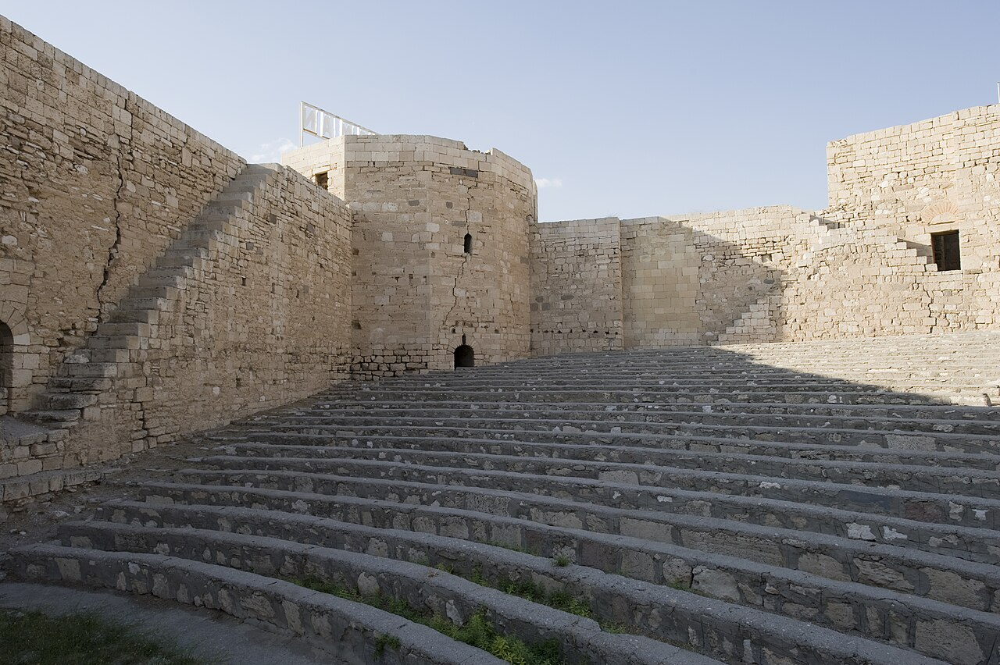
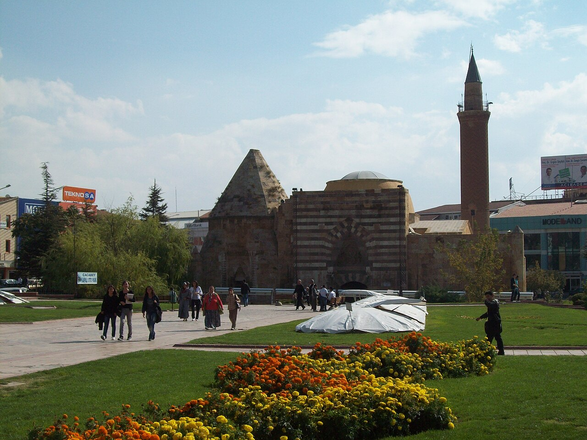
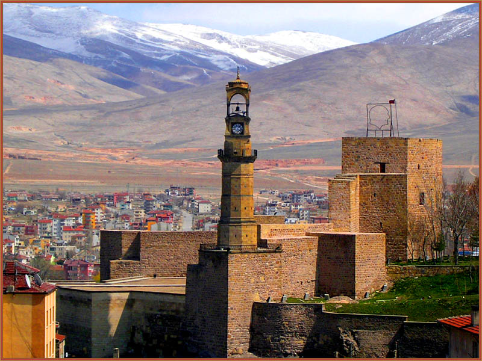
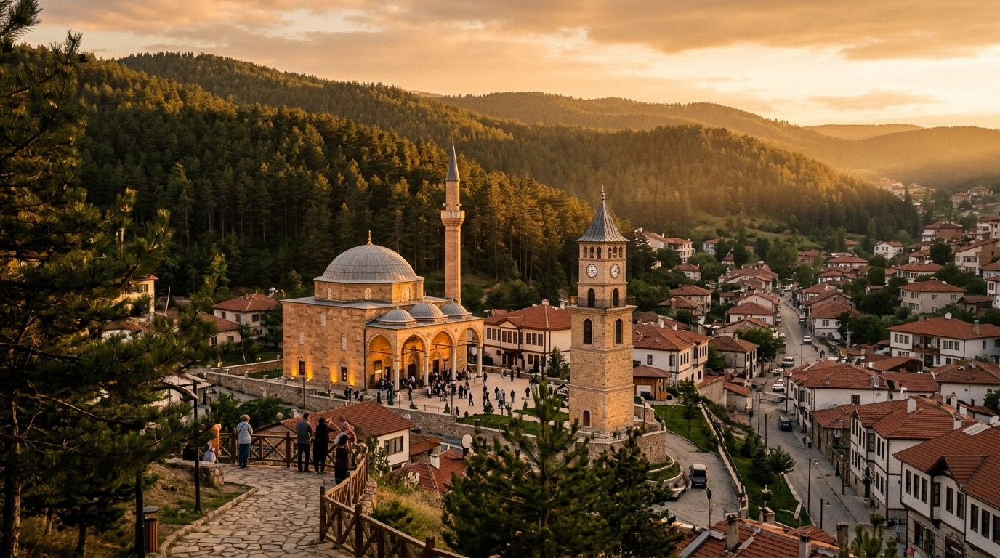

# 🌾 İç Anadolu Bölgesi

> *Bozkırın Kalbi & İrfan Havzası: Mevlana'dan Yunus Emre'ye, Hacı Bektaş'tan Ahi Evran'a uzanan tevazu yurdu.*

**Keşif İlerlemesi:** `8 / 13 İl` (**%61.5**) &nbsp;•&nbsp; [🏠 Ana Sayfaya Dön](../README.md) &nbsp;•&nbsp; [🌐 Web Portalı](https://bahattinyunus.github.io/dijitalseyyah/)

---

## 🖼️ Bölge İlleri Görsel Rehberi

<table>
  <tr>
    <td align="center" width="33%" valign="top">
       
      <strong><a href="Aksaray/README.md">68 • Aksaray</a></strong> 
      ✅ Gezildi • 📍 Ihlara Vadisi 🍽️ Aksaray Tava
    </td>
    <td align="center" width="33%" valign="top">
       
      <strong><a href="Ankara/README.md">06 • Ankara</a></strong> 
      ✅ Gezildi • 📍 Hacı Bayram-ı Veli Camii 🍽️ Ankara Döneri
    </td>
    <td align="center" width="33%" valign="top">
       
      <strong><a href="Cankiri/README.md">18 • Çankırı</a></strong> 
      ⏳ Bekliyor • 📍 Tarihi Tuz Mağarası 🍽️ Yaren Güveci
    </td>
  </tr>
  <tr>
    <td align="center" width="33%" valign="top">
       
      <strong><a href="Eskisehir/README.md">26 • Eskişehir</a></strong> 
      ✅ Gezildi • 📍 Odunpazarı Evleri 🍽️ Çibörek
    </td>
    <td align="center" width="33%" valign="top">
       
      <strong><a href="Karaman/README.md">70 • Karaman</a></strong> 
      ⏳ Bekliyor • 📍 Karaman Kalesi 🍽️ Karaman Guymak Tatlısı
    </td>
    <td align="center" width="33%" valign="top">
       
      <strong><a href="Kayseri/README.md">38 • Kayseri</a></strong> 
      ⏳ Bekliyor • 📍 Erciyes Dağı 🍽️ Kayseri Mantısı
    </td>
  </tr>
  <tr>
    <td align="center" width="33%" valign="top">
       
      <strong><a href="Kirikkale/README.md">71 • Kırıkkale</a></strong> 
      ✅ Gezildi • 📍 Çeşnigir Köprüsü ve Kanyonu 🍽️ Kırıkkale Tavası
    </td>
    <td align="center" width="33%" valign="top">
       
      <strong><a href="Kirsehir/README.md">40 • Kırşehir</a></strong> 
      ⏳ Bekliyor • 📍 Ahi Evran Camii ve Türbesi 🍽️ Kırşehir Köftesi
    </td>
    <td align="center" width="33%" valign="top">
       
      <strong><a href="Konya/README.md">42 • Konya</a></strong> 
      ✅ Gezildi • 📍 Mevlana Müzesi & Dergahı 🍽️ Etliekmek
    </td>
  </tr>
  <tr>
    <td align="center" width="33%" valign="top">
       
      <strong><a href="Nevsehir/README.md">50 • Nevşehir</a></strong> 
      ✅ Gezildi • 📍 Göreme Açık Hava Müzesi 🍽️ Testi Kebabı
    </td>
    <td align="center" width="33%" valign="top">
       
      <strong><a href="Nigde/README.md">51 • Niğde</a></strong> 
      ⏳ Bekliyor • 📍 Niğde Kalesi ve Saat Kulesi 🍽️ Niğde Tavası
    </td>
    <td align="center" width="33%" valign="top">
       
      <strong><a href="Sivas/README.md">58 • Sivas</a></strong> 
      ✅ Gezildi • 📍 Divriği Ulu Cami ve Darüşşifası 🍽️ Sivas Köftesi
    </td>
  </tr>
  <tr>
    <td align="center" width="33%" valign="top">
       
      <strong><a href="Yozgat/README.md">66 • Yozgat</a></strong> 
      ✅ Gezildi • 📍 Yozgat Çamlığı Milli Parkı 🍽️ Testi Kebabı
    </td>
    <td width="33%"></td>
    <td width="33%"></td>
  </tr>
</table>

---

*Anadolu Seyahatnamesi — Dijital Seyyah Bölge Dosyası*
