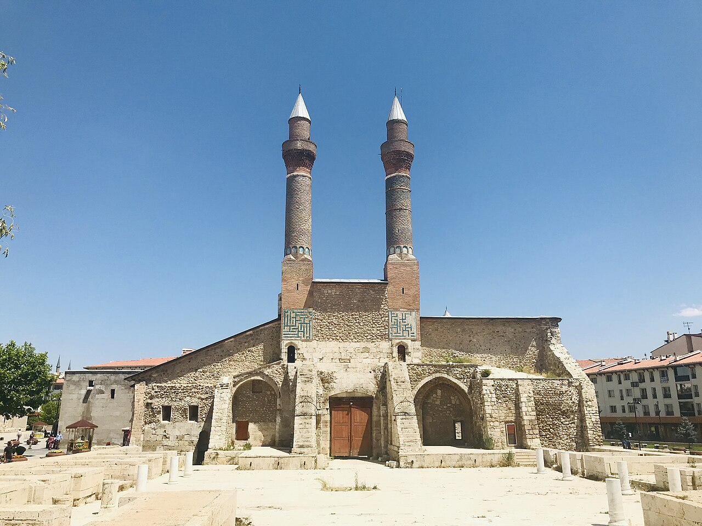

# 📍 Sivas - Seyahat ve Tefekkür Notları

  

## 📜 Şehrin Ruhu
> "Selçuklu çinilerinde gökyüzünü arayan, bozkırın ortasında yükselen ulu medreseleriyle vakur ve tarihi şehir."

### 🌍 Şehrin Dokusu ve Tarihsel Arka Planı
Selçuklu döneminin en büyük eğitim ve kültür merkezlerinden biri olan Sivas, Cumhuriyetin temellerinin atıldığı Sivas Kongresi'ne de ev sahipliği yapmıştır. Hititlerden Danişmendlilere, Anadolu Selçuklularından Eretna ve Kadı Burhaneddin dönemlerine, Osmanlı'dan 4 Eylül 1919'un Milli Mücadele ruhuna kadar uzanan bu vakur şehir; Anadolu'nun tek bir meydanda (Kent Meydanı) üç büyük Selçuklu şaheserini —Çifte Minareli, Şifaiye ve Buruciye Medreselerini— bir arada barındıran nadir açık hava müzelerinden biridir. Mengücekoğulları'nın Divriği'de taşa işlediği UNESCO mirası Ulu Camii ve Darüşşifası ise İslam mimarisinin yeryüzündeki eşsiz taçlarındandır.

### 🕌 Manevi Mimarlar ve Tarihî Şahsiyetler
- **Şemseddin-i Sivâsî Hazretleri:** XVI. yüzyılda yaşamış büyük Halvetî şeyhi, alim ve şair; Meydan Camii avlusundaki türbesi Sivas'ın en önemli manevi merkezlerindendir.
- **Âşık Veysel Şatıroğlu:** Şarkışla'nın Sivrialan köyünden tüm dünyaya "Benim sadık yarim kara topraktır" diye seslenen, gönül gözü açık büyük halk ozanı.
- **Pir Sultan Abdal:** Yıldızeli'nin Banaz köyünde yetişen, Anadolu âşıklık ve deyiş geleneğinin en gür seslerinden biri.
- **Kadı Burhaneddin ve İhramcızade İsmail Hakkı Toprak:** Biri XIV. yüzyılda ilim, siyaset ve divan şiirini birleştiren devlet adamı; diğeri XX. yüzyılda Sivas'ın manevi hayatına ve vakıf eserlerinin ihyasına öncülük eden gönül büyüğü.

### 💬 Şehir Hakkında Edebi ve Tarihi Alıntılar
> "Sivas, Selçuklu çinilerinde gökyüzünü arayan, bozkırın asil şaheseridir." — Âşık Veysel
>
> "Divriği Ulu Camii, mimarinin ve taş işçiliğinin yeryüzündeki nihai mucizesidir." — Evliya Çelebi
>
> "Sivas, Selçuklu'nun taşa işlenmiş ruhu, bozkırın en vakur kalesidir." — Ahmet Hamdi Tanpınar

### 🕊️ Gezginin Not Defterinden (Manevi Boyut ve Tefekkür)
Divriği Ulu Camii'nin kapısındaki namaz kılan insan gölgesini izlerken, taş ustalarının ilahi aşkla mermere nasıl şekil verdiğini tefekkür edersiniz. Akşam serinliğinde Buruciye Medresesi'nin avlusunda oturup çifte minarelerin yıldızlara uzanan silüetine bakarken, bir yandan Şifaiye'de asırlar önce şifa arayan hastaları, bir yandan da hemen karşıdaki Kongre Binası'nda "Manda ve himaye kabul olunamaz" diyen kararlı iradeyi aynı meydanda hissetmek benzersiz bir tarih bilinci uyandırır.

### 🍽️ Yöresel Lezzet Tavsiyeleri
- **Yerel Tatlar ve İkramlar:** Şehrin yerel esnaf lokantalarında ve pazar yerlerinde deneyimlenen bütçe dostu, kültürel dokuyu yansıtan eşsiz lezzetler. Sadece et ve tuzla yoğrulan meşhur **Sivas Köftesi**, **Sivas Katmeri**, **Hıngel (Sivas Mantısı)**, **Peskütan Çorbası**, **Madımak Yemeği**, **Divriği Pilavı** ve **Kalburabastı / Hurma Tatlısı** şehrin unutulmaz tatlarıdır.
- **Tefekkür Eşliğinde Çay/Kahve:** Şehrin tarihi kıraathanelerinde, Buruciye veya Şifaiye Medresesi'nin taş revaklı avlularında ya da Taşhan'ın kemerli bahçesinde yudumlanan demli çaylar.

### ⛺ Konaklama ve Bütçe Stratejisi
- **Sıfır Konaklama Maliyeti (Modern Kervansaraylar):** GSB Seyahatsever projesi kapsamında şehirdeki KYK yurtlarında 5 gün boyunca ücretsiz konaklanarak bütçe korunmuştur.
- **Ulaşım ve Lojistik Planlama:** Rota optimizasyonuna uyularak komşu iller sırayla takip edilmiş, böylece hem yol maliyeti minimuma indirilmiş hem de karbon ayak izi azaltılmıştır.

### 💻 Yarı Göçebe Mesaisi (İlim Tahsili & Kütüphane)
- **Kütüphane Rutini:** Gündüz vakitlerinde şehrin İl Halk Kütüphanesinde zaman geçirilerek bilgisayar başında yazılım geliştirme ve ders çalışma faaliyetleri sürdürülmüştür.
  * *Seyyahın Kütüphane Notu:* Sivas İl Halk Kütüphanesi - Sessiz, çalışma disiplinine uygun, internet imkanı sunan verimli bir ilim yuvası.
- **Süre ve Uyum:** Kütüphane mesaisi bitiminde şehrin ruhuna karışmak üzere yollara düşülmüş, 5 günlük menzil süresiyle şehir sindirilerek keşfedilmiştir.

### 🧭 5 Günlük Menzil Rotası
- **1. Gün — Selçuklu Meydanı ve Kongre Hafızası:** Sabah kütüphane mesaisi; öğleden sonra **Atatürk Kongre ve Etnografya Müzesi**, **Çifte Minareli Medrese**, **Şifaiye Medresesi**, **Buruciye Medresesi** ve **Kale Camii**.
- **2. Gün — Gök Medrese, Ulu Camii ve Tarihi Çarşılar:** **Gök Medrese**, eğik minaresiyle **Sivas Ulu Camii**, **Şemseddin-i Sivâsî Türbesi (Meydan Camii)**, **Taşhan**, **Subaşı Hanı** ve **Behram Paşa Hanı**.
- **3. Gün — Divriği Mucizesi (Tam Gün):** Sabah erken tren veya araçla UNESCO Dünya Mirası **Divriği Ulu Camii ve Darüşşifası**, **Divriği Kalesi**, tarihi **Divriği Konakları** ve **Cam Seyir Terası** ziyareti.
- **4. Gün — Şarkışla ve Âşık Veysel'in İzinde:** Sabah kütüphane çalışması; öğleden sonra Şarkışla Sivrialan'da **Âşık Veysel Müzesi** ve mezarı ziyareti; dönüşte **Eğri Köprü** (Kızılırmak).
- **5. Gün — Doğa Harikaları (Gürün veya Hafik):** **Gökpınar Gölü**'nün turkuaz berraklığı ve **Şuğul Kanyonu** (ya da **Tödürge / Hafik Gölü** ve **Sıcak Çermik**) keşfiyle Sivas'a veda.

### ✨ Keşfedilesi Duraklar ve Landmarks
Bu şehrin havasını solumak, ruhuna dokunmak için mutlaka adımlanması gereken köşe taşları:
- [ ] **Divriği Ulu Camii ve Darüşşifası**
- [ ] **Çifte Minareli Medrese**
- [ ] **Gök Medrese**
- [ ] **Buruciye Medresesi**
- [ ] **Atatürk Kongre Müzesi ve Şifaiye Medresesi**
- [ ] **Gökpınar Gölü ve Âşık Veysel Müzesi (Sivrialan)**

### 📸 Menzil Fotoğraf Galerisi
<table>
  <tr>
    <td width="50%" align="center">
       
      <b>Bozkırın Taç Kapıları:</b> Çifte Minareli, Gök Medrese ve Selçuklu'nun göğe uzanan zarafeti
    </td>
    <td width="50%" align="center">
       
      <b>Taşın Şiire Dönüştüğü Yer:</b> Divriği Ulu Camii, Darüşşifa ve Cumhuriyetin temelleri
    </td>
  </tr>
</table>

---
*Bu il bizzat deneyimlenmiş, yolları aşındırılmış ve seyahatnameye sevgiyle işlenmiştir.* ✅
