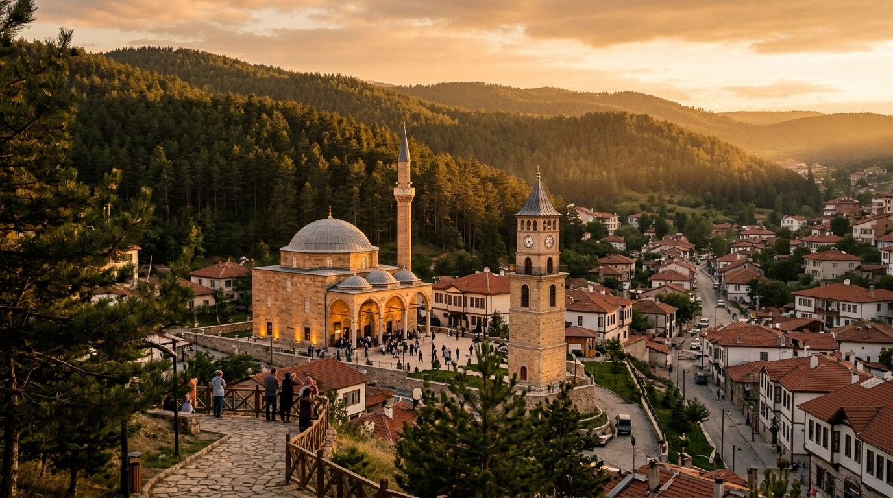
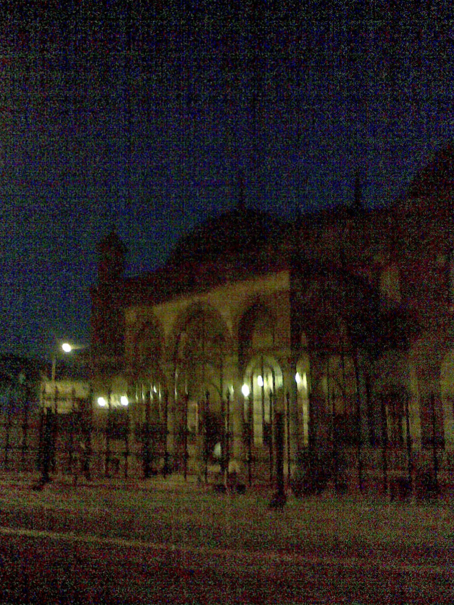

# 📍 Yozgat - Seyahat ve Tefekkür Notları

  

## 📜 Şehrin Ruhu
> "Bozkırın ortasında serin bir nefes, Yozgat Çamlığı'nın gölgesinde saklı kalan samimi bir Anadolu şehri."

## 🗺️ Künye
*   **Kategori:** Doğa / Şehir Dokusu / İrfan Havzası

### 🌍 Şehrin Dokusu ve Tarihsel Arka Planı
İç Anadolu bozkırının kalbinde, Bozok Yaylası'nın serin sırtlarında kurulan Yozgat; Hititlerin kadim yerleşimlerinden Kerkenes Harabeleri'ne (Pteria), Roma döneminin iki bin yıllık şifa kaynağı Sarıkaya Roma Hamamı'na (Basilica Therma) ve XVIII. yüzyılda Bozok Sancağı'nı imar eden Çapanoğlu ailesinin zarif Osmanlı mimarisine kadar köklü bir geçmişe sahiptir. 1958'de Türkiye'nin ilk milli parkı ilan edilen Yozgat Çamlığı, bozkırın ortasında asırlık karaçam ağaçlarıyla yükselen eşsiz bir ekolojik ve ruhani vahadır.

### 🕌 Manevi Mimarlar ve Tarihî Şahsiyetler
- **Şeyhzade Ahmet Şevki Efendi:** XIX. yüzyılda Yozgat'ta ilim ve irfan halkaları kuran, şehrin manevi hafızasında derin izler bırakan alim ve mutasavvıf.
- **Çapanoğlu Mustafa Bey ve Süleyman Bey:** Yozgat'ı kuran, Anadolu'da Avrupa barok-ampir üslubunun Osmanlı cami mimarisiyle en özgün sentezlerinden **Çapanoğlu Büyük Camii**'ni inşa ettiren devlet adamları.
- **Nida Tüfekçi ve Bozok Aşıkları:** Akdağmadeni'nden doğup tüm Türkiye'ye "Sürmeli" türküsünü ve Orta Anadolu bozlak kültürünü armağan eden büyük halk müziği üstadı.
- **Bozoklu Osman Şakir Efendi ve Yozgatlı Hüzni:** Şehrin edebi ve kültürel mirasını mısralarla geleceğe taşıyan şair ve müellifler.

### 💬 Şehir Hakkında Edebi ve Tarihi Alıntılar
> "Yozgat'ta Çamlık'a çıktığınızda, bozkırın uçsuz bucaksız sükûneti ile çam kokusunun birleştiği o serin nefes insanın ruhunu dinlendirir." — Anadolu Seyahatnamesi Notlarından
>
> "Çapanoğlu Camii, bozkırın ortasında zarafeti ve inceliğiyle parlayan bir Osmanlı mührüdür." — Sanat Tarihi Notları

### 🕊️ Gezginin Not Defterinden (Manevi Boyut ve Tefekkür)
Türkiye'nin ilk milli parkı olan Yozgat Çamlığı'nda yürüyüş yaparken doğanın zikrine şahit olmak ve bozkırın ortasındaki bu yeşil vahada tefekküre dalmak unutulmaz bir deneyimdi. Şehrin sakin ve vakur yapısı, modern dünyanın karmaşasından uzaklaşmak için ideal bir sığınak sundu. Saat Kulesi'nin gölgesinde çay yudumlayıp Çapanoğlu Camii'nin kalem işi kubbesini seyrederken, büyük metropollerin gürültüsünde unutulan samimi Anadolu misafirperverliğini yeniden hatırlarsınız.

### 🍽️ Yöresel Lezzet Tavsiyeleri
- **Yerel Tatlar ve İkramlar:** Şehrin yerel esnaf lokantalarında ve pazar yerlerinde deneyimlenen bütçe dostu, kültürel dokuyu yansıtan eşsiz lezzetler. Özellikle bakır sinide hamur ve kaz/tavuk etiyle sunulan meşhur **Arabaşı Çorbası**, taş fırında pişen **Testi Kebabı**, **Tandırlık / Parmak Çöreği**, **Madımak**, **Desti Böreği** ve **İncir Uyutması** Yozgat sofrasının alametifarikasıdır.
- **Tefekkür Eşliğinde Çay/Kahve:** Saat Kulesi meydanındaki tarihi kıraathanelerde veya Yozgat Çamlığı Milli Parkı'nın çam ağaçları altındaki seyir noktalarında yudumlanan demli çaylar.

## ⛺ Konaklama ve Bütçe Stratejisi
*   **Sıfır Konaklama Maliyeti:** GSB Seyahatsever projesi kapsamında şehirdeki KYK yurtlarında ücretsiz konaklanarak bütçe korunmuştur.
*   **Ulaşım Optimizasyonu:** İç Anadolu rotasında komşu illerden geçiş yapılarak yol masrafı minimize edilmiştir.

## 💻 Yarı Göçebe Mesaisi (İlim Tahsili & Kütüphane)
*   **Kütüphane Rutini:** Gündüz vakitlerinde şehrin İl Halk Kütüphanesinde zaman geçirilerek bilgisayar başında yazılım geliştirme ve ders çalışma faaliyetleri sürdürülmüştür.
    * *Seyyahın Kütüphane Notu:* Yozgat İl Halk Kütüphanesi - Sessiz, çalışma disiplinine uygun, internet imkanı sunan verimli bir ilim yuvası.
*   **Şehri Sindirme:** Kütüphane mesaisi bitiminde Yozgat'ın tarihi dokusu acele etmeden, derinlemesine keşfedilmiştir.

## 👁️ Gözlemler ve Deneyim
Türkiye'nin ilk milli parkı olan Yozgat Çamlığı'nda yürüyüş yaparken doğanın zikrine şahit olmak ve bozkırın ortasındaki bu yeşil vahada tefekküre dalmak unutulmaz bir deneyimdi. Şehrin sakin ve vakur yapısı, modern dünyanın karmaşasından uzaklaşmak için ideal bir sığınak sundu.

### 🧭 5 Günlük Menzil Rotası
- **1. Gün — Şehir Merkezi ve Çapanoğlu Mirası:** Sabah İl Halk Kütüphanesi'nde çalışma; öğleden sonra **Saat Kulesi**, **Çapanoğlu Camii**, **Nizamoğlu Konağı (Yozgat Müzesi)** ve **Hayri İnal Konağı**.
- **2. Gün — Türkiye'nin İlk Milli Parkı:** Sabah mesaisi sonrası **Yozgat Çamlığı Milli Parkı**'nda uzun doğa yürüyüşü, **Fatih Tabiat Parkı** ve çam ağaçları altında kitap okuma.
- **3. Gün — İki Bin Yıllık Şifa (Sarıkaya):** **Sarıkaya Roma Hamamı (Basilica Therma)** —dünyada hâlâ sıcak termal suyu akan en eski Roma hamamlarından biri— ziyareti ve yöresel mutfak deneyimi.
- **4. Gün — Kadim Tarih ve Doğa (Sorgun & Kerkenes):** Sabah kütüphane oturumu; öğleden sonra antik Med/Kayıp Şehir **Kerkenes Harabeleri** ve **Kazankaya Kanyonu** (Aydıncık) keşfi.
- **5. Gün — Akdağmadeni veya Boğazlıyan ve Veda:** **Akdağmadeni Ormanları** ve tarihi taş kilise/konakları gezilerek Bozok Yaylası'na veda.

## ✨ Keşfedilesi Duraklar
Bu şehrin havasını solumak için mutlaka adımlanması gereken yerler:
- [x] **Yozgat Çamlığı Milli Parkı**
- [x] **Çapanoğlu Camii**
- [x] **Saat Kulesi**
- [x] **Nizamoğlu Konağı (Müze)**
- [ ] **Sarıkaya Roma Hamamı (Basilica Therma)**
- [ ] **Kazankaya Kanyonu ve Kerkenes Harabeleri**

### 📸 Menzil Fotoğraf Galerisi
<table>
  <tr>
    <td width="50%" align="center">
       
      <b>Bozkırın Yeşil Vahası:</b> Türkiye'nin ilk milli parkı Yozgat Çamlığı ve serin Bozok ufku
    </td>
    <td width="50%" align="center">
       
      <b>Osmanlı Zarafeti ve Kadim İzler:</b> Çapanoğlu Camii, Saat Kulesi ve Sarıkaya Roma Hamamı
    </td>
  </tr>
</table>

---
*Bu il bizzat deneyimlenmiş, yolları aşındırılmış ve seyahatnameye sevgiyle işlenmiştir.* ✅
