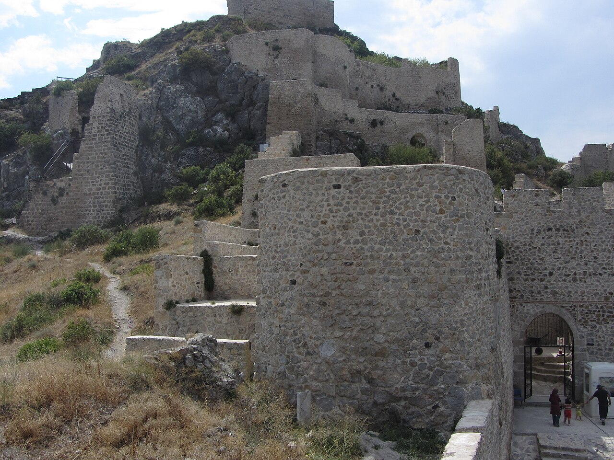

# 📍 Amasya - Seyahat ve Tefekkür Notları

  

## 📜 Şehrin Ruhu
> "Kral Kaya Mezarları'nın gölgesinde, Yeşilırmak'ın iki yakasında yükselen Yalıboyu evleriyle tarihin secdesi."

### 🌍 Şehrin Dokusu ve Tarihsel Arka Planı
Pontus Krallığı'na başkentlik yapan ve Osmanlı döneminde Şehzadeler Şehri olarak parlayan Amasya, zengin kültürel birikimiyle Karadeniz'in incisidir. Harşena Dağı'nın eteklerine oyulmuş Hellenistik döneme ait Kral Kaya Mezarları ile Yeşilırmak kıyısındaki zarif Osmanlı konakları, şehirde binlerce yıllık medeniyet katmanlarını tek bir ufuk çizgisinde birleştirir. Roma, Selçuklu, İlhanlı ve Osmanlı dönemlerinde stratejik bir ilim ve idare merkezi olan Amasya; aynı zamanda 22 Haziran 1919'da yayımlanan Amasya Genelgesi ile Milli Mücadele'nin hukuki ve fikri temelinin atıldığı müstesna şehirlerden biridir.

### 🕌 Manevi Mimarlar ve Tarihî Şahsiyetler
- **Strabon (MÖ 64 – MS 24):** Antik çağın en büyük coğrafyacısı ve tarihçisi olan Strabon Amasya'da doğmuş, 17 ciltlik *Geographika* eserinde memleketini hayranlıkla tasvir etmiştir.
- **Şehzade Bayezid (II. Bayezid) & Yavuz Sultan Selim:** Osmanlı'nın "Dârü'l-İzz" ve "Şehzadeler Şehri" olarak andığı Amasya'da sancak beyliği yapmış, devleti yönetecek ilmî ve idarî terbiyeyi bu vadide kazanmışlardır.
- **Pir İlyas (Şücâüddin İlyas) & Gümüşlüzâde Ailesi:** Halvetiyye tarikatının Anadolu'daki önemli temsilcilerinden Pir İlyas, Amasya'nın manevi iklimini asırlar boyunca besleyen irfan ocaklarının başındadır.
- **Şeyh Hamdullah (1429–1520):** "Kıbletü'l-Küttâb" (Hattatların Kıblesi) unvanıyla anılan, Osmanlı hat sanatına kimliğini kazandıran büyük üstat Amasya'da yetişmiştir.
- **Sabuncuoğlu Şerefeddin (1385–1468):** Osmanlı tıbbının öncü cerrahı, Amasya Bimarhanesi'nde 14 yıl başhekimlik yapmış ve *Cerrahiyyetü'l-Haniyye* adlı resimli tıp eserini burada kaleme almıştır.

### 💬 Şehir Hakkında Edebi ve Tarihi Alıntılar
> "Amasya, nehrin iki yakasında tarihin ve dağların secdesidir." — Evliya Çelebi
>
> "Yeşilırmak, Amasya'nın içinden akan bir zaman şeridi gibidir." — Ahmet Hamdi Tanpınar
>
> "Benim memleketim Amaseia, içinden İris (Yeşilırmak) nehrinin aktığı derin ve geniş bir vadide kurulmuştur; hem tabiat hem de sanat eliyle tahkim edilmiştir." — Strabon (*Geographika*)

### 🕊️ Gezginin Not Defterinden (Manevi Boyut ve Tefekkür)
Yeşilırmak'ın akışını izlerken, Amasya'da yetişen şehzadeleri ve taht kavgalarının geçiciliğini, dağları delen Ferhat'ın ilahi aşkını tefekkür edersiniz. Akşam ezanı vakti Harşena Dağı'nın yamacındaki Kral Kaya Mezarları ışıklandırıldığında, taşlara kazınan fani hükümdarlıklarla nehrin durmaksızın akan ebedî sesi arasındaki tezat insana derin bir huşu verir.

### 🍽️ Yöresel Lezzet Tavsiyeleri
- **Amasya Çöreği & Baklalı Dolma:** Haşhaşlı ve cevizli meşhur Amasya çöreği ile odun ateşinde pişen baklalı yaprak sarması şehrin sofralarının baş tacıdır.
- **Toyga Çorbası & Keşkek:** Yoğurt, yarma ve nane ile hazırlanan ferahlatıcı toyga çorbası ve ağır ateşte dövülen Amasya keşkeği mutlaka tadılmalıdır.
- **Amasya Elması & Semaver Çayı:** Misket aromalı hakiki Amasya elması eşliğinde Yeşilırmak kıyısındaki çay bahçelerinde demli çay yudumlamak ayrı bir keyiftir.
- **Yerel Tatlar ve İkramlar:** Şehrin yerel esnaf lokantalarında ve pazar yerlerinde deneyimlenen bütçe dostu, kültürel dokuyu yansıtan eşsiz lezzetler.
- **Tefekkür Eşliğinde Çay/Kahve:** Şehrin tarihi kıraathanelerinde veya doğa manzaralı tepelerinde yudumlanan demli çaylar.

### ⛺ Konaklama ve Bütçe Stratejisi
- **Sıfır Konaklama Maliyeti (Modern Kervansaraylar):** GSB Seyahatsever projesi kapsamında şehirdeki KYK yurtlarında 5 gün boyunca ücretsiz konaklanarak bütçe korunmuştur.
- **Ulaşım ve Lojistik Planlama:** Rota optimizasyonuna uyularak komşu iller sırayla takip edilmiş, böylece hem yol maliyeti minimuma indirilmiş hem de karbon ayak izi azaltılmıştır.

### 💻 Yarı Göçebe Mesaisi (İlim Tahsili & Kütüphane)
- **Kütüphane Rutini:** Gündüz vakitlerinde şehrin İl Halk Kütüphanesinde zaman geçirilerek bilgisayar başında yazılım geliştirme ve ders çalışma faaliyetleri sürdürülmüştür.
  * *Seyyahın Kütüphane Notu:* Amasya İl Halk Kütüphanesi - Sessiz, çalışma disiplinine uygun, internet imkanı sunan verimli bir ilim yuvası.
- **Süre ve Uyum:** Kütüphane mesaisi bitiminde şehrin ruhuna karışmak üzere yollara düşülmüş, 5 günlük menzil süresiyle şehir sindirilerek keşfedilmiştir.

### 🧭 5 Günlük Menzil Rotası
- **1. Gün (Nehir Kıyısı ve Külliye):** Sabah Amasya İl Halk Kütüphanesi'nde çalışma mesaisi; öğleden sonra Sultan II. Bayezid Külliyesi, Alçak Köprü ve Yalıboyu Evleri boyunca yürüyüş; akşam Yeşilırmak kenarında tefekkür.
- **2. Gün (Harşena ve Kaya Mezarları):** Sabah mesaisi ardından Harşena Kalesi'ne tırmanış, Pontus Kral Kaya Mezarları ve Kızlar Sarayı kalıntılarının incelenmesi; gün batımında şehre panoramik bakış.
- **3. Gün (Tıp, İlim ve Müze Günü):** Sabuncuoğlu Tıp ve Cerrahi Tarihi Müzesi (Amasya Bimarhanesi), Amasya Arkeoloji Müzesi, Şehzadeler Müzesi ve Saraydüzü Kışla Binası ziyareti.
- **4. Gün (Aşkın ve Suyun İzinde):** Ferhat ile Şirin Su Kanalı ve Aşıklar Müzesi, Gökmedrese Camii, Burmalı Minare Camii ve Pir İlyas Türbesi'nde manevi durak.
- **5. Gün (Tabiat ve Veda):** Boraboy Gölü Tabiat Parkı'na yarım günlük doğa kaçamağı, dönüşte tarihi çarşıdan Amasya çöreği ve elması temini ile menzile veda.

### ✨ Keşfedilesi Duraklar ve Landmarks
Bu şehrin havasını solumak, ruhuna dokunmak için mutlaka adımlanması gereken köşe taşları:
- [ ] **Kral Kaya Mezarları**
- [ ] **Harşena Kalesi**
- [ ] **Yalıboyu Tarihi Evleri**
- [ ] **Ferhat ile Şirin Aşıklar Müzesi ve Su Kanalı**
- [ ] **II. Bayezid Külliyesi**
- [ ] **Sabuncuoğlu Tıp ve Cerrahi Tarihi Müzesi**
- [ ] **Boraboy Gölü Tabiat Parkı**

### 📸 Menzil Fotoğraf Galerisi
<table>
  <tr>
    <td align="center" width="50%">
       
      <em>Yeşilırmak kıyısında Yalıboyu Evleri ve Harşena silueti</em>
    </td>
    <td align="center" width="50%">
       
      <em>Harşena Dağı yamaçlarındaki kadim Kral Kaya Mezarları</em>
    </td>
  </tr>
</table>

---
*Bu il bizzat deneyimlenmiş, yolları aşındırılmış ve seyahatnameye sevgiyle işlenmiştir.* ✅
