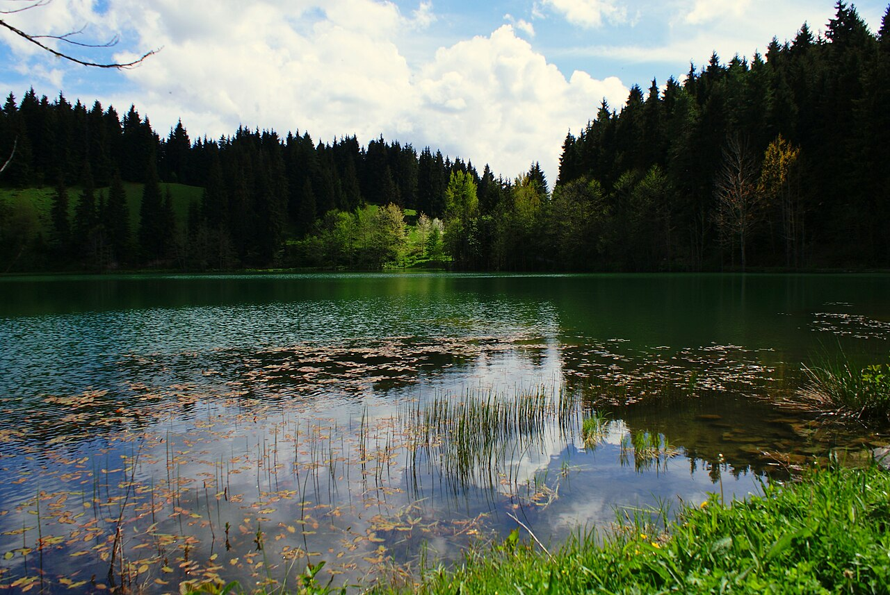

# 📍 Artvin - Seyahat ve Tefekkür Notları

  

## 📜 Şehrin Ruhu
> "Karagöl'ün büyüleyici yansımasında yeşilin binbir tonunu barındıran, dik yamaçların ve sisli yaylaların şehri."

### 🌍 Şehrin Dokusu ve Tarihsel Arka Planı
Çoruh Nehrinin şekillendirdiği Artvin, Gürcü krallıklarından Osmanlı'ya uzanan tarihi kaleleri ve eşsiz tabiatıyla doğu sınırımızın en dik duruşlu şehridir. Antik çağlarda Kolhis ve Tao-Klarceti coğrafyasının kalbinde yer alan Artvin; Bagratlı döneminden kalma görkemli taş manastırları, sarp kayalıklara kondurulmuş gözetleme kaleleri ve Osmanlı döneminde Yavuz Sultan Selim'in Trabzon valiliği sırasında fethedilen stratejik geçitleriyle zengin bir tarih barındırır. Türkiye'nin UNESCO Biyosfer Rezerv Alanı olan Camili (Macahel) Havzası ile dünyanın en derin kanyon vadilerinden Çoruh havzasına ev sahipliği yapar.

### 🕌 Manevi Mimarlar ve Tarihî Şahsiyetler
- **Âşık Zülâlî (1873–1956):** Artvin'in Posof-Şavşat kültür havzasının güçlü halk ozanlarından olup Anadolu âşıklık geleneğinde hikmetli deyişleriyle iz bırakmıştır.
- **İskender Paşa & Osmanlı Serhat Beyleri:** 16. yüzyılda Artvin ve Ardanuç havalisinin Osmanlı idaresine katılmasında öncülük eden, Ardanuç'ta kendi adını taşıyan cami ve türbeyi inşa ettiren tarihî şahsiyetlerdir.
- **Halk İrfanı ve Yayla Kültürü:** Kafkasör, Macahel ve Şavşat yaylalarında nesilden nesile aktarılan ahşap cami mimarisi (özellikle çivisiz ahşap işleme sanatıyla Maral ve Camili camileri) bölgenin estetik ve manevi zarafetinin yaşayan nişanesidir.

### 💬 Şehir Hakkında Edebi ve Tarihi Alıntılar
> "Artvin, gökyüzüne komşu toprakların, bulutlarla oynaşan dağların vatanıdır." — Bedri Rahmi Eyüboğlu
>
> "Karagöl, yeşil dağların ortasına düşmüş zümrüt bir damla gibidir." — Evliya Çelebi
>
> "Artvin'de yollar göğe doğru kıvrılır; insan her dönemeçte tabiatın azameti karşısında kendi küçüklüğünü yeniden keşfeder." — Seyyah Notu

### 🕊️ Gezginin Not Defterinden (Manevi Boyut ve Tefekkür)
Karagöl'ün kenarında sessizce otururken, doğanın kusursuz dengesini ve yaratıcının 'Musavvir' esmasının tecellilerini hayranlıkla tefekkür edersiniz. Çoruh Vadisi'nin derinliklerinden göğe uzanan sarp yamaçlar, sisin bir perde gibi açılıp kapandığı ladin ormanları arasında insana dünyevî gürültüden tamamen arınmış bir inziva hissi sunar.

### 🍽️ Yöresel Lezzet Tavsiyeleri
- **Kuymak (Muhlama) & Mısır Ekmeği:** Yayla tereyağı ve yöresel koloti peyniriyle hazırlanan sıcak kuymak, taş fırın mısır ekmeği eşliğinde günün en bereketli başlangıcıdır.
- **Karalahana Sarması & Laz Böreği:** Doğu Karadeniz mutfağının vazgeçilmezi karalahana sarması ve çıtır yufka arasında muhallebili, karabiber dokunuşlu Laz böreği.
- **Cağ Kebabı & Silor (Siron):** Yusufeli ve Şavşat hattında odun ateşinde pişen et yemekleri ve sarımsaklı yoğurtlu silor.
- **Yerel Tatlar ve İkramlar:** Şehrin yerel esnaf lokantalarında ve pazar yerlerinde deneyimlenen bütçe dostu, kültürel dokuyu yansıtan eşsiz lezzetler.
- **Tefekkür Eşliğinde Çay/Kahve:** Şehrin tarihi kıraathanelerinde veya doğa manzaralı tepelerinde yudumlanan demli çaylar.

### ⛺ Konaklama ve Bütçe Stratejisi
- **Sıfır Konaklama Maliyeti (Modern Kervansaraylar):** GSB Seyahatsever projesi kapsamında şehirdeki KYK yurtlarında 5 gün boyunca ücretsiz konaklanarak bütçe korunmuştur.
- **Ulaşım ve Lojistik Planlama:** Rota optimizasyonuna uyularak komşu iller sırayla takip edilmiş, böylece hem yol maliyeti minimuma indirilmiş hem de karbon ayak izi azaltılmıştır.

### 💻 Yarı Göçebe Mesaisi (İlim Tahsili & Kütüphane)
- **Kütüphane Rutini:** Gündüz vakitlerinde şehrin İl Halk Kütüphanesinde zaman geçirilerek bilgisayar başında yazılım geliştirme ve ders çalışma faaliyetleri sürdürülmüştür.
  * *Seyyahın Kütüphane Notu:* Artvin İl Halk Kütüphanesi - Sessiz, çalışma disiplinine uygun, internet imkanı sunan verimli bir ilim yuvası.
- **Süre ve Uyum:** Kütüphane mesaisi bitiminde şehrin ruhuna karışmak üzere yollara düşülmüş, 5 günlük menzil süresiyle şehir sindirilerek keşfedilmiştir.

### 🧭 5 Günlük Menzil Rotası
- **1. Gün (Şehir Merkezi ve Çoruh Panoraması):** Sabah Artvin İl Halk Kütüphanesi'nde çalışma; öğleden sonra Artvin Kalesi (Livana Kalesi), Kafkasör Yaylası ve şehri kuş bakışı gören Atatepe ziyareti.
- **2. Gün (Borçka Karagöl):** Sabah erken hareketle Borçka Karagöl Tabiat Parkı'na yolculuk; göl çevresinde tam tur yürüyüş, göl kenarında kitap okuma ve fotoğraf çekimi.
- **3. Gün (Arhavi ve Mençuna Şelalesi):** Çifte Köprü (Ortacalar) üzerinden Kamilet Vadisi'ne giriş; orman içi patikadan tırmanarak Mençuna Şelalesi'nin serinliğinde mola.
- **4. Gün (Şavşat ve Cittaslow Huzuru):** "Sakin Şehir" Şavşat'a uzanış; Şavşat Karagöl, Tibeti Kilisesi kalıntıları ve ahşap mimarili köylerde geleneksel Karadeniz dokusunu gözlemleme.
- **5. Gün (Ardanuç ve Cehennem Deresi Kanyonu):** Sabah kütüphane mesaisini tamamlama; öğleden sonra Cehennem Deresi Kanyonu ve İskender Paşa Camii ziyaretiyle Artvin menzilini tamamlama.

### ✨ Keşfedilesi Duraklar ve Landmarks
Bu şehrin havasını solumak, ruhuna dokunmak için mutlaka adımlanması gereken köşe taşları:
- [ ] **Borçka Karagöl**
- [ ] **Şavşat Karagöl**
- [ ] **Mençuna Şelalesi ve Çifte Köprü**
- [ ] **Artvin Kalesi**
- [ ] **Atatepe ve Kafkasör Yaylası**
- [ ] **Cehennem Deresi Kanyonu**

### 📸 Menzil Fotoğraf Galerisi
<table>
  <tr>
    <td align="center" width="50%">
       
      <em>Borçka Karagöl'de gökyüzü ve ladin ormanlarının zümrüt yansıması</em>
    </td>
    <td align="center" width="50%">
       
      <em>Sisli dağların kucakladığı Artvin vadileri ve yayla dokusu</em>
    </td>
  </tr>
</table>

---
*Bu il bizzat deneyimlenmiş, yolları aşındırılmış ve seyahatnameye sevgiyle işlenmiştir.* ✅
