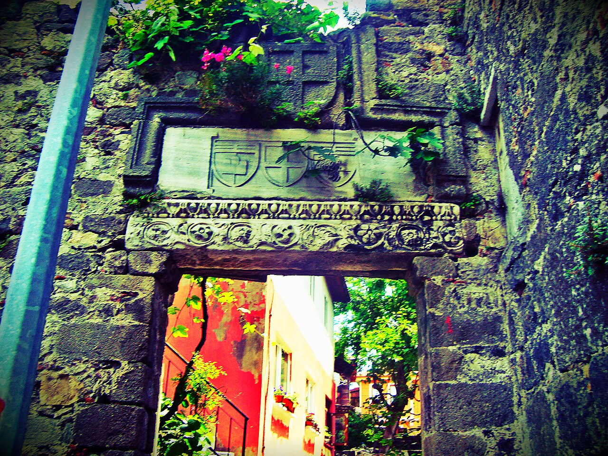
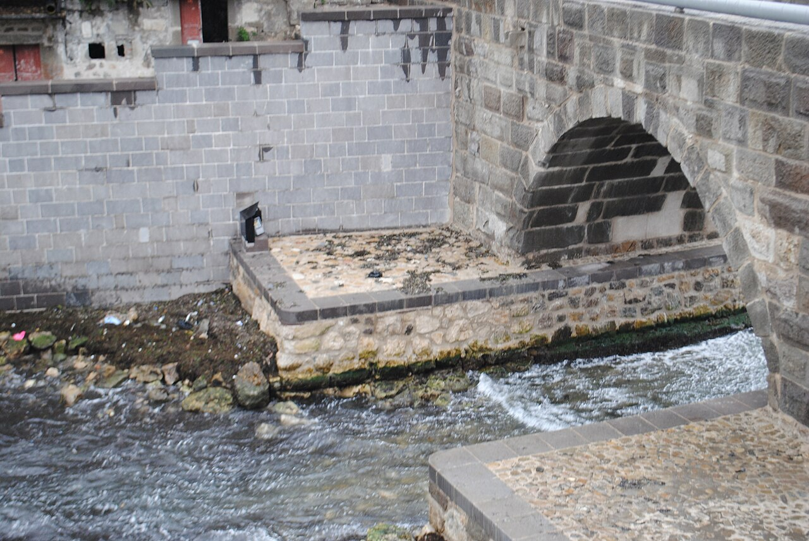

# 📍 Bartin - Seyahat Notları (Keşif Dosyası)

  

## 📜 Seyyahın Beklentisi
> "Fatih Sultan Mehmet'in 'Çeşm-i Cihan' (Dünyanın Göz Bebeği) diye selamladığı Amasra'nın koylarında, 80 milyon yıllık lav sütunlarının ve Bartın Çayı'nın dingin sularının hikâyesini dinlemek için bekleyen bir menzil."

### 🌍 Şehrin Dokusu ve Tarihsel Arka Planı
Antik çağlarda *Parthenios* ("Sular Tanrısı / Bakireler Irmağı") adıyla bilinen Bartın Çayı'nın etrafında kurulan Bartın, Batı Karadeniz'in en zarif tarih ve tabiat sentezlerinden biridir. MÖ 12. yüzyıldan itibaren Paflagonya, Fenike, Miletos, Roma, Bizans, Ceneviz ve Osmanlı medeniyetlerine ev sahipliği yapan bölge, özellikle 1460 yılında Fatih Sultan Mehmet'in savaşsız teslim aldığı Amasra Kalesi ile Osmanlı denizcilik ve sanat tarihinde özel bir yere sahiptir. Türkiye'de üzerinde gemi taşımacılığı yapılabilen tek akarsu olan Bartın Çayı, geleneksel ahşap Bartın evleri, 80 milyon yıllık Güzelcehisar Bazalt Lav Sütunları ve Küre Dağları Milli Parkı'nın bakir kanyonlarıyla Bartın, keşfedilmeyi bekleyen saklı bir hazinedir.

### 🕌 Manevi Mimarlar ve Tarihî Şahsiyetler
- **Fatih Sultan Mehmet (1432–1481):** 1460'ta Amasra'ya tepeden baktığında hocası Lala'ya *"Lala, Lala! Çeşm-i Cihan bu m'ola?"* (Dünyanın göz bebeği burası mıdır?) diyerek şehrin güzelliğini tarihe mühürlemiştir.
- **Halil Bey & Bartın Vakıf Kültürü:** 18. ve 19. yüzyıllarda Bartın'da inşa edilen Şadırvan Camii, İbrahim Paşa Camii (Orta Cami) ve tarihî ahşap hanlar şehrin esnaf ve vakıf zarafetini yansıtır.
- **Barış Akarsu (1979–2007):** Amasra'nın yetiştirdiği sevilen sanatçı; ilçenin kültürel hafızasında ve sahilindeki heykelinde sevgiyle yaşatılmaktadır.
- **Tel Kırma Ustaları (Bartın Kadınları):** Yüzyıllardır gümüş ve altın tellerle tül üzerine işlenen coğrafi işaretli Bartın tel kırma sanatı, şehrin ince estetik ruhunu temsil eder.

### 💬 Şehir Hakkında Edebi ve Tarihi Alıntılar
> "Lala, Lala! Çeşm-i Cihan bu m'ola?" — Fatih Sultan Mehmet (Amasra'ya ilk bakışı, 1460)
>
> "Amasra, bir yarımada üzerinde iki limanı kucaklayan, kalesi ve yeşiliyle gönülleri fetheden nadide bir beldedir." — Evliya Çelebi
>
> "Bartın Çayı usulca akarken, eski ahşap konakların cumbaları suya kendi tarihini fısıldar." — Seyyah Beklentisi

### 🍽️ Planlanan Yöresel Lezzet Durakları
- **Amasra Salatası & Taze Karadeniz Balığı:** 25'ten fazla taze yeşillik ve sebzenin sanat eseri gibi dizildiği meşhur Amasra salatası eşliğinde ızgara palamut, hamsi veya mezgit.
- **Bartın Pompom Helvası & Kabak Burması:** Yöresel tatlıların gözdesi çıtır kabak burması ve geleneksel Bartın helvası.
- **Pum Pum Çorbası & Pirinçli Mantı:** Mısır unu ve kavurma ile yapılan doyurucu pum pum çorbası ve el açması Bartın mantısı.
- **Tefekkür Eşliğinde Çay:** Amasra Boztepe'de Kemere Köprüsü'ne karşı gün batımında demli çay.

### ⛺ Konaklama ve Bütçe Planı
- **Modern Kervansaray Stratejisi:** GSB Seyahatsever projesi kapsamında Bartın KYK yurtlarında 5 gün boyunca sıfır konaklama maliyetiyle kalınması planlanmaktadır.
- **Komşu İl Optimizasyonu:** Zonguldak → Bartın → Karabük (Safranbolu) → Kastamonu Batı Karadeniz koridoru üzerinden düşük maliyetli ulaşım hedeflenmektedir.

### 💻 Planlanan Kütüphane Mesaisi
- **Kütüphane Durağı:** Bartın İl Halk Kütüphanesi (veya Amasra İlçe Halk Kütüphanesi) – Sabah saatlerinde yazılım ve okuma mesaisi yapılıp öğleden sonra kıyı ve kanyon keşiflerine çıkılması planlanmaktadır.

### 🧭 5 Günlük Planlanan Menzil Rotası
- **1. Gün (Bartın Merkezi ve Çay Kıyısı):** Sabah kütüphane mesaisi; öğleden sonra Bartın Çayı kenarında yürüyüş, tarihî ahşap Bartın evleri, Kemal Samancıoğlu Etnografya Müzesi ve Tarihi Galla Pazarı (Kadınlar Pazarı).
- **2. Gün (Amasra – Çeşm-i Cihan):** Amasra Kalesi, Roma dönemi Kemere Köprüsü, Amasra Müzesi, Çekiciler Çarşısı, Fatih Camii ve Boztepe'de gün batımı; akşam Amasra salatası eşliğinde balık.
- **3. Gün (Güzelcehisar Lav Sütunları ve İnkumu):** 80 milyon yıllık volkanik Güzelcehisar Bazalt Lav Sütunları ahşap yürüyüş yolu, ardından İnkumu Plajı ve Seyir Terası'ndan Karadeniz ufku.
- **4. Gün (Ulus ve Küre Dağları Milli Parkı):** Ulus ilçesindeki Ulukaya Şelalesi ve Kanyonu'nda doğa yürüyüşü; Anadolu'nun en zengin orman ekosistemlerinden birinde oksijen ve tefekkür molası.
- **5. Gün (Kuşkayası Yol Anıtı ve Veda):** Roma İmparatoru Claudius döneminden kalma Anadolu'daki tek yol anıtı Kuşkayası'nı ve Bakacak Tepesi'ni ziyaret ederek Bartın dosyasını kapatma.

### ✨ Keşfedilmesi Beklenen Duraklar ve Landmarks
- [ ] **Amasra Kalesi ve Kemere Köprüsü**
- [ ] **Güzelcehisar Bazalt Lav Sütunları**
- [ ] **İnkumu Plajı ve Seyir Terası**
- [ ] **Kuşkayası Yol Anıtı**
- [ ] **Ulukaya Şelalesi ve Kanyonu**
- [ ] **Tarihi Bartın Evleri ve Galla Pazarı**

### 📸 Menzil Fotoğraf Galerisi
<table>
  <tr>
    <td align="center" width="50%">
       
      <em>Fatih'in 'Çeşm-i Cihan' dediği Amasra yarımadası (Planlanan Menzil)</em>
    </td>
    <td align="center" width="50%">
       
      <em>80 milyon yıllık Güzelcehisar Lav Sütunları ve Batı Karadeniz kıyıları</em>
    </td>
  </tr>
</table>

---
*Henüz adımlanmamış bu kadim şehir, keşif defterinde sırasını bekleyen bir menzil olarak kayda geçirilmiştir.*
