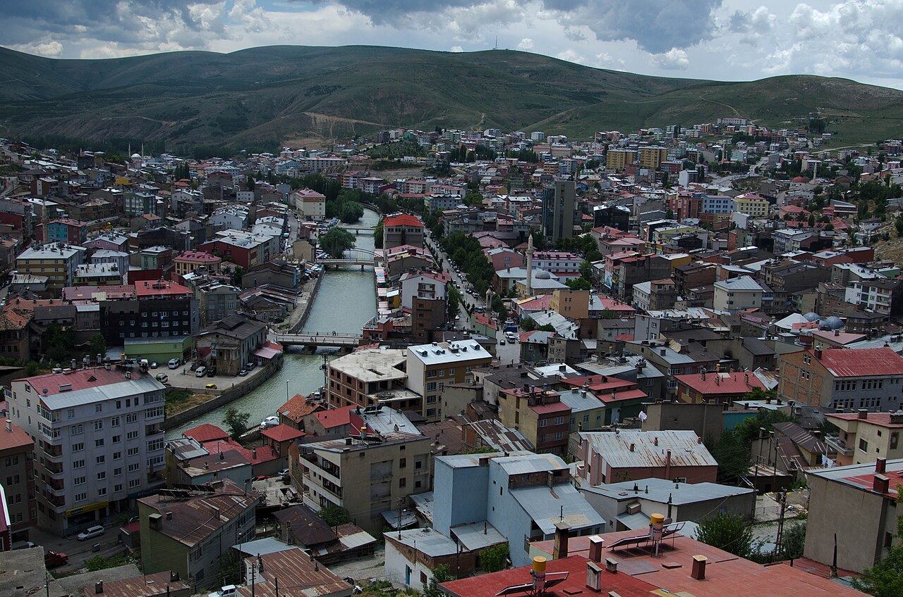
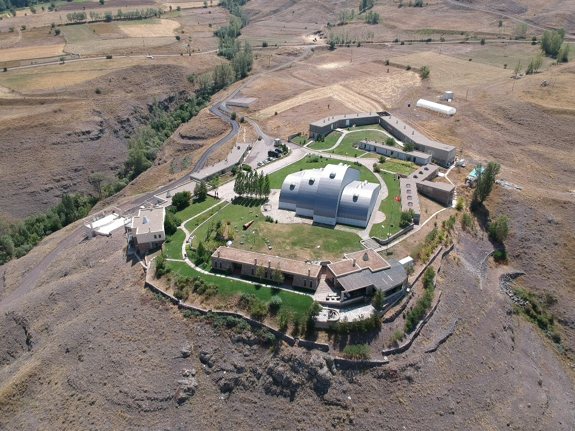

# 📍 Bayburt - Seyahat ve Tefekkür Notları

  

## 📜 Şehrin Ruhu
> "Baksı Müzesi ile modern sanatı bozkırın tepesinde buluşturan, Çoruh'un serinlettiği tarihi kale şehir."

### 🌍 Şehrin Dokusu ve Tarihsel Arka Planı
İpek Yolu üzerinde yer alan Bayburt, tarihi kalesi ve yetiştirdiği aşıklarla meşhur olup, Baksı Müzesi ile geleneksel ve moderni harmanlamıştır. Tarihî kaynaklarda "Paypert" adıyla anılan bu kadim şehir, Urartulardan Roma'ya, Saltuklulardan Danişmendlilere, Akkoyunlulardan Osmanlı'ya kadar Doğu Karadeniz ile Doğu Anadolu arasındaki en mühim geçiş kapısı olmuştur. Çoruh Nehri'nin ikiye böldüğü şehir merkezinde yükselen heybetli Bayburt Kalesi (Çinimaçin Kalesi), asırlar boyunca kervanların güvenliğini sağlayan sarsılmaz bir kale-şehir kimliği taşımıştır.

### 🕌 Manevi Mimarlar ve Tarihî Şahsiyetler
- **Dede Korkut:** Oğuz Türklerinin bilge atası Dede Korkut'un anlatılarında Bayburt ("Bayburt Hisarı") Bamsı Beyrek destanının merkezinde yer alır; şehir her yıl Dede Korkut Kültür ve Sanat Şölenleriyle bu mirası yaşatır.
- **Bayburtlu Zihni (1797–1859):** Türk halk ve divan edebiyatının usta şairi; *"Vardım ki yurdundan ayağ göçürmüş..."* koşmasıyla Anadolu'nun hüznünü ve vatan sevgisini mısralara dökmüştür.
- **Şair Celâlî (1845–1915):** Bayburt âşıklık geleneğinin en dokunaklı isimlerinden biri olup içli ağıtları ve deyişleriyle şehrin sözlü hafızasında yaşar.
- **İrşâdî Baba (1779–1884):** Bayburt'un manevi büyüklerinden, tasavvuf şairi ve gönül ehli.
- **Prof. Dr. Hüsamettin Koçan:** Doğduğu Bayraktar köyünün tepesinde Baksı Müzesi'ni kurarak çağdaş sanat ile Anadolu el sanatlarını buluşturmuş ve Bayburt'a Avrupa Konseyi Müze Ödülü'nü kazandırmıştır.

### 💬 Şehir Hakkında Edebi ve Tarihi Alıntılar
> "Bayburt Kalesi, Çoruh'un üzerinde yükselen ihtişamlı bir kartal yuvasıdır." — Evliya Çelebi
>
> "Baksı, bozkırın tepesinde yükselen bir çağdaş sanat ve irfan vahasıdır." — Hüsamettin Koçan
>
> "Vardım ki yurdundan ayağ göçürmüş, / Yavru gitmiş ıssız kalmış otağı..." — Bayburtlu Zihni

### 🕊️ Gezginin Not Defterinden (Manevi Boyut ve Tefekkür)
Bayburt Kalesi'nin surlarından Çoruh Nehrini izlerken, asırlar boyu bu kalede nöbet tutan askerleri ve tarihin nöbetleşe geçen doğasını tefekkür edersiniz. Bozkırın ortasında yükselen Baksı Müzesi'nde ise insanın köklerinden kopmadan geleceğe nasıl köprü kurabileceğine dair derin bir ilham bulursunuz.

### 🍽️ Yöresel Lezzet Tavsiyeleri
- **Galaçoş & Lor Dolması:** Mercimek, kıyma, süzme yoğurt ve kavrulmuş ekmekle hazırlanan doyurucu galaçoş ile pazı yaprağına sarılan lor dolması Bayburt mutfağının başyapıtlarıdır.
- **Tatlı Çorba & Bayburt Ketesi:** Kuşburnu marmelatı ve yarma ile yapılan şifalı tatlı çorba ile tereyağlı, içli Bayburt ketesi.
- **Kuşburnu Çayı:** Bayburt dağlarının doğal şifası olan kuşburnu marmelatı ve sıcak kuşburnu çayı.
- **Yerel Tatlar ve İkramlar:** Şehrin yerel esnaf lokantalarında ve pazar yerlerinde deneyimlenen bütçe dostu, kültürel dokuyu yansıtan eşsiz lezzetler.
- **Tefekkür Eşliğinde Çay/Kahve:** Şehrin tarihi kıraathanelerinde veya doğa manzaralı tepelerinde yudumlanan demli çaylar.

### ⛺ Konaklama ve Bütçe Stratejisi
- **Sıfır Konaklama Maliyeti (Modern Kervansaraylar):** GSB Seyahatsever projesi kapsamında şehirdeki KYK yurtlarında 5 gün boyunca ücretsiz konaklanarak bütçe korunmuştur.
- **Ulaşım ve Lojistik Planlama:** Rota optimizasyonuna uyularak komşu iller sırayla takip edilmiş, böylece hem yol maliyeti minimuma indirilmiş hem de karbon ayak izi azaltılmıştır.

### 💻 Yarı Göçebe Mesaisi (İlim Tahsili & Kütüphane)
- **Kütüphane Rutini:** Gündüz vakitlerinde şehrin İl Halk Kütüphanesinde zaman geçirilerek bilgisayar başında yazılım geliştirme ve ders çalışma faaliyetleri sürdürülmüştür.
  * *Seyyahın Kütüphane Notu:* Bayburt İl Halk Kütüphanesi - Sessiz, çalışma disiplinine uygun, internet imkanı sunan verimli bir ilim yuvası.
- **Süre ve Uyum:** Kütüphane mesaisi bitiminde şehrin ruhuna karışmak üzere yollara düşülmüş, 5 günlük menzil süresiyle şehir sindirilerek keşfedilmiştir.

### 🧭 5 Günlük Menzil Rotası
- **1. Gün (Kale ve Çoruh Kıyısı):** Sabah Bayburt İl Halk Kütüphanesi'nde çalışma; öğleden sonra Bayburt Kalesi'ne çıkış, Tarihi Saat Kulesi, Ulu Cami ve Çoruh Nehri kenarında yürüyüş.
- **2. Gün (Baksı Müzesi – Sanatın Zirvesi):** Bayraktar köyüne hareket ederek Baksı Müzesi'nin sergi salonlarını, yöresel el sanatları atölyelerini ve Çoruh vadisine bakan terasını keşif.
- **3. Gün (Aydıntepe Yeraltı Şehri):** Sabah mesaisi sonrası Aydıntepe ilçesine geçerek tüf kayalara oyulmuş binlerce yıllık Aydıntepe Yeraltı Şehri'ni ve Aydıntepe Yaylası'nı ziyaret.
- **4. Gün (Kenan Yavuz Etnografya Müzesi & Dede Korkut):** Beşpınar köyündeki ödüllü Kenan Yavuz Etnografya Müzesi'nde Anadolu köy hayatının canlı hafızasını deneyimleme; Masat köyünde Dede Korkut Türbesi'nde dua.
- **5. Gün (Kop Şehitliği ve Veda):** Sabah kütüphane çalışması; öğleden sonra Sırakayalar Şelalesi veya Kop Dağı Şehitliği ziyareti, yerel fırından Bayburt ketesi alarak yola devam.

### ✨ Keşfedilesi Duraklar ve Landmarks
Bu şehrin havasını solumak, ruhuna dokunmak için mutlaka adımlanması gereken köşe taşları:
- [ ] **Bayburt Kalesi**
- [ ] **Baksı Müzesi**
- [ ] **Aydıntepe Yeraltı Şehri**
- [ ] **Kenan Yavuz Etnografya Müzesi**
- [ ] **Bayburt Saat Kulesi ve Çoruh Nehri**
- [ ] **Dede Korkut Türbesi (Masat Köyü)**

### 📸 Menzil Fotoğraf Galerisi
<table>
  <tr>
    <td align="center" width="50%">
       
      <em>Çoruh Nehri üzerinde nöbet tutan heybetli Bayburt Kalesi</em>
    </td>
    <td align="center" width="50%">
       
      <em>Anadolu bozkırının tepesinde çağdaş sanat ve irfan durağı</em>
    </td>
  </tr>
</table>

---
*Bu il bizzat deneyimlenmiş, yolları aşındırılmış ve seyahatnameye sevgiyle işlenmiştir.* ✅
