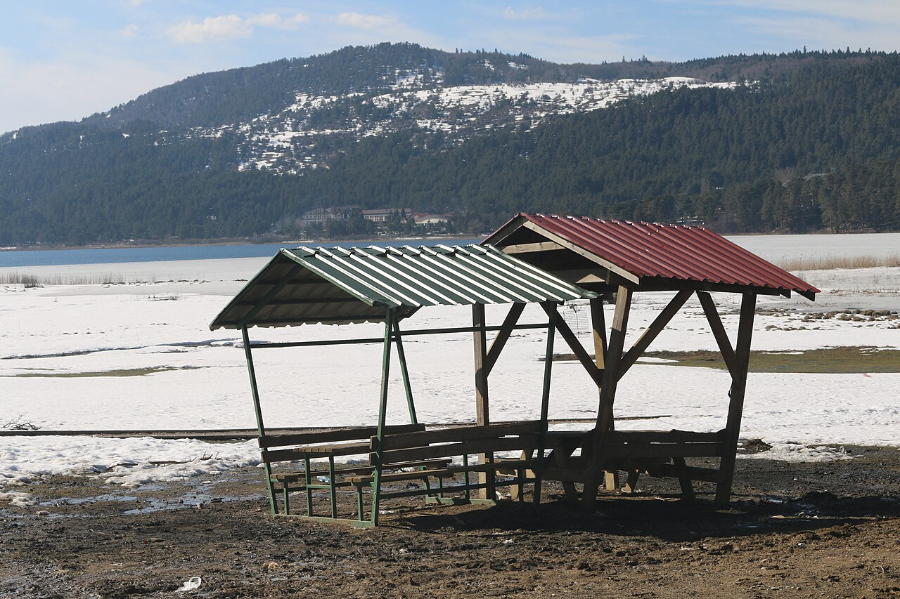
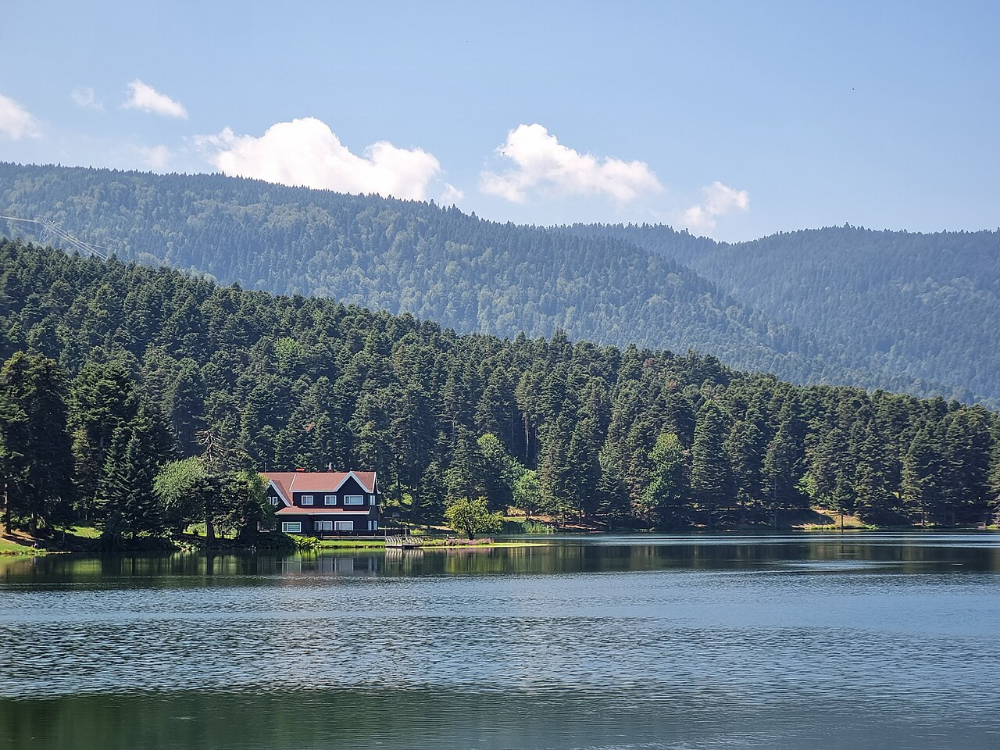

# 📍 Bolu - Seyahat Notları (Keşif Dosyası)

  

## 📜 Seyyahın Beklentisi
> "Yedigöller'in sonbahar aynasında yaprakların zikrini dinlemek, Göynük'te Akşemseddin Hazretleri'nin huzurunda İstanbul'un manevi fethini yâd etmek için bekleyen yeşil bir sığınak."

### 🌍 Şehrin Dokusu ve Tarihsel Arka Planı
Antik çağlarda *Claudiopolis* (Bithynium) adıyla bilinen Bolu, İstanbul ile Ankara arasındaki kadim geçiş yolunun tam kalbinde, %65'inden fazlası ormanlarla kaplı eşsiz bir tabiat ve irfan yurdudur. Roma, Bizans ve Osmanlı dönemlerinde stratejik bir konaklama ve ilim güzergâhı olan Bolu; Abant, Gölcük ve Yedigöller gibi masalsı krater/heyelan göllerinin yanı sıra Cittaslow (Sakin Şehir) unvanlı Göynük ve Mudurnu ilçeleriyle Osmanlı ahşap sivil mimarisinin en özgün örneklerini günümüze taşır. Aynı zamanda Mengen ilçesiyle Osmanlı saray mutfağından günümüze uzanan Türk aşçılık geleneğinin başkentidir.

### 🕌 Manevi Mimarlar ve Tarihî Şahsiyetler
- **Akşemseddin Hazretleri (1389–1459):** İstanbul'un manevi fatihi, Fatih Sultan Mehmet'in hocası, aynı zamanda tıp ve mikrobiyolojinin öncüsü büyük mutasavvıf; fetihten sonra Göynük'e yerleşmiş ve türbesi bugün Göynük'ün manevi kalbi olmuştur.
- **Köroğlu (16. yüzyıl):** *"Benden selam olsun Bolu Beyi'ne!"* diyerek haksızlığa karşı direnişin, yiğitliğin ve halk ozanlığının destansı sembolü olan efsanevi kahraman.
- **Şeyhülislam İbn-i Kemal & Mudurnu Ahileri:** Mudurnu'da asırlardır her Cuma günü süregelen "Esnaf Duası" geleneği, Anadolu Ahilik ahlakının yaşayan en köklü örneklerindendir.
- **İzzet Baysal (1907–2000):** "Bolu'nun Babası" olarak anılan büyük hayırsever; kurduğu vakıf aracılığıyla Bolu'ya üniversite, hastaneler ve yüzlerce eğitim kurumu kazandırarak vakıf medeniyetini modern çağda yaşatmıştır.

### 💬 Şehir Hakkında Edebi ve Tarihi Alıntılar
> "Benden selam olsun Bolu Beyi'ne / Çıkıp şu dağlara yaslanmalıdır!" — Köroğlu
>
> "Bolu Dağları'nın ormanları öylesine gürdür ki gökyüzü yaprakların arasından güçlükle seçilir; havası ve suları cana şifadır." — Evliya Çelebi
>
> "Göynük'ün ahşap konakları arasında yürürken, Akşemseddin'in dingin nefesi hâlâ vadide hissedilir." — Seyyah Beklentisi

### 🍽️ Planlanan Yöresel Lezzet Durakları
- **Mengen Aşçı Yemekleri & Abant Kebabı:** Osmanlı saray mutfağını şekillendiren Mengenli ustaların elinden keşli cevizli erişte, orman kebabı ve patlıcanlı Abant kebabı.
- **Bolu Saray Helvası & Bolu Çikolatası:** İncecik tel tel ağızda dağılan Mudurnu/Göynük saray helvası ve fındıklı Bolu çikolatası.
- **Ovmaç Çorbası & Kaldırık Dolması:** Yöresel hamur kırıntılarıyla yapılan ovmaç çorbası ve orman otlarından hazırlanan kaldırık dolması.
- **Tefekkür Eşliğinde Çay:** Gölcük Tabiat Parkı'ndaki göl evi manzarasına karşı termostan sıcacık çay.

### ⛺ Konaklama ve Bütçe Planı
- **Modern Kervansaray Stratejisi:** GSB Seyahatsever projesi kapsamında Bolu KYK yurtlarında 5 gün boyunca ücretsiz konaklayarak bütçeyi doğa ve kültür rotalarına ayırmak.
- **Komşu İl Optimizasyonu:** Düzce → Bolu → Karabük/Zonguldak hattında komşu il zincirine uygun ekolojik ulaşım.

### 💻 Planlanan Kütüphane Mesaisi
- **Kütüphane Durağı:** Bolu İl Halk Kütüphanesi (ve Bolu Abant İzzet Baysal Üniversitesi Kütüphanesi) – Orman havasının dinginliğinde verimli gündüz yazılım ve okuma mesaileri.

### 🧭 5 Günlük Planlanan Menzil Rotası
- **1. Gün (Bolu Merkez ve Gölcük):** Sabah Bolu İl Halk Kütüphanesi'nde çalışma; öğleden sonra Yıldırım Bayezid Camii, Tarihi Yukarı Taşhan, Bolu Müzesi ve akşamüstü kartpostallık Gölcük Tabiat Parkı yürüyüşü.
- **2. Gün (Yedigöller Milli Parkı):** Büyükgöl, Seringöl, Deringöl, Nazlıgöl, Küçükgöl, İncegöl ve Sazlıgöl'ü kapsayan tam günlük doğa yürüyüşü; Kapankaya Seyir Terası'ndan orman denizi.
- **3. Gün (Göynük – Akşemseddin Menzili):** Cittaslow Göynük'e yolculuk; Akşemseddin Türbesi ve Gazi Süleyman Paşa Camii'nde manevi durak, Zafer Kulesi'ne çıkış ve tarihî Osmanlı sokakları.
- **4. Gün (Abant Gölü ve Mudurnu):** Sabah Abant Gölü Milli Parkı çevresinde yürüyüş; öğleden sonra Mudurnu'nun ahşap konakları, Armutçular Konağı, Yıldırım Bayezid Camii ve Cuma Esnaf Duası kültürü.
- **5. Gün (Seben Kaya Evleri veya Kartalkaya/Aladağlar & Veda):** Sabah kütüphane mesaisi; öğleden sonra Seben Solaklar Kaya Evleri veya Aladağ Yaylaları'nda veda yürüyüşü ve saray helvası temini.

### ✨ Keşfedilmesi Beklenen Duraklar ve Landmarks
- [ ] **Yedigöller Milli Parkı**
- [ ] **Abant Gölü Milli Parkı**
- [ ] **Gölcük Tabiat Parkı**
- [ ] **Göynük Tarihi Evleri ve Akşemseddin Türbesi**
- [ ] **Mudurnu Tarihi Çarşısı ve Konakları**
- [ ] **Seben Kaya Evleri**

### 📸 Menzil Fotoğraf Galerisi
<table>
  <tr>
    <td align="center" width="50%">
       
      <em>Bolu'nun gökyüzünü yansıtan masalsı orman gölleri (Planlanan Menzil)</em>
    </td>
    <td align="center" width="50%">
       
      <em>Akşemseddin diyarı Göynük ve Yedigöller'in dingin tabiatı</em>
    </td>
  </tr>
</table>

---
*Henüz adımlanmamış bu kadim şehir, keşif defterinde sırasını bekleyen bir menzil olarak kayda geçirilmiştir.*
