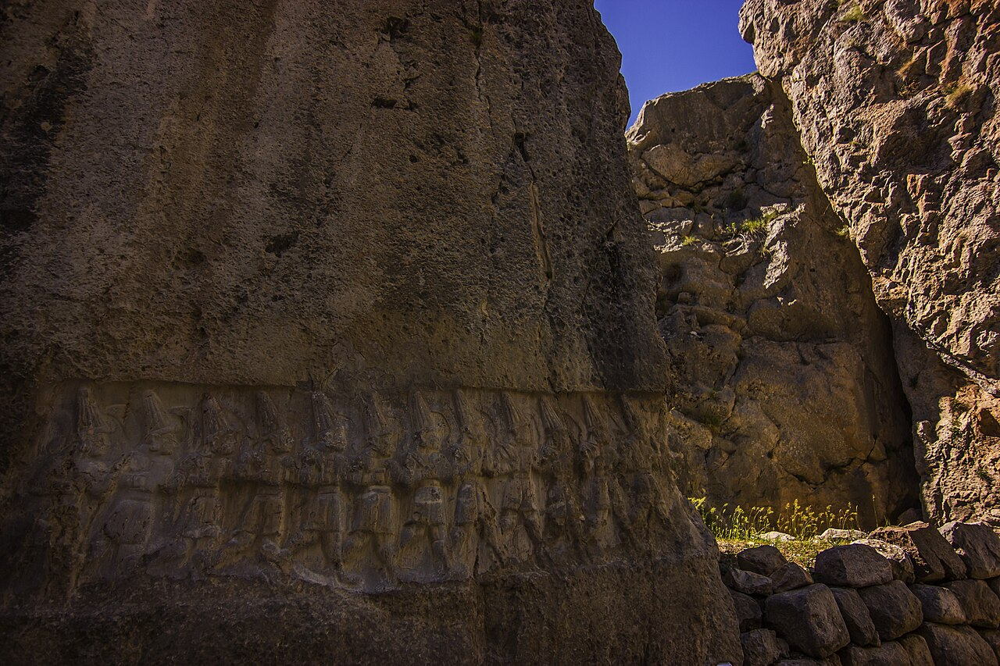

# 📍 Corum - Seyahat ve Tefekkür Notları

  

## 📜 Şehrin Ruhu
> "Hattuşaş antik kentinin binlerce yıllık mabet kalıntılarıyla Hitit uygarlığının gücünü fısıldayan kadim topraklar."

### 🌍 Şehrin Dokusu ve Tarihsel Arka Planı
Hitit İmparatorluğu'nun başkenti olan Hattuşaş ve Alacahöyük gibi dünyanın en eski arkeolojik alanlarına sahip olan Çorum, insanlık tarihinin en önemli kapılarından biridir. UNESCO Dünya Mirası Listesi'nde yer alan Hattuşaş, tarihin bilinen ilk yazılı barış antlaşması olan Kadeş Antlaşması'nın kil tabletlerine ev sahipliği yapmıştır. Hititlerden Friglere, Roma'dan Danişmendlilere, Selçuklulardan Osmanlı'ya uzanan kesintisiz yerleşim tarihi; Kızılırmak ve Yeşilırmak havzalarının bereketiyle birleşerek Çorum'u hem arkeolojinin hem de Anadolu ahilik geleneğinin güçlü bir merkezine dönüştürmüştür.

### 🕌 Manevi Mimarlar ve Tarihî Şahsiyetler
- **Şeyhülislam Ebussuud Efendi (1490–1574):** Kanuni Sultan Süleyman döneminin büyük İslam hukukçusu ve Şeyhülislamı, İskilip kökenli olup Osmanlı hukuk sistemini şekillendiren eserler vermiştir.
- **Koyun Baba (15. yüzyıl):** Osmancık'ta türbesi bulunan, Anadolu'nun manevi fatihlerinden ve Horasan erenlerinden olan büyük veli; adına II. Bayezid tarafından görkemli bir köprü (Koyunbaba Köprüsü) inşa ettirilmiştir.
- **İskilipli Âtıf Hoca (1875–1926):** Osmanlı'nın son döneminde yetişmiş müderris ve âlim, Çorum'un İskilip ilçesinin ilmî birikimini temsil eden isimlerdendir.
- **Sahabeden Suheyb-i Rûmî ve Hıdırlık Makamları:** Çorum Hıdırlık mevkiinde yer alan sahabe makamları, şehrin asırlardır süregelen ziyaret ve maneviyat kültürünün merkezidir.

### 💬 Şehir Hakkında Edebi ve Tarihi Alıntılar
> "Hattuşaş, taşın ve demirin Hitit ustaları eliyle şekillendiği, tarihin ilk büyük başkentidir." — Ekrem Akurgal
>
> "Çorum, Hitit mirasının üzerinde yükselen bereketli bir Anadolu vahasıdır." — Evliya Çelebi
>
> "Bin tanrılı Hitit ülkesinin taş kapılarından geçerken, dört bin yıl öncesinin diplomasi ve hukuk sesleri hâlâ rüzgârda yankılanır." — Seyyah Notu

### 🕊️ Gezginin Not Defterinden (Manevi Boyut ve Tefekkür)
Hattuşaş Yazılıkaya'daki kaya kabartmalarını incelerken, binlerce yıl önce yaşamış insanların inanç dünyasını ve zamanın acımasız akışını tefekkür edersiniz. Bir zamanlar koca bir imparatorluğa hükmeden surların bugün sessiz kır çiçeklerine ev sahipliği yapması, yeryüzünde kalıcı olanın yalnızca hakikat ve bırakılan hayırlı eserler olduğunu fısıldar.

### 🍽️ Yöresel Lezzet Tavsiyeleri
- **İskilip Dolması:** Bakır kazanlarda, özel buhar düzenekleriyle 12 saate yakın ağır ağır pişen etli ve pirinçli İskilip dolması Anadolu'nun en zahmetli ve nefis şölen yemeklerindendir.
- **Çorum Leblebisi & Çorum Mantısı:** Taze kavrulmuş sıcak sarı leblebi ve fırınlanarak hazırlanan çıtır Çorum mantısı.
- **Sırık Kebabı & Çatal Aşı:** Kargı ve Osmancık hattında meşhur sırık kebabı ile yeşil mercimekli çatal aşı çorbası.
- **Yerel Tatlar ve İkramlar:** Şehrin yerel esnaf lokantalarında ve pazar yerlerinde deneyimlenen bütçe dostu, kültürel dokuyu yansıtan eşsiz lezzetler.
- **Tefekkür Eşliğinde Çay/Kahve:** Şehrin tarihi kıraathanelerinde veya doğa manzaralı tepelerinde yudumlanan demli çaylar.

### ⛺ Konaklama ve Bütçe Stratejisi
- **Sıfır Konaklama Maliyeti (Modern Kervansaraylar):** GSB Seyahatsever projesi kapsamında şehirdeki KYK yurtlarında 5 gün boyunca ücretsiz konaklanarak bütçe korunmuştur.
- **Ulaşım ve Lojistik Planlama:** Rota optimizasyonuna uyularak komşu iller sırayla takip edilmiş, böylece hem yol maliyeti minimuma indirilmiş hem de karbon ayak izi azaltılmıştır.

### 💻 Yarı Göçebe Mesaisi (İlim Tahsili & Kütüphane)
- **Kütüphane Rutini:** Gündüz vakitlerinde şehrin İl Halk Kütüphanesinde zaman geçirilerek bilgisayar başında yazılım geliştirme ve ders çalışma faaliyetleri sürdürülmüştür.
  * *Seyyahın Kütüphane Notu:* Corum İl Halk Kütüphanesi - Sessiz, çalışma disiplinine uygun, internet imkanı sunan verimli bir ilim yuvası.
- **Süre ve Uyum:** Kütüphane mesaisi bitiminde şehrin ruhuna karışmak üzere yollara düşülmüş, 5 günlük menzil süresiyle şehir sindirilerek keşfedilmiştir.

### 🧭 5 Günlük Menzil Rotası
- **1. Gün (Şehir Merkezi ve Tarihi Çarşı):** Sabah Çorum İl Halk Kütüphanesi'nde çalışma; öğleden sonra 1896 yapımı Saat Kulesi, Ulu Cami (Murad-ı Rabi Camii), Velipaşa Hanı ve Hıdırlık ziyareti.
- **2. Gün (Hattuşaş ve Yazılıkaya – Hitit Başkenti):** Boğazkale'ye tam günlük keşif; Aslanlı Kapı, Yerkapı tüneli, Kral Kapısı, Büyük Tapınak, Yeşil Taş ve Yazılıkaya Açık Hava Tapınağı.
- **3. Gün (Alacahöyük ve Çorum Müzesi):** Sabah Alacahöyük Sfenksli Kapı ve Kral Mezarları; öğleden sonra Hitit vazoları ve Kadeş tablet kopyalarının sergilendiği Çorum Müzesi.
- **4. Gün (İncesu Kanyonu ve Ortaköy Şapinuva):** Ortaköy'deki kadim Hitit şehri Şapinuva kalıntıları ve Çekerek Irmağı boyunca uzanan görkemli İncesu Kanyonu'nda doğa yürüyüşü.
- **5. Gün (Osmancık veya İskilip Hattı):** Osmancık'ta Koyunbaba Köprüsü ve Kandiber Kalesi (veya İskilip'te tarihi konaklar ve İskilip dolması tadımı); dönüşte taze kavrulmuş Çorum leblebisiyle veda.

### ✨ Keşfedilesi Duraklar ve Landmarks
Bu şehrin havasını solumak, ruhuna dokunmak için mutlaka adımlanması gereken köşe taşları:
- [ ] **Hattuşaş Antik Kenti (Boğazkale) ve Yazılıkaya**
- [ ] **Alacahöyük Arkeolojik Alanı**
- [ ] **Çorum Müzesi**
- [ ] **Çorum Saat Kulesi ve Ulu Cami**
- [ ] **İncesu Kanyonu**
- [ ] **Osmancık Koyunbaba Köprüsü**

### 📸 Menzil Fotoğraf Galerisi
<table>
  <tr>
    <td align="center" width="50%">
       
      <em>UNESCO Dünya Mirası Hattuşaş Antik Kenti ve Hitit mirası</em>
    </td>
    <td align="center" width="50%">
       
      <em>Anadolu'nun kadim medeniyet katmanlarını taşıyan Çorum</em>
    </td>
  </tr>
</table>

---
*Bu il bizzat deneyimlenmiş, yolları aşındırılmış ve seyahatnameye sevgiyle işlenmiştir.* ✅
